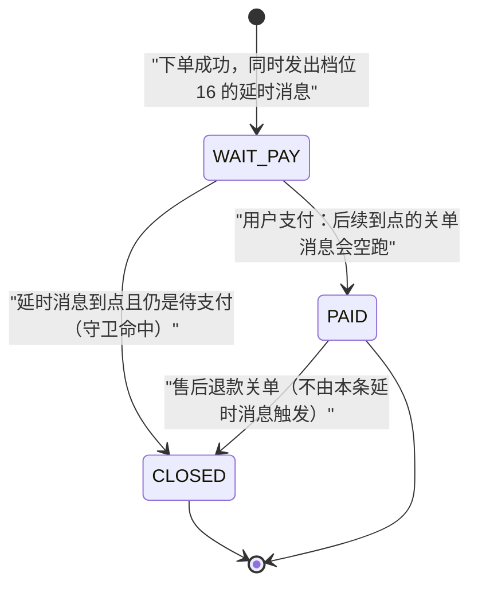
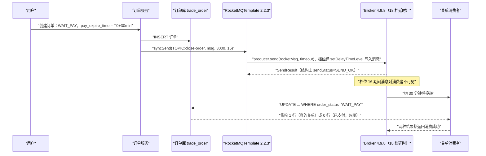

## 为什么需要「延时消息关单」？（痛点引入）

电商交易里有一条谁都躲不掉的需求：**订单创建后 30 分钟未支付就自动关闭**。它的难点不在「关单」这条 SQL，而在「30 分钟后提醒我去关单」这件事由谁负责。

传统做法是自己造闹钟：

```sql
-- 自建轮询方案：每分钟扫一次库（示意，非推荐）
-- 本文示例把 pay_expire_time 存成毫秒时间戳（BIGINT），与消息体里的 payDeadlineEpochMillis 同一量纲
SELECT order_no FROM trade_order
 WHERE order_status = 'WAIT_PAY'
   AND pay_expire_time <= #{nowMillis};
```

这段 SQL 本身没问题，问题是它必须**有人反复执行**：定时线程、分布式锁、多实例去重、扫描频率与数据库压力之间的取舍、宕机后漏扫的补偿——全都要自己写。而延时消息把「等待」这件事交给了服务端：下单时顺手发一条消息，声明「30 分钟后再投给消费者」，到点由 Broker 触发。

| 维度 | 自建轮询扫库 | 用 4.x 延时消息 |
|------|--------------|-----------------|
| 「什么时候该处理」由谁记 | 应用自己：定时任务 + 计划表 | 服务端：消息属性里带档位，到点投递 |
| 多实例重复触发 | 要分布式锁 / 分片才能不重跑 | 同一消费组内每条消息只被一个实例消费一次（失败重试除外） |
| 精度与成本的关系 | 越准要扫得越勤，DB 压力随频率线性涨 | 精度由档位决定，扫描成本为零 |
| 宕机补偿 | 扫描线程挂了这段时间的任务全漏 | 消息已落到服务端，进程重启后照样投递 |
| 时长可选范围 | 任意（自己算） | **只有 18 个固定档位**，档位外时长要另找出口 |
| 语义兜底 | 仍要校验订单状态才能关 | 仍要校验订单状态才能关 |

最后一行是关键：延时消息省掉的是「计时与触发」，**没有**省掉「业务判定」。上游对这张场景的原文定位就是把判定写给消费者：

> 比如在电商交易中超时未支付关闭订单的场景，在订单创建时会发送一条延时消息。这条消息将会在 30 分钟以后投递给消费者，消费者收到此消息后需要判断对应的订单是否已完成支付。如支付未完成，则关闭订单。如已完成支付则忽略，此时就需要用到延迟消息
>
> —— 上游 4.x《消息类型·生产者》原文（`docs/02-producer/01concept1.md` L92，同段还给出了顺序/批量/事务三类消息的对应场景）

> ### 💡 新人小结：延时消息是「让快递站压单」，不是「自己定闹钟」
>
> - 自建轮询 = 你每隔几分钟跑下楼看快递到没到：跑得越勤越准，但你人不能病、不能两台手机同时跑下楼撞车；
> - 延时消息 = 下单时就跟快递站说「这条 30 分钟后再送」：压单、看时间、到点出库都是快递站（Broker）的活；
> - 但快递站只会按「18 个固定档期」压单：1 秒、5 秒、10 秒……最长 2 小时。你说「15 秒后送」，它没有这一档；
> - 无论哪种触发方式，「包裹是不是该签收」只有看一眼订单状态才知道——触发机制替代不了业务判断。
>
> **一句话总结：延时消息解决「谁来计时」，状态守卫解决「计时到了还该不该做」，两件事都不能少。**

**本文路线**：官方定位 → `delayLevel` 入参的源码事实 → 档位怎么选（含枚举封装）→ 订单状态机与时序 → 消费端注解与守卫 SQL → 失败重投的两个旋钮 → 同刻挤压 → 档位外时长的出口。机制原理（档位表本体、5.0 任意时刻定时）不在本文重抄，见[普通消息与定时延时消息](/docs/04-message-features/消息类型/普通消息与定时延时消息/)。

环境口径按站内基线：Spring Boot Web 2.7.18 + JDK 8 + Apache RocketMQ 4.9.8 + rocketmq-spring-boot-starter 2.2.3。starter 2.2.3 的**构建基线**是 Boot 2.5.9 / Spring 5.3.20 / 客户端 5.0.0 / JDK 1.8（依据 `org.apache.rocketmq:rocketmq-spring-boot-parent:2.2.3` 的 pom 属性），Boot 2.7.18 属同一大版本内的向后兼容使用。本文所有代码只用于讲解，**本轮没有搭建、也没有运行任何工程**，代码块里的 `// 预期输出:` 一律是「按源码路径推定」的结构说明，不是本机运行读数。

---

## 术语表（先对齐名词，再读正文）

| 术语 | 全称 / 出处 | 通俗含义（用自己的话） | 在本文中的角色 |
|------|-------------|------------------------|----------------|
| delayLevel | 投递等级 / 延时档位，1~18 | 4.x 里表示「延后多久」的**档位号**，不是秒数 | 本文核心入参 |
| setDelayTimeLevel | `Message` 上的 setter，4.9.8 客户端唯一的延时旋钮 | 把档位号写进消息属性（对应属性键 `DELAY`） | starter 内部真正做的事 |
| RocketMQTemplate | starter 的发送门面（`core/RocketMQTemplate.java`） | 把 Spring 的 `Message` 转成 RocketMQ 消息再发出去 | `syncSend(..., delayLevel)` 的宿主 |
| 四参 syncSend | `syncSend(String, Message<?>, long, int)` L677 | 唯一带档位入参的同步发送重载 | 本文推荐入口 |
| destination | 目的地字符串，格式 `topic:tag` | 「寄到哪个主题、贴哪个标签」写在同一个字符串里 | 关单消息的路由参数 |
| messageDelayLevel | Broker 侧配置项 | 那 18 个档期本身是服务端配出来的，档位号是这张表的行号 | 档位时长的来源 |
| 状态守卫 SQL | 本文对「带状态条件的 UPDATE」的称呼 | 只有「还是待支付」才允许被关，改动人要小 | 消费端幂等的关键 |
| WAIT_PAY / PAID / CLOSED | 订单状态取值（本文示例命名） | 待支付 / 已支付 / 已关闭 | 状态机三个节点 |
| consumeMode | `@RocketMQMessageListener` 属性，默认 `CONCURRENTLY` | 消费端是「多人同时拆快递」还是「一条传送带」 | 关单消费者选型 |
| delayLevelWhenNextConsume | 同上注解属性，默认 0 | 消费失败后「下一次重投由谁定节奏」 | 重投档位旋钮 |
| maxReconsumeTimes | 同上注解属性，默认 -1 | 最多重投几次；并发模式下 -1 就是 16 | 次数上限旋钮 |
| %RETRY% / DLQ | 重试主题与死信主题 | 重投用的中转队列和最终搁置处 | 关单失败的落点（机制在 05 页） |
| nearestLevelAtLeast | 本文示例工具方法（自研，非 starter API） | 「至少等这么久」的时长往上取最近的档 | 防误用的封装 |

---

## 官方定位：关单场景本来就是延时消息的标准用例

上游《延迟消息发送》（`docs/02-producer/04message3.md`）开篇两句就是本文的场景说明书：

1. **定义**：「延迟消息发送是指消息发送到 Apache RocketMQ 后，并不期望立马投递这条消息，而是延迟一定时间后才投递到 Consumer 进行消费。」注意「发送到……后」——延时的起算点是**消息到达服务端**，不是订单创建，也不是消费时刻。
2. **场景**：「在分布式定时调度触发、任务超时处理等场景，需要实现精准、可靠的延时事件触发。使用 RocketMQ 的延时消息可以简化定时调度任务的开发逻辑，实现高性能、可扩展、高可靠的定时触发能力。」超时关单正是「任务超时处理」。

同一篇的示例代码里，官方只强调一件事：

> 这里最重要的是message中设置延迟等级，例子中设置的等级是3，也就是发送者发送后，10s后消费者才能收到消息。
>
> —— `docs/02-producer/04message3.md` 示例后的提示

「等级 3 → 10s」这句话把语义钉死了：**入参是档位号，时长要去查表**。这也正是 Spring Boot 侧最容易写错的地方。

---

## delayLevel 入参：starter 2.2.3 源码里的四件事

下面四条全部可以在 `rocketmq-spring` 仓库 tag `rocketmq-spring-all-2.2.3` 的文件 `rocketmq-spring-boot/src/main/java/org/apache/rocketmq/spring/core/RocketMQTemplate.java` 里逐行读到。

**第一件：只有 `delayLevel > 0` 才会被写进消息。** L677 的四参重载里，与延时相关的代码只有三行：

```java
public SendResult syncSend(String destination, Message<?> message, long timeout, int delayLevel) {  // L677
    // ... 前置校验见第三件
    org.apache.rocketmq.common.message.Message rocketMsg = this.createRocketMqMessage(destination, message);
    if (delayLevel > 0) {                    // L685
        rocketMsg.setDelayTimeLevel(delayLevel);  // L686
    }                                        // L687
    SendResult sendResult = producer.send(rocketMsg, timeout);   // L688
    return sendResult;                       // L693
}
```

于是 `delayLevel` 的两类取值有了确切答案：

- **传 0：这一行根本不执行**，消息不带任何延时属性，等价于普通消息，立刻对消费者可见。这不是推测——同文件 L487-489 的三参 `syncSend` 就是靠 `return syncSend(destination, message, timeout, 0);` 把「不带延时」实现成「档位传 0」；请求应答那组重载的 javadoc 更直接写着 `@param delayLevel message delay level(0 means no delay)`（L158、L170、L228 三处）。
- **传 19 或更大的数：starter 侧不做上界校验**，源码里唯一的条件就是 `delayLevel > 0`，没有任何「≤18」的判断；同理，传 18 与传 19 在这段代码里的处理方式完全一样，都是原样交给 `setDelayTimeLevel`。**档位之外取值会发生什么，4.x 官方文档只给了 18 档的表、没有定义档位外行为，本文对此不下结论**；站内〈普通消息与定时延时消息〉的示例注释口径是「落在 18 档之外，语义不成立」。工程上正确的做法是别让调用方有机会传越界值，见下一节的枚举封装。

**第二件：档位入参出现在 6 个真正写消息的地方，其余重载都是委托。** 全文件 `setDelayTimeLevel` 的调用点只有这 6 行，条件全部是同一个 `if (delayLevel > 0)`：

| 入口方法 | 声明行 | 写档位的行 | 用途 |
|----------|--------|-----------|------|
| `sendAndReceive(String, Message<?>, Type, String hashKey, long, int)` | L231-232 | L240-241 | 请求应答 + 延时 |
| `sendAndReceive(String, Message<?>, RocketMQLocalRequestCallback, String hashKey, long, int)` | L421-422 | L430-431 | 回调式请求应答 + 延时 |
| `syncSend(String, Message<?>, long, int)` | L677 | L685-687 | **本文主角：同步发送 + 档位** |
| `syncSendOrderly(String, Message<?>, String hashKey, long, int)` | L759 | L767-769 | 顺序发送 + 档位 |
| `asyncSend(String, Message<?>, SendCallback, long, int)` | L865-866 | L873-874 | 异步发送 + 档位 |
| `asyncSendOrderly(String, Message<?>, String hashKey, SendCallback, long, int)` | L1004-1005 | L1012-1013 | 异步顺序 + 档位 |

两个容易忽略的推论，也都能在源码里对上：批量重载 `syncSend(String, Collection<T>)`（L498）与 `syncSend(String, Collection<T>, long)`（L510）的签名里**没有档位入参**；三参顺序发送 `syncSendOrderly(destination, message, hashKey, timeout)`（L745-747）内部是 `..., timeout, 0)`，即「顺序 + 不延时」。想让一条延时消息同时保持分区有序，只有 L759 那个五参重载可用。

**第三件：入参非法时抛什么，是源码写死的结构。** L678-681 对 `message` 或其 payload 为 `null` 直接 `throw new IllegalArgumentException("`message` and `message.payload` cannot be null")`；L694-697 把发送过程中的任何异常统一包成 `MessagingException` 抛出。也就是说 `delayLevel` 本身不在校验范围内，而「空消息」「发不出去」这两类失败在应用侧看到的异常类型是确定的。

**第四件：想靠消息头传档位，这条路在 2.2.3 里不存在。** `RocketMQHeaders` 确实有 `DELAY = "DELAY"` 这个常量（`support/RocketMQHeaders.java` L34），但它只在**收侧**被回填：`RocketMQUtil.convertToSpringMessage(...)` 里 `setHeader(toRocketHeaderKey(RocketMQHeaders.DELAY), message.getDelayTimeLevel())`（`support/RocketMQUtil.java` L108）——那是把 Broker 的档位读给你的视图。发侧的 `getAndWrapMessage(destination, headers, payloads)`（L165-212）只显式处理 `KEYS`（L180-187）、`FLAG`（L188-198）、`WAIT_STORE_MSG_OK`（L199-200），其余 header 进 L201-208 的循环落成用户属性，整个方法体里没有任何一行调用 `setDelayTimeLevel`。结论很实在：**在 Spring Boot 里要让消息延时，只有把 `delayLevel` 作为方法入参传进去这一条路。**

> ### 💡 新人小结：`delayLevel` 是「电梯楼层按钮」，不是「等几秒」
>
> - 你按 16 楼，得到的是「16 楼」这个**位置**，不是「等 16 秒」；档位号同理，是那张 18 行表里的**行号**；
> - 表里的行号从 1 开始，按 0 相当于没按按钮——源码里 `if (delayLevel > 0)` 就是「按钮无效就不动作」；
> - 这栋楼只有 18 层，按 19 层按钮：面板上没有这个按钮，starter 也不会替你拦住（源码无上界校验），别赌；
> - 电梯的楼层映射表（哪层对应多久）写在服务端配置项 `messageDelayLevel` 里，站内〈组件架构与部署形态详解〉记录了本机 4.9.8 发行包该项的取值就是这 18 档：`1s 5s 10s 30s 1m 2m 3m 4m 5m 6m 7m 8m 9m 10m 20m 30m 1h 2h`（见 [组件架构与部署形态详解](/docs/01-overview/认识RocketMQ/组件架构与部署形态详解/)）。
>
> **一句话总结：入参叫「档位」，就要先查表再传值；表本身在 Broker 配置里，改表会让所有档位语义一起变。**

---

## 档位选取：30 分钟对应哪一档

「30 分钟未支付关单」这句业务话，翻译成入参就是 `delayLevel = 16`。下表只摘录本文用得上的 10 档（1~5 与 14~18），**档位号→时长的完整 18 行以站内专文为准**，请勿以本文片段当全表：[普通消息与定时延时消息](/docs/04-message-features/消息类型/普通消息与定时延时消息/)（该页《使用限制：18 级延迟投递表》一节，与上游 `docs/02-producer/04message3.md` 的表一致）。

| 档位号 | 延时时长（摘自 04 页档位表） | 在交易链路里常见的用途 | 与本文的关系 |
|--------|------------------------------|------------------------|--------------|
| 1 | 1s | 单元联调、快速验证「延时确实生效」 | 只用于自检，不用于业务 |
| 2 | 5s | 短任务重试、库存回补的小缓冲 | —— |
| 3 | 10s | 官方示例用的档位（等级 3 = 10s） | 恰是并发消费第一次重试的间隔起点 |
| 4 | 30s | 秒杀占位、支付结果二次确认窗口 | 「15 秒」这类需求最近的可取档 |
| 5 | 1min | 购物车提醒、优惠券锁定时长 | —— |
| 14 | 10min | 长时间未操作提醒 | —— |
| 15 | 20min | 排队号过期 | 比 30 分钟激进，不能当关单用 |
| 16 | 30min | **超时未支付关单（本文场景）** | ✅ 目标档位 |
| 17 | 1h | 预约占位、酒店类长锁单 | 关单窗口 1 小时的业务用它 |
| 18 | 2h | 4.x 单条延时的上限 | 超过 2 小时必须接力或另找出口 |

选档只有三条纪律：

1. **向上取档，不要向下**。关单这件事「晚关」比「早关」安全：晚 5 分钟关单只是用户抱怨，早 5 分钟关单会把还在支付页的用户订单关掉。所以 30 分钟的需求只能落在 16 档，不能为了省事落 15 档（20min）。
2. **档位时长是「至少」而不是「正好」**。到点投递还要经历分发与拉取，加上本文「同一时刻大量延时消息的挤压与打散」一节讲的精度提示，实际到达消费者的时刻只会晚不会早——这条决定了消费端绝不能把「收到消息」当成「已过了整整 30 分钟」的时钟。
3. **业务口径与档位必须成对写死**。`30 分钟` 同时出现在三个地方：订单表的 `pay_expire_time`、消息体里的 `payDeadlineEpochMillis`、发送时的档位 16。三处由同一段代码算出来，别靠人肉对齐。

---

## ✅ 推荐写法：DelayLevel 枚举与 nearestLevelAtLeast 工具方法

既然 `delayLevel` 会被原样塞进 `setDelayTimeLevel`，而 starter 不做上界校验，那就在应用侧把入参域锁死：**别让调用方传 int，让它传枚举。**

```java
package demo.trade.mq;

import java.time.Duration;
import java.util.Optional;

/**
 * 4.x 延时档位（delayLevel）封装。
 * 档位号 -> 时长 的映射摘自站内〈普通消息与定时延时消息〉的 18 级延迟投递表，
 * 与上游 docs/02-producer/04message3.md 的表一致；时长若与 Broker 的
 * messageDelayLevel 配置不符，以 Broker 为准（本枚举只负责把越界值挡在编译期）。
 */
public enum DelayLevel {
    ONE_SECOND      (1,  Duration.ofSeconds(1)),
    FIVE_SECONDS    (2,  Duration.ofSeconds(5)),
    TEN_SECONDS     (3,  Duration.ofSeconds(10)),
    THIRTY_SECONDS  (4,  Duration.ofSeconds(30)),
    ONE_MINUTE      (5,  Duration.ofMinutes(1)),
    TWO_MINUTES     (6,  Duration.ofMinutes(2)),
    THREE_MINUTES   (7,  Duration.ofMinutes(3)),
    FOUR_MINUTES    (8,  Duration.ofMinutes(4)),
    FIVE_MINUTES    (9,  Duration.ofMinutes(5)),
    SIX_MINUTES     (10, Duration.ofMinutes(6)),
    SEVEN_MINUTES   (11, Duration.ofMinutes(7)),
    EIGHT_MINUTES   (12, Duration.ofMinutes(8)),
    NINE_MINUTES    (13, Duration.ofMinutes(9)),
    TEN_MINUTES     (14, Duration.ofMinutes(10)),
    TWENTY_MINUTES  (15, Duration.ofMinutes(20)),
    THIRTY_MINUTES  (16, Duration.ofMinutes(30)),   // 本文场景
    ONE_HOUR        (17, Duration.ofHours(1)),
    TWO_HOURS       (18, Duration.ofHours(2));      // 4.x 上限

    private final int level;
    private final Duration duration;

    DelayLevel(int level, Duration duration) {
        this.level = level;
        this.duration = duration;
    }

    /** 真正传给 RocketMQTemplate 的值：1~18，永远 > 0。 */
    public int level() {
        return level;
    }

    public Duration duration() {
        return duration;
    }

    /**
     * 「至少等这么久」的向上取档：返回第一个时长 >= target 的档位。
     * 找不到（超过 2 小时）时返回 Optional.empty()，由调用方显式处理，
     * 而不是悄悄发出一条立刻可见的普通消息。
     */
    public static Optional<DelayLevel> nearestLevelAtLeast(Duration target) {
        if (target == null || target.isZero() || target.isNegative()) {
            return Optional.empty();
        }
        for (DelayLevel candidate : values()) {   // 声明顺序即时长升序
            if (candidate.duration.compareTo(target) >= 0) {
                return Optional.of(candidate);
            }
        }
        return Optional.empty();
    }
}
```

按上面这段逻辑推演（**以下均为按代码逻辑推定，不是本机运行读数**）：

```java
// 预期输出: nearestLevelAtLeast(Duration.ofMinutes(30)) -> Optional[THIRTY_MINUTES]，level() == 16
// 预期输出: nearestLevelAtLeast(Duration.ofSeconds(15)) -> Optional[THIRTY_SECONDS]，level() == 4（向上取，多等 15 秒）
// 预期输出: nearestLevelAtLeast(Duration.ofDays(1))     -> Optional.empty（2 小时封顶，档位表外）
```

第 2 行值得停一下：15 秒这种「档位表里没有的时长」，向上取档得到的是 30 秒，业务上多等了 15 秒。这是 4.x 的固有损失，不是 bug；要精确到 15 秒或「明天 09:00」，走本文最后一节的出口。

发送侧把这个枚举用起来：

```java
package demo.trade.mq;

import demo.trade.domain.CloseOrderTask;
import org.apache.rocketmq.spring.core.RocketMQTemplate;
import org.apache.rocketmq.spring.support.RocketMQHeaders;
import org.springframework.messaging.Message;
import org.springframework.messaging.support.MessageBuilder;
import org.springframework.stereotype.Service;

@Service
public class OrderCloseDelaySender {

    private static final String TOPIC = "TRADE_ORDER_DELAY_TOPIC";
    private static final String TAG = "close-order";
    /** 单次发送超时（毫秒）。rocketmq.producer.sendMessageTimeout 的默认值就是 3000，
     *  这里显式写出是为了让「timeout」与「delayLevel」在调用点各归各位。 */
    private static final long SEND_TIMEOUT_MS = 3000L;

    private final RocketMQTemplate rocketMQTemplate;

    public OrderCloseDelaySender(RocketMQTemplate rocketMQTemplate) {
        this.rocketMQTemplate = rocketMQTemplate;
    }

    /** 下单成功后调用：创建时刻与 30 分钟窗口由同一段代码算出，档位与窗口成对绑定。 */
    public void scheduleClose(String orderNo) {
        long createdMillis = System.currentTimeMillis();
        long payDeadlineMillis = createdMillis + DelayLevel.THIRTY_MINUTES.duration().toMillis();

        CloseOrderTask task = new CloseOrderTask(orderNo, createdMillis, payDeadlineMillis);
        // KEYS 头会被 RocketMQUtil.getAndWrapMessage 显式识别并写入消息 key（L180-187），
        // 便于日后按订单号在控制台精确查这条延时消息。
        Message<CloseOrderTask> message = MessageBuilder.withPayload(task)
                .setHeader(RocketMQHeaders.KEYS, orderNo)
                .build();

        rocketMQTemplate.syncSend(TOPIC + ":" + TAG, message,
                SEND_TIMEOUT_MS, DelayLevel.THIRTY_MINUTES.level());
    }
}
```

```java
// 预期输出: 调用返回 SendResult，其 sendStatus 字段值为 SEND_OK；
//           该消息在 Broker 侧带着档位 16 的属性存放，30 分钟内对消费者不可见。
// 预期输出: 若 orderNo 对应的消息因网络等原因发送失败，应用侧看到的异常类型是
//           org.apache.rocketmq.client.exception.MQClientException 等被
//           RocketMQTemplate 统一包装后的 MessagingException（源码 L694-697），
//           而不是「静默返回 null」。
// 说明: 以上两行是按 RocketMQTemplate.syncSend L677-698 的代码路径推定的结构说明，
//       本轮未搭建工程、未运行代码，不是本机运行读数；msgId、耗时等随机数值本文一概不写。
```

> ### 💡 新人小结：为什么非要一个枚举
>
> - 裸 `int` 参数像一张空白便条：写 16 的人自己得记得「这是 30 分钟」，三个月后没人敢改；
> - 枚举把「档位号 + 时长 + 语义名字」绑在一起，`DelayLevel.THIRTY_MINUTES.level()` 读起来就是结论本身；
> - 越界值在枚举里根本造不出来，`nearestLevelAtLeast` 又替「表里没有的时长」给出确定的向上取档与 empty 分支，把「悄悄发成立刻投递」这种最危险的失败模式挡在编译期；
> - 它同时是团队文档：新人看枚举常量就知道最长只能 2 小时。

---

## ❌ 不推荐写法：三种把档位用错的方式

❌ **误用一：把 `delayLevel` 当秒数传。**

```java
// ❌ 想延 1800 秒（30 分钟），于是直接写了 1800
rocketMQTemplate.syncSend(TOPIC + ":close-order", message, 3000L, 1800);
// 错误点：1800 会被当成「档位号」原样交给 setDelayTimeLevel（源码只有 if (delayLevel > 0)，
//         L685-687），「1800 秒」这个语义在服务端根本不存在；而 18 档之外的取值行为
//         4.x 官方并未定义，所以这条消息的实际投递时刻是不可预期的，
//         且 starter 不会给你任何警告或异常。
// 正确做法：先换算成档位，再传 level()。
```

❌ **误用二：传 0 或 19。**

```java
// ❌ 传 0：以为 0 是「不延时、稍后再说」，实际是「根本不带延时属性」
rocketMQTemplate.syncSend(TOPIC + ":close-order", message, 3000L, 0);
// 源码事实：L685 的 if (delayLevel > 0) 不成立，setDelayTimeLevel 一行都不执行，
//           消息是普通消息、立刻可见；三参重载 L487-489 内部就是这样传 0 的，
//           请求应答的 javadoc 也写明「0 means no delay」（L158）。
//           后果：订单刚创建，消费者就收到「该关单了」——只要守卫不严就是误关。

// ❌ 传 19 或更大：档位表外
rocketMQTemplate.syncSend(TOPIC + ":close-order", message, 3000L, 19);
// 源码事实：starter 侧没有上界校验，19 会被原样传下去；
//           4.x 官方文档只列了 18 档、没有定义档位外取值的行为，
//           所以「会立刻投递 / 会报错 / 会按 2 小时」这三种想象结论都没有依据。
//           工程结论只有一条：这种入参必须挡在项目外（用枚举），别靠线上试。
```

❌ **误用三：把档位时长当业务时钟，消费端不校验绝对时间。**

```java
// ❌ 「收到档位 16 的消息，就认为已经过了 30 分钟」
@Override
public void onMessage(CloseOrderTask task) {
    orderService.close(task.getOrderNo(), "PAY_TIMEOUT");   // 无条件关单
}
```

这条最贵，因为它把「触发」当成了「事实」：档位 16 只保证不早于 30 分钟投递，**不保证准点**（分发延迟、重试、进程重启都会让它更晚）；反过来，一条消息也可能因业务重复调度而被投递第二次。正确的判定素材是订单表里的状态与支付截止时间，不是「我收到了一条延时消息」。对比如下：

| 判据 | ❌ 只信「档位到点」 | ✅ 状态守卫 + 绝对时间 |
|------|--------------------|------------------------|
| 消息被重复投递 | 可能重复关单/重复通知 | UPDATE 影响 0 行，自动变空操作 |
| 消息因重试晚到 10 分钟 | 行为与预期不符却无人察觉 | 仍能正确关单，且能记录「迟到多久」 |
| 用户第 29 分钟支付成功 | 若消息早已投递则误关 | 状态已是 PAID，守卫拦住 |
| 档位配置被运维改动 | 业务时长被悄悄改变 | 以 `pay_expire_time` 为准，与档位解耦 |

---

## 订单状态机与一次关单的完整时序

先看订单三个状态之间由谁推动。状态迁移图如下：



图后解读三件事：

1. `WAIT_PAY → PAID` 与 `WAIT_PAY → CLOSED` 抢的是同一个状态位，**谁先改成功谁赢**——这正是「带状态条件的 UPDATE」能天然做仲裁的原因，不需要额外加锁。
2. 延时消息触发的只有 `WAIT_PAY → CLOSED` 一条边。`PAID → CLOSED` 属于售后链路，不能由这条关单消息触发；把两条边写进同一个消费者，就会出「已支付订单被超时任务关掉」的事故。
3. 图里没有「CLOSED → WAIT_PAY」。关单是不可逆动作，需要恢复只能新建订单，因此消费者对 CLOSED 的处理只有一种：**不做任何事，正常确认消费**。

再看一条消息从下单到关单的旅程：



图后解读两条容易被忽略的边界：

- 第 3~5 步之间**没有任何等待**：发送调用立刻返回，30 分钟的等待发生在 Broker 内部（延时的起算点是消息到达服务端，见 `docs/02-producer/04message3.md` 定义句）。所以「先 INSERT 再发延时消息」的顺序很重要——如果先发后写库，消息极快投递时库里还没这张单。
- 最后一行「两种结果都返回消费成功」是刻意的：影响 0 行不是失败，返回失败只会让消息进重试队列，白耗一轮阶梯。

---

## 消费端：监听器注解、状态守卫 SQL 与幂等

关单消费者用 starter 的注解形态即可，不需要手写 `DefaultMQPushConsumer`：

```java
package demo.trade.mq;

import demo.trade.domain.CloseOrderTask;
import org.apache.rocketmq.spring.annotation.ConsumeMode;
import org.apache.rocketmq.spring.annotation.RocketMQMessageListener;
import org.apache.rocketmq.spring.core.RocketMQListener;
import demo.trade.service.OrderService;
import org.slf4j.Logger;
import org.slf4j.LoggerFactory;

/**
 * 超时未支付关单消费者。
 * 注解属性默认值依据 tag rocketmq-spring-all-2.2.3 的
 * rocketmq-spring-boot/src/main/java/org/apache/rocketmq/spring/annotation/RocketMQMessageListener.java：
 *   consumeMode() 默认 CONCURRENTLY（L67）、consumeThreadNumber() 默认 20（L87）、
 *   maxReconsumeTimes() 默认 -1（L95）、delayLevelWhenNextConsume() 默认 0（L154）。
 * 下面把与关单相关的几项显式写出来，是为了让评审一眼看到策略，而不是靠默认值。
 */
@RocketMQMessageListener(
        topic = "TRADE_ORDER_DELAY_TOPIC",
        selectorExpression = "close-order",          // TAG 过滤（selectorType 默认 TAG，L57）
        consumerGroup = "trade-order-close-group",   // 必填且需全局唯一（L45）
        consumeMode = ConsumeMode.CONCURRENTLY,      // 关单不需要跨订单的顺序
        consumeThreadNumber = 20,
        maxReconsumeTimes = -1,                      // 并发模式下 -1 即 16（L90-95 注释原文）
        delayLevelWhenNextConsume = 0)               // 重投节奏交给 Broker（L147-154 注释原文）
public class OrderCloseConsumer implements RocketMQListener<CloseOrderTask> {

    private static final Logger log = LoggerFactory.getLogger(OrderCloseConsumer.class);

    private final OrderService orderService;

    public OrderCloseConsumer(OrderService orderService) {
        this.orderService = orderService;
    }

    @Override
    public void onMessage(CloseOrderTask task) {
        long nowMillis = System.currentTimeMillis();
        int affected = orderService.closeIfStillUnpaid(task.getOrderNo(), nowMillis);
        if (affected == 1) {
            long lateMillis = nowMillis - task.getPayDeadlineEpochMillis();   // 只用于观测「比业务截止时间晚到了多久」
            log.info("order closed by delay message, orderNo={}, lateMillis={}", task.getOrderNo(), lateMillis);
        } else {
            // 已支付 / 已关闭 / 订单不存在：什么都不做，正常确认消费，别让消息进重试队列
            log.info("nothing to close, orderNo={}", task.getOrderNo());
        }
    }
}
```

```java
// 预期输出: 走到 log.info 分支之一，方法正常返回；starter 的监听器容器据此提交消费位点。
// 预期输出: 若 closeIfStillUnpaid 抛异常，onMessage 抛出的异常会被消费框架捕获并计入消费失败，
//           消息按 delayLevelWhenNextConsume / maxReconsumeTimes 决定重投节奏（见下一节）。
// 说明: 这里是结构层面的分支说明，本轮未运行代码；日志里的订单号等取值本文不编造。
```

「守卫」落在这条 UPDATE 上——状态条件写在 WHERE 里，而不是先 SELECT 再判断：

```sql
-- ✅ 状态守卫：只有「仍是待支付」且「确实已过支付截止时间」才允许关闭
UPDATE trade_order
   SET order_status   = 'CLOSED',
       close_reason   = 'PAY_TIMEOUT',
       gmt_modified   = NOW()
 WHERE order_no       = #{orderNo}
   AND order_status   = 'WAIT_PAY'
   AND pay_expire_time <= #{nowMillis};

-- ❌ 反例一：状态条件不在 SQL 里，靠先查后改
--    SELECT order_status FROM trade_order WHERE order_no = ?;  -- 查到 WAIT_PAY 再 UPDATE
--    查与改之间用户支付成功，这条 UPDATE 就会关掉已支付订单。
-- ❌ 反例二：只按 order_no 关单，不校验 order_status
--    UPDATE trade_order SET order_status = 'CLOSED' WHERE order_no = ?;
--    重复投递的第二次会把 PAID 直接改成 CLOSED。
```

对照 MyBatis 侧的返回值判定：

| 情形 | `UPDATE` 影响行数 | 消费者应当 | 为什么 |
|------|-------------------|-----------|--------|
| 正常超时 | 1 | 正常返回（消费成功） | 任务完成 |
| 用户已支付 | 0 | 正常返回 | 消息使命已到，无需重试 |
| 消息重复投递 | 0 | 正常返回 | 幂等由状态条件天然保证 |
| 数据库异常/超时 | 抛异常 | 让它失败 | 交给重投阶梯，别自己吞 |

注意第 2 列「影响行数」为 0 时**不是失败**：状态守卫天然把重复投递变成的空操作吸收掉了，这就是为什么关单场景可以不做额外的去重表。需要「同一笔业务只处理一次」的更强保证时，再用业务唯一键去重，口径见[消费重试与死信队列](/docs/05-consumption/均衡进度与重试/消费重试与死信队列/)。

`consumeMode` 这里保持 `CONCURRENTLY`：关单消息之间没有先后关系，多个订单可以并行处理。只有当同一订单的「支付通知」和「超时关单」必须串行且不允许空跑时，才考虑 `ORDERLY`（顺序消费的落地在[顺序消息与分区有序落地](/docs/11-springboot-integration/六种消息实战/顺序消息与分区有序落地/)），代价是一条消息卡住整个队列。

> ### 💡 新人小结：消费者是「到货签收员」，不是「计时器」
>
> - 快递 30 分钟后送到门口，签收员只负责核对门牌和状态，不负责记得「过了多久」；
> - 核对不过（已支付）就什么都不做，正常签收；千万别退回去让快递员反复送，那只会占用重投阶梯；
> - 「先瞄一眼再决定改不改」等于两个人同时改一张纸，必须把判断写进 UPDATE 的 WHERE 里，让数据库替你做仲裁；
> - 消费者组名（`consumerGroup`）像部门编号，全局唯一且所有实例必须一致，否则负载与订阅会打架（订阅一致性口径见[基本最佳实践订阅一致性与JVM调优](/docs/08-best-practice/使用规范与调优/基本最佳实践订阅一致性与JVM调优/)）。

---

## delayLevelWhenNextConsume 与 maxReconsumeTimes：失败后怎么再投

关单不该失败，但基础设施会失败（DB 抖一下）。这时两个参数决定消息怎么走。注解里 `delayLevelWhenNextConsume` 的注释原文给了三个取值的确切含义（tag `rocketmq-spring-all-2.2.3`，`RocketMQMessageListener.java` L147-154）：

```java
/**
 * Message consume retry strategy in concurrently mode.
 *
 * -1,no retry,put into DLQ directly
 * 0,broker control retry frequency
 * >0,client control retry frequency
 */
int delayLevelWhenNextConsume() default 0;
```

| 取值 | 注释原文 | 行为口径 | 关单场景建议 |
|------|----------|----------|--------------|
| `-1` | no retry, put into DLQ directly | 失败不重试，直接进死信主题 | 只有配了死信告警与人工补偿才敢用 |
| `0`（默认） | broker control retry frequency | 重投节奏由 Broker 安排，也就是并发消费的那套阶梯 | ✅ 推荐：保持默认，交给阶梯兜住 |
| `>0` | client control retry frequency | 重投节奏改由客户端侧控制，不再沿用 Broker 的默认安排 | 除非明确知道该怎么设，否则别动 |

需要说清边界：注解注释只写到「由谁控制重投频率」这一层，这个正数在链路上具体换算成多久后再投，本文依据的材料没有给出可核的映射说明，因此不臆测。能确定的是默认值 `0` 之下的节奏：即站内[消费重试与死信队列](/docs/05-consumption/均衡进度与重试/消费重试与死信队列/)记录的并发消费阶梯（第一次 10 秒、第 16 次 2 小时）。

`maxReconsumeTimes` 的注释则解释了两件事（同文件 L89-95）：

```java
/**
 * Max re-consume times.
 *
 * In concurrently mode, -1 means 16;
 * In orderly mode, -1 means Integer.MAX_VALUE.
 */
int maxReconsumeTimes() default -1;
```

- **并发消费模式下 `-1` 就是 16 次**：这与站内[消费重试与死信队列](/docs/05-consumption/均衡进度与重试/消费重试与死信队列/)记录的上游阶梯表对得上——并发重试间隔从 10 秒起、第 16 次为 2 小时，超过 16 次后每次间隔固定 2 小时；上游 4.x《Push 消费》还指出这套阶梯「与延迟消息第三个等级开始的时间完全一致」（`docs/03-consumer/02push.md` L220）。也就是说**同一张 18 档表既服务延时消息，也服务重投节奏**，档位 3（10s）正是第一次重试的间隔。
- **顺序消费模式下 `-1` 是 `Integer.MAX_VALUE`**：几乎无限重试，配合 `suspendCurrentQueueTimeMillis`（默认 1000 毫秒，注释标明最小 10、最大 30000，L156-161）反复挂起当前队列。若关单改成了 `ORDERLY`，`-1` 这个「看起来是默认所以安全」的值就会变成「一条坏消息永久堵死队列」，必须显式设成有限次数。

顺带一个易踩的属性：`consumeThreadMax`（默认 64，L76-82）**已标注 `@Deprecated`**，注释直接说明它效果不好（线程池用容量为 `Integer.MAX_VALUE` 的 `LinkedBlockingQueue`，见 issue#429），要控制并发就改 `consumeThreadNumber`（默认 20）。

---

## 同一时刻大量延时消息的挤压与打散

上游在同一篇《延迟消息发送》末尾给了明确提示（`docs/02-producer/04message3.md` L55，站内 04 页也以此为 WARNING 收录）：

> 延时消息的实现逻辑需要先经过定时存储等待触发，延时时间到达后才会被投递给消费者。因此，如果将大量延时消息的定时时间设置为同一时刻，则到达该时刻后会有大量消息同时需要被处理，会造成系统压力过大，导致消息分发延迟，影响定时精度。

对关单来说，这条提示的实际含义是：**「30 分钟」是下界，不是承诺**。大促零点开放的瞬间产生的上万订单会落在同一档位、同一时刻集中到点，按上游的说法这会造成服务端压力过大、消息分发延迟、影响定时精度（延迟到多久上游没给数字，本文也不给）——这不影响正确性（守卫与绝对时间判定仍在），但会影响体验：用户看到的「订单关闭」可能比预期晚。

| 缓解方向 | 机制依据 | 是否官方原文 | 对关单语义的影响 |
|----------|----------|--------------|------------------|
| 把「发延时消息」的时刻错峰（下单事务提交后按订单号哈希在若干秒窗口内分批发送） | 延时从「消息发送到 RocketMQ 后」起算（`docs/02-producer/04message3.md` 定义句），发送时刻的分散会等量传导到投递时刻 | 定义是官方原文，「分桶抖动」是工程推演 | 无影响，只是把集中到点摊平 |
| 消费端以 `pay_expire_time` 判定，不依赖到点准点 | 档位时长是下界；重投与分发延迟只会让它更晚 | 官方提示的方向 | 无影响，属于必备设计 |
| 关单消费者多实例同组横向扩容、保持 `CONCURRENTLY` | 并发模式下多队列并行处理 | 通用做法，非该场景官方样例 | 缩短到点后的处理排队 |
| ❌ 为了让 30 分钟「更准」而改用 20 分钟档（15 档）提前触发 | —— | —— | **有害**：会关掉仍在支付的用户订单 |
| ❌ 把 16 档与 17 档混着发以摊平压力 | —— | —— | **有害**：一半订单 1 小时才关，业务口径不一致 |

可落地的抖动写法（注意：抖动只作用在**发送时刻**，档位与业务截止时间不变）：

```java
/** 秒杀开抢场景：把上万条 16 档消息的「发送时刻」摊开，避免同一秒集中到点。
 *  抖动量必须远小于 30 分钟业务窗口，否则等于偷偷放宽了关单时间。
 *  说明：这是依据上游挤压提示推导的工程缓解手段，官方文档未给处置样例。
 *  节选前提：类内已持有 private final ScheduledExecutorService scheduler
 *  （java.util.concurrent.Executors 创建，JDK 8 可用）。 */
public void scheduleCloseWithSpread(String orderNo) {
    long bucketMillis = Math.abs(orderNo.hashCode()) % 5_000L;   // 0~4.9 秒的稳定分桶
    scheduler.schedule(() -> scheduleClose(orderNo), bucketMillis, TimeUnit.MILLISECONDS);
    // 订单表里的 pay_expire_time 仍按创建时刻 + 30 分钟写入，与抖动无关；
    // 消费端的绝对时间判断（pay_expire_time <= now）保证不会因为抖动而提前关单。
}
```

如果不想引入本地定时器，另一个更朴素的做法是**接受延迟、把准确性责任完全交给消费端**：到点晚 1 分钟关单在绝大多数交易场景里是可以接受的，而「晚关」永远比「早关」安全。

---

## 档位外时长的出口：本篇边界与定时消息篇

本文的场景刚好落在表内的档位 16。但下面几类需求在 4.9.8 + starter 2.2.3 上**用档位实现不了**：

| 需求 | 档位能表达吗 | 原因 | 出口 |
|------|--------------|------|------|
| 「延后 15 秒」 | ❌ | 档位只有 10s（3 档）与 30s（4 档），没有 15s | 见定时消息篇的向下取档 + 到期接力 |
| 「明天 09:00 整投递」 | ❌ | 档位只表达「从现在起多久」，不能表达绝对时刻 | 同上，或落库扫描补偿 + MQ 只作触发器 |
| 「延后 3 小时」 | ❌ | 18 档上限是 2 小时 | 接力重投（发 2 小时，到点再补一条） |
| 「30 分钟关单」 | ✅ 档位 16 | 正好是表里的行 | 本文全部代码 |

需要「任意时刻/精确时长」的写法、starter 里 `syncSendDelayTimeSeconds` / `syncSendDelayTimeMills` / `syncSendDeliverTimeMills` 三个方法的适用边界与在 4.9.8 上的降级方案，本文不展开，统一在[定时消息与任意时刻投递](/docs/11-springboot-integration/六种消息实战/定时消息与任意时刻投递/)里给代码与取舍表。这里只留两条一句话结论（依据都在那篇）：

- 这三个方法的 javadoc 原文都写着 `This function is only valid when the broker version is 5.0 or above`，Broker 4.9.8 不满足前提；
- 4.9.8 客户端根本没有对应的 setter：`rocketmq-all-4.9.8-bin-release` 的 `lib/rocketmq-common-4.9.8.jar` 中 `org/apache/rocketmq/common/message/Message.class` 里与延时相关的符号只有 `getDelayTimeLevel` / `setDelayTimeLevel` 与属性键 `DELAY`。

另外一条来自上游的主题规划提醒，和关单直接相关：生产环境不同消息类型要用不同主题，不要在同一个主题里混用多种消息类型（`docs/02-producer/01concept1.md` 的 note）。所以 `TRADE_ORDER_DELAY_TOPIC` 只放延时消息，别把普通业务事件也塞进来。

---

## 配置与前置准备

关单链路需要的配置只有两组：生产者（下单侧）与消费者（关单侧）。`rocketmq.*` 的键与默认值取自 tag `rocketmq-spring-all-2.2.3` 的 `autoconfigure/RocketMQProperties.java`。

```yaml
rocketmq:
  name-server: 127.0.0.1:9876        # 与 producer.group 两项一起决定生产者 Bean 是否装配（缺任一项就没有 defaultMQProducer）
  producer:
    group: trade-order-producer      # 必填；starter 的断言原文是 [rocketmq.producer.group] must not be null
    sendMessageTimeout: 3000         # 默认 3000 毫秒；syncSend 未显式传 timeout 时用它
    retryTimesWhenSendFailed: 2      # 默认 2：发送失败时客户端内部重试次数（可能带来重复投递）
  consumer:
    group: trade-order-close-group   # 监听器上的 consumerGroup 才是每个消费者的最终依据，需全局唯一
```

```bash
# 主题必须先存在（生产环境建议关闭 autoCreateTopicEnable），延时消息单独占一个主题
sh bin/mqadmin updateTopic -n 127.0.0.1:9876 -c DefaultCluster -t TRADE_ORDER_DELAY_TOPIC
# 命令参数与更多队列数/权限选项见〈mqadmin命令参考-主题集群与Broker〉
```

主题创建命令与参数取值的完整口径见[mqadmin命令参考-主题集群与Broker](/docs/06-operations/命令行工具/mqadmin命令参考-主题集群与Broker/)；本地单机先把 NameServer 与 Broker 起来的步骤在[本地二进制部署与消息收发](/docs/03-quickstart/单机部署/本地二进制部署与消息收发/)。

两个容易被忽略的点：`retryTimesWhenSendFailed=2` 意味着「发送成功但客户端没收到响应」时可能重复投递，这正是消费端必须靠状态守卫而不靠「消息只来一次」的原因之一；`RocketMQTemplate` 的 `defaultMQProducer` 由 `RocketMQUtil.createDefaultMQProducer(...)` 创建，两个分支实际 `new` 的都是 `TransactionMQProducer`（`RocketMQUtil.java` L264、L267），所以延时发送与事务发送共用同一个模板实例并不冲突。

---

## 要点总结

1. **`delayLevel` 是档位号，不是时长。** starter 源码里与它相关的只有 `if (delayLevel > 0) { rocketMsg.setDelayTimeLevel(delayLevel); }`（`RocketMQTemplate.java` L685-687）；传 0 等于不写延时属性（三参重载 L487-489 就是这么实现的，请求应答 javadoc 亦写明 `0 means no delay`），传 19 之类档位外取值 starter 不做拦截、而 4.x 官方未定义其后果，因此要挡在应用侧。
2. **30 分钟未支付关单 = 档位 16。** 档位号→时长摘自站内 18 级表（[普通消息与定时延时消息](/docs/04-message-features/消息类型/普通消息与定时延时消息/)），本文只列常用 10 档；选档向上取、业务窗口与档位成对绑定，超 2 小时或需要绝对时刻走[定时消息与任意时刻投递](/docs/11-springboot-integration/六种消息实战/定时消息与任意时刻投递/)。
3. **用枚举把入参域锁死。** `DelayLevel` + `nearestLevelAtLeast(Duration)` 让「越界档位」编译不出来、让「表里没有的时长」显式返回 `Optional.empty()`，避免悄悄发成立刻投递的普通消息。
4. **消费端三件套：并发消费 + 状态守卫 + 绝对时间。** `consumeMode = CONCURRENTLY`；`UPDATE ... WHERE order_status = 'WAIT_PAY'` 用影响行数当仲裁；判据取订单表的 `pay_expire_time`，不是「收到延时消息」这个事件本身。影响 0 行也要正常确认消费。
5. **失败重投看两个旋钮。** `delayLevelWhenNextConsume`：`-1` 不重试直接进 DLQ、`0` 由 Broker 控制频率（默认，推荐）、`>0` 客户端控制频率；`maxReconsumeTimes` 在并发模式 `-1` 即 16 次（注释原文），顺序模式 `-1` 是 `Integer.MAX_VALUE`——改 `ORDERLY` 时必须显式限次。
6. **档位时长是下界不是承诺。** 上游明确提示同刻大量定时会相互挤压、影响分发精度；缓解靠「发送时刻错峰 + 消费端绝对时间判定」，绝不靠提前档位或混档。
7. **本轮结论都来自源码与官方文档，不含任何运行读数。** 所有 `// 预期输出:` 均按其后的源码路径推定，异常类型与返回值字段可信，随机数值本文不写。

> ### 💡 新人小结：延时消息关单学完了，记住这 5 点
>
> 1. **先查表再传值**：`delayLevel` 是 18 行表的行号，30 分钟对应 16，别把 1800 当秒数递进去；
> 2. **0 是「不延时」，越界是「没人替你负责」**：源码只认 `> 0`，其余全靠你自己挡；
> 3. **触发 ≠ 判定**：消息只负责「到点叫你」，关不关得成看订单状态，守卫要写在 UPDATE 的 WHERE 里；
> 4. **晚 1 分钟没事，早 1 分钟出事**：档位不准点时向「更晚」一侧靠，永远不要为了准点提前触发；
> 5. **失败重投是另一套档位**：`delayLevelWhenNextConsume=0` 保持默认，`maxReconsumeTimes=-1` 在并发模式就是 16 次，别把它当「无限」当「不限」。
>
> **一句话总结：档位管「何时醒」，守卫管「该不该做」，两个都写对，超时关单才敢交给消息队列。**

**延伸路径**：机制与档位表本体 → [普通消息与定时延时消息](/docs/04-message-features/消息类型/普通消息与定时延时消息/)；失败重投与死信 → [消费重试与死信队列](/docs/05-consumption/均衡进度与重试/消费重试与死信队列/)；档位外时长 → [定时消息与任意时刻投递](/docs/11-springboot-integration/六种消息实战/定时消息与任意时刻投递/)；同组其他形态的 Spring Boot 写法 → [普通消息与三种发送语义](/docs/11-springboot-integration/六种消息实战/普通消息与三种发送语义/)。
