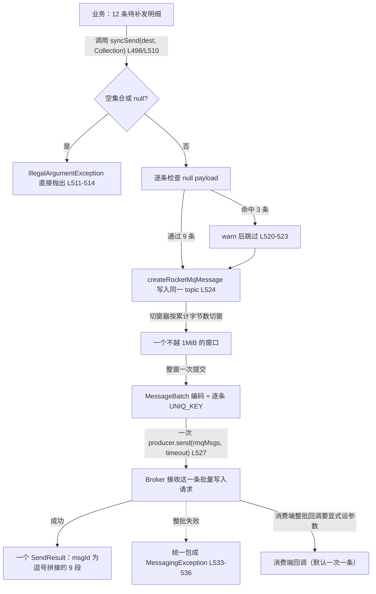

## 为什么需要「整批发送」？（痛点引入）

场景是账务中心最常见的那一类：月底对账发现某天有 12 万条订单明细漏推给风控系统，需要**补发**。运营给出的 SLA 是「十分钟内补完」。

如果按第 1 篇里的 `syncSend(destination, message)` 逐条补，链路是这样的：一条明细 = 一次 RPC = 一个 `SendResult` = 一次网络往返与一组队列路由查询。12 万条就是 12 万次，任何一次抖动都要单独记录、单独补偿，日志里刷出 12 万行。上游官方文档对批量消息的定位写得很直白：「将一些消息聚成一批以后进行发送，可以增加吞吐率，并减少 API 和网络调用次数」（`docs/02-producer/05message4.md` L3）。

于是改成一次提交一批，`RocketMQTemplate` 里那组接受 `Collection` 的重载看起来正好为此而生：

```java
SendResult result = rocketMQTemplate.syncSend("TOPIC_ORDER_DETAIL:replenish", messages);
```

但**批量不是免费的**，它把三个原本很自然的能力换走了：

1. **追溯**：原来每条一个 `SendResult`，谁失败一目了然；现在整批只有一个返回值，提交 12 条、成功几条、失败在哪条，全要从一个对象里反推。
2. **上限**：原来单条只要不超过 `maxMessageSize` 就能发；现在多了一条整批体积的红线（文档口径 1MiB），越线的是「一批」而不是「一条」，一次失败全军覆没。
3. **同主题**：原来同一批可以想发哪个 topic 就发哪个；现在整批必须落在同一个 topic，且**这是由代码写法决定的**，不是靠自觉。

> ### 💡 新人小结：整箱发货与十二张面单
>
> 把逐条发送想成「寄 12 个包裹，每个贴一张面单」，把整批发送想成「把 12 件货装进一个封箱，只贴一张面单」：
> - 面单少了一张 → 快递公司（Broker）受理次数少、扫描（网络往返）次数少，这就是吞吐收益；
> - 封箱一旦超重（超过 1MiB）就被整箱退回，不是退回里面那一件 → 所以要先「分箱」；
> - 面单上写的收件地址是封箱级别的，一箱只能一个地址 → 对应「整批必须同一个 topic」；
> - 箱内 12 件货各自的小票还在 → 这就是下文 `msgId` 逗号拼接串的意义。
>
> 一句话：**批量省的是「次数」，代价是「粒度」**。写代码前先确认业务能接受粒度变粗。

本文的所有结论都来自两处一手依据：starter 源码（`rocketmq-spring` 仓库 tag `rocketmq-spring-all-2.2.3`，文件 `rocketmq-spring-boot/src/main/java/org/apache/rocketmq/spring/core/RocketMQTemplate.java`、`.../support/RocketMQUtil.java`、`.../autoconfigure/RocketMQProperties.java`）与 4.9.8 客户端/服务端实物 class 常量与调用链（`rocketmq-all-4.9.8-bin-release` 的 `lib/rocketmq-client-4.9.8.jar`、`lib/rocketmq-common-4.9.8.jar`、`lib/rocketmq-store-4.9.8.jar`、`lib/rocketmq-broker-4.9.8.jar`，逐类反编译核对）。**本轮不搭工程、不运行代码**，所有代码块里的输出行一律写作 `// 预期输出:`，并注明是按源码路径推定的结构性结果，不是本机运行读数。

## 先把这几个词钉死

| 术语 | 全称 | 通俗含义（自己的话） | 在本文中的角色 |
|------|------|----------------------|----------------|
| 整批发送 | batch send | 把多条消息打包成一次 RPC 提交给 Broker | 本文主角，`syncSend(String, Collection)` 系列 |
| `Collection` 重载 | overloaded method | 参数是消息集合而不是单条消息的同名方法 | 批量入口的判定依据（源码 L498/L510/L944/L956/L816/L829） |
| `MessageBatch` | org.apache.rocketmq.common.message.MessageBatch | 客户端把一批消息编码成「一条物理消息」的载体，它继承自 `Message` | 1MiB 预算与同 topic 约束的实际执行者 |
| `SendResult` | org.apache.rocketmq.client.producer.SendResult | 发送回执，含 `sendStatus`/`msgId`/`offsetMsgId`/`messageQueue`/`queueOffset` | 整批只有一个，是追溯粒度变粗的根源 |
| UNIQ_KEY | 客户端生成的消息唯一键属性 | 每条消息在客户端被赋的「小票号」，由 `MessageClientIDSetter.setUniqID` 写入 | 整批 `msgId` 串里的每一段就是它 |
| 1MiB 整批上限 | batch size limit | 上游文档给的整批体积红线：超过就得自己切分 | 切窗器的预算来源（`docs/02-producer/05message4.md` L28） |
| `maxMessageSize` | producer 端消息体上限参数 | 单条消息体允许的最大字节数，starter 默认 `1024*1024*4` | 与 1MiB 是两套不同的约束，第三节辨析 |
| `consumeMessageBatchMaxSize` | 消费端批量回调条数参数 | 一次回调最多交给业务多少条消息，默认 1 | 消费侧对照（`docs/05-bestPractice/01bestpractice.md` L123-125） |
| 切窗 | window splitting | 在应用侧按累计字节数把待补发明细分成若干个「不越线」的批次 | 本文要给出可落地实现 |

## 批量入口在 `RocketMQTemplate` 里一共三个家族

同一件「打包提交」的事，starter 给了三种语义（同步、异步、顺序），每种还各带一个「用默认超时」的委托重载。默认超时的来源是 `producer.getSendMsgTimeout()`，对应 starter 参数 `rocketmq.producer.sendMessageTimeout`，默认 3000 毫秒（`RocketMQProperties.java` L114）。

| 入口 | 签名与行号（tag `rocketmq-spring-all-2.2.3` 逐行核对） | 返回值 | 内部落到的那一次发送 |
|------|------------------------------|--------|----------------------|
| 同步批量 | `<T extends Message> SendResult syncSend(String destination, Collection<T> messages)` L498 | 一个 `SendResult` | L499 直接委托 L510 |
| 同步批量（带超时） | `syncSend(String, Collection<T>, long timeout)` L510 | 一个 `SendResult` | L527 `producer.send(rmqMsgs, timeout)` |
| 异步批量 | `asyncSend(String, Collection<T>, SendCallback)` L944 | 无返回值 | L945 委托 L956 |
| 异步批量（带超时） | `asyncSend(String, Collection<T>, SendCallback, long timeout)` L956 | 无返回值 | L971 `producer.send(rmqMsgs, sendCallback, timeout)` |
| 顺序批量 | `syncSendOrderly(String, Collection<T>, String hashKey)` L816 | 一个 `SendResult` | L817 委托 L829 |
| 顺序批量（带超时） | `syncSendOrderly(String, Collection<T>, String hashKey, long timeout)` L829 | 一个 `SendResult` | L844 `producer.send(messageBatch, this.messageQueueSelector, hashKey, timeout)` |

注意最右列的差异：顺序批量拿到的是 `MessageBatch`（L843 显式调用模板私有 `batch(...)`），并把 `hashKey` 交给队列选择器；另两个家族把集合原样交给 producer，由客户端内部再打包。这个差别会带来第八节讲的失败面差异。

## 官方实现的五条语义，逐行落地

以 `syncSend(String, Collection, long)`（L510-537）为基准，把它的行为拆成五条可以背下来的规则。异步批量 L956-975 与顺序批量 L829-852 的偏离点单独标出。

**第一条：整批为空或集合为 null，抛 `IllegalArgumentException`，消息文本固定。**

```java
if (Objects.isNull(messages) || messages.size() == 0) {
    log.error("syncSend with batch failed. destination:{}, messages is empty ", destination);
    throw new IllegalArgumentException("`messages` can not be empty");
}
```

这段在 L511-514，位于 `try` 块**之外**。含义很实际：空批是调用方的逻辑错误，starter 不把它包装成 `MessagingException`，你在 `catch (MessagingException e)` 里永远接不到它——顺序批量 L830-833 用 `messages.isEmpty()` 判定，抛的是同一个异常同一个文本。异步批量 L957-960 也一样。

**第二条：批内的 null 消息或 null payload 被 warn 后跳过，不报错。**

```java
for (Message msg : messages) {
    if (Objects.isNull(msg) || Objects.isNull(msg.getPayload())) {
        log.warn("Found a message empty in the batch, skip it");
        continue;
    }
    rmqMsgs.add(this.createRocketMqMessage(destination, msg));
}
```

L519-525。这条最容易被误读成「静默失败」：提交 12 条、其中 3 条 payload 为 null，方法**照样返回成功状态的 `SendResult`**，但真正上线的只有 9 条。也就是说：**成功返回的条数可能少于提交条数**，而且条数只能从 warn 日志和回执里的 `msgId` 段数反推。异步批量 L964-970 行为一致。

极端情况要注意：如果批内**全部**条目都命中跳过分支，`rmqMsgs` 会变成空集合，而 L511 判的是**入参**集合，拦不住它。此时调用继续走到 L527，4.9.8 客户端的 `MessageBatch.generateFromList` 对空集合的校验写成 `assert`（默认关闭，字节码里是 `$assertionsDisabled` 分支），走完循环后用「第一条消息」去设置批的 topic，于是抛出 NPE，被客户端包成 `MQClientException("Failed to initiate the MessageBatch")`，再由 L533-536 包成 `MessagingException`。**结论：整批被跳空不是「静默成功」，而是一次体积未知的整批失败**，报错文案里也没有「你提交了 0 条」这条线索，必须靠发送前自己数非空条数。

偏离点在顺序批量：L837-841 只判 `Objects.isNull(message)`，**不判 payload**。payload 为 null 时会进到 `createRocketMqMessage`（L1189-1194）→ `RocketMQUtil.convertToRocketMessage` 的转换器版本（`RocketMQUtil.java` L214-240），第一件事就是 L220-222 的 `throw new RuntimeException("the message cannot be empty")`，随即被 L236-238 包成 `RuntimeException("convert to RocketMQ message failed.")`，最后被 L850-851 包成 `MessagingException`。**同一条脏数据，同步批量是「跳过它、发出其余」，顺序批量是「整批炸掉」。**

**第三条：每条都用同一个 destination 写入 topic，所以整批必然同主题。**

转换发生在 L524 的 `createRocketMqMessage(destination, msg)`，它把**方法入参里的 destination** 原样传给 `RocketMQUtil.convertToRocketMessage(...)`（L1189-1194），后者最终走 `getAndWrapMessage`（`RocketMQUtil.java` L165-212）：

```java
String[] tempArr = destination.split(":", 2);
String topic = tempArr[0];
String tags = "";
if (tempArr.length > 1) {
    tags = tempArr[1];
}
Message rocketMsg = new Message(topic, tags, payloads);
```

L172-178 这几行说明了两件事：destination 的格式是 `topic:tag`，整批循环里它是同一个字符串常量，所以每条 `org.apache.rocketmq.common.message.Message` 的 topic 与 tag 都被写成同一个值。**「同批 topic 必须相同」在 starter 这条路径上不是靠约定保证的，而是被方法签名（destination 只传一次）结构性地锁死了**——你想违反它都写不出来。上游文档 L28 的那句「同一批 batch 中 topic 必须相同」在客户端还有兜底：4.9.8 的 `MessageBatch.generateFromList` 会逐条比对，不同就抛 `UnsupportedOperationException("The topic of the messages in one batch should be the same")`。

顺带两条同一处的细节，写批量时容易踩：

- **空字符串 payload 不会被第二条的 null 检查拦住**。`payloads.length < 1` 时 `getAndWrapMessage` 在 L169-171 直接 `return null`，于是 `rmqMsgs` 里被塞进一个 null 元素，异常要等到客户端编码阶段才炸（`generateFromList` 遍历时 NPE），最终由 `RocketMQTemplate` L533-536 包成 `MessagingException`。整批一起失败，而不跳过那一条。
- **`WAIT_STORE_MSG_OK` 是逐条从 headers 读的**（L199-200），一旦批内某些消息把这个头设成 `false`、另一些没设，`MessageBatch.generateFromList` 的第四条检查会抛 `UnsupportedOperationException("The waitStoreMsgOK of the messages in one batch should the same")`。批量场景里请把这个头从业务代码里禁掉。

**第四条：真正发出去只有一次 `producer.send`。**

L527 的 `producer.send(rmqMsgs, timeout)` 是整批唯一的发送点。4.9.8 的 `DefaultMQProducer.send(java.util.Collection, long)` 内部先调私有 `batch(Collection)`（`MessageBatch.generateFromList` → 逐条 `Validators.checkMessage` → 逐条 `MessageClientIDSetter.setUniqID` → `MessageBatch.encode()` 写回 body），再调 `DefaultMQProducerImpl.send(Message, long)`。也就是说：**一批 N 条消息在网络上就是一条消息**，`sendKernelImpl` 里还会因为 `msg instanceof MessageBatch` 而把 `SendMessageRequestHeader.setBatch(true)` 置上，并且**不再给批对象本身补 UNIQ_KEY**（各条子消息的 UNIQ_KEY 早在 `batch(...)` 里就写好了）。顺序批量 L843-844 同理，只是多了队列选择器。

**第五条：除空批之外的所有异常统一包成 `MessagingException`。**

L533-536：`catch (Exception e)` 后 `throw new MessagingException(e.getMessage(), e)`。异步批量 L972-975、顺序批量 L850-851 相同。这条决定你的 `catch` 结构只能看到两类：`IllegalArgumentException`（空批）与 `MessagingException`（其他全部，包括超限、路由缺失、topic 不一致、waitStoreMsgOK 不一致、批内 null payload 的顺序批量）。想区分「是超限还是路由问题」只能读 `e.getMessage()` 里透传上来的原始文案——这也是第十二节故障定位表要解决的问题。

> ### 💡 新人小结：这五条像快递分拣台的五道工序
>
> - 整批为空 → 分拣台直接拒收这一筐，还当场吼你一句（`IllegalArgumentException`，不会被包进回执）；
> - 筐里有空盒子 → 记录一笔「空盒跳过」，其余照常发走，箱单仍是成功（条数悄悄变少）；
> - 面单在装箱前就打印好了，一箱一张 → 整批只能一个收件地址（topic 锁死）；
> - 一箱只过一次传送带 → 一次 RPC；
> - 传送带上出任何意外 → 统一换成一张「异常回执单」（`MessagingException`），原始原因写在备注栏里。

## 一张图看完整条链路

下面这张图画的是「一批 12 条明细」从应用调用到消费端回调的完整路径，节点全部对应上面给出过的源码位置。



读图要点有三个。第一，分支 `C` 和分支 `K` 是两类异常，`C` 不经过 `try`，别把 `catch` 只写成 `MessagingException`。第二，`E → F` 说明被跳过的条目不会出现在回执的任何地方，只能靠日志与条数差发现。第三，`G` 之前（L524）与 `G` 之后（L527）各有一段校验：前者决定 topic 是否统一，后者在客户端与服务端两侧各自查体积与一致性，发送重试与流控的机制本文不重复，见 `/docs/04-message-features/发送可靠性与存储/发送重试流控与消息存储清理/`。

## 1MiB、同主题与 `maxMessageSize`：三个上限到底谁管谁

starter 侧的 producer 参数默认值来自 `RocketMQProperties.java` 的字段初始化，`Producer.maxMessageSize = 1024 * 1024 * 4`（L141），装配时由 `autoconfigure/RocketMQAutoConfiguration.java` L115 的 `producer.setMaxMessageSize(producerConfig.getMaxMessageSize())` 写给真实 producer（同一批赋值里，L112 写 `setSendMsgTimeout`、L116 写 `setCompressMsgBodyOverHowmuch`）。上游参数文档对它的说明是「客户端验证，允许发送的最大消息体大小，默认 `1024 * 1024 * 4`，4M」（`docs/06-parameterConfiguration/01local.md` L82）。而批量文档给的却是 1MiB（`docs/02-producer/05message4.md` L28）。两者不是同一个校验点，混起来就会写出「以为安全其实整批被拒」的代码。

| 约束 | 数值口径 | 谁来校验 | 越线的表现 |
|------|----------|----------|------------|
| 整批不超过 1MiB | 上游批量文档 L28 的工程红线，超限需自行分割 | 本文核对到的三处校验点（客户端逐条 `Validators.checkMessage`、批对象编码 `MessageBatch.generateFromList`、服务端批编码 `MessageExtEncoder`）里都没有名为 1MiB 的常量断言，这条靠应用侧切窗落实 | 整批发送失败，异常被 L533-536 包成 `MessagingException` |
| 同批 topic 必须相同 | 文档 L28；destination 单值也在结构上锁死 | `RocketMQUtil.getAndWrapMessage` L172-178 + `MessageBatch.generateFromList` | `UnsupportedOperationException("The topic of the messages in one batch should be the same")` |
| 单条 body ≤ `maxMessageSize`（默认 4MiB） | `RocketMQProperties.java` L141；文档 L82 | 客户端 `Validators.checkMessage`（逐条比对 body 长度与 producer 的该参数） | `MQClientException("the message body size over max value, MAX:...")`，再包成 `MessagingException` |
| 整批编码后总体积 ≤ 服务端存储侧上限 | 4.9.8 `MessageStoreConfig.maxMessageSize` 默认 4194304（构造器里的常量核对），经 `CommitLog.updateMaxMessageSize` 注入编码器 | Broker 的批编码器 `MessageExtEncoder.encode(MessageExtBatch, ...)` 比较整批 body 体积与该上限 | warn 文案 `message body size exceeded, msg body size: ..., maxMessageSize: ...`，抛 `RuntimeException("message body size exceeded")`，回到客户端后被包成 `MessagingException` |

三者关系可以这样收束成一句话：**`maxMessageSize` 是「一条」的上限（默认 4MiB，客户端与服务端各有一道），1MiB 是「一批」的上限（文档给的工程红线，代码里没有同名断言）**。所以不能拿「反正默认 4MiB」当理由把整批攒到几 MiB：整批一旦越过 1MiB 就没有文档背书，而校验失败是以「窗口」为单位整体失败的。

还有两个字节层面的细节，直接决定切窗预算怎么算：

1. **整批 body 是每条编码字节的顺序拼接，不是纯业务字节之和。** 4.9.8 的 `MessageBatch.encode()` 调 `MessageDecoder.encodeMessages(List)`，后者对每条调 `encodeMessage(Message)`，其长度公式（从字节码常量核对）是 `20 + body.length + 2 + properties.length`：20 字节定长头 + 2 字节属性段长度字段 + 属性内容。属性段还有一条独立红线：单条属性序列化后的长度不得超过 32767 字节，超了直接 `RuntimeException("Properties size of message exceeded...")`。所以**按累计字节数切窗时必须用 `body.length` 而不是 `String.length()`，并且给每条留定长头与属性段的余量**。
2. **批量消息不参与压缩。** 客户端在发送前决定是否压缩 body 的那一步，遇到 `MessageBatch` 直接返回不压缩（源码里先判 `instanceof MessageBatch` 再走压缩阈值分支），所以 `rocketmq.producer.compressMessageBodyThreshold`（`RocketMQProperties.java` L119，默认 `1024 * 4`）对整批**不生效**。这跟单条发送的直觉正好相反：单条超 4KB 会被压，整批不会，1MiB 预算必须按未压缩字节算。

## 分批切分器：按累计字节数切窗

下面这个切窗器只做一件事：把「12 万条明细」按字节预算切成若干窗口，保证每个窗口交给 `syncSend(String, Collection)` 时整批 body 不越 1MiB 红线。它只依赖 spring-messaging 的 `Message` 接口，不依赖容器与 starter Bean，因此可以在账务服务里被直接复用、也能脱机单测。

```java
package com.example.replenish;

import org.springframework.messaging.Message;

import java.nio.charset.Charset;
import java.util.ArrayList;
import java.util.List;
import java.util.function.ToIntFunction;

/** 明细批量补发的切窗器：按「整批编码后的累计字节数」切窗。 */
public final class BatchWindowSplitter {

    /** 上游 docs/02-producer/05message4.md L28：整批大小不能超过 1MiB，超限需自行分割。 */
    static final int BATCH_BUDGET = 1024 * 1024;

    /**
     * 4.9.8 的 MessageDecoder.encodeMessage 长度公式为 20 + body.length + 2 + properties.length，
     * 因此每条除业务字节外固定还要占 22 字节（20 字节定长头 + 2 字节属性段长度字段）。
     * 属性内容长度不固定（UNIQ_KEY、TAGS、KEYS 以及 starter 逐条写入的用户属性），
     * 这里按 256 字节保守预留；真实上限是单条属性段 32767 字节，越界会直接抛 RuntimeException。
     */
    static final int PER_MESSAGE_ENVELOPE = 22;
    static final int PROPERTY_RESERVE = 256;

    /** 留 5% 余量：字段增加、序列化差异都落在这里，而不是落在整批失败上。 */
    static final int SAFE_BUDGET = BATCH_BUDGET - BATCH_BUDGET / 20;

    private final Charset charset;
    private final int maxWindowCount;
    private final ToIntFunction<Message<?>> extraCostForPojo;

    public BatchWindowSplitter(Charset charset, int maxWindowCount, ToIntFunction<Message<?>> extraCostForPojo) {
        this.charset = charset;
        this.maxWindowCount = maxWindowCount;
        this.extraCostForPojo = extraCostForPojo;
    }

    public List<List<Message<?>>> split(List<Message<?>> details) {
        List<List<Message<?>>> windows = new ArrayList<List<Message<?>>>();
        List<Message<?>> current = new ArrayList<Message<?>>();
        int bytes = 0;
        for (Message<?> msg : details) {
            int cost = costOf(msg);
            if (cost > SAFE_BUDGET) {
                throw new IllegalArgumentException("单条明细的编码体积已超整批预算，请走单发或做内容分片: " + cost);
            }
            if (!current.isEmpty() && bytes + cost > SAFE_BUDGET) {
                windows.add(current);
                current = new ArrayList<Message<?>>();
                bytes = 0;
            }
            current.add(msg);
            bytes += cost;
        }
        if (!current.isEmpty()) {
            windows.add(current);
        }
        if (windows.size() > maxWindowCount) {
            throw new IllegalStateException("窗口数 " + windows.size() + " 超过限流阈值 " + maxWindowCount);
        }
        return windows;
    }

    /**
     * 体积口径统一取 body 字节数而不是 String.length()：
     * 1MiB 是字节预算，而 starter 在 RocketMQUtil.convertToRocketMessage（L223-234）里
     * 就是按 charset 把 payload 转成字节；charset 默认 UTF-8（RocketMQTemplate.java L69），
     * 一个中文字符占 3 字节，用字符数会系统性低估。
     */
    private int costOf(Message<?> msg) {
        Object payload = msg.getPayload();
        int bodyBytes;
        if (payload instanceof String) {
            bodyBytes = ((String) payload).getBytes(charset).length;
        } else if (payload instanceof byte[]) {
            bodyBytes = ((byte[]) payload).length;
        } else {
            // POJO 会先被消息转换器序列化成 JSON 再按 charset 转字节，
            // 所以由调用方注入「序列化后的实际字节数」，绝不用 toString 猜。
            bodyBytes = extraCostForPojo.applyAsInt(msg);
        }
        return PER_MESSAGE_ENVELOPE + PROPERTY_RESERVE + bodyBytes;
    }
}
```

参数说明：`BATCH_BUDGET` 与 `PROPERTY_RESERVE` 的分工是「文档红线」与「编码开销余量」；`PER_MESSAGE_ENVELOPE = 22` 直接来自编码公式；`extraCostForPojo` 传进来的是「把这条消息的 payload 序列化成 JSON 后的 UTF-8 字节数」这个函数，通常就是 `m -> toJson(m.getPayload()).getBytes(charset).length`；`SAFE_BUDGET` 取 95% 而不是 100%，是因为校验点分布在客户端与服务端两处，任何一处按更严口径判定都会让整窗失败，余量是买「不会整窗重投」的保险；`maxWindowCount` 与限流的关系见 `/docs/08-best-practice/使用规范与调优/基本最佳实践订阅一致性与JVM调优/`，补发类任务最容易在月底把下游打满。

调用侧把切窗与发送串起来，并把「提交条数 / 回执条数」的差落成可追溯的记录：

```java
@Service
public class OrderDetailReplenishService {

    private static final String DESTINATION = "TOPIC_ORDER_DETAIL:replenish";

    private final RocketMQTemplate rocketMQTemplate;
    private final BatchWindowSplitter splitter;

    public OrderDetailReplenishService(RocketMQTemplate rocketMQTemplate, BatchWindowSplitter splitter) {
        this.rocketMQTemplate = rocketMQTemplate;
        this.splitter = splitter;
    }

    public ReplenishReport replenish(String billId, List<Message<?>> details) {
        ReplenishReport report = new ReplenishReport(billId);
        for (List<Message<?>> window : splitter.split(details)) {
            int submitted = window.size();
            try {
                SendResult result = rocketMQTemplate.syncSend(DESTINATION, window);
                int acked = countSegments(result.getMsgId());
                report.onWindowDone(submitted, acked, result);
            } catch (IllegalArgumentException emptyBatch) {
                report.onEmptyWindow(submitted);      // L511-514：空批，未被包成 MessagingException
            } catch (MessagingException wrapped) {
                report.onWindowFailed(submitted, wrapped.getMessage());  // L533-536 的统一包装
            }
        }
        return report;
    }

    /** 整批共用一个 SendResult：msgId 是批内各条 UNIQ_KEY 用英文逗号拼成的一个串。 */
    private static int countSegments(String msgId) {
        if (msgId == null || msgId.isEmpty()) {
            return 0;
        }
        return msgId.split(",").length;
    }
}
```

```java
// 预期输出:（依据源码路径推定的结构性结果，非本机运行读数）
// submitted=12, acked=9   // 三条 payload 为 null 被 L520-523 跳过，回执串只有 9 段
// submitted=12, acked=0, error="the message body size over max value, MAX:4194304"
//   // 未切窗直接提交导致整窗失败，异常文案由 Validators.checkMessage 产生后被 MessagingException 透传
```

这段输出的解释段必须说明清楚：**上面两行是按 `RocketMQTemplate.java` L519-527 的循环结构、以及 4.9.8 客户端 `Validators.checkMessage` 与回执组装路径逐行推定的结构形态**，`acked` 的具体数字取决于当次提交里脏数据条数，本轮没有工程可跑，因此不构成运行读数。真正需要固化进代码的是「比较 `submitted` 与 `countSegments(acked)`，不等就报警」这条断言。

## 整批共用一个 `SendResult`：追溯与幂等

先看结构。L527 的签名决定了**一次 `syncSend` 只可能拿到一个 `SendResult`**，`sendStatus`、`offsetMsgId`、`messageQueue`、`queueOffset` 全是单值，没有「第 3 条失败、第 7 条成功」这种粒度可用。

但 `msgId` 这个字段有个值得利用的细节：4.9.8 的回执组装路径遇到 `MessageBatch` 时，不是取批自身的 uniq（`sendKernelImpl` 明确跳过给批对象设 UNIQ_KEY），而是**遍历批内每条子消息，把各自的 UNIQ_KEY 用英文逗号拼成一个串塞进 `msgId`**。所以整批回执里的 `msgId` 是可以 `split(",")` 拆回「条」级的——前提是你提交前就把自己的明细顺序与这个串对得上（顺序一致，因为 `MessageBatch` 保持了 `Collection` 的迭代顺序）。

于是追溯能力是这样的分布：

| 想知道的事 | 能否从整批回执得到 | 靠什么补 |
|------------|--------------------|----------|
| 这一窗总共发出几条 | 可以：`msgId.split(",").length` | 与提交条数比对，差值即被跳过的条数 |
| 某一条明细是否上线 | 可以，但要靠提交顺序：回执串的段序 = 过滤掉 null 之后的提交顺序，应用侧必须自己留下这份「窗口内明细顺序」 | 落库时按「窗口 ID + 段序」建索引表，或提交前先剔除脏数据再记录顺序 |
| 某一条落在哪个队列、哪个物理位点 | 不可以：`queueOffset` 与 `offsetMsgId` 整批只有一个值 | 回执只能定位到那一个共用位点，单条要靠消息轨迹或按 key 查询 |
| 整批发送是否失败 | 可以：`sendStatus` + 是否抛 `MessagingException` | 失败面是整窗，重投也要整窗重投 |

幂等结论因此非常明确：**幂等键必须取业务字段，不能取 msgId**。逐条论证：

1. **整批重投是「按窗复制」，不是「按条补发」。** 一个窗失败（超限、路由缺失、服务端拒绝）时，`producer.send`（L527）整体抛错，你的补偿动作只能重跑这一窗；已成功那部分如果之前也成功过一次，就会形成整窗内容重复。此时批内每条的 UNIQ_KEY 都跟上一轮一样，「msgId 相同」挡不住重复投递带来的业务重复。
2. **官方最佳实践已经点名 msgId 不可靠。** 文档原话：msgId 一定是全局唯一标识符，但实际使用中可能存在相同消息有两个不同 msgId 的情况（消费者主动重发、因客户端重投机制导致的重复等），这种情况就需要使用业务字段进行重复消费（`docs/05-bestPractice/01bestpractice.md` L110-112）。批量场景把「客户端重投」的概率放大成整窗级别，更不能指望 msgId。
3. **条数与下标都会漂移。** 第二条规则（L520-523）意味着「提交第 7 条」不等于「上线第 7 条」；一旦有人把幂等键写成「窗口序号 + 批内下标」，脏数据一进来键就全部错位，表现为「重复插了一半、漏了另一半」这种最难查的账务事故。
4. **切窗边界本身不稳定。** 预算改一个数字、某条明细多加一个字段，窗口重组，同一条明细会换窗。「明细主键 + 账期」这类业务字段才与切窗策略无关，天然稳定。

消费端的闸门因此长这样（幂等键取业务字段，整批一次数据库往返）：

```java
// 幂等表 primary key: (bill_id, detail_no) —— 与 msgId、窗口序号都无关
for (MessageExt ext : msgs) {
    Detail d = parse(ext.getBody());
    try {
        idempotentDao.insert(d.getBillId(), d.getDetailNo(), MessageClientIDSetter.getUniqID(ext));
    } catch (DuplicateKeyException duplicated) {
        continue;   // 整窗重投时这一条已在库中，跳过即可
    }
    applyDetail(d);
}
```

## 批量消费端对照：`consumeMessageBatchMaxSize`

发送侧攒批与消费侧攒批是**两件不同的事**，很多方案把「批量发送」直接写成「消费端能一次拿到我这一整批」，这是错的。

- 上游最佳实践给的批量消费参数是 `consumeMessageBatchMaxSize`，**默认 1，即一次只消费一条消息；设为 N 时每次消费的消息数小于等于 N**（`docs/05-bestPractice/01bestpractice.md` L123-125）。参数手册同样记默认值 1（`docs/06-parameterConfiguration/01local.md` L106）。
- 也就是说：**默认配置下，即使你一次发出 9 条，消费端仍然是一条一条回调**。想要整批回调，必须显式把这个参数调大。
- 4.9.8 客户端上这个参数有对应的 setter：`org.apache.rocketmq.client.consumer.DefaultMQPushConsumer` 里存在私有字段 `consumeMessageBatchMaxSize` 与 `getConsumeMessageBatchMaxSize()` / `setConsumeMessageBatchMaxSize(int)`（本地对 `lib/rocketmq-client-4.9.8.jar` 逐类核对）。
- 但 starter 这边要留个心：`@RocketMQMessageListener` 的属性全清单里**没有** `consumeMessageBatchMaxSize`（本地核对 `RocketMQMessageListener.java` 全文无该属性名，可核对到的属性见本分类集成基线篇的参数表）。所以走注解路线时，批量消费不能靠「加一个注解属性」达成；要么落到原生 `DefaultMQPushConsumer` 路线自己 set，要么在容器装配阶段介入。tag 2.2.3 的文件清单里另有 `rocketmq-spring-boot/src/main/java/org/apache/rocketmq/spring/core/RocketMQPushConsumerLifecycleListener.java` 与 `.../support/DefaultRocketMQListenerContainer.java` 两个文件，本轮没有把它们的正文取到本地逐行核对，所以本篇**不**断言它们的接口签名与调用时机；下文只给已被证实的原生 consumer 写法（`setConsumeMessageBatchMaxSize(int)` 在 4.9.8 客户端里确实存在）。

原生路线的最小写法（把整批 16 条交给业务一次处理，用 `keys` 而不是 msgId 做幂等）：

```java
DefaultMQPushConsumer consumer = new DefaultMQPushConsumer("cg_order_detail_replenish");
consumer.setNamesrvAddr("localhost:9876");
consumer.subscribe("TOPIC_ORDER_DETAIL", "replenish");
consumer.setConsumeMessageBatchMaxSize(16);   // 默认 1，见 bestPractice L123-125
consumer.registerMessageListener((MessageListenerConcurrently) (msgs, context) -> {
    try {
        List<String> bizKeys = new ArrayList<String>();
        for (MessageExt ext : msgs) {
            bizKeys.add(ext.getKeys());        // KEYS 由发送侧 header 写入，取业务单号
        }
        replenishService.applyInOneTransaction(bizKeys);
        return ConsumeConcurrentlyStatus.CONSUME_SUCCESS;
    } catch (Exception e) {
        return ConsumeConcurrentlyStatus.RECONSUME_LATER;   // 整批重投，幂等键必须能挡住
    }
});
consumer.start();
```

配套的两条约束要一起记住：批量回调里的 `RECONSUME_LATER` 会作用在**整批**上，业务要么保证可重入、要么把这批拆成单条再失败；订阅关系一致性（同一 consumerGroup 的 topic 与过滤表达式必须相同）在批量消费下更容易被忽视，机制与口径见 `/docs/08-best-practice/使用规范与调优/基本最佳实践订阅一致性与JVM调优/`，重试与死信路径见 `/docs/05-consumption/均衡进度与重试/消费重试与死信队列/`。

## 四种写法横向对比

| 写法 | 入口与行号 | 网络与回执粒度 | 失败面 | 适用判断 |
|------|------------|----------------|--------|----------|
| 整批同步 | `syncSend(String, Collection)` L498 / L510 | 一次 RPC，一个 `SendResult`（`msgId` 为逗号拼接串） | 整个窗口 | 补发、对账明细，业务可整窗重投 |
| 逐条同步 | `syncSend(String, Message)` L475 / L487 | N 次 RPC，N 个 `SendResult` | 单条，可精准补发 | 条数少、要求逐条可追溯与逐条限流 |
| 整批异步 | `asyncSend(String, Collection, SendCallback)` L944 / L956 | 一次 RPC，回调一次（L971） | 整个窗口；异常仍被 L972-975 包成 `MessagingException` | 补发不阻塞主线程，能接受回调线程里做整窗补偿 |
| 整批顺序 | `syncSendOrderly(String, Collection, hashKey)` L816 / L829 | 一次 RPC，一个 `SendResult`；L843-844 显式构造 `MessageBatch` 并按 hashKey 选队列 | 整个窗口，且批内 null payload 会整批炸（与同步批量不同） | 明细之间必须同队列且保持提交顺序 |

## ✅ 推荐与 ❌ 不推荐对照

| ✅ 推荐写法 | 理由（源码依据） | ❌ 不推荐写法 | 后果 |
|-------------|------------------|---------------|------|
| 先切窗再 `syncSend(dest, window)` | 1MiB 是整批红线（文档 L28），窗口内体积可控 | 把 12 万条直接塞进一个 `Collection` | 整批失败，`MessagingException`（L533-536），要重投全部 |
| 幂等键用 `(billId, detailNo)` 业务字段 | msgId 在整窗重投下不变但内容重复；官方 L110-112 也点名 msgId 不可靠 | 幂等键用 `SendResult.getMsgId()` 或批内下标 | 跳过整窗导致漏账；下标被跳空规则（L520-523）打乱 |
| 提交前过滤 null / 空 payload 明细并计数上报 | L520-523 只会 warn 后跳过，不会让调用方知道少了几条 | 只看 `sendStatus` 成功就认为全部上线 | 成功返回的条数少于提交条数，账务不平 |
| 同一 destination 只对应一个业务主题 | L524 把 destination 的 topic 写进每一条，结构上无法混装 | 想「一批里既发明细又发汇总」而拼两个 topic | 违反同批 topic 必须相同（文档 L28），被 `MessageBatch` 拒绝 |
| 窗口大小用配置项 + `maxWindowCount` 限流 | 补发是流量尖峰，窗口数与速率要能被外部约束 | 用循环反复 `syncSend(dest, oneMessage)` 冒充批量 | N 次 RPC、N 倍网络调用与日志量，把批量收益全部抵消，且拿不到整批语义 |
| `catch (IllegalArgumentException)` 与 `catch (MessagingException)` 分开写 | 空批异常在 `try` 外抛出（L511-514），不会被包装 | 只 `catch (MessagingException)` | 空批场景直接冒到调用栈顶层，报表里没有这一行 |
| 需要整批回调时显式设 `consumeMessageBatchMaxSize` | 默认 1（bestPractice L123-125），不改就永远单条回调 | 以为「批量发送 = 消费端批量收到」 | 消费端仍逐条回调，攒批 SQL 优化全部落空 |
| 发送侧为明细写 `RocketMQHeaders.KEYS` = 业务单号 | `getAndWrapMessage` L180-187 会把该头写入消息 keys，可按 key 反查 | 只依赖整批 `offsetMsgId` 追溯 | 整批只有一个物理位点，单条无法定位 |

「❌ 用循环单发冒充批量」值得单独点一句：`docs/02-producer/05message4.md` L3 给批量的价值定义就是**减少 API 和网络调用次数**。写成 `for (Message m : list) { rocketMQTemplate.syncSend(dest, m); }` 后，你保留了一次调用的假象，却产生了 N 次 RPC、N 个回执、N 份重试记录（重试次数来自 `rocketmq.producer.retryTimesWhenSendFailed`，默认 2，`RocketMQProperties.java` L125）。吞吐与可观测性两头都亏，还容易让人误判「批量已生效」。判断依据很简单：**日志里有没有出现 `syncSend with batch failed` 这类批量路径专属文案（L512/L534），以及 Broker 侧请求头是否带 batch 标志。**

> ### 💡 新人小结：批量、逐条、异步、顺序，四种写法像四种寄件方式
>
> - 逐条同步 = 一件件跑驿站，每件一张单，最清楚也最累；
> - 整批同步 = 一箱一次，签收单只有一张，箱子退回来就是整箱退回；
> - 整批异步 = 一箱交给快递员，他签完再回来告诉你结果，你这段时间可以先干别的；
> - 整批顺序 = 一箱按固定顺序编号并指定同一个货架，后面的取件必须按编号来。
>
> 选哪个取决于你更怕「慢」还是更怕「查不到那一条」。

## 常见失败形态与定位路线

| 现象（异常类型 + 文案线索） | 源码出处 | 真实根因 | 处置动作 |
|-----------------------------|----------|----------|----------|
| `IllegalArgumentException`，固定文案为「messages can not be empty」（原文用反引号包住 messages） | L511-514（异步 L957-960、顺序 L830-833 同文案） | 空集合或 null 被直接提交，未经 `try` | 调用前判空并记录为业务异常，不要混进发送失败指标 |
| `MessagingException`，但日志里有 `Found a message empty in the batch, skip it` | L520-523 | 批内脏数据被静默跳过，发送本身可能成功 | 比对提交条数与 `msgId.split(",").length`，差异进告警 |
| `MQClientException("Failed to initiate the MessageBatch")`（透传进 `MessagingException`） | 4.9.8 客户端批编码路径；起点是 L519-525 把整批跳空 | 批内条目全部为 null / null payload，交给 producer 的集合是空的 | 发送前先过滤并计数，非空条数为 0 就当作业务异常处理，不要真的去调用 |
| `UnsupportedOperationException: The topic of the messages in one batch should be the same`（透传进 `MessagingException`） | 4.9.8 `MessageBatch.generateFromList`；结构上由 L524 避免 | 绕过 `RocketMQTemplate` 直接用了原生 producer，或 destination 解析被自定义转换器改动 | 批量按 topic 分组后再发送 |
| `The waitStoreMsgOK of the messages in one batch should the same` | 同上；starter 侧来源是 `RocketMQUtil.java` L199-200 逐条读 header | 批内混设了 `WAIT_STORE_MSG_OK` 头 | 批量路径禁用该 header，或按值分组 |
| `TimeDelayLevel is not supported for batching` | 同上 | 想在批量里塞延时档位 | 延时与批量互斥；延时走单条 `syncSend(dest, msg, timeout, delayLevel)`，档位口径见 `/docs/04-message-features/消息类型/普通消息与定时延时消息/` |
| `the message body size over max value, MAX:4194304` | 客户端逐条校验（阈值来自 `RocketMQProperties.java` L141） | 单条明细自己就超了 4MiB | 单条走内容分片；同时复核切窗预算 |
| 整批体积被服务端存储侧拒绝（warn 文案 `message body size exceeded, msg body size: ..., maxMessageSize: ...`，异常文案 `message body size exceeded`） | 4.9.8 Broker 批编码器 `MessageExtEncoder.encode(MessageExtBatch, ...)`，阈值来自 `MessageStoreConfig.getMaxMessageSize()`（默认 4194304） | 窗口体积算漏了定长头与属性段，或把整批攒到数 MiB | 用 `20 + body.length + 2 + properties.length` 口径重算，并保留 5% 余量 |
| 整批属性段超限（`Properties size of messageExtBatch exceeded!`） | 同上编码器批路径，上限为 32767 字节 | 把大量用户属性塞进整批那一条的 properties | 把非索引字段移进 body，属性只留过滤与检索需要的键 |
| 顺序批量整批炸，同步批量同样数据却只跳过 | 循环体差异：同步 L519-525 判 `msg == null || msg.getPayload() == null`，顺序 L837-841 只判 `message == null` | 顺序批量不判 payload null，脏数据进到转换阶段抛错 | 发送前统一做 payload 校验，别让两种入口行为不一致 |
| 发送成功但消费端仍逐条回调 | bestPractice L123-125：`consumeMessageBatchMaxSize` 默认 1 | 只改了发送侧，没改消费侧参数 | 在消费者上显式设置该参数（注解未暴露，见第八节） |

定位时的一条通用原则：**先看是不是整窗失败**。批量路径的失败单位是窗口，`RocketMQTemplate` 只会给你一个 `MessagingException`（L533-536），原始原因在 `e.getMessage()` 里透传。把上面表格右两列做成 runbook 里的匹配规则，比逐条打日志有效得多。

## 要点总结

1. **批量入口只有三个家族**：`syncSend(Collection)` L498/L510、`asyncSend(Collection, SendCallback)` L944/L956、`syncSendOrderly(Collection, hashKey)` L816/L829，都是「一次 RPC、一个回执」。
2. **五条实现语义要背下来**：空批抛 `IllegalArgumentException`（在 `try` 外，L511-514）；批内 null / null payload 被 warn 跳过（L520-523，成功条数可能少于提交条数；全部被跳空时集合为空，失败点在客户端编码阶段，文案是 `Failed to initiate the MessageBatch`）；每条用同一个 destination 写 topic（L524 + `RocketMQUtil` L172-178，同主题被结构锁死）；只有一次 `producer.send(rmqMsgs, timeout)`（L527）；其余异常统一包 `MessagingException`（L533-536）。顺序批量不跳 null payload，而是整批失败（L837-841）。
3. **三个上限各管一层**：1MiB 是文档给的整批红线（`05message4.md` L28，代码里没有同名断言，靠切窗落实）；同批 topic 必须相同（文档 L28 + `MessageBatch` 校验）；`maxMessageSize=1024*1024*4` 是**单条**上限（`RocketMQProperties.java` L141）。别拿 4MiB 当整批预算。
4. **切窗按字节算，不按条数算**：体积口径取 `body.length`（UTF-8 下中文 3 字节），每条再加 `20 + 2 + 属性段` 的定长开销，整批不参与压缩（`compressMessageBodyThreshold` 对批无效），最后留约 5% 余量。
5. **追溯能力被整批压平**：`SendResult` 只有一份，`offsetMsgId`/`queueOffset` 单值；`msgId` 是批内各条 UNIQ_KEY 的逗号串，可以 `split(",")` 得到「发出几条」，但定位不到单条物理位点。
6. **幂等键必须取业务字段**，四条理由：整窗重投是整窗复制、官方文档 L110-112 已点名 msgId 不可靠、跳空规则让下标漂移、切窗边界随预算重组。
7. **批量发送 ≠ 批量消费**：`consumeMessageBatchMaxSize` 默认 1（bestPractice L123-125），注解层没暴露这个属性，要整批回调得走原生 consumer 参数；批量回调下 `RECONSUME_LATER` 作用在整批。
8. **❌ 不要写循环单发冒充批量**：`for + syncSend(单条)` 保留 N 次 RPC 与 N 份重试记录，把批量的唯一收益（减少网络与 API 次数）全部丢掉。
9. 机制原理不在这篇里重复：重试与流控、存储清理走 `/docs/04-message-features/发送可靠性与存储/发送重试流控与消息存储清理/`；订阅一致性与 JVM 调优走 `/docs/08-best-practice/使用规范与调优/基本最佳实践订阅一致性与JVM调优/`。

> ### 💡 新人小结：批量消息学完了，记住这 5 点
>
> 把这一篇压缩成五句话，下次装箱前默念一遍：
> - **一次调用 = 一个箱 = 一张单**：`Collection` 重载只给你一个 `SendResult`。
> - **超重整箱退**：切窗按字节算，1MiB 是箱子的限重，`maxMessageSize` 是单件货的限重，两个数别混。
> - **空盒会被悄悄拿走**：批内 null 只 warn 不报错，条数差要靠 `msgId.split(",")` 自己核对。
> - **一箱一个地址**：topic 在 `createRocketMqMessage` 那一刻就被写死了，想发两个主题只能切两窗。
> - **幂等看货单号，不看运单号**：重投时运单号一模一样，只有业务字段能挡住重复入账。
