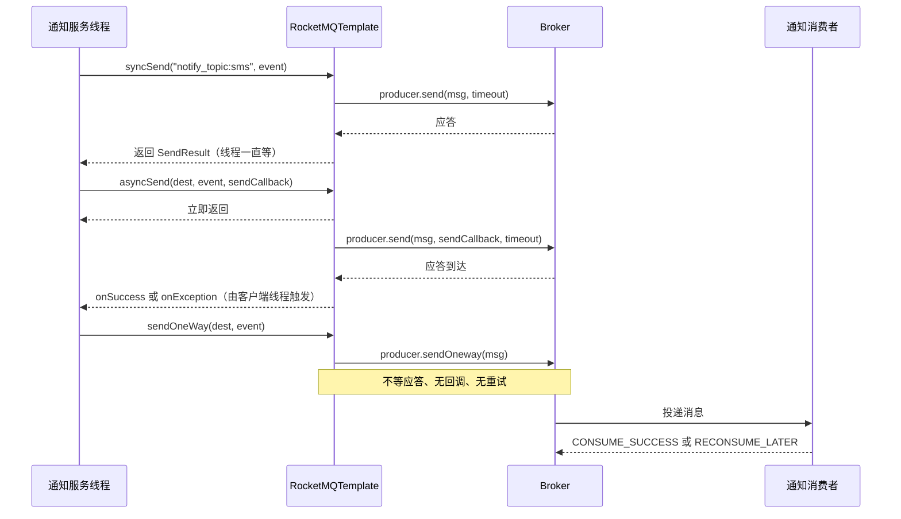
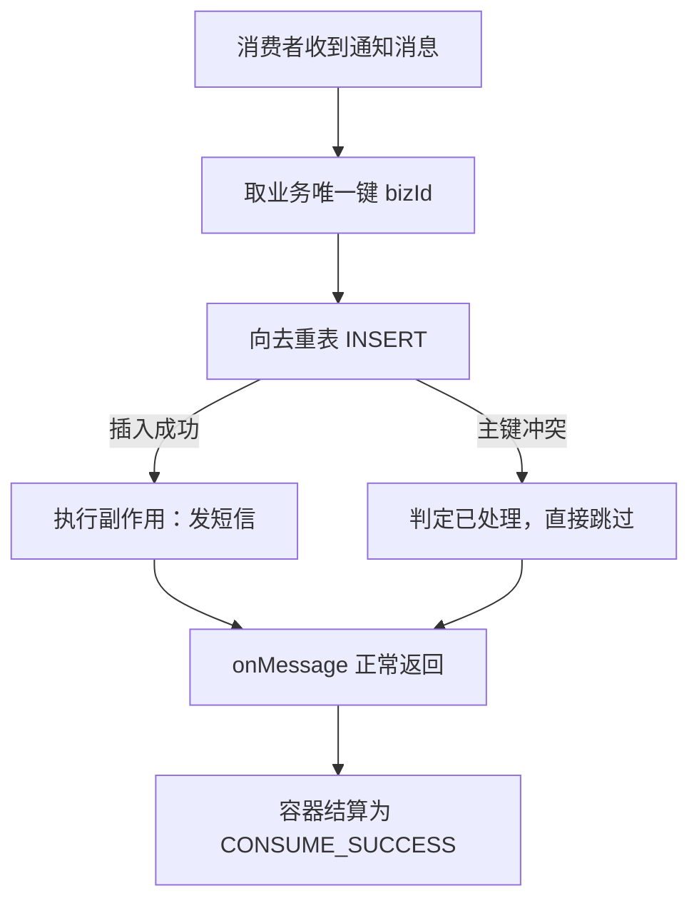

> [!NOTE] 证据口径
> 本篇不搭建、不运行任何真实工程。文中出现的「实测」一律指**静态取证**——读 `rocketmq-spring` 仓库 tag
> `rocketmq-spring-all-2.2.3` 的源码行号、扫 `rocketmq-all-4.9.8-bin-release` 发行包里 jar 的类结构与常量池；
> 不是运行读数。代码块里的 `// 预期输出:` 是按源码签名与上游文档结构推定的结果，不代表本机跑过。

## 为什么需要「区分四种发送语义」？（痛点引入）

通知服务只做一件事：业务方调它一个接口，它把「下单成功」这件事广播给短信、积分、风控三个下游。第一版代码里只有一个调用：

```java
rocketMQTemplate.syncSend("notify_topic:sms", event);
log.info("通知已发送");
```

四件事同时出问题了，而且每一件都指向「语义选错」而不是「代码写错」：

1. **接口被下游拖慢。** `syncSend` 的调用线程要一直等到 Broker 给出应答才返回（`RocketMQTemplate.java` L688 就是 `producer.send(rocketMsg, timeout)` 这一步在等）。下游写库慢、网络抖，通知接口的响应时间就被这条发送的耗时直接决定。
2. **「一条通知到底发没发出去」没人答得上来。** 上面那行日志只证明代码走到过这里，不证明消息进了 Broker——`log.info` 把返回值整个扔掉了，`SendResult` 里的发送状态一个都没看。
3. **有人为了「不阻塞」把 `syncSend` 换成 `sendOneWay`。** 问题立刻从「慢」变成「静默丢」：单向发送不等应答、没有回调、失败也没有重试（`docs/02-producer/02message1.md` L180 的原文口径就是「没有重试而导致数据丢失」）。
4. **同一条通知被处理了两遍，积分扣了两次。** 同步发送自带内部重试（`RocketMQTemplate.java` L466-469 的 javadoc 明写「multiple messages may potentially delivered to broker(s)」），消费端还会因为业务异常再投一次；而有人在去重表里把 `msgId` 当唯一键——这个键根本不管用，理由见本文〈消费幂等闸门〉一节。

| 你要回答的问题 | 该选的语义 | 选错的代价 |
|----------------|------------|------------|
| 这条消息确认落到 Broker 了吗？ | 同步发送 `syncSend` | 用单向就永远答不上来 |
| 我不想让当前线程等应答，但仍要知道成败 | 异步发送 `asyncSend` + `SendCallback` | 忽略 `onException` 分支等于假装成功 |
| 这类消息丢了可以接受吗？可以——日志埋点 | 单向发送 `sendOneWay` | 拿它发业务通知，丢多少无人知道 |
| 我发出去还要拿下游的计算结果 | 请求应答 `sendAndReceive` | 用「发送 + 轮询查库」自己拼，等于重造一遍 |

> ### 💡 新人小结：四种语义其实是四种「寄件方式」
>
> 把 `RocketMQTemplate` 想成快递前台，`destination` 想成收件地址：
> - **同步发送** = 柜台当面寄：你不走完「收件—称重—给回执」整个流程就不许离开，你手里那张回执单（`SendResult`）就是证据。
> - **异步寄件** = 放下包裹拿个号就走：号上没有结果，短信（回调）才告诉你成没成；短信没来，你无法断定成没成。
> - **单向寄件** = 门口的投递箱：扔进去立刻转身，没人应你，也没人提醒你箱子满了。
> - **请求应答** = 代办点「你递材料、我当场给你盖章结论」：你要的不是「寄到了」，而是结论本身。
>
> **一句话总结：四种语义的差别不在消息内容，而在「你愿意为『知道结果』付出多少等待」。**

**学习路线图**

```
痛点引入 → 术语对齐 → 依赖与配置 → 四语义对照 → 逐个落地写法 → 消费端与幂等 → ✅/❌ 对照 → 排查清单
在哪      为什么    能跑起来    选哪个        怎么写          收到后怎么办    高发错误     出问题时
```

本文只管**普通消息在 Spring Boot 里怎么写**。机制原理一律不重抄：三种发送方式的底层语义与 4.x 的 18 级延时档位见[普通消息、批量消息与定时延时消息](/docs/04-message-features/消息类型/普通消息与定时延时消息/)；发送侧重试与流控见[发送重试流控与消息存储清理](/docs/04-message-features/发送可靠性与存储/发送重试流控与消息存储清理/)；消费侧重试阶梯与死信见[消费重试与死信队列](/docs/05-consumption/均衡进度与重试/消费重试与死信队列/)；Tag 与 SQL92 的匹配规则见[消息过滤Tag与SQL92](/docs/05-consumption/消费模型/消息过滤Tag与SQL92/)。全量 `rocketmq.*` 参数表与自动装配生效条件在[SpringBoot集成方案与版本基线](/docs/11-springboot-integration/集成基线/SpringBoot集成方案与版本基线/)，本文只取发送语义用得上的几行。

---

## 术语表（先对齐名词，再读正文）

| 术语 | 全称 | 通俗含义（用自己的话） | 在本文中的角色 |
|------|------|------------------------|----------------|
| destination | 目的地字符串 | 收件地址，格式 `topic:tag`，冒号前是主题、冒号后是标签 | 每个发送方法的第一个入参 |
| syncSend | 同步发送 | 调用线程等 Broker 应答，拿到 `SendResult` 才返回 | 「确认发出去了」的唯一写法 |
| asyncSend | 异步发送 | 调用立刻返回，成败由 `SendCallback` 通知 | 链路耗时敏感但仍要结果的场景 |
| sendOneWay | 单向发送 | 只发不等、无回调、无重试，吞吐最高但可能丢 | 日志埋点这类可丢消息 |
| sendAndReceive | 请求应答 | 发一条请求消息，等（或用回调收）下游的应答消息 | 要结论而不是要回执 |
| SendResult | 发送结果对象 | 回执单：状态、两个标识、落在哪个队列、队列位点 | 同步发送的返回值 |
| SendStatus | 发送状态枚举 | 回执单上那一栏结论，只有四个取值 | 判断「真成功」还是「存疑」 |
| sendMessageTimeout | 发送超时（毫秒） | 一次发送最多等多久，默认 3000 | 决定同步调用最长阻塞时间 |
| retryTimesWhenSendFailed | 同步发送失败重试次数 | 内部再试几次，默认 2，可能因此重复投递 | 重复消息的第一个来源 |
| retryTimesWhenSendAsyncFailed | 异步发送失败重试次数 | 异步通道的同款重试，默认 2 | 重复消息的第二个来源 |
| retryNextServer | 发送未成功时是否换 Broker | 映射到客户端的 `setRetryAnotherBrokerWhenNotStoreOK`，默认 false | 决定重试是否换机器 |
| KEYS | 消息业务索引键 | 挂在消息上的业务唯一号，可按它查消息 | 幂等与追溯的正主 |
| TAGS | 消息标签 | 主题内的二级分类，消费端按它过滤 | 只有 destination 里的 tag 会生效 |
| RocketMQReplyListener | 消费者应答接口 | 消费端「返回一个值」给请求方的接口 | 请求应答的消费侧 |
| 幂等闸门 | 业务层去重表 | 先占坑再干活，占不到坑就说明干过了 | 消费端唯一可靠的重复防线 |

---

## 依赖与配置：先把能跑起来的骨架摆出来

版本口径先说清楚，别写成「官方支持」：**`rocketmq-spring-boot-parent:2.2.3` 的 pom 里构建基线是 `java.version=1.8`、`spring.boot.version=2.5.9`、`spring.version=5.3.20`、`rocketmq.version=5.0.0`**；本项目把 Web 层钉在 Boot 2.7.18，属于**同一大版本内的向后兼容使用**，不是 starter 2.2.3 的构建基线。starter 2.2.3 默认带进 5.0.0 客户端；本工程按部署的 Broker 版本（4.9.8）把客户端显式压到 4.9.8，代价是 starter 里那三个 5.x 定时方法不可用（本分类〈定时消息与任意时刻投递〉一篇专门讲这件事）。

```xml
<parent>
    <groupId>org.springframework.boot</groupId>
    <artifactId>spring-boot-starter-parent</artifactId>
    <version>2.7.18</version>
</parent>

<properties>
    <java.version>1.8</java.version>
    <maven.compiler.source>1.8</maven.compiler.source>
    <maven.compiler.target>1.8</maven.compiler.target>
    <rocketmq.version>4.9.8</rocketmq.version>
</properties>

<dependencies>
    <dependency>
        <groupId>org.springframework.boot</groupId>
        <artifactId>spring-boot-starter-web</artifactId>
    </dependency>

    <!-- 集成入口：starter 只带 spring-boot-starter / -validation 与 rocketmq-spring-boot -->
    <dependency>
        <groupId>org.apache.rocketmq</groupId>
        <artifactId>rocketmq-spring-boot-starter</artifactId>
        <version>2.2.3</version>
    </dependency>

    <!-- 显式声明更靠近本项目，覆盖 starter 传递进来的 5.0.0 客户端 -->
    <dependency>
        <groupId>org.apache.rocketmq</groupId>
        <artifactId>rocketmq-client</artifactId>
        <version>${rocketmq.version}</version>
    </dependency>
    <dependency>
        <groupId>org.apache.rocketmq</groupId>
        <artifactId>rocketmq-acl</artifactId>
        <version>${rocketmq.version}</version>
    </dependency>
</dependencies>
```

上面注释里那句「starter 只带……」不是推测：`rocketmq-spring-boot-starter:2.2.3` 的 pom 只有三个依赖（`rocketmq-spring-boot`、`spring-boot-starter`、`spring-boot-starter-validation`），而 `rocketmq-spring-boot:2.2.3` 的 pom 把 `rocketmq-client`、`rocketmq-acl` 声明成普通（非 optional）依赖，所以靠「在后面重复声明一次同名坐标」把版本压下去是可行的。

```yaml
rocketmq:
  name-server: 127.0.0.1:9876
  producer:
    group: notify-producer-group
    send-message-timeout: 3000
    retry-times-when-send-failed: 2
    retry-times-when-send-async-failed: 2
    retry-next-server: false
    compress-message-body-threshold: 4096
    max-message-size: 4194304

notify:
  topic: notify_topic
```

`rocketmq.name-server` 与 `rocketmq.producer.group` 是生产者 Bean 的两道硬门槛：自动配置类上挂 `@ConditionalOnClass(MQAdmin.class)` 与 `@ConditionalOnProperty(prefix = "rocketmq", value = "name-server", matchIfMissing = true)`（`RocketMQAutoConfiguration.java` L56-57），而 `defaultMQProducer` 还额外要求 `name-server` 与 `producer.group` 两个键都存在（L89-92），进去后立刻 `Assert.hasText(groupName, "[rocketmq.producer.group] must not be null")`（L97）。**没配 group 就没有生产者 Bean，也没有 `rocketMQTemplate`**——这类「模板注入不到」的启动失败在集成基线那篇有完整清单。

四个发送语义用得上的键，默认值都来自 `RocketMQProperties.java` 的字段初始化，落到客户端的方式是自动配置里的一段硬赋值：

| yml 键（`rocketmq.producer.*`） | 默认值与出处 | 落到客户端的哪个 setter | 语义后果 |
|---------------------------------|--------------|--------------------------|----------|
| `send-message-timeout` | 3000，`RocketMQProperties.java` L114 | `setSendMsgTimeout`，`RocketMQAutoConfiguration.java` L112 | 同步发送最长阻塞时间与请求应答的默认超时 |
| `retry-times-when-send-failed` | 2，L125 | `setRetryTimesWhenSendFailed`，L113 | 同步发送最多尝试次数由此决定，重复投递的第一个来源 |
| `retry-times-when-send-async-failed` | 2，L131 | `setRetryTimesWhenSendAsyncFailed`，L114 | 异步通道的内置重试次数 |
| `retry-next-server` | false，L136 | `setRetryAnotherBrokerWhenNotStoreOK`，L117 | 默认重试不换 Broker；要换得显式打开 |
| `max-message-size` | 4194304（1024\*1024\*4），L141 | `setMaxMessageSize`，L115 | 单条消息体积红线 |
| `compress-message-body-threshold` | 4096（1024\*4），L119 | `setCompressMsgBodyOverHowmuch`，L116 | 超过该大小的消息体默认走压缩 |

这张表有个容易被忽略的含义：**这些赋值全部发生在自动配置创建生产者时**。一旦你自己声明了 `DefaultMQProducer` Bean，`@ConditionalOnMissingBean(DefaultMQProducer.class)`（L90）让自动配置退让，上面的 yml 值一个都不会应用到你那个实例上。

---

## 四种语义对照：返回值、是否阻塞、重试来自哪个默认值

| 维度 | `syncSend` | `asyncSend` | `sendOneWay` | `sendAndReceive` |
|------|-----------|-------------|--------------|------------------|
| 方法签名出处 | `RocketMQTemplate.java` L475、L487、L707、L719 | L909、L891、L933、L921 | L1070、L1090 | L117/L127（阻塞版）、L278/L289（回调版） |
| 返回值 | `SendResult` | `void`（结果只进回调） | `void` | 阻塞版返回应答反序列化后的 `T`；回调版返回 `void` |
| 调用线程是否等 Broker | 等，等满 timeout | 不等，提交完即返回 | 不等，且不接收任何应答 | 阻塞版等；回调版不等 |
| 成败告知点 | 返回值 + 异常 | `SendCallback.onSuccess` / `onException` | 无处告知 | 返回值/回调 + 异常 |
| 内置重试来源 | `retryTimesWhenSendFailed`（默认 2，`RocketMQProperties.java` L125） | `retryTimesWhenSendAsyncFailed`（默认 2，L131） | 无重试通道 | 走客户端 request 路径，超时以 `producer.getSendMsgTimeout()` 起算（L118） |
| 超时默认值 | `sendMessageTimeout=3000`（L114），未显式传 timeout 时由 `producer.getSendMsgTimeout()` 取（L476） | 同上，L910 | 不适用（不等应答） | 同上，L118；回调版 `timeout<=0` 时回落到该默认值（L433-435） |
| 是否可能重复投递 | 会：内置重试后「多条消息可能都被送达 Broker」（L466-469 javadoc） | 会：javadoc 同样点名 `RetryTimesWhenSendAsyncFailed`（L901-903） | 不会重复（一次都不重试），但可能整条丢 | 请求消息可能重复；应答按 correlation 关联 |
| 官方定位 | 「可靠的同步传输广泛用于重要通知消息、短消息通知等」（L462-464 javadoc；`docs/02-producer/02message1.md` L54） | 「一般用于链路耗时较长、对响应时间较为敏感的业务场景」（L896-897；上游 L103） | 「类似 UDP……吞吐最大但可能丢消息，用于日志收集这类中等可靠性场景」（L1062-1065；上游 L163） | 「This method returns immediately. On receiving reply message, callback will be executed」（L410-411） |

上游对这三条基础方式的定位是一句话能背下来的：**「Apache RocketMQ 可用于以三种方式发送消息：同步、异步和单向传输。前两种消息类型是可靠的，因为无论它们是否成功发送都有响应」**（`docs/02-producer/02message1.md` L50）。这里的「可靠」指的是**有响应可判**，不是「一定送达」——判据在 `SendResult` 里，而不在调用没抛异常这件事里。

三种基础语义在时间轴上的分叉是这样的：



读这张图的关键在三条返回箭头的落点：`syncSend` 的结果回到**通知服务线程**，所以它能阻塞；`asyncSend` 的结果回到**回调**，而回调不在通知服务线程上跑；`sendOneWay` 干脆没有任何返回箭头。最后那对 `B->>C` 与 `C-->>B` 是消费侧的事，与发送语义无关：无论你用哪种方式发出去，消费端只有「成功」和「回头再投」两种答复。

> ### 💡 新人小结：别把「没抛异常」当成「发成功了」
>
> - `syncSend` 没抛异常，只说明这一次调用拿到了应答；**应答本身的内容**（`SendStatus`）才是判据，四种取值里有三种是「落盘存疑」。
> - `asyncSend` 里两层要分清：参数为空是**调用线程当场抛** `IllegalArgumentException`（L867-870），Broker 侧失败是**回调里 `onException`**（L909 起）。只写 `onSuccess` 的人，把第二层失败整个吞掉了。
> - `sendOneWay` 的异常只覆盖「连发都发不出去」这一小段（L1078-1081），消息在 Broker 侧是否落盘，它一概不知。
>
> **一句话总结：想知道结果，就必须去读结果对象或回调；调用返回本身永远不是结果。**

---

## 同步发送：把 `SendResult` 读成三件事

`syncSend` 有两族重载：收 Spring `Message` 的（L475、L487）和直接收 payload 的（L707、L719）。不传 timeout 的重载都会走到 `producer.getSendMsgTimeout()`，也就是 yml 里的 `send-message-timeout`（默认 3000）。

```java
@Service
public class NotifyProducer {

    private static final Logger log = LoggerFactory.getLogger(NotifyProducer.class);

    @Autowired
    private RocketMQTemplate rocketMQTemplate;

    @Value("${notify.topic}")
    private String notifyTopic;

    public NotifyResult sendSynchronously(NotifyEvent event) {
        Message<NotifyEvent> message = MessageBuilder.withPayload(event)
            .setHeader(RocketMQHeaders.KEYS, event.getBizId())
            .build();

        String destination = notifyTopic + ":sms";
        SendResult result = rocketMQTemplate.syncSend(destination, message);
        // 预期输出: SendResult 对象，字段形态见下表（依据源码签名与上游文档结构描述，非本机运行读数）

        if (result.getSendStatus() != SendStatus.SEND_OK) {
            log.error("notify not fully stored, bizId={}, status={}",
                event.getBizId(), result.getSendStatus());
            notifyFallback.record(event, result.getSendStatus());
        }
        return NotifyResult.of(event.getBizId(), result);
    }
}
```

`SendResult` 能拿到什么，全部由类结构决定，跟跑没跑过无关：

| 能读到的东西 | getter | 结构性含义 | 在通知场景里能回答什么 |
|--------------|--------|------------|--------------------------|
| 发送状态 | `getSendStatus()` | 取值只有 `SEND_OK`、`FLUSH_DISK_TIMEOUT`、`FLUSH_SLAVE_TIMEOUT`、`SLAVE_NOT_AVAILABLE` 四种（`docs/02-producer/02message1.md` L63；4.9.8 的 `SendStatus` 枚举实测也只有这四项） | 是「确认成功」还是「落盘存疑」；后三种都需要业务兜底 |
| 客户端侧消息标识 | `getMsgId()` | 整条发送的客户端标识，starter 打日志用的就是它（L691） | 排查链路的线索，但不能当业务唯一键 |
| 服务端侧消息标识 | `getOffsetMsgId()` | 与上面那个是**两个不同的字段**，同一次成功发送会同时给出两者 | 说明「一条消息有多个标识」，判重必须用业务号 |
| 落在哪个队列 | `getMessageQueue()` | 内含 topic、brokerName、queueId 三个维度 | 判断消息进了哪台 Broker 的哪个队列 |
| 队列内位点 | `getQueueOffset()` | 该消息在队列中的位置号 | 与消费进度对照，判断是否被消费 |
| 事务编号 | `getTransactionId()` | 普通消息发送时非关注字段 | 事务消息一篇再展开 |

**判据的正确写法是「先判 `sendStatus`，再决定是否兜底」**。上游 `02message1.md` L89-91 的 note 就是这个口径：同步发送务必捕获异常并做业务侧失败兜底，忽略异常就可能导致消息实际未成功发送。

还有一个坑藏在 Spring 的通用 API 里：`rocketMQTemplate.convertAndSend(dest, payload)` **不是轻量发送**，它落到 `doSend`（L1142-1143），而 `doSend` 内部调的就是 `syncSend`。想用「看起来更随意的写法」降低阻塞，只是换个名字继续等。

---

## 异步发送：回调线程与失败分支

`asyncSend` 的四个非顺序重载在 L909（`Message` 版）、L891（带 timeout）、L933（payload 版）、L921（payload + timeout），最终都落到 L865-881 的实现，其中提交动作是 `producer.send(rocketMsg, sendCallback, timeout)`（L876）。

```java
public void sendAsync(NotifyEvent event) {
    Message<NotifyEvent> message = MessageBuilder.withPayload(event)
        .setHeader(RocketMQHeaders.KEYS, event.getBizId())
        .build();

    try {
        rocketMQTemplate.asyncSend(notifyTopic + ":sms", message, new SendCallback() {
            @Override
            public void onSuccess(SendResult sendResult) {
                if (sendResult.getSendStatus() != SendStatus.SEND_OK) {
                    notifyFallback.record(event, sendResult.getSendStatus());
                }
            }

            @Override
            public void onException(Throwable e) {
                // 这一支是异步唯一的失败出口，绝不能留空
                log.error("async notify failed, bizId={}", event.getBizId(), e);
                notifyFallback.record(event, e);
            }
        });
    } catch (IllegalArgumentException badInput) {
        // 提交阶段当场抛出：payload 为空（L867-870）
        log.error("illegal notify event, bizId={}", event.getBizId(), badInput);
    }
}
```

关于「回调在哪个线程上跑」，源码只给了三处可靠事实，据此推定、非本机运行读数：

1. javadoc 写明「This method returns immediately. On sending completion, `sendCallback` will be executed」（L896-899）——回调与调用线程是两次不同的执行。
2. `RocketMQTemplate` 暴露了 `setAsyncSenderExecutor(ExecutorService)`（L107-109），内部直接转发给 `producer.setAsyncSenderExecutor(...)`；4.9.8 客户端确实有这对 get/set（`rocketmq-client-4.9.8.jar` 中 `DefaultMQProducerImpl` 的 `getAsyncSenderExecutor` / `setAsyncSenderExecutor`，实测 javap 第 63、64 行）。也就是说**回调线程池是可以替换的，但只能从代码里换**。
3. starter 的 `rocketmq.*` 配置项里没有任何线程池键：`RocketMQProperties.Producer` 的全部字段就是 L99-171 那一组（group、namespace、sendMessageTimeout、compressMessageBodyThreshold、retryTimesWhenSendFailed、retryTimesWhenSendAsyncFailed、retryNextServer、maxMessageSize、accessKey、secretKey、enableMsgTrace、customizedTraceTopic、tlsEnable、instanceName）。想给回调换池子，yml 无路可走。

推论就很清楚了：**回调跑在客户端自己的线程上，你在回调里做慢活，占的是客户端的发送回调资源**。回调体里只做两件事——判 `sendStatus`、把失败交给业务线程池或兜底表；不要在里面再同步调下游。

异步还有第二重重复：javadoc 明确「internal implementation would potentially retry up to `RetryTimesWhenSendAsyncFailed` times before claiming sending failure, which may yield message duplication」（L901-903），默认值 2 来自 `RocketMQProperties.java` L131。

最后一条和生命周期有关：`RocketMQTemplate.destroy()` 会直接 `producer.shutdown()`（L1158-1160）。上游在异步示例里专门留了一句提醒——「异步发送，如果要求可靠传输，必须要等回调接口返回明确结果后才能结束逻辑，否则立即关闭 Producer 可能导致部分消息尚未传输成功」（`docs/02-producer/02message1.md` L146）。对 Web 应用来说，等价纪律是：**不要在请求线程里发完就走、然后指望优雅停机帮你把没回来的回调补齐。**

---

## 单向发送：只适合「可以丢」的那一类

`sendOneWay(String, Message<?>)` 在 L1070，payload 版在 L1090，实现只有一行有效动作 `producer.sendOneway(rocketMsg)`（L1077）。javadoc 把性质说透了：「类似 UDP，不等 Broker 确认就返回，吞吐最大但可能丢消息；用于中等可靠性场景，比如日志收集」（L1062-1065）。

```java
public void track(NotifyDeliveryTrace trace) {
    // 埋点数据：丢一条不影响业务，量极大，不能让它阻塞主流程
    rocketMQTemplate.sendOneWay(notifyTraceTopic, trace);
}
```

三条硬边界：

- **没有返回值**，方法签名就是 `void`，所以「发送成功的消息可见性」这件事只能靠消费端或轨迹工具反查，不能靠调用点断言。
- **没有失败通知**。上游 L180 的原文口径：单向发送没有请求应答处理，出现发送失败时因为没有重试而导致数据丢失；若数据不可丢，建议改用可靠同步或可靠异步。
- **参数校验仍然会当场抛**：`message` 或 `message.getPayload()` 为空时抛 `IllegalArgumentException`（L1071-1074），异常包装成 `MessagingException` 只发生在提交阶段（L1078-1081）。所以「`sendOneWay` 不抛异常」连「提交成功」都不代表一定成立。

> ### 💡 新人小结：单向与异步差在哪
>
> 两者都不等应答，区别只有一个：**异步有一张「事后通知」的短信，单向连短信都没有。** 于是「允许丢多少」决定了选择——允许丢、且量大到同步扛不住，用单向；一条都不许丢但也不想等，用异步 + 回调兜底。别用「代码更短」来选发送语义，`sendOneWay(dest, payload)` 确实比 `asyncSend` 少写八行，但它少掉的正是你要的答案。

---

## 请求应答：`sendAndReceive` 的阻塞版与回调版

`sendAndReceive` 在 2.2.3 里是一整组重载（L117-L449），分两类：给 `Type` 的**阻塞版**返回应答反序列化后的对象（L117、L127、L138、L149…核心实现在 L231-255），给 `RocketMQLocalRequestCallback` 的**回调版**返回 `void`（L278、L289…核心实现在 L421-452）。

```java
public QuotaSnapshot askQuota(QuotaRequest request) {
    QuotaSnapshot reply = rocketMQTemplate.sendAndReceive(
        "quota_query_topic:quota", request, QuotaSnapshot.class);
    // 阻塞版：不传 timeout 时用 producer.getSendMsgTimeout()（L118）
    if (reply == null) {
        // 实现里 replyMessage 为空会返回 null 而不是抛异常（L250 的三元判断）
        return QuotaSnapshot.unknown(request);
    }
    return reply;
}

public void askQuotaAsync(QuotaRequest request) {
    rocketMQTemplate.sendAndReceive("quota_query_topic:quota", request,
        new RocketMQLocalRequestCallback<QuotaSnapshot>() {
            @Override
            public void onSuccess(QuotaSnapshot message) {
                quotaCache.put(request.getBizId(), message);
            }

            @Override
            public void onException(Throwable e) {
                log.error("quota reply failed, bizId={}", request.getBizId(), e);
            }
        }, 3000);
}
```

`RocketMQLocalRequestCallback` 是泛型接口，两个方法 `onSuccess(T)` / `onException(Throwable)`；应答类型由 `getMessageType(...)` 从回调实现的泛型实参反推（L1224 起），所以上面那段匿名类的 `<QuotaSnapshot>` 不是装饰——它决定了应答怎么反序列化。

**消费端必须实现另一个接口** `RocketMQReplyListener<T, R>`（`rocketmq-spring-boot/src/main/java/org/apache/rocketmq/spring/core/RocketMQReplyListener.java` L26-31，javadoc 原文「The consumer supporting request-reply should implement this interface」，方法签名 `R onMessage(T message)`）：

```java
@RocketMQMessageListener(consumerGroup = "quota-query-group",
                         topic = "quota_query_topic",
                         selectorExpression = "quota")
public class QuotaQueryReplyListener implements RocketMQReplyListener<QuotaRequest, QuotaSnapshot> {

    @Override
    public QuotaSnapshot onMessage(QuotaRequest request) {
        return quotaService.snapshot(request.getUserId());
    }
}
```

容器侧的分流逻辑是确定的：`DefaultRocketMQListenerContainer.handleMessage(...)` 先判 `rocketMQListener`，非空就调 `onMessage` 且不发送任何回复；否则走 `rocketMQReplyListener` 分支，把返回值包成应答消息发出去（该文件 L458-482，其中取应答生产者、`producer.setSendMsgTimeout(replyTimeout)`、发送应答分别在同文件 L466-469）。两个细节值得记住：

- **应答的超时用的是消费端注解上的 `replyTimeout`**，默认 3000 毫秒（`RocketMQMessageListener.java` L105；容器在初始化时把它读进字段，见该文件 L246 的 `this.replyTimeout = anno.replyTimeout();`）。请求方的 timeout 和应答方的发送超时是两个独立旋钮，调一侧不管用。
- **应答发不出去不会触发消费重试**：容器里那段 `SendCallback` 的 `onSuccess` 只在 `sendStatus != SEND_OK` 时打 error 日志、`onException` 也只打 error（L471-480 区间），它们不影响监听器返回值，消息仍按「业务方法正常返回即 `CONSUME_SUCCESS`」结算（同文件 L421-431 的并发分支）。所以请求方只会等到超时，看不到原因——排查请求应答不通时，这是第一个要看的地方。

请求应答在 4.9.8 上是**可用的**，这一点和 5.x 定时三件套恰好相反：`request` 系列方法在 4.9.8 客户端里就是公开 API（`rocketmq-client-4.9.8.jar` 中 `DefaultMQProducer` 实测有 `request(Message, long)`、`request(Message, RequestCallback, long)` 以及带 `MessageQueueSelector` / `MessageQueue` 的同名重载共六个），`MessageConst` 里也备齐了 `PROPERTY_CORRELATION_ID`、`PROPERTY_MESSAGE_REPLY_TO_CLIENT`、`PROPERTY_REPLY_MESSAGE_ARRIVE_TIME`、`PROPERTY_PUSH_REPLY_TIME` 四个属性键，应答消息由客户端工具类 `MessageUtil.createReplyMessage(Message, byte[])` 构造。阻塞版在超时时抛的是 `RequestTimeoutException`（`request(Message, long)` 签名声明的检查异常之一），与 `syncSend` 的失败形态不同，捕获时要单列一支。

---

## destination 语法与 `RocketMQHeaders` 的 `KEYS` / `TAGS`

destination 的解析发生在 `RocketMQUtil.getAndWrapMessage(...)`：`destination.split(":", 2)`，第一段当 topic，剩下**整段**当 tag，然后 `new Message(topic, tags, payloads)`（`rocketmq-spring-boot/src/main/java/org/apache/rocketmq/spring/support/RocketMQUtil.java` L172-178）。

```java
// ✅ 一个 tag：冒号后整段就是 tag
rocketMQTemplate.syncSend("notify_topic:sms", event);

// ✅ 不带 tag：destination 只写 topic，tags 为空串
rocketMQTemplate.syncSend("notify_topic", event);

// ✅ 业务唯一号走 KEYS 头：只有它会被提升成消息的 Keys 属性
rocketMQTemplate.syncSend("notify_topic:sms", MessageBuilder
    .withPayload(event)
    .setHeader(RocketMQHeaders.KEYS, event.getBizId())
    .build());

// ❌ 以为 TAGS 头能打标签
rocketMQTemplate.syncSend("notify_topic", MessageBuilder
    .withPayload(event)
    .setHeader(RocketMQHeaders.TAGS, "sms")
    .build());
```

为什么那个 ❌ 不生效：`getAndWrapMessage` 对请求头只做了三件特殊处理——读 `KEYS`（先按裸键 `KEYS` 取，取不到再按带前缀的 `rocketmq_KEYS` 取，然后 `rocketMsg.setKeys(...)`，L180-187）、读 `FLAG`（L188-198）、读 `WAIT_STORE_MSG_OK`（L199-200）；**其余头一律走「不是保留键就塞成用户属性」这条通道**（L201-208）。于是 `TAGS` 这个头要么因为恰好在 `MessageConst.STRING_HASH_SET` 保留键集合里被直接丢弃、要么带着 `rocketmq_` 前缀变成一个普通用户属性，两种写法都改不掉消息的 tag。tag 只有一个来源，就是 destination 冒号后面那一段。

`RocketMQHeaders` 本身是一组字符串常量（`support/RocketMQHeaders.java` L23-35）：`PREFIX = "rocketmq_"`，加上 `KEYS`、`TAGS`、`TOPIC`、`MESSAGE_ID`、`BORN_TIMESTAMP`、`BORN_HOST`、`FLAG`、`QUEUE_ID`、`SYS_FLAG`、`TRANSACTION_ID`、`DELAY`、`WAIT`。发请求时用得上的只有 `KEYS`；**读进来的一批**才有用——容器把 `MessageExt` 转成 Spring `Message` 时，会把这些字段带上 `rocketmq_` 前缀逐个写进头（`RocketMQUtil.java` L94-112 与 `toRocketHeaderKey` L114-116）。所以消费端拿到 `Message<Map<String,Object>>` 这类泛型时，`rocketmq_TAGS`、`rocketmq_KEYS` 是**读**的，不是**写**的。

多 tag 也别在 destination 上想办法。`||` 是**订阅端表达式**语法，一条消息只允许设置一个 Tag（约束与写法见[消息过滤Tag与SQL92](/docs/05-consumption/消费模型/消息过滤Tag与SQL92/)）：发送侧贴一张标，消费侧写 `selectorExpression = "sms||mail"` 收两张标。上游对 Keys 的定位同样清楚：业务唯一标识要设置到 keys 字段，服务端为其建哈希索引，可按 topic + key 反查消息内容与消费者，且因为哈希索引「务必保证 Key 尽可能唯一」（`docs/05-bestPractice/01bestpractice.md` L13）。

---

## 消费端最简形态与默认值表

最简形态只有一个注解加一个接口：

```java
@RocketMQMessageListener(consumerGroup = "notify-sms-group",
                         topic = "notify_topic",
                         selectorExpression = "sms")
@Component
public class SmsNotifyListener implements RocketMQListener<NotifyEvent> {

    @Override
    public void onMessage(NotifyEvent event) {
        // 幂等闸门 + 业务副作用，见下一节
        notifyService.deliver(event);
    }
}
```

其余属性全部可以不管，因为它们都有默认值；但默认值里有三项会直接影响你对「重复」和「并发」的直觉：

| 注解属性 | 默认值与出处 | 实际落点 | 对本文场景的含义 |
|----------|--------------|----------|------------------|
| `consumerGroup` | 必填、需全局唯一（`RocketMQMessageListener.java` L45 与其 javadoc L39-41） | 容器 `Assert.notNull(consumerGroup, ...)`（`DefaultRocketMQListenerContainer.java` L615） | 组名写错等于换了一个消费进度，会「重复消费历史消息」 |
| `topic` | 必填 | 同上 L617 | 与 destination 的 topic 段必须严格一致 |
| `selectorType` / `selectorExpression` | `TAG` / `"*"`（L57、L62） | 容器按类型组装订阅表达式 | 不设表达式就是全量接收，Tag 过滤等于没做 |
| `consumeMode` | `CONCURRENTLY`（L67） | 决定失败答复走并发还是顺序分支 | 普通通知保持默认即可 |
| `messageModel` | `CLUSTERING`（L72） | 容器 switch 设定（该文件 L651-660 区间） | 集群模式下同组只有一份投递 |
| `consumeThreadNumber` | **20**（L87） | 容器把**核心与最大线程数都设成它**：`setConsumeThreadMax(consumeThreadNumber)` 紧跟 `setConsumeThreadMin(consumeThreadNumber)`，注释原文「set the consumer core thread number and maximum thread number has the same value」（同文件 L644-646） | 消费并发度是固定 20，不是「20 起步、最多 64」 |
| `consumeThreadMax` | 64，但已 `@Deprecated`（L81-82） | 不再由容器使用 | 注释直指 issues#429：线程池用 `LinkedBlockingQueue` 且容量为 `Integer.MAX_VALUE`，所以该属性效果不好，应改用 `consumeThreadNumber` |
| `maxReconsumeTimes` | **-1**（L95） | 容器 `consumer.setMaxReconsumeTimes(maxReconsumeTimes)`（同文件 L648） | javadoc 原文：**并发模式下 -1 表示 16，顺序模式下 -1 表示 `Integer.MAX_VALUE`**（L92-93） |
| `consumeTimeout` | 15（分钟，L100） | 容器 L647 | 单条消息最多占用消费线程 15 分钟 |
| `replyTimeout` | 3000（毫秒，L105） | 只服务于请求应答的回复发送 | 见上一节 |
| `delayLevelWhenNextConsume` | 0（L154） | 异常时写进上下文（同文件 L426 区间） | 注释口径：-1 不重试直接进 DLQ；0 由 Broker 控制频率；>0 由客户端控制 |
| `suspendCurrentQueueTimeMillis` | 1000（L161，注释标注最小 10、最大 30000） | 顺序模式挂起当前队列的间隔 | 顺序消息一篇展开 |

`maxReconsumeTimes` 的 -1→16 换算，站内[消费重试与死信队列](/docs/05-consumption/均衡进度与重试/消费重试与死信队列/)指出「4.x 客户端参数表的 -1 与 16 的换算关系上游未给出」；在 starter 层这个缺口是被注释放平的——**注解 javadoc 直接写了「In concurrently mode, -1 means 16」**（`RocketMQMessageListener.java` L92-93），并且容器只是把这个 -1 原样传给客户端。阶梯间隔与死信去向不在本文展开。

另外一条容易踩的空档：容器要求 `rocketMQListener` 与 `rocketMQReplyListener` **至少实现一个**，否则 `IllegalArgumentException("Property 'rocketMQListener' or 'rocketMQReplyListener' is required")`（同文件 L612-613）。只写了注解、忘了 `implements RocketMQListener<...>`，报的就是这句。

---

## 消费幂等闸门：为什么唯一键不能写 `msgId`

重复消息有三个来源，其中两个在发送侧、一个在消费侧，全都写在源码注释里：同步内置重试（L466-469）、异步内置重试（L901-903）、消费失败重投（默认 16 次，见上一节）。所以「下游只处理一次」这件事**不可能靠发送语义保证**，只能由业务层闸门保证。上游给的落地方式是一段可以直接照抄的口径（`docs/05-bestPractice/01bestpractice.md` L110）：确定消息唯一键 → 消费前查关系数据库 → 不存在则插入并消费，否则跳过 → 实际过程考虑原子性，用主键冲突来实现「查 + 插」。

```java
@Component
public class SmsNotifyListener implements RocketMQListener<NotifyEvent> {

    @Autowired
    private NotifyConsumeRecordMapper recordMapper;
    @Autowired
    private SmsGateway smsGateway;

    @Override
    public void onMessage(NotifyEvent event) {
        NotifyConsumeRecord record = new NotifyConsumeRecord();
        record.setBizId(event.getBizId());          // 业务唯一键，不是 msgId
        record.setConsumerGroup("notify-sms-group"); // 同一消息可能有多个下游分组
        record.setFirstSeenAt(Instant.now());

        try {
            recordMapper.insert(record);            // 占坑：主键冲突即抛异常
        } catch (DuplicateKeyException alreadyDone) {
            // 这个分组已经处理过这条业务事件，直接返回就是 CONSUME_SUCCESS
            return;
        }

        smsGateway.deliver(event);
    }
}
```

判重的表结构层面，唯一约束就落在 `(biz_id, consumer_group)` 这两列上；`biz_id` 与发送侧写进 `RocketMQHeaders.KEYS` 的是同一个值，这样一次投递在「查询」与「判重」两处用的是同一把钥匙。



图的要点在于**跳过的那一支也必须正常返回**：只要 `onMessage` 正常结束，容器就返回 `CONSUME_SUCCESS`（`DefaultRocketMQListenerContainer.java` L421-431 的并发分支），Broker 才会把这条重复消息真正消化掉；如果为了「记录一下」再抛异常，重复消息只会不停重投。

**为什么不能拿 `msgId` 当唯一键？** 三条论证，全部有出处：

1. **上游直接否掉。** `docs/05-bestPractice/01bestpractice.md` L112 原文：「msgId 一定是全局唯一标识符，但是实际使用中，可能会存在相同的消息有两个不同 msgId 的情况（消费者主动重发、因客户端重投机制导致的重复等），这种情况就需要使业务字段进行重复消费。」唯一键可以选 msgId 的前提是「同一条业务消息只有一个 msgId」，而这句话把前提否掉了。
2. **对象结构本身就给了两个标识。** `SendResult` 同时有 `getMsgId()` 与 `getOffsetMsgId()`（4.9.8 客户端类结构实测），starter 打调试日志取的是前者（`RocketMQTemplate.java` L691）。同一次成功发送就已经产出两个不同形态的 id，把它们写进判重表等于把「一次尝试」当成「一条业务事件」。
3. **重试机制天然为每次尝试生成新的客户端 id。** 发送侧的内置重试由 `retryTimesWhenSendFailed`（默认 2）驱动，重试是「再发一遍」而不是「把上一次的结果拿回来」；客户端批量路径里能看到 `MessageClientIDSetter.setUniqID(message)` 这类**逐条为消息赋 id** 的动作（`RocketMQTemplate.java` L1256，位于私有 `batch(...)` 内，L1250-1264），可见 id 是在发送侧构造消息时打上去的属性。于是「同一业务事件、多次尝试、多个 id」是结构上的必然，不是偶发 bug。

反过来，Keys 才是设计给「业务唯一」用的那个字段：服务端为每条消息建哈希索引，可按 topic + key 反查内容与消费者（上游 L13）。用 msgId 判重，判的是「这一趟快递的面单」；用业务号判重，判的是「这一件货」。**同一件商品分两次下单会贴出两张面单，但订单号只有一个。**

---

## ✅ 推荐与 ❌ 不推荐：四个高发写法

**❌ 一：用 `syncSend` 做日志埋点。**

```java
// ❌ 埋点量大，且每条都要等 Broker 应答，等于让主流程替埋点付等待成本
@EventListener
public void onNotifyDelivery(NotifyDeliveryTrace trace) {
    rocketMQTemplate.syncSend(notifyTraceTopic, trace);   // L475：内部等满 send-message-timeout
}

// ✅ 埋点允许丢、要吞吐：单向；真要计数：异步 + 回调落兜底表
@EventListener
public void onNotifyDelivery(NotifyDeliveryTrace trace) {
    try {
        rocketMQTemplate.sendOneWay(notifyTraceTopic, trace);   // L1070-1082：不等应答、无重试
    } catch (MessagingException e) {
        log.warn("trace submit failed, ignored by design", e);
    }
}
```

`syncSend` 的定位是「重要通知消息、短信通知」这类可靠同步场景（L462-464 javadoc，与上游 `02message1.md` L54 同口径）；单向的定位是「中等可靠性，如日志收集」（L1062-1065）。把两者对调，前者让主线程为可丢数据买单，后者让不可丢数据静默消失。

**❌ 二：忽略 `asyncSend` 的失败分支。**

```java
// ❌ 只写 onSuccess，Broker 侧失败没有任何出口
rocketMQTemplate.asyncSend(dest, message, new SendCallback() {
    @Override public void onSuccess(SendResult r) { okCounter.increment(); }
    @Override public void onException(Throwable e) { /* 什么都没做 */ }
});

// ✅ 失败分支落兜底表或本地重投队列，并显式判 sendStatus
rocketMQTemplate.asyncSend(dest, message, new SendCallback() {
    @Override public void onSuccess(SendResult r) {
        if (r.getSendStatus() != SendStatus.SEND_OK) {
            fallback.record(event, r.getSendStatus());
        }
    }
    @Override public void onException(Throwable e) {
        fallback.record(event, e);
    }
});
```

注意两个失败通道不同：入参非法是调用线程当场抛 `IllegalArgumentException`（L867-870），提交后的失败只出现在 `onException`（L909 起）。空实现 `onException` 就是把第二条通道焊死。

**❌ 三：`sendOneWay` 之后假设一定送达。**

```java
// ❌ 用「调用没抛异常」推导「用户已经收到通知」
rocketMQTemplate.sendOneWay("notify_topic:sms", event);
notifyState.markDelivered(event.getBizId());

// ✅ 单向只推进「已提交」，状态由消费侧回执或下游落库来推进
rocketMQTemplate.sendOneWay("notify_topic:sms", event);
notifyState.markSubmitted(event.getBizId());   // 语义上明确区分「已提交」与「已投递」
```

单向既没有 `SendResult` 也没有回调（L1070-1082 的签名与实现），任何「一定送达」的断言在这里都没有证据来源；上游对它的告诫是「若数据不可丢，建议选用可靠同步或可靠异步发送方式」（`02message1.md` L180）。

**❌ 四：把 `TAGS` 头当标签、把 `msgId` 当唯一键。** 前一条的源码理由见〈destination 语法〉一节（`getAndWrapMessage` 只提升 `KEYS`，L180-208），后一条见〈消费幂等闸门〉三论证。✅ 写法统一是：tag 进 destination，业务唯一号进 `RocketMQHeaders.KEYS` 并与去重表唯一列同源。

---

## 排查清单

| 现象 | 大概率原因 | 核对依据 |
|------|------------|----------|
| 通知接口偶发变慢，下游没变化 | 用了 `syncSend`，等待的是 Broker 应答；`send-message-timeout` 默认 3000，且内置重试最多 2 次 | `RocketMQTemplate.java` L475-489；`RocketMQProperties.java` L114、L125 |
| 发送方「全部成功」，下游却少收了很多 | 用了 `sendOneWay` 且未做兜底：无应答、无重试 | 同上 L1070-1082；`docs/02-producer/02message1.md` L180 |
| 异步发送「看起来成功」但消息缺失 | `onException` 是空实现；或应用提前关闭造成 `producer.shutdown()` 后回调无处可归 | 同上 L909-911 与 L1158-1160；`02message1.md` L146 |
| `sendStatus` 不是 `SEND_OK` | 刷盘超时／同步到备超时／备不可用三类之一，属落盘存疑而非「肯定失败」 | `docs/02-producer/02message1.md` L63 |
| 同一业务事件下游处理两次 | 发送侧重试（同步 2、异步 2）+ 消费重投（默认 16）叠加，且幂等闸门用了 `msgId` | `RocketMQTemplate.java` L466-469、L901-903；`RocketMQMessageListener.java` L92-95；`01bestpractice.md` L110、L112 |
| 换了 `selectorExpression` 后收不到预期消息 | Tag 只有一个来源（destination 冒号后），`TAGS` 头不生效；多标签的「或」关系只在订阅端表达式里有效 | `RocketMQUtil.java` L172-208；见[消息过滤Tag与SQL92](/docs/05-consumption/消费模型/消息过滤Tag与SQL92/) |
| `sendAndReceive` 稳定超时、消费端日志无异常 | 消费端实现了 `RocketMQListener` 而非 `RocketMQReplyListener`，容器根本不发应答；或应答发送失败只打了 error 日志 | `DefaultRocketMQListenerContainer.java` L458-482、L612-613 |
| 消费并发数与预期不符 | `consumeThreadNumber` 被同时设成核心与最大线程数；`consumeThreadMax` 已废弃且不再被容器使用 | 同文件 L644-646；`RocketMQMessageListener.java` L81-87 |
| 启动时 `rocketMQTemplate` 注入失败 | 缺 `rocketmq.name-server` 或 `rocketmq.producer.group`，生产者 Bean 条件不成立 | `RocketMQAutoConfiguration.java` L56-57、L89-92、L96-97 |

---

## 要点总结

1. **四种语义回答的是四个问题**：`syncSend` 回答「确认落 Broker 了吗」（返回 `SendResult`，L475/L487）；`asyncSend` 回答「不等线程的前提下成败如何」（`void` + `SendCallback`，L909/L891）；`sendOneWay` 回答「最省的寄法是什么」（`void`、无回调，L1070/L1090）；`sendAndReceive` 回答「下游算出来的结论是什么」（泛型返回值或 `RocketMQLocalRequestCallback`，L117/L278）。
2. **重试数字只有一个来源**：`sendMessageTimeout=3000`、`retryTimesWhenSendFailed=2`、`retryTimesWhenSendAsyncFailed=2`、`retryNextServer=false`，全部在 `RocketMQProperties.java` L114/L125/L131/L136，并在 `RocketMQAutoConfiguration.java` L112-L117 原样灌进客户端；`retryNextServer` 落地的是 `setRetryAnotherBrokerWhenNotStoreOK`，默认不换 Broker。
3. **`SendResult` 的判据是 `sendStatus`，不是「没抛异常」**：四种取值 `SEND_OK` / `FLUSH_DISK_TIMEOUT` / `FLUSH_SLAVE_TIMEOUT` / `SLAVE_NOT_AVAILABLE`（上游 `02message1.md` L63），后三种要业务兜底；`convertAndSend` 内部就是 `syncSend`（L1142-1143），换名字不换阻塞。
4. **异步的回调线程由客户端持有，starter 只给了一个注入口**：`setAsyncSenderExecutor` 直通客户端（L107-109），而 `rocketmq.*` 里没有任何线程池键（`RocketMQProperties.Producer` L99-171 的字段全集），所以回调体要保持「判状态 + 交兜底」两件事，慢活交给业务线程池。
5. **请求应答在 4.9.8 上可用，且失败面很窄**：`request` 六个重载与四个 correlation 属性都在 4.9.8 客户端里；消费端必须 `implements RocketMQReplyListener<T, R>`（L26-31），应答发送超时用消费端 `replyTimeout`（默认 3000，`RocketMQMessageListener.java` L105），应答失败只落日志不触发重试（容器 L466-482）。
6. **destination 是 `topic:tag`，且 tag 只有这一处能设**：`split(":", 2)` 后整段当 tag（`RocketMQUtil.java` L172-178）；请求头里只有 `KEYS` 被提升为消息 Keys（L180-187），其余非保留键变用户属性（L201-208），所以 `RocketMQHeaders.TAGS` 是读入侧的字段而不是写出侧的开关。
7. **消费端最简形态的默认值里有三个反直觉数字**：`consumeThreadNumber=20` 会被同时设为核心与最大线程数（注解 L87、容器 L644-646），`consumeThreadMax=64` 已废弃（L81-82，issues#429），`maxReconsumeTimes=-1` 在并发模式下表示 16、顺序模式下表示 `Integer.MAX_VALUE`（L92-95）。
8. **幂等闸门用业务唯一键**：发送侧重试 + 消费重投让重复成为必然；`msgId` 不能当唯一键（上游 `01bestpractice.md` L110、L112），去重表唯一约束落在 `(biz_id, consumer_group)`，且跳过分支必须正常返回才会结算成 `CONSUME_SUCCESS`。

---

> ### 💡 新人小结：普通消息的四种发送语义学完了，记住这 5 点
>
> 1. **先问「要不要结果」再选 API**：要结果用 `syncSend`；要结果但不想等用 `asyncSend`；可以丢用 `sendOneWay`；要下游的结论用 `sendAndReceive`。
> 2. **默认值就是重试事实**：3000 毫秒超时、同步重试 2 次、异步重试 2 次、默认不换 Broker；改它们只能改 `rocketmq.producer.*`，而且你自己声明了 `DefaultMQProducer` Bean 就一个都不生效。
> 3. **回执单要读，不是拿在手里就行**：`sendStatus` 四种取值里只有 `SEND_OK` 是真成功，另外三种都要兜底；一条成功发送同时给出 `msgId` 与 `offsetMsgId`，这本身就说明它不能当业务唯一键。
> 4. **地址栏一栏、标签纸一张**：destination 写 `topic:tag` 且只能一个 tag，`||` 是消费端订阅语法；业务唯一号写进 `RocketMQHeaders.KEYS`，查询与判重用同一把钥匙。
> 5. **闸门在消费端，不在发送端**：`INSERT 冲突即跳过`，跳过也要正常返回；`consumeThreadNumber=20` 与「并发模式 -1 即 16 次重投」决定了你的重复量级。
