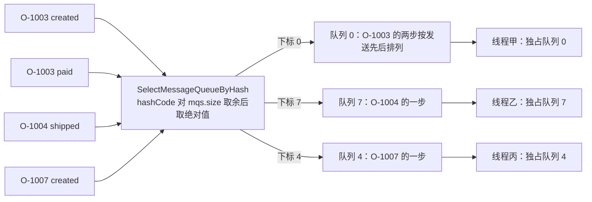
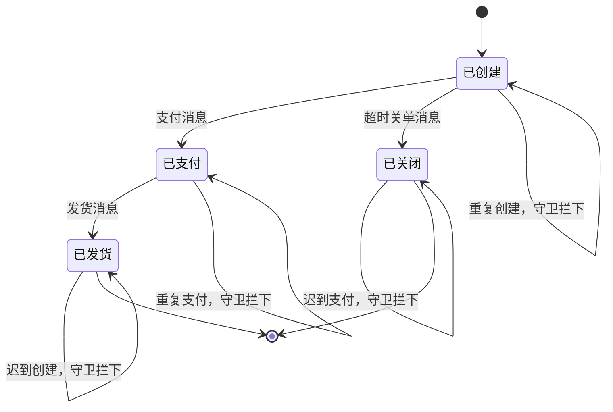

## 为什么需要「顺序消息」？（痛点引入）

订单状态机只有三条消息：`created`、`paid`、`shipped`。用普通消息发出去，事故通常长这样：

- **状态倒退**：`created` 落在队列 3、`paid` 落在队列 5、`shipped` 落在队列 1。三条消息被三个线程同时取走，消费端先执行了「发货」，再执行「创建」——发货时订单还不存在，业务代码只能报错重试；等 `created` 终于被处理，又把已经 `SHIPPED` 的状态覆盖回 `WAIT_PAY`。
- **关单误伤**：超时关单消息与支付消息赛跑（关单写法见[延时消息与订单超时关单](/docs/11-springboot-integration/六种消息实战/延时消息与订单超时关单/)），先关后付，钱收了订单却是关闭态，只能靠人工对账修复。
- **重复副作用**：同一步骤被处理两次，扣减库存、发优惠券这类动作重复执行，账务与实物不一致。

上游文档对这件事的定位很直白：「如果是普通消息，订单 A 的消息可能会被轮询发送到不同的队列中，不同队列的消息将无法保持顺序」（`docs/02-producer/03message2.md` L20），而选型场景里「同一订单严格顺序」本来就是顺序消息的标准用例（`docs/02-producer/01concept1.md` L92）。

必须先把能力边界说清楚：**Apache RocketMQ 4.x 提供的是分区顺序，不是全主题大一统 FIFO**。原文表述是「在 Apache RocketMQ 中支持分区顺序消息……同一个 ShardingKey 的消息会被分配到同一个队列中，并按照顺序被消费」（`docs/02-producer/03message2.md` L6）。机制原理、四种生产/消费组合、5.0 的 MessageGroup 换代都在站内[顺序消息（机制原理）](/docs/04-message-features/消息类型/顺序消息/)里写过，本文不重复那套推导，只做一件事：**把这套语义翻译成 Spring Boot + starter 2.2.3 里能落地的注解与 API 写法**，并说明哪些写法在工程上根本不成立。

> ### 💡 新人小结：顺序消息排队的是「窗口」，不是「整个大厅」
>
> - 银行大厅有 8 个窗口（= 队列）。普通消息是大屏幕随机叫号，同一家人的三张单据被拆到三个窗口，谁先办完没有保证；
> - 顺序消息做的事只有一件：**给这家人指定一个户主名（hashKey），凭这个名字永远排同一个窗口**；
> - 窗口内一个一个办（单队列串行），不同窗口之间互不相等（跨队列无序）；
> - 想让整个大厅只留一个窗口来「保证绝对顺序」，代价是全大厅的吞吐压到一个人手上——这就是本文最后一节要说清的「全局有序为什么不成立」。

**本文路线**

```
痛点 → 发送三组入口 → hashKey 如何变成队列 → 队列分配可视化 → 消费端 ORDERLY 串行机制
     → 挂起重试两参数 → 全局 vs 分区对照 → 状态守卫与幂等分工 → ✅/❌ → 最小可运行片段 → 定位清单
```

> [!NOTE] 本文的证据口径
> 本轮不搭工程、不运行代码。文中出现的「实测」一律指**静态取证**：源码行号（tag `rocketmq-spring-all-2.2.3`）、`rocketmq-all-4.9.8-bin-release` 里 jar 的条目扫描、`javap -c -p` 反编译得到的指令序列，以及按 `String.hashCode` 定义式做的纯函数算术。全文不含任何运行读数：队列编号的实际分布、耗时、`msgId` 字面量一律不写，代码块的结果行统一写作「预期输出」并说明推定依据。

---

## 术语表（本文用到的每个词都先钉死）

| 术语 | 全称 | 通俗含义（用自己的话） | 在本文中的角色 |
|------|------|------------------------|----------------|
| hashKey | 顺序发送的分区键（starter 形参名） | 「户主名」：同一批要保序的消息共用一个字符串 | `*Orderly` 方法的必填参数，`RocketMQTemplate.java` L729 注释原文建议取值 orderId / productId |
| ShardingKey | 分区键（4.x 文档叫法） | 与 hashKey 同一个概念的文档称谓 | 上游机制描述用词，`docs/02-producer/03message2.md` L6 |
| MessageQueueSelector | 消息队列选择器接口 | 「这条消息去哪个窗口」由它现场决定 | starter 的 `messageQueueSelector` 字段类型，L71 |
| SelectMessageQueueByHash | 默认的按哈希选队列实现 | 拿 hashKey 的 hashCode 对队列数取模 | 默认实现，本章逐字节拆解 |
| destination | starter 的路由串 | 形如 `topicName:tags`，发送时解析成主题与 Tag | 所有发送方法第一个参数（L727 javadoc） |
| ConsumeMode.ORDERLY | 顺序消费模式 | 一个队列同一时刻只交给一个线程 | 消费端保序的**唯一**开关，默认值是 CONCURRENTLY |
| MessageQueueLock | 客户端的队列锁表 | 每个队列一把本地锁，抢到才准消费 | 4.9.8 `ConsumeMessageOrderlyService` 的字段，串行机制的实物 |
| suspendCurrentQueueTimeMillis | 顺序消费挂起间隔 | 这条没啃动，整条队列歇多久再来 | 注解默认 1000，注释标界 10~30000（L156-161） |
| maxReconsumeTimes | 最大重试次数 | 同一条消息最多啃几次 | 顺序模式下 -1 即 `Integer.MAX_VALUE`（注释 L90-95） |
| REBALANCE_LOCK_INTERVAL | 队列锁续约间隔 | 占着窗口时每多久向银行报到一次 | 4.9.8 `ProcessQueue` 常量，默认 20000 毫秒 |

---

## 发送侧：三组 orderly 入口，签名里都写着 hashKey

`rocketmq-spring` 仓库 tag `rocketmq-spring-all-2.2.3`，文件 `rocketmq-spring-boot/src/main/java/org/apache/rocketmq/spring/core/RocketMQTemplate.java`。三组方法族、行号与语义：

| 方法族 | 重载与行号 | 阻塞与返回 | 适用 |
|--------|-----------|-----------|------|
| `syncSendOrderly` | `Message` 版 L732 / L745 / L759（五参带 `delayLevel`）；payload 版 L790 / L803；`Collection` 版 L816 / L829 | 阻塞，返回一个 `SendResult` | 订单主流程这类「发失败要知道」的路径 |
| `asyncSendOrderly` | `Message` 版 L1030 / L988 / L1004（六参带 `delayLevel`）；payload 版 L1042 / L1055 | 立即返回，结果走 `SendCallback` | 高吞吐且能接受回调线程里处理失败 |
| `sendOneWayOrderly` | `Message` 版 L1102；payload 版 L1122 | 不等 Broker 应答，无返回、无 timeout 形参 | 只适合允许丢的流水类消息 |

三组最终都落到同一件事上——把 `hashKey` 交给选择器（源码原文）：

- L770：`SendResult sendResult = producer.send(rocketMsg, messageQueueSelector, hashKey, timeout);`
- L1015：`producer.send(rocketMsg, messageQueueSelector, hashKey, sendCallback, timeout);`
- L1109：`producer.sendOneway(rocketMsg, messageQueueSelector, hashKey);`

四条实现细节，逐条有行号：

1. **空消息先拒**：`syncSendOrderly` 在 L760-763 判 `message == null || message.getPayload() == null`，抛 `IllegalArgumentException("`message` and `message.payload` cannot be null")`；`asyncSendOrderly` L1006-1008、`sendOneWayOrderly` L1103-1105 同款。
2. **异常统一包装**：任何底层异常都被包成 `MessagingException`（L777-778、L1017-1018、L1111-1112），业务侧只该捕获 `MessagingException`，不要指望拿到 `MQBrokerException` 原类型。
3. **timeout 缺省来自生产者配置**：无 timeout 的重载一律用 `producer.getSendMsgTimeout()`（L733、L1031、L1043），即 `rocketmq.producer.sendMessageTimeout`，默认 3000 毫秒（`autoconfigure/RocketMQProperties.java` 的 `Producer.sendMessageTimeout=3000`）。
4. **顺序 + 延时可以叠加**：只有 `syncSendOrderly(String, Message<?>, String, long, int delayLevel)` L759 与 `asyncSendOrderly(..., long timeout, int delayLevel)` L1004 带档位入参，内部 `if (delayLevel > 0) rocketMsg.setDelayTimeLevel(delayLevel);`（L767-769、L1012-1014）。档位本身只有 18 级，取值规则与踩坑见[延时消息与订单超时关单](/docs/11-springboot-integration/六种消息实战/延时消息与订单超时关单/)。

`Collection` 版（L816 / L829）是「顺序 + 批量」的组合：实现里把整批转成 `MessageBatch`，再 `producer.send(messageBatch, this.messageQueueSelector, hashKey, timeout)`（L843-844），即**整批同一个 hashKey、同一条队列、只返回一个 `SendResult`**。批大小与同主题约束见[批量消息与整批上限](/docs/11-springboot-integration/六种消息实战/批量消息与整批上限/)。

> [!NOTE]
> `hashKey` 不是 `KEYS`。`RocketMQHeaders.KEYS`（`support/RocketMQHeaders.java`）写进的是消息的索引属性，用于控制台按关键字查消息；`hashKey` 只参与「选哪条队列」，两者互不替代。上游示例里就同时出现：`new Message("TopicTest", tags[...], "KEY" + i, body)` 传的是消息 keys，而 `producer.send(msg, selector, orderId)` 传的分类标准是 `orderId`（`docs/02-producer/03message2.md` L38-47）。

---

## hashKey 怎么变成队列：默认选择器的真实实现

这一步必须按源码与实物说话，不能靠「大概是取模」的想象。

### 字段与默认实现

同一个文件里：

- L71：`private MessageQueueSelector messageQueueSelector = new SelectMessageQueueByHash();`
- L30：`import org.apache.rocketmq.client.producer.selector.SelectMessageQueueByHash;`
- L99 / L103：`getMessageQueueSelector()` / `setMessageQueueSelector(MessageQueueSelector)`

也就是说：**starter 默认就用 `SelectMessageQueueByHash`，全部 `*Orderly` 方法共用这同一个字段**；换选择器只能整体替换（`setMessageQueueSelector` 是模板级 setter，改了对三组方法同时生效）。

顺手确认一件事：4.9.8 客户端里这个类确实存在。对 `rocketmq-all-4.9.8-bin-release` 的 `lib/rocketmq-client-4.9.8.jar` 做条目扫描（`unzip -l`），实测有 `org/apache/rocketmq/client/producer/selector/SelectMessageQueueByHash.class`，与 starter 的 import 路径完全一致；同包下还有 `SelectMessageQueueByRandom`、`SelectMessageQueueByMachineRoom`，接口本身在 `org/apache/rocketmq/client/producer/MessageQueueSelector.class`。结论：把客户端从 starter 自带的 5.0.0 钉到 4.9.8 之后，**顺序发送这条路径不会缺类**，`DefaultMQProducer` 的三参重载也齐备（`send(Message, MessageQueueSelector, Object)`、`(…, long)`、带 `SendCallback` 的两个、`sendOneway(Message, MessageQueueSelector, Object)` 均在 4.9.8 客户端签名表中）。

### 实现体逐句拆解

对该 class 做 `javap -c -p` 反编译，`select` 方法的指令序列是：`aload_3 → Object.hashCode() → List.size() → irem → istore → ifge → Math.abs(int) → List.get(i) → checkcast MessageQueue → areturn`。逐句翻译回 Java 等价形式：

```java
// 依据：4.9.8 客户端 lib/rocketmq-client-4.9.8.jar 中
// org/apache/rocketmq/client/producer/selector/SelectMessageQueueByHash.class 的字节码指令序列，
// 按「选择器收到的 arg 是 String hashKey」这一前提写成等价 Java 形态。
public MessageQueue select(List<MessageQueue> mqs, Message msg, Object arg) {
    int value = arg.hashCode() % mqs.size();  // 位移 0-10：hashCode 后 irem 取余
    if (value < 0) {
        value = Math.abs(value);              // 位移 13-23：ifge 分支 + Math.abs
    }
    return mqs.get(value);                    // 位移 25-33：按下标取队列
}
```

三条可以直接抄进设计评审的结论：

| 结论 | 依据 | 工程含义 |
|------|------|----------|
| 同一 `hashKey` 在队列数不变时永远落同一队列 | `hashCode()` 是 `String` 的纯函数，`mqs.size()` 不变则下标不变 | 这就是「分区有序」的全部实现，没有服务端参与 |
| 落位依赖 `mqs.size()`，队列数一变就整体漂移 | 取模的模数就是入参队列列表长度（字节码 `List.size()`） | 扩缩容 / Broker 掉线都会让同一订单换队列 —— 见下节实算 |
| 负余数被 `Math.abs` 掰正，下标恒在 `[0, size)` | `ifge` + `Math.abs` 两个位移 | 排查时**别用 Python/JS 的 `%` 心算**：`-1990198498 % 8` 在 Java 里是 `-2`（取绝对值后为 2），在 Python 里是 `6`，两者会算出不同队列 |

入参 `mqs` 从哪来，字节码里同样读得到：`sendSelectImpl` 里先 `tryToFindTopicPublishInfo(topic)`，再 `mQClientFactory.getMQAdminImpl().parsePublishMessageQueues(topicPublishInfo.getMessageQueueList())`，最后 `clientConfig.getMessageQueueSelector().select(...)`。其中 `parsePublishMessageQueues`（4.9.8 `MQAdminImpl.class`）只做一件事：遍历列表、把 topic 的命名空间前缀剥掉、重建 `MessageQueue` 再交出去，**没有额外筛队列**。所以「模数」就是你这个主题在路由里的发布队列总数。

### 实算：三个订单号的落位

下面这张表是把 `String.hashCode` 的定义式 `s[0]*31^(n-1) + s[1]*31^(n-2) + … + s[n-1]`（32 位有符号溢出）与上面的取模逻辑直接算出来的纯算术结果，**不是任何一次运行读数**；队列数固定时，同一订单的 `created/paid/shipped` 三步共用一个 hashKey，因此三步同一下标。

| hashKey | hashCode() | `hash % 8`（Java 语义） | 8 队列时下标 | 4 队列时下标 |
|---------|------------|--------------------------|--------------|--------------|
| `O-1003` | -1990198496 | 0 | 0 | 0 |
| `O-1004` | -1990198495 | -7 → abs 7 | 7 | 3 |
| `O-1007` | -1990198492 | -4 → abs 4 | 4 | 0 |
| `ORD-77881` | 1683052613 | 5 | 5 | 1 |
| `20261018000001` | 382742665 | 1 | 1 | 1 |

看第三、四列：`O-1004` 与 `O-1007` 在队列数从 8 变成 4 之后，下标分别从 7→3、4→0。**队列数一变，落位就漂**，这不是概率问题而是算术问题。上游文档对此给的是同一条取舍：Broker 掉线后若队列总数变化，「同一个 ShardingKey 的消息就会发送到不同的队列上，造成乱序；如果不发生变化，那消息将会发送到掉线 Broker 的队列上，必然是失败的」，因此要严格顺序就得建主题时加 `-o`（`--order`）为 true，并保证 NameServer 的 `orderMessageEnable` 与 `returnOrderTopicConfigToBroker` 都是 true，「上述任意一个条件不满足，则是保证可用性而不是严格顺序」（`docs/02-producer/03message2.md` L79-89）。

> ### 💡 新人小结：hashKey 是「户主名」，不是「快递单号」
>
> - 户主名要能长期不变：订单号、用户 ID、设备 SN 都行——同一家人永远排同一窗口（上游也建议「最细粒度的分区键」，`docs/02-producer/03message2.md` L73）；
> - 快递单号每次都不一样：拿 UUID 或时间戳当 hashKey，等于每次都换个窗口排队，顺序链当场断裂；
> - 户主名也不能全家共用一个：所有订单挤同一个 hashKey = 所有消息挤同一条队列，顺序是保住了，吞吐与热点全没了；
> - 别在客户端算「我该发第几号队列」：`mqs.size()` 由路由决定，你的算术只在队列数不变的假设下成立，队列数一变就漂移——这正是上表演示的算术事实。

---

## 队列分配可视化：三条订单怎么落位

先看数据流向，图后逐条对应到上面的实算表。



图后解读：

1. 四条发送调用经过**同一个选择器实例**（`RocketMQTemplate.java` L71 的那个字段），所以 `O-1003` 的 `created` 与 `paid` 一定进队列 0，先后次序由服务端在队列里的存储顺序决定；
2. `O-1004`、`O-1007` 落在别的队列，**与 `O-1003` 之间不存在任何顺序承诺**，这正是「分区有序」的定义；
3. 右侧「一个线程独占一条队列」由消费端实现，见下一节；
4. 队列 0 内如果混进另一个 hashKey（例如下标同样是 0 的其它订单号），两组各自内部保序、组间不涉及顺序，机制侧的解释在[顺序消息（机制原理）](/docs/04-message-features/消息类型/顺序消息/)，本文不重抄。

---

## 消费侧：ConsumeMode.ORDERLY 才是串行开关

注解默认值决定了**很多人根本没打开顺序消费**：`consumeMode() default ConsumeMode.CONCURRENTLY`（tag `rocketmq-spring-all-2.2.3`，`annotation/RocketMQMessageListener.java` L67）。枚举只有两个值，`ConsumeMode.java` L20-29：

```java
public enum ConsumeMode {
    /** Receive asynchronously delivered messages concurrently */
    CONCURRENTLY,
    /** Receive asynchronously delivered messages orderly. one queue, one thread */
    ORDERLY
}
```

`ORDERLY` 的注释原文写了实现口径：**one queue, one thread**。上游消费文档补了反面对照：「在并发消费中，可能会有多个线程同时消费一个队列的消息，因此即使发送端通过发送顺序消息保证消息在同一个队列中按照 FIFO 的顺序，也无法保证消息实际被顺序消费」（`docs/03-consumer/02push.md` L72）。

「一队列一线程」不是口号。`rocketmq-all-4.9.8-bin-release` 的 `lib/rocketmq-client-4.9.8.jar` 里 `org/apache/rocketmq/client/impl/consumer/ConsumeMessageOrderlyService.class` 及其内部类 `ConsumeMessageOrderlyService$ConsumeRequest.class` 的字节码给出的实物链条：

| 机制 | 字节码证据（4.9.8 客户端） | 对写代码的意义 |
|------|---------------------------|----------------|
| 每队列一把锁 | 服务类字段 `messageQueueLock`（构造器位移 5-12），`MessageQueueLock` 内部是 `ConcurrentMap mqLockTable`，`fetchLockObject(mq)` 按队列取/建锁对象 | 串行粒度是「队列」，不是线程池、不是消费者实例 |
| 同一队列互斥执行 | `ConsumeRequest.run()` 取 `fetchLockObject(mq)` 后紧接 `monitorenter`（位移 40-43），尾部两处 `monitorexit`（996、1017） | 同一时刻一条队列最多一个线程在处理，跨队列并行 |
| 队列锁闸门 | 进入消费前的判定是 `BROADCASTING.equals(model) || (processQueue.isLocked() && !processQueue.isLockExpired())`（位移 44-80）；集群模式未锁定时打日志 `the message queue not locked, so consume later, {}` 并转 `tryLockLaterAndReconsume(mq, pq, 10)`（位移 122-183） | 「没抢到锁就不消费」是硬闸门，不是重试优化 |
| 服务端队列锁续约 | `start()` 里仅当 `messageModel()==CLUSTERING` 才 `scheduleAtFixedRate(lockMQPeriodically, 1000, ProcessQueue.REBALANCE_LOCK_INTERVAL, MS)`；`lockMQPeriodically()` 落到 `RebalanceImpl.lockAll()`；`shutdown()` 的 `unlockAllMQ()` 同样只在 CLUSTERING 分支 | 广播模式没有这套锁：见下面 ❌ 清单第 4 条 |
| 锁寿命参数 | `ProcessQueue` 常量 `REBALANCE_LOCK_INTERVAL` 取系统属性 `rocketmq.client.rebalance.lockInterval` 默认 **20000**，`REBALANCE_LOCK_MAX_LIVE_TIME` 取 `rocketmq.client.rebalance.lockMaxLiveTime` 默认 **30000**；`isLockExpired()` 即 `now - lastLockTimestamp > 30000` | 续约线程独立于消费线程，与业务耗时无关，别把它当「消费慢就丢锁」 |
| 消费线程池 | 构造器里 `new ThreadPoolExecutor(getConsumeThreadMin(), getConsumeThreadMax(), 60000ms, new LinkedBlockingQueue(), new ThreadFactoryImpl("ConsumeMessageThread_" + consumerGroup + "_"))`（位移 52-176），队列是**无界** `LinkedBlockingQueue` | 与注解里 `consumeThreadMax` 被废弃的理由同源的构造形态，见下 |

### consumeThreadNumber 与队列数的关系

注解层两个参数（`RocketMQMessageListener.java`）：

- `consumeThreadMax() default 64` 带 `@Deprecated`（L74-82），注释原文：该属性效果不好，因为消费者线程池用 `LinkedBlockingQueue` 且容量是 `Integer.MAX_VALUE`，应改用 `consumeThreadNumber`，并挂了 issue#429；
- `consumeThreadNumber() default 20`（L84-87）。

把「一队列一线程」和线程池的构造放在一起，就能得到工程上真正要的结论——**线程数决定的是「同时能推进多少条队列」，永远不能让单队列变快**：

| 场景（同一消费者实例分到的队列数 → consumeThreadNumber） | 能并行推进的队列数 | 说明 |
|---|---|---|
| 8 条队列 → 20 线程 | 8 | 多出来的线程不会拆开任何一条队列（`monitorenter` 的粒度是队列） |
| 32 条队列 → 20 线程 | 20 | 线程成为瓶颈，剩下 12 条队列的 `ConsumeRequest` 在无界队列里排队 |
| 8 条队列 → 8 线程 | 8 | 刚好；某条队列被挂起时其余 7 条不受影响 |
| 32 条队列 → 4 线程 | 4 | 一条队列的长耗时会连带饿死其它队列，最容易出现「整实例停摆」 |

最后一行对应《基本最佳实践》的告诫：「不建议阻塞监听器，因为它会阻塞线程池，并最终可能会终止消费进程」（`docs/05-bestPractice/01bestpractice.md` L196），而顺序消费多一层代价：「消费者将锁定每个消息队列，以确保他们被逐个消费，虽然这将会导致性能下降，但是当你关心消息顺序的时候会很有用」（同文件 L184-186）。

顺带给一条容易误读的实测细节：4.9.8 的 `ConsumeRequest.run()` 里确实有「这批消费耗时是否超过 `consumeTimeout`」的判定（位移 738-765：`now - begin > consumeTimeout × 60 × 1000` 则记为 `ConsumeReturnType.TIME_OUT`），但这个结果只在注册了消费钩子时写进 `ConsumeMessageContext`（位移 799-829 前置条件是 `hasHook()`），**不会打断这条消息的处理，也不会放行队列里的下一条**。所以注解里那个 `consumeTimeout() default 15L`（`RocketMQMessageListener.java` L97-100，单位分钟）不是熔断开关——长耗时调用要在业务侧自己加超时与熔断，别指望它兜底。

> ### 💡 新人小结：把线程想成「窗口服务员」
>
> - 一个窗口同一时刻只有一名服务员在办（队列级互斥），加派服务员不会让这一扇窗办得更快；
> - 服务员总数决定「同时能开几扇窗」：窗多服务员少，就得有窗空等着，表现是消费 TPS 掉底、积压上涨；
> - 「顺序消费」买的是「不串位」，卖的是「窗口并行度」，这是设计评审时唯一要签字的交换条件。

---

## 顺序失败的挂起重试：suspendCurrentQueueTimeMillis 与 maxReconsumeTimes

顺序消费失败的处理路径和并发消费**根本不同**，这层差异站内[消费重试与死信队列](/docs/05-consumption/均衡进度与重试/消费重试与死信队列/)讲机制，本文只讲注解怎么写、参数边界在哪。

上游给出的机制分野（`docs/03-consumer/02push.md` L211）：「顺序消费消费失败后会先在客户端本地重试直到最大重试次数，这样可以避免消费失败的消息被跳过，消费下一条消息而打乱顺序消费的顺序，而并发消费消费失败后会将消费失败的消息重新投递回服务端……在这期间会正常消费队列后面的消息」。4.9.8 的实物完全对得上：`ConsumeMessageOrderlyService.processConsumeResult(...)` 在挂起分支依次调 `checkReconsumeTimes(msgs)` → `ProcessQueue.makeMessageToConsumeAgain(msgs)` → `submitConsumeRequestLater(processQueue, messageQueue, context.getSuspendCurrentQueueTimeMillis())`（位移 134-164）——**同一批消息在本地重新排队，不回到服务端**，所以队列顺序不断。

### suspendCurrentQueueTimeMillis：整条队列歇多久

注解（`RocketMQMessageListener.java` L156-161）：

```java
/**
 * The interval of suspending the pull in orderly mode, in milliseconds.
 *
 * The minimum value is 10 and the maximum is 30000.
 */
int suspendCurrentQueueTimeMillis() default 1000;
```

三个口径要记住：

| 事项 | 取值/位置 | 依据 |
|------|-----------|------|
| 默认值 | 1000 毫秒 | 注解 L161 |
| 允许边界 | 最小 10、最大 30000（注释原文标注） | 注解 L159 |
| 只在顺序模式起作用 | 「重试间隔：消息消费失败后再次被投递给 Consumer 消费的间隔时间，只在顺序消费中起作用」 | `docs/03-consumer/02push.md` L205 |
| 客户端单次可调 | `ConsumeOrderlyContext.setSuspendCurrentQueueTimeMillis(long)`（4.9.8 实物存在该方法），上游示例在返回挂起态前调用它设 3000 | `docs/03-consumer/02push.md` L86 |

取值建议写成一条判据：**这条队列能接受的最大「单条消息延迟」**就是它的上界。设太小（几十毫秒）等于对同一个失败原因高频猛撞；设满 30000 则一条坏消息能把整条队列钉住半分钟，而这条队列里还有别的订单。两害相权，真正的答案在下面这个参数上。

### maxReconsumeTimes：-1 在顺序模式里不是「16 次」

注解注释原文（`RocketMQMessageListener.java` L89-95）：

```java
/**
 * Max re-consume times.
 *
 * In concurrently mode, -1 means 16;
 * In orderly mode, -1 means Integer.MAX_VALUE.
 */
int maxReconsumeTimes() default -1;
```

4.9.8 客户端把这条注释坐实了：`ConsumeMessageOrderlyService.class` 的私有方法 `getMaxReconsumeTimes()` 字节码为 `invokevirtual getMaxReconsumeTimes() → iconst_m1 → if_icmpne → ldc 2147483647 → ireturn`，即「消费者上的值为 -1 时返回 `Integer.MAX_VALUE`，否则原样返回」；上游参数差别表同样写着顺序消费「该参数取值无最大限制。若未设置参数值，默认最大重试次数为 Integer.MAX」（`docs/03-consumer/02push.md` L217）。

后果必须直说：

- `maxReconsumeTimes = -1`（默认）在 `ORDERLY` 下等于**无限本地重试**。一条永远失败的消息会把它所在队列**永久钉死**，队列里后面的正常订单一起陪着等。
- 越过上限时走的是 `checkReconsumeTimes(msgs)` 分支：达到上限的消息会被写入重试次数属性并 `sendMessageBack(...)`（重试 Topic 由 `MixAll.getRetryTopic(consumerGroup)` 得出），本地不再重投 —— 消息进入死信（`%DLQ%ConsumerGroupName`，定义见 `docs/03-consumer/02push.md` L234 与站内[消费重试与死信队列](/docs/05-consumption/均衡进度与重试/消费重试与死信队列/)）。**代价是队列里出现一个「顺序洞」**：这条被跳过，后面的继续走。
- 因此顺序消费的正解是「显式设一个小而你会心疼的次数」，然后为死信消息准备好对账/补偿出口，而不是留着 -1 赌它不失败。

顺带一个易错点：`delayLevelWhenNextConsume`（注解 L147-154）的注释第一行就写明「Message consume retry strategy in **concurrently** mode」，它管的是并发模式的重投节奏；顺序模式的重试节奏归 `suspendCurrentQueueTimeMillis` 管，别把两者混在一个注解里当保险。

### 失败该怎么「表达」

原生客户端顺序监听器只有两种返回：`ConsumeOrderlyStatus.SUCCESS` 与 `ConsumeOrderlyStatus.SUSPEND_CURRENT_QUEUE_A_MOMENT`（`docs/03-consumer/02push.md` L94；4.9.8 的枚举里另有 `COMMIT`/`ROLLBACK` 两个常量，上游消费文档的语义描述只用前者两个）。《基本最佳实践》的建议是「我们不建议抛出异常，你可以返回 `ConsumeOrderlyStatus.SUSPEND_CURRENT_QUEUE_A_MOMENT` 作为替代」（L184-186）。

starter 的 `RocketMQListener<T>` 形态里没有返回值可写，失败只能靠抛异常表达。这里给一条实测的兜底事实：4.9.8 的 `ConsumeRequest.run()` 对监听器抛出的 `Throwable` 有捕获处理——打日志 `consumeMessage exception: %s Group: %s Msgs: %s MQ: %s`（位移 559-625），状态变量保持为 `null`；随后 `processConsumeResult(...)` 调用之前有一步归一化 `if (status == null) status = ConsumeOrderlyStatus.SUSPEND_CURRENT_QUEUE_A_MOMENT;`（位移 830-839 实测）。也就是说「抛异常」与「主动返回挂起态」在客户端侧汇到同一条重试路径；同一个类里还有失败分支日志 `consumeMessage Orderly return not OK, Group: {} Msgs: {} MQ: {}`（状态为 null / ROLLBACK / SUSPEND 时打印，位移 645-698）。结论：**用 starter 注解写顺序消费者时，失败就抛异常，不必为了「返回状态」绕回原生客户端 API**；但异常粒度要拿捏准——业务判定「这条本就不该处理」（状态守卫拦下）绝不能抛异常，只有基础设施故障才抛。

---

## 全局有序 vs 分区有序：什么时候必须承认做不到

| 对照维度 | 分区有序（本文方案，可用） | 全局有序（全主题一条队） |
|----------|----------------------------|--------------------------|
| 队列数 | 主题多个队列，靠 `hashKey` 把「要比顺序的消息」聚到同一队列 | 机制推论要求主题只有 1 个队列（顺序边界就是队列，推论过程见站内[顺序消息（机制原理）](/docs/04-message-features/消息类型/顺序消息/)） |
| 上游能力口径 | 4.x 原文只声明「支持分区顺序消息」（`docs/02-producer/03message2.md` L6） | 4.x/5.0 文档均未以「全局顺序」为标题给出功能条目与配置案例 |
| 生产端约束 | 同一 hashKey 的消息需「单一生产者 + 串行发送」（`docs/02-producer/03message2.md` L10-12） | 全站所有消息都要挤进这一个生产调用序列 |
| 吞吐 | 随队列数水平扩展；有效并行度 = min(队列数, 消费线程数) | 单队列 + 单线程串行，等于放弃 RocketMQ 的并行模型 |
| 失败放大效应 | 一条坏消息只钉住它所在的那一条队列，其余队列照常 | 一条坏消息钉住整个主题；配合默认 `maxReconsumeTimes=-1` 会全站停摆 |
| Broker 掉线 | 队列总数变化则取模漂移，需 `-o true` + `orderMessageEnable` + `returnOrderTopicConfigToBroker` 三条件才保严格顺序，否则退化为保持可用（`docs/02-producer/03message2.md` L79-89） | 单队列没有「漂移」问题，但有单点：那台 Broker 掉线就是彻底不可用 |
| 适用场景 | 同一订单、同一用户、同一设备内部有序，彼此无关 | 只有「顺序粒度 = 整个主题」这种极小流量业务才谈得上，工程上一律不建议 |

一句话选型：**业务真的需要「跨订单比先后」吗？** 99% 的答案是「不需要」，那就一个业务实体一个 `hashKey`。

---

## 订单状态机：顺序语义与状态守卫、幂等的分工

先声明这三件事的关系，避免把顺序当万能：**顺序解决「先后」，幂等解决「重复」，状态守卫解决「非法跳变」**。而顺序消费本身会制造重复投递——上面实测的 `makeMessageToConsumeAgain` + `submitConsumeRequestLater` 就是同一批消息在本地重新排队，同一条消息会被再次交给监听器。所以「上了 ORDERLY 就不用写幂等」是错的，恰恰相反：**顺序模式下必须写幂等**。



图后解读：允许的跳变只有三条正向边（每次只许前进一步），其余全部退回原状态。这张图成立的前提是「同一订单的三步在同一队列、被同一线程按序处理」——发送侧 `hashKey=orderNo` 保证前半句，消费侧 `consumeMode=ORDERLY` 保证后半句。守卫落在 SQL 的 WHERE 里，让数据库做仲裁，而不是先查后改：

| 收到的步骤 | 当前状态 | 允许的下一步 | 守卫写法要点 | 拦下时该做什么 |
|-----------|----------|--------------|--------------|----------------|
| `created` | 无订单 | `CREATED` | `INSERT ... ON CONFLICT/唯一键忽略`（按你的数据库方言） | 已存在即视为重复，正常返回 |
| `paid` | `CREATED` | `PAID` | `UPDATE ... SET status='PAID' WHERE order_no=? AND status='CREATED'` | 影响行数 0 → 不抛异常 |
| `paid` | `CLOSED` | 不允许 | 同上一条 WHERE 条件不成立 | 影响行数 0 → 记审计日志，别改状态 |
| `shipped` | `PAID` | `SHIPPED` | `... WHERE order_no=? AND status='PAID'` | 影响行数 0 → 说明顺序或状态被破坏，报警 |
| `close` | `CREATED` | `CLOSED` | `... WHERE order_no=? AND status='CREATED' AND 已过支付截止` | 影响行数 0 → 正常返回 |

判定口径与延时篇一致：影响行数为 0 **不是失败**（重复投递与迟到消息被守卫天然吸收），只有数据库抖动、远程依赖超时才抛异常交给挂起重试。

> ### 💡 新人小结：三个防线各自管什么
>
> - 顺序（`hashKey` + `ORDERLY`）：保证同一家人的三张单据按窗口叫号顺序办；
> - 幂等（业务唯一键去重）：保证「同一张单据被送到两次」不办两遍——本地重试与网络重投都会造成二次送达；
> - 状态守卫（WHERE 带前置状态）：保证即使顺序真的破了（队列数漂移、被跳过、人工重放），状态也不会倒退；
> - 三者是叠加关系，不是替代关系。只留顺序砍掉守卫，等于把数据安全押在「路由不漂」这个假设上。

---

## ✅ 推荐与 ❌ 不推荐：六个高发写法

| # | ❌ 不推荐 | 为什么会坏 | ✅ 推荐 |
|---|-----------|-----------|---------|
| 1 | 只在消费端加 `consumeMode=ORDERLY`，发送端仍用 `syncSend(dest, payload)` | 普通发送会被打散到多个队列，顺序消费只是「按队列存储顺序消费」，存储顺序 ≠ 发送顺序（`docs/03-consumer/02push.md` L72 与站内机制篇的组合表） | 发送端换 `syncSendOrderly(dest, message, orderNo)`，两端同时改 |
| 2 | `hashKey` 传时间戳、UUID、`msgId`、每次变化的字符串 | 默认实现是 `arg.hashCode() % mqs.size()`（4.9.8 字节码实测），key 每次变 → 下标每次变 → 同一订单三步散到不同队列 | `hashKey` 传业务实体 ID，且整条链路只用这一个值 |
| 3 | 在顺序监听器里做长耗时远程调用（同步调库存/物流/短信网关）而不设超时 | 该队列被 `monitorenter` 独占，后面消息全等；线程数小于队列数时整实例停摆（`docs/05-bestPractice/01bestpractice.md` L184-196） | 单步处理加超时与熔断，耗时动作拆成下游另一条消息；宁可把它变成显式挂起重试 |
| 4 | `messageModel = MessageModel.BROADCASTING` 还指望保序 | 广播是「组内每台实例都消费全量消息」（`docs/03-consumer/02push.md` L64-68），且 4.9.8 里顺序消费的队列锁续约与 `isLocked()` 闸门都在 `CLUSTERING` 分支上（`ConsumeMessageOrderlyService.start()` / `ConsumeRequest.run()` 字节码实测），跨实例不互斥，同一队列被并发消费；广播模式还不提供失败重试（同文件 L199） | 顺序消费一律 `CLUSTERING`（注解默认即此，L72），多实例靠队列分配分摊，每台只推进自己分到的队列 |
| 5 | 靠生产者默认重试「保顺序」：认为 `retryTimesWhenSendFailed=2` 会自动补上失败的那条 | 4.9.8 的选择器发送路径 `DefaultMQProducerImpl.sendSelectImpl` 方法体内只有一次 `MessageQueueSelector.select` 与一次 `sendKernelImpl`（字节码位移 0-231 无重试回边），读 `getRetryTimesWhenSendFailed()` 的位置在另一个方法 `sendDefaultImpl` 体内；换队列重试不在这条路径上 | 顺序发送失败当作业务失败处理：捕获 `MessagingException`、按 `orderNo` 落补偿表或整单重发；换队列本来就等于破坏顺序 |
| 6 | `maxReconsumeTimes` 留默认 `-1` 上顺序消费 | 顺序模式下 `-1` = `Integer.MAX_VALUE`（注解注释 L90-95，且 4.9.8 `getMaxReconsumeTimes()` 实测 `iconst_m1 → ldc 2147483647`），一条坏消息无限钉住整条队列 | 显式设小次数（例如 3~5），同时准备死信对账出口，接受「跳过留下顺序洞」这个明确代价 |

---

## 完整最小片段：依赖、配置、生产者、消费者

### 依赖坐标（`pom.xml` 片段）

```xml
<properties>
    <java.version>1.8</java.version>
    <spring-boot.version>2.7.18</spring-boot.version>
    <rocketmq-spring.version>2.2.3</rocketmq-spring.version>
    <rocketmq.version>4.9.8</rocketmq.version>
</properties>

<dependencies>
    <dependency>
        <groupId>org.apache.rocketmq</groupId>
        <artifactId>rocketmq-spring-boot-starter</artifactId>
        <version>${rocketmq-spring.version}</version>
    </dependency>
    <!-- 本工程把客户端钉到 4.9.8：直接声明优先于 starter 传递来的 rocketmq-client 5.0.0。
         顺序发送所需的选择器类与三参重载在 4.9.8 客户端实物中存在（本文「默认选择器」一节实测）。 -->
    <dependency>
        <groupId>org.apache.rocketmq</groupId>
        <artifactId>rocketmq-client</artifactId>
        <version>${rocketmq.version}</version>
    </dependency>
</dependencies>
```

Boot 2.7.18 与 starter 2.2.3 的组合关系口径（构建基线是 Boot 2.5.9 / Spring 5.3.20 / 客户端 5.0.0 / JDK 1.8，本组合属同大版本内向后兼容使用）不是本篇内容，理由与影响面在[SpringBoot集成方案与版本基线](/docs/11-springboot-integration/集成基线/SpringBoot集成方案与版本基线/)里已经逐条给过。

### 前置主题：顺序语义要把 `-o` 打开

```bash
# ✅ 建主题时声明顺序（4.x 原文命令形态，docs/02-producer/03message2.md L84）
sh bin/mqadmin updateTopic -c DefaultCluster -t TRADE_ORDER_STATE_TOPIC -o true -n 127.0.0.1:9876
# 预期输出: 回显 create topic ... success 与一条 TopicConfig，其中 order=true；
#           readQueueNums / writeQueueNums / perm 以你实际参数为准，本文不给具体读数。
# 另需确认 NameServer 配置：orderMessageEnable=true、returnOrderTopicConfigToBroker=true
# 三条件缺一即退化为「保可用不保严格顺序」（依据同上 L79-89）。
# 参数逐项含义见 mqadmin 页：/docs/06-operations/命令行工具/mqadmin命令参考-主题集群与Broker/
# 本地单机起 NameServer/Broker 见 /docs/03-quickstart/单机部署/本地二进制部署与消息收发/
```

### 消息体与生产者

```java
package demo.trade.mq;

import java.io.Serializable;

/** 订单状态流转消息：三步共用同一个 orderNo 作为 hashKey。 */
public class OrderStepMsg implements Serializable {

    private static final long serialVersionUID = 1L;

    private String orderNo;
    /** CREATED / PAID / SHIPPED / CLOSED，取值与消费端状态守卫一致。 */
    private String step;
    private Long occurredAt;

    public String getOrderNo() {
        return orderNo;
    }

    public void setOrderNo(String orderNo) {
        this.orderNo = orderNo;
    }

    public String getStep() {
        return step;
    }

    public void setStep(String step) {
        this.step = step;
    }

    public Long getOccurredAt() {
        return occurredAt;
    }

    public void setOccurredAt(Long occurredAt) {
        this.occurredAt = occurredAt;
    }
}
```

```java
package demo.trade.mq;

import org.apache.rocketmq.spring.core.RocketMQTemplate;
import org.apache.rocketmq.spring.support.RocketMQHeaders;
import org.slf4j.Logger;
import org.slf4j.LoggerFactory;
import org.springframework.messaging.Message;
import org.springframework.messaging.support.MessageBuilder;
import org.springframework.stereotype.Service;

/**
 * 订单状态消息生产者。
 * 方法重载与行号依据 tag rocketmq-spring-all-2.2.3 的
 * rocketmq-spring-boot/src/main/java/org/apache/rocketmq/spring/core/RocketMQTemplate.java：
 *   syncSendOrderly(String, Message<?>, String)              L732
 *   syncSendOrderly(String, Message<?>, String, long)        L745
 *   syncSendOrderly(String, Message<?>, String, long, int)   L759（多一个 delayLevel）
 *   syncSendOrderly(String, Object, String)                  L790（payload 版）
 *   asyncSendOrderly(String, Message<?>, String, SendCallback) L1030
 *   sendOneWayOrderly(String, Object, String)                L1122
 */
@Service
public class OrderStepProducer {

    private static final Logger log = LoggerFactory.getLogger(OrderStepProducer.class);

    /** destination 形如 topicName:tags（RocketMQTemplate.java L727 javadoc）。 */
    private static final String DESTINATION = "TRADE_ORDER_STATE_TOPIC:order-step";

    private final RocketMQTemplate rocketMQTemplate;

    public OrderStepProducer(RocketMQTemplate rocketMQTemplate) {
        this.rocketMQTemplate = rocketMQTemplate;
    }

    /** ✅ 主路径：同一订单的每一步都只按 orderNo 选队列，且由调用线程串行发送。 */
    public void publish(OrderStepMsg stepMsg) {
        Message<OrderStepMsg> message = MessageBuilder.withPayload(stepMsg)
                // KEYS 是索引属性，供控制台查消息；它与决定落位的 hashKey 互不替代。
                .setHeader(RocketMQHeaders.KEYS, stepMsg.getOrderNo())
                .build();
        // hashKey = orderNo：默认选择器按 arg.hashCode() % 队列数 取下标（4.9.8 客户端实物）。
        org.apache.rocketmq.client.producer.SendResult result =
                this.rocketMQTemplate.syncSendOrderly(DESTINATION, message, stepMsg.getOrderNo());
        if (log.isInfoEnabled()) {
            // SendResult 是结构体，可取 SendStatus / msgId / messageQueue（4.9.8 SendResult 类实测有 getMessageQueue()）。
            log.info("orderly send done, orderNo={}, step={}, status={}, queue={}",
                    stepMsg.getOrderNo(), stepMsg.getStep(),
                    result.getSendStatus(), result.getMessageQueue());
        }
    }

    /** ✅ 需要显式超时时用带 timeout 的重载（L745），单位毫秒。 */
    public void publishWithTimeout(OrderStepMsg stepMsg, long timeoutMillis) {
        this.rocketMQTemplate.syncSendOrderly(DESTINATION, stepMsg, stepMsg.getOrderNo(), timeoutMillis);
    }

    /**
     * ❌ 反面写法只展示不推荐：
     *   syncSendOrderly(DESTINATION, stepMsg, String.valueOf(System.currentTimeMillis()));
     *   syncSendOrderly(DESTINATION, stepMsg, UUID.randomUUID().toString());
     * 两者都让 hashKey 每次都变，默认选择器的取模下标随之每次变，同一订单的三步散到不同队列。
     */

    /**
     * ⚠️ 异步顺序发送：签名齐备（L1030 / L988 / L1004），但 4.9.8 客户端把异步任务交给
     * 发送线程池执行（DefaultMQProducerImpl 中带 selector 的异步 send 内部 submit 一个 Runnable），
     * 提交顺序不等于到达 Broker 的顺序。要用它就必须保证「同一订单的多次提交在本线程里串行发生」，
     * 否则退回同步入口。生产顺序性的两个条件（单一生产者 + 串行发送）见
     * docs/02-producer/03message2.md L10-12。
     */
}
```

```java
// 预期输出: 走到 log.info 那一行，SendResult 的 messageQueue 字段对同一 orderNo 恒定；
//           具体的 brokerName / queueId 数值取决于你的主题队列数与路由，本文不编造。
// 说明: 依据源码调用链（L732 → L759 → L770 的 producer.send(rocketMsg, messageQueueSelector, hashKey, timeout)）推定的结构，非本机运行读数。
// 预期失败形态: 空 payload 抛 IllegalArgumentException（L760-763）；底层异常统一是 MessagingException（L777-778）；
//           主题无路由时客户端抛 MQClientException，异常消息以 "No route info for this topic," 开头（4.9.8 sendSelectImpl 字节码实测字符串）。
```

### 消费者

```java
package demo.trade.mq;

import org.apache.rocketmq.spring.annotation.ConsumeMode;
import org.apache.rocketmq.spring.annotation.RocketMQMessageListener;
import org.apache.rocketmq.spring.core.RocketMQListener;
import org.slf4j.Logger;
import org.slf4j.LoggerFactory;
import demo.trade.service.OrderStateMachineService;

/**
 * 订单状态消费者：顺序模式 + 显式重试参数。
 * 注解属性默认值与注释原文依据 tag rocketmq-spring-all-2.2.3 的
 * rocketmq-spring-boot/src/main/java/org/apache/rocketmq/spring/annotation/RocketMQMessageListener.java：
 *   consumeMode() 默认 CONCURRENTLY（L67）           → 这里必须显式改成 ORDERLY
 *   messageModel() 默认 CLUSTERING（L72）            → 顺序消费只能用默认值
 *   consumeThreadNumber() 默认 20（L87）
 *   consumeThreadMax() 默认 64 且已 @Deprecated（L74-82，注释直指 issue#429）
 *   maxReconsumeTimes() 默认 -1，顺序模式下即 Integer.MAX_VALUE（L89-95）
 *   suspendCurrentQueueTimeMillis() 默认 1000，注释标界最小 10 / 最大 30000（L156-161）
 */
@RocketMQMessageListener(
        topic = "TRADE_ORDER_STATE_TOPIC",
        selectorExpression = "order-step",          // TAG 过滤（selectorType 默认 TAG，L57）
        consumerGroup = "trade-order-state-group",  // 必填且需全局唯一（L45）
        consumeMode = ConsumeMode.ORDERLY,           // 串行开关：一个队列同一时刻只交给一个线程
        consumeThreadNumber = 20,                    // 决定同时能推进多少条队列，不决定单队列速度
        maxReconsumeTimes = 3,                       // 顺序模式别留 -1：一条坏消息会钉死整条队列
        suspendCurrentQueueTimeMillis = 1000)        // 失败后本队列挂起 1s 再重投（边界 10~30000）
public class OrderStateConsumer implements RocketMQListener<OrderStepMsg> {

    private static final Logger log = LoggerFactory.getLogger(OrderStateConsumer.class);

    private final OrderStateMachineService stateMachine;

    public OrderStateConsumer(OrderStateMachineService stateMachine) {
        this.stateMachine = stateMachine;
    }

    @Override
    public void onMessage(OrderStepMsg msg) {
        // 1) 幂等：业务唯一键 (orderNo, step) 去重，二次送达直接返回。
        //    顺序模式必然带来重复投递：客户端失败后在同一队列本地重投（4.9.8 makeMessageToConsumeAgain
        //    + submitConsumeRequestLater 的实测调用链），不是「上了 ORDERLY 就不会重复」。
        if (this.stateMachine.duplicateDetected(msg.getOrderNo(), msg.getStep())) {
            log.info("duplicate step ignored, orderNo={}, step={}", msg.getOrderNo(), msg.getStep());
            return;
        }
        // 2) 状态守卫：只允许前进一步，条件写在 UPDATE 的 WHERE 里，由数据库仲裁。
        //    返回 0 表示「本就不该推进」（迟到 / 重复 / 非法跳变），这是正常分支，不抛异常。
        int affected = this.stateMachine.advance(msg.getOrderNo(), msg.getStep());
        if (affected == 0) {
            log.warn("state guard rejected, orderNo={}, step={}", msg.getOrderNo(), msg.getStep());
            return;
        }
        // 3) 基础设施故障才抛：4.9.8 顺序消费里抛异常等价于返回 SUSPEND_CURRENT_QUEUE_A_MOMENT
        //    （ConsumeRequest 捕获 Throwable 后状态留空，随后 if (status == null) 归一化成挂起态，字节码实测），
        //    于是本队列按 suspendCurrentQueueTimeMillis 挂起后重投，队列顺序不断。
        this.stateMachine.notifyDownstreamWithinTimeout(msg);
    }
}
```

守卫 SQL（与状态机图的三条正向边一一对应）：

```sql
-- ✅ 只允许前进一步：前置状态写进 WHERE
UPDATE trade_order
   SET order_status = 'PAID', gmt_paid = NOW()
 WHERE order_no     = #{orderNo}
   AND order_status = 'CREATED';

-- ✅ 发货必须以「已支付」为前置，迟到的发货消息会命中 0 行而不是把状态拉回去
UPDATE trade_order
   SET order_status = 'SHIPPED', gmt_shipped = NOW()
 WHERE order_no     = #{orderNo}
   AND order_status = 'PAID';

-- ❌ 反例一：不带前置状态的更新
--    UPDATE trade_order SET order_status = 'CREATED' WHERE order_no = ?;
--    一条重复/迟到的 created 会把 SHIPPED 拉回 CREATED，状态倒退。
-- ❌ 反例二：先 SELECT 判断再 UPDATE
--    查与改之间的窗口里另一条消息已经改了状态，判断依据失效。
```

### application.yml

```yaml
# 键名与默认值依据 tag rocketmq-spring-all-2.2.3 的
# rocketmq-spring-boot/src/main/java/org/apache/rocketmq/spring/autoconfigure/RocketMQProperties.java
rocketmq:
  name-server: localhost:9876          # 生产者 Bean 的条件之一；缺它就没有 defaultMQProducer
  producer:
    group: trade-order-producer-group  # 没有它就没有 defaultMQProducer，也就没有 rocketMQTemplate
    send-message-timeout: 3000         # 默认即 3000ms，顺序发送无 timeout 重载时用它
    # retry-times-when-send-failed: 2  # 默认 2；注意：选择器发送路径不在这条重试循环上（本文 ❌ 表第 5 条）
# 消费端的 group / topic / 顺序模式全部由 @RocketMQMessageListener 声明（注解里 consumerGroup 是必填项），
# 本例不在 yml 里写 rocketmq.consumer.group，避免两处各说一套。
```

```bash
# 预期输出: 应用启动时依次出现 defaultMQProducer 与 rocketMQTemplate 的装配，随后为每个
#           @RocketMQMessageListener Bean 创建顺序消费容器；消费线程名前缀在 4.9.8 客户端是
#           "ConsumeMessageThread_<consumerGroup>_"（ConsumeMessageOrderlyService 构造器里的 ThreadFactoryImpl 实测）。
# 说明: 依据源码装配条件与线程工厂命名推定的结构，非本机运行读数。
# 启动失败先查依赖、配置键与自动装配条件：/docs/11-springboot-integration/集成基线/SpringBoot集成方案与版本基线/
```

---

## 失败形态与定位路线

顺序消息的排查要点是「先分清哪一半坏了」：生产顺序性坏了表现为同一订单的消息出现在不同队列；消费顺序性坏了表现为同一队列的消息被多个线程交叉处理。

| 现象 | 源码/文档依据 | 第一定位动作 |
|------|----------------|--------------|
| 抛 `MessagingException`，底层原因被包了一层 | `RocketMQTemplate.java` L776-779（catch Exception → `new MessagingException(e.getMessage(), e)`） | 看 cause 链，别只看顶层消息 |
| 报 `No route info for this topic, <topic>` | 4.9.8 `sendSelectImpl` 在 `tryToFindTopicPublishInfo` 返回空/不 ok 时的固定前缀（字节码字符串实测） | 主题是否已建、`name-server` 是否正确、Broker 是否注册（链[本地二进制部署与消息收发](/docs/03-quickstart/单机部署/本地二进制部署与消息收发/)） |
| 抛 `IllegalArgumentException("`message` and `message.payload` cannot be null")` | L760-763 | payload 组装漏字段，属调用方问题 |
| 同一订单三步出现在不同队列 | 默认选择器按 `arg.hashCode() % mqs.size()`（4.9.8 实物）；`mqs.size()` 变化即漂移 | 先确认 hashKey 是否恒定，再确认期间是否扩缩过队列 / 掉过 Broker（`-o true` 三条件，`docs/02-producer/03message2.md` L79-89） |
| 加了 ORDERLY 仍乱序 | `consumeMode` 默认 CONCURRENTLY（注解 L67）；`docs/03-consumer/02push.md` L72 说明多线程可同消费一队列 | 检查线上实例的注解是否真的带 `consumeMode = ConsumeMode.ORDERLY`，以及是否新老版本混跑（订阅一致性口径见[基本最佳实践订阅一致性与JVM调优](/docs/08-best-practice/使用规范与调优/基本最佳实践订阅一致性与JVM调优/)） |
| 日志出现 `the message queue not locked, so consume later` | 4.9.8 `ConsumeRequest.run()` 字符串常量，集群模式下队列未加锁时走 `tryLockLaterAndReconsume` | 属正常再平衡窗口；持续刷则查 Broker 侧队列可用性与消费组是否跨版本混用 |
| 日志出现 `consumeMessage Orderly return not OK, Group: {} Msgs: {} MQ: {}` | 4.9.8 `ConsumeRequest` / `ConsumeMessageOrderlyService` 字符串常量 | 你的监听器返回了失败语义（或抛异常），配合 `suspendCurrentQueueTimeMillis` 观察挂起节奏 |
| 某条队列长时间不前进、其余队列正常 | 队列级 `synchronized`（`ConsumeRequest.run` 的 monitorenter）+ 本地重投链路 | 十有八九是这一条队列里有个永远失败的消息；看 `maxReconsumeTimes` 是否留了 -1 |
| 死信里出现被跳过的订单消息 | `checkReconsumeTimes` 达上限后 `sendMessageBack`（重试 Topic 由 `MixAll.getRetryTopic(consumerGroup)` 得出）；死信定义 `docs/03-consumer/02push.md` L234 | 顺序洞是设计里要显式接受的代价，补对账/人工重放出口，链[消费重试与死信队列](/docs/05-consumption/均衡进度与重试/消费重试与死信队列/) |

---

## 要点总结

1. **三组入口都只多一个 `hashKey`**：`syncSendOrderly`（L732/L745/L759、payload L790/L803、Collection L816/L829）、`asyncSendOrderly`（L988/L1004/L1030/L1042/L1055）、`sendOneWayOrderly`（L1102/L1122）最终都落到 `producer.send(rocketMsg, messageQueueSelector, hashKey, ...)`（L770/L1015/L1109）。改发送语义不改保序承诺，两端要一起改。
2. **默认选择器的实现在 4.9.8 客户端里是「`arg.hashCode() % mqs.size()`，负数取绝对值，再按下标取队列」**，字段初值见 `RocketMQTemplate.java` L71、setter 见 L103；由此得出两条硬约束：同一 hashKey 同队列（队列数不变时），队列数一变就整体漂移——本文的实算表把 8→4 队列的下标变化算成了具体数字，Broker 掉线场景的取舍要显式选 `-o true` + 两个 NameServer 开关。
3. **消费端串行只由 `consumeMode = ConsumeMode.ORDERLY` 决定**，其注释口径是「one queue, one thread」，机制实物是 `MessageQueueLock.fetchLockObject(mq)` 上的 `synchronized`；`consumeThreadNumber` 决定「同时能推进几条队列」，永远不能让单队列变快，`consumeThreadMax` 已 `@Deprecated`（issue#429 的理由在 4.9.8 顺序服务的线程池构造里同样是无界 `LinkedBlockingQueue`）。
4. **顺序模式的重试参数与并发模式不是一回事**：`suspendCurrentQueueTimeMillis` 默认 1000、边界 10~30000、只在顺序模式起作用；`maxReconsumeTimes` 的 -1 在顺序模式是 `Integer.MAX_VALUE`（注释原文 + 4.9.8 字节码 `iconst_m1 → ldc 2147483647` 双证），默认值等于「一条坏消息永久钉死一条队列」，必须显式设小并预备死信对账。
5. **全局有序不是功能而是自残**：上游只声明分区顺序；把顺序粒度扩到整个主题等价于单队列单线程，吞吐与可用性同时塌方，业务真正需要的是「同一订单内有序」，用订单号做 hashKey。
6. **顺序不替代幂等与状态守卫**：顺序消费失败会在本地重投同一批消息，重复投递是它的副产品；守卫（WHERE 带前置状态）负责在顺序真被破坏时拦住状态倒退，幂等键负责拦住重复副作用。

---

> ### 💡 新人小结：顺序消息在 Spring Boot 里学完了，记住这 5 点
>
> 1. **先问「谁和谁要比先后」**：答案若是「同一订单内部」，`hashKey` 就写订单号，并且整条链路只写这一个值；写时间戳、UUID 就是自己制造乱序。
> 2. **发送端与消费端要同时改**：`syncSendOrderly` + `consumeMode=ORDERLY`，只做后半件事等于在并发消费里幻想顺序。
> 3. **线程数是「同时开几扇窗」，不是「一扇窗办多快」**：队列级互斥决定了单队列不可能被拆开；反过来，队列多于线程时，一条队列的长耗时调用会连带饿死其它队列。
> 4. **顺序模式的重试参数必须显式签字**：`maxReconsumeTimes` 别留 -1（那等于无限本地重试钉住队列），`suspendCurrentQueueTimeMillis` 按「这条队列能接受的最大单条延迟」来定，并为死信准备人工出口。
> 5. **别拿广播模式当保序手段**：每台实例吃全量消息、失败不重试、顺序消费的队列锁闸门又只挂在集群模式分支上；要保序就留在 `CLUSTERING`，靠队列分摊扩展。
