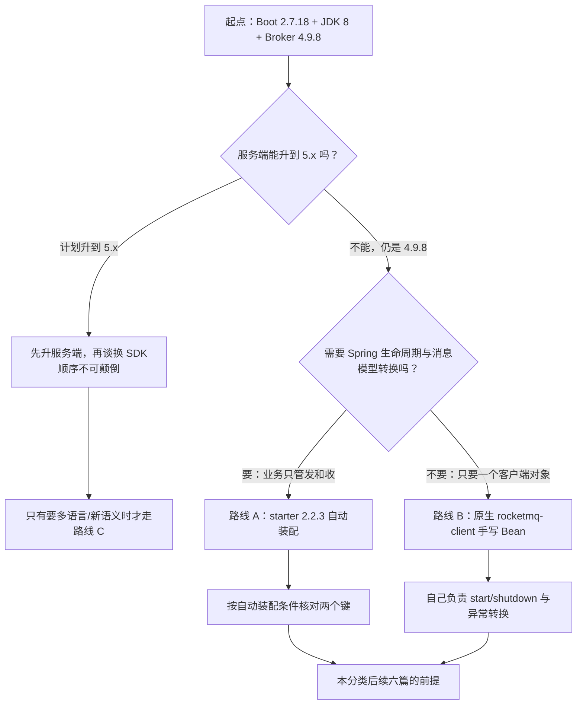
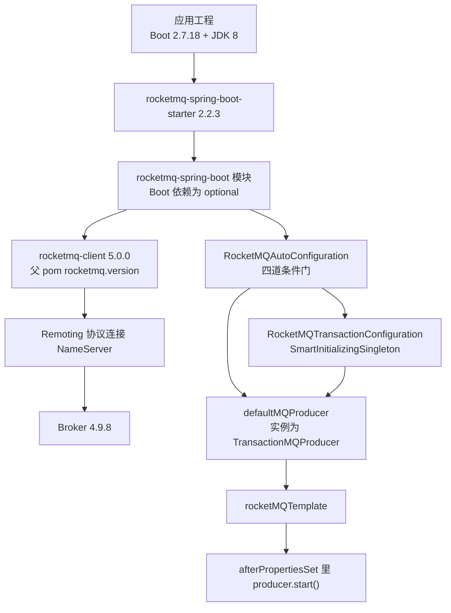

> [!NOTE] 证据口径
> 本篇不搭建、不运行任何真实工程。文中出现的「实测」一律指**静态取证**——读 `rocketmq-spring` 仓库 tag
> `rocketmq-spring-all-2.2.3` 的源码行号、扫 `rocketmq-all-4.9.8-bin-release` 发行包里 jar 的类结构与常量池；
> 不是运行读数。代码块里的 `// 预期输出:` 是按源码签名与上游文档结构推定的结果，不代表本机跑过。

## 为什么先定基线，再写 Spring Boot 集成代码？（痛点引入）

三类在 Spring Boot 项目里高频出现、且都能在源码里找到唯一解释的事故：

1. **模板 Bean 凭空消失**。新人只配了 `rocketmq.name-server`，代码里 `@Autowired RocketMQTemplate` 启动就报找不到 Bean。原因不是「starter 有 bug」，而是生产者的创建条件要求 `name-server` 与 `producer.group` 两个键同时存在（`autoconfigure/RocketMQAutoConfiguration.java` L89-91），少一个就没有生产者，连带模板也不生成（同文件 L157-159、L172-185）。
2. **定时消息静默无效**。照着 5.x 风格文档写了 `rocketMQTemplate.syncSendDeliverTimeMills(...)`，编译通过、启动正常，但消息不可能按你给的绝对时刻投递——4.9.8 侧不存在档位之外的定时入口。starter 自己的 javadoc 原文写着 `This function is only valid when the broker version is 5.0 or above`（`core/RocketMQTemplate.java` L541、L568、L596、L623），而 4.9.8 侧连对应的属性键都不存在。
3. **把 starter 的构建基线当成官方支持矩阵**。看到「2.2.3 的父 pom 写的是 Spring Boot 2.5.9」就断定不能配 Boot 2.7.18，或者反过来对外宣称「2.2.3 官方支持 Boot 2.7」——两种说法都不准，本篇第「版本基线」一节给出可守的口径。

| 没有基线时的痛苦 | 有基线之后的改善 |
|---|---|
| Bean 没注入，靠猜配置项、逐个试错 | 直接对照自动装配条件表，一眼定位到缺哪个键 |
| 六种消息挨个试 API，试出「定时不生效」这种静默故障 | 发送入口与可用性在映射表里一行一行标明，含 4.9.8 上不可用的显式标注 |
| 依赖冲突、版本口径靠口口相传，新人接手即翻车 | 客户端与 Broker 的三种搭配及其后果写死，附源码行号与 jar 实物证据 |
| 参数不知默认值，出问题只能全量覆写 | `rocketmq.*` 三段配置键逐行给字段与默认值出处 |
| 启动失败只看到一串堆栈 | 排查清单把每条异常文案钉回它出自哪一行源码 |

> ### 💡 新人小结：为什么「集成」要先量尺寸？
>
> 把 Spring Boot 接 RocketMQ 想象成**给老房子装新电器**：
> - 电压制式 = 版本基线：墙上的插座（Broker 4.9.8）是固定的，你不能指望换个插头形状（客户端版本）就改变供电制式；
> - 空开是否合闸 = 自动装配条件：电器（`rocketMQTemplate`）不工作，多数不是坏了，而是某一路空开（`name-server`、`producer.group`）没合上；
> - 说明书上的额定参数 = 配置键默认值：不写就用出厂值，写了就必须知道自己改的是哪一档；
> - 电器本身支持的功能 = 消息类型能力：带不来的功能（任意时刻定时）不是接线问题，是这个制式根本没有那一路电。
>
> **一句话：先量制式、再查空开、最后才拧螺丝——顺序反了，排查会一路白跑。**

本文的范围与路线：

```
版本基线 → 路线选型 → 依赖与客户端搭配后果 → rocketmq.* 默认值 → 自动装配条件 → 前置 Topic/Group → 六类消息 API 映射 → 启动失败定位
定死什么     走哪条       哪些能力坏掉          能调什么键      为什么不生效      建什么         怎么写            报错怎么读
```

---

## 术语表：本文每一个名词都先解释再使用

下文引用 starter 源码时，统一指 `rocketmq-spring` 仓库 tag `rocketmq-spring-all-2.2.3`，路径前缀 `rocketmq-spring-boot/src/main/java/org/apache/rocketmq/spring/`，行号为该 tag 实测；4.9.8 的实物证据指 `rocketmq-all-4.9.8-bin-release` 的 `lib/*.jar` 内 class 文件符号扫描结果。

| 术语 | 全称 | 通俗含义 | 在本文中的角色 |
|---|---|---|---|
| starter | `rocketmq-spring-boot-starter` | 一组「按约定把配置变成 Bean」的依赖打包，你写配置它建对象 | 路线 A 的载体，版本 2.2.3 |
| 自动装配 | auto-configuration | Spring Boot 按「类在不在、键配没配、Bean 有没有别人抢」三类条件决定要不要建 Bean | 第「自动装配」一节逐条拆解它的命中条件 |
| Remoting 协议 SDK | `rocketmq-client` | 4.x 时代就有的 Java 客户端，走自定义 TCP 私有协议 | starter 底层实际用的客户端；也是路线 B 的主体 |
| gRPC SDK | `rocketmq-client-java` | 5.x 新写的多语言客户端，走 gRPC + Protocol Buffers | 路线 C；官方明确仅支持 5.0 及以上服务端 |
| NameServer | 命名服务器 | 路由中心，客户端先问它「这个 Topic 在哪台 Broker 上」 | `rocketmq.name-server` 配的正是它的地址 |
| Broker | 消息服务器 | 真正存消息、投递消息的进程，本环境为 4.9.8 | 决定哪些消息类型能力存在 |
| Topic | 主题 | 消息的一级分类地址，发送前应先建好 | 第「前置准备」一节讲建法与队列数 |
| Consumer Group | 消费组 | 一组消费者的身份标识，同组订阅必须一致 | `@RocketMQMessageListener.consumerGroup` 必填项 |
| Producer Group | 生产组 | 一类生产者的标识，事务消息回查要用它找回同类实例 | `rocketmq.producer.group`，缺它就没有生产者 Bean |
| `delayLevel` | 延迟档位 | 4.x 的延时只有 18 个预设档位，传的是档位号不是秒数 | 延时消息唯一的 4.9.8 可用入口 |
| 定时（TIMER） | 任意时刻投递 | 5.x 能力：指定秒数、毫秒数或绝对时间戳投递 | 三方法在 4.9.8 上不可用，本文显式标注 |
| `TransactionMQProducer` | 事务生产者 | `DefaultMQProducer` 的子类，多了半消息与回查能力 | starter 实际建的就是它，见 `support/RocketMQUtil.java` L264/L267 |
| ACL | Access Control List，访问控制 | 用 accessKey/secretKey 做鉴权 | 影响 starter 是否关闭 vip channel 与 RPC Hook |

---

## 三条集成路线：怎么选型？

同一个「在 Spring Boot 里发 RocketMQ 消息」的需求，工程上有三条可走的路，差别不在语法糖，而在**协议、服务端代际与生命周期归属**。

| 对比维度 | 路线 A：`rocketmq-spring-boot-starter` 2.2.3 | 路线 B：原生 `rocketmq-client` 手写 Bean | 路线 C：5.x gRPC 客户端 `rocketmq-client-java` |
|---|---|---|---|
| 底层协议 | Remoting（starter 依赖 `rocketmq-client`，模块 pom L67-76） | Remoting | gRPC + Protocol Buffers |
| 服务端代际约束 | 客户端与服务端分属两代时需逐项确认（见下一节三种搭配） | 与 4.x 文档同代：《普通消息发送》给的依赖示例坐标就是 `rocketmq-client`，示例版本写 4.9.4（`docs/02-producer/02message1.md` L29-35），本环境按 4.9.8 发行包使用同一 API 族 | 官方原文：不支持 4.x，`gRPC SDK 仅支持版本大于等于5.0的服务端`（`versioned_docs/version-5.0/13-sdk/01overview.md` L72） |
| 与 Boot 2.7.18 / JDK 8 的关系 | starter 构建基线 JDK 1.8（父 pom `java.version=1.8`），Boot 由应用侧提供 | 与 Boot 无关，纯 Java API | 属 5.x 技术栈，与本环境的 Boot 2.x + JDK 8 不同代 |
| 生产者生命周期 | 模板实现 `InitializingBean`/`DisposableBean`：`afterPropertiesSet()` 里 `producer.start()`（L1127-1131），`destroy()` 里 `producer.shutdown()`（L1157-1165） | 自己调 `start()`/`shutdown()`，容器关闭时需自己挂 | 由客户端自己的工厂入口管理 |
| 消息类型入口 | 同步/异步/单向/批量/档位延时/顺序/事务/请求应答共八组方法，见映射表 | 同样的能力要用原生 `Message`、`MessageQueueSelector`、`TransactionListener` 手写 | 语义对齐 5.x，含任意时刻定时 |
| 事务本地监听器 | `@RocketMQTransactionListener` + `RocketMQLocalTransactionListener` 两方法即可 | 手写 `TransactionListener`（`executeLocalTransaction`/`checkLocalTransaction`） | 5.x 侧为另一套 API，与 Remoting 不兼容（同文档 L76） |
| 消费端形态 | `@RocketMQMessageListener` 声明式 | 手写 `DefaultMQPushConsumer`/`DefaultLitePullConsumer` 并注册监听 | 5.x PushConsumer/SimpleConsumer 口径 |
| 能力覆盖自述 | 模块 README 原文：`Produce and Consume Spring Message`、`Send (half) Message in Transaction` | 上游 4.x 文档《普通消息发送》整章 | 上游 5.x SDK 文档 |
| 本环境结论 | ✅ 默认选择 | 适合需要完全掌控客户端对象的场景 | ❌ 服务端仍是 4.9.8 时不可用 |

选型决策流程如下，图中每个判断点都能在本文找到对应依据行：



读图要点：唯一能直接排除掉路线 C 的判据是**服务端代际**——官方 FAQ 一句话写死（`gRPC SDK 仅支持版本大于等于5.0的服务端`），并且换 SDK 需要对照修改代码（L76）。而 A 与 B 之间不是「高级 vs 低级」的关系：B 用到的所有能力 A 都有对应入口，区别在于生命周期与异常转换归谁管——`RocketMQTemplate` 的 `afterPropertiesSet()` 与 `destroy()`（L1127-1165）就是路线 B 里你必须自己写的那两段。

| 写法 | 判断 | 依据 |
|---|---|---|
| ✅ 只注入 `RocketMQTemplate`，不自己造 `DefaultMQProducer` | 推荐 | 自动装配会建出 `TransactionMQProducer` 实例（`RocketMQUtil.java` L264/L267），模板天然可做事务发送 |
| ✅ 需要多集群时，空子类 + `@ExtRocketMQTemplateConfiguration` | 推荐 | 官方示例 `ExtRocketMQTemplate` 全文就是一个 `extends RocketMQTemplate` 的空类加注解，注解上写 `nameServer = "${demo.rocketmq.extNameServer}"` 等占位符 |
| ❌ 自己声明 `new DefaultMQProducer()` Bean 并期待模板还能做事务 | 不推荐 | 自动装配因 `@ConditionalOnMissingBean`（L90）退让，事务注册时 `(TransactionMQProducer) rocketMQTemplate.getProducer()` 强转（`RocketMQTransactionConfiguration.java` L69、L72、L74）会抛 `ClassCastException` |
| ❌ 服务端 4.9.8 却引入 `rocketmq-client-java` | 明确不可用 | `versioned_docs/version-5.0/13-sdk/01overview.md` L72 |

---

## 版本基线：2.2.3 的构建基线与 Boot 2.7.18 怎么组合才不越界

`org.apache.rocketmq:rocketmq-spring-boot-parent:2.2.3` 的 pom 属性实测如下：

| 属性 | 值 | 含义 |
|---|---|---|
| `java.version` | `1.8` | starter 的编译目标，与本环境 JDK 8 一致 |
| `spring.boot.version` | `2.5.9` | 它构建时用的 Boot 版本 |
| `spring.version` | `5.3.20` | 它构建时用的 Spring Framework 版本 |
| `rocketmq.version` | `5.0.0` | 它默认带进来的 `rocketmq-client` 版本 |
| `jackson.version` | `2.11.1` | 序列化相关依赖的版本管理点 |

**口径必须这样表述**：2.2.3 的**构建基线**是 Boot 2.5.9 / Spring 5.3.20 / 客户端 5.0.0 / JDK 1.8；本环境把 Boot 升到 2.7.18，属于**同一 Boot 大版本内的向后兼容使用**，不是 starter 的构建基线。因此：

- ✅ 可以写：「starter 2.2.3 构建于 Boot 2.5.9，在 Boot 2.7.x + JDK 8 上按 Boot 2.x 系兼容使用」。
- ❌ 不可以写：「rocketmq-spring 2.2.3 官方支持 Boot 2.7」——上游发布物里没有这句话。
- 版本序列事实：2.2.x 分支的最后一个是 2.2.3（再往上是 2.3.0 至 2.3.6，2.3.x 面向 Boot 3）。这就是**本环境钉死在 2.2.3 的原因**：JDK 8 与 Boot 2.x 把升级方向限死了。

依赖结构上有两点决定了这层组合为什么能跑：`rocketmq-spring-boot` 模块 pom 把 `spring-boot`、`spring-boot-autoconfigure`、两个 processor 全标了 `<optional>true</optional>`（L42-61），它们不会传给应用，Boot 由工程自己提供；而 `spring-messaging`、`spring-core`、`spring-context`、`spring-aop`、`jackson-databind`、`jackson-datatype-jsr310` 是普通 compile 依赖（L81-104），版本最终由工程侧的版本管理决定。

### 客户端版本与 Broker 4.9.8 的三种搭配及其后果

starter 2.2.3 默认带 `rocketmq-client 5.0.0`（父 pom 属性）。工程可以保留它，也可以显式钉回 4.9.8；这一票直接决定下面这张表的哪一行落在你头上。

| 搭配 | 装配与常规发送 | 定时（任意时刻） | 依据 |
|---|---|---|---|
| ① 保留 starter 自带客户端（5.0.0）连 Broker 4.9.8 | 六类消息的入口都在，档位延时可用 | 这三个入口依赖的是 5.0.0 客户端的定时属性，**4.9.8 侧没有对应的属性键可被消费**：`rocketmq-common-4.9.8.jar` 中 `MessageConst` 的键集合里没有任何 `TIMER` 前缀符号 | `lib/rocketmq-common-4.9.8.jar` 常量池扫描；`core/RocketMQTemplate.java` L541/L568/L596 javadoc |
| ② 客户端显式钉到 4.9.8 连 Broker 4.9.8 | 除定时三方法外，starter 用到的 setter 与发送方法在 4.9.8 里都存在 | **这条路径会坏**：`RocketMQTemplate` L642/L645/L648 调 `setDelayTimeSec`/`setDelayTimeMs`/`setDeliverTimeMs`，而 4.9.8 的 `Message.class` 只有 `getDelayTimeLevel`/`setDelayTimeLevel`，这三个 setter 不存在 → 运行时找不到方法 | 扫描 `Message.class` 的结论；调用点见 `RocketMQTemplate.java` L631-664 |
| ③ 换成 5.x gRPC 客户端连 Broker 4.9.8 | 不适用：starter 认的是 Remoting 客户端 | 不适用 | 官方：`gRPC SDK 仅支持版本大于等于5.0的服务端`（`versioned_docs/version-5.0/13-sdk/01overview.md` L72） |

搭配 ② 的「其余都在」也是逐条扫 4.9.8 发行包的 class 文件符号表得到的，不是推测：`rocketmq-client-4.9.8.jar` 的 `org/apache/rocketmq/client/ClientConfig.class` 里 `setNamespace`、`setInstanceName`、`setNamesrvAddr` 都在，`producer/DefaultMQProducer.class` 里 `setSendMsgTimeout`、`setMaxMessageSize`、`setCompressMsgBodyOverHowmuch`、`setVipChannelEnabled`、`setUseTLS`、`send(Collection, long)`、`sendMessageInTransaction` 都在，`producer/TransactionMQProducer.class` 里 `setTransactionListener`、`setExecutorService` 也在。换句话说：**把客户端钉到 4.9.8 只会让「定时三件套」坏掉，不会让自动装配或事务坏掉**——这也是为什么后面那张 API 映射表里只有定时那一行需要打 ❌。

表述纪律：4.9.8 侧不存在这些属性键与档位外的定时入口，官方 javadoc 亦注明方法仅在 Broker 5.0 及以上有效；不要写成「Broker 会报错」——那没有依据。

```xml
<!-- ✅ 推荐：沿用 starter 自带的 Remoting 客户端，工程侧只锁 starter 版本 -->
<dependency>
  <groupId>org.apache.rocketmq</groupId>
  <artifactId>rocketmq-spring-boot-starter</artifactId>
  <version>2.2.3</version><!-- 构建基线：Boot 2.5.9 / Spring 5.3.20 / 客户端 5.0.0 / JDK 1.8 -->
</dependency>

<!-- ❌ 不推荐做法（仅展示）：为「和服务端版本对齐」把客户端钉到 4.9.8 -->
<!-- 后果不是编译失败，而是 syncSendDelayTimeSeconds / syncSendDelayTimeMills / syncSendDeliverTimeMills -->
<!-- 三条路径在运行时找不到 4.9.8 Message 里不存在的 setter（RocketMQTemplate.java L642/L645/L648） -->
<dependency>
  <groupId>org.apache.rocketmq</groupId>
  <artifactId>rocketmq-client</artifactId>
  <version>4.9.8</version><!-- 若确需这样做，必须同时禁用上面三个入口 -->
</dependency>
```

参数解释：`rocketmq-spring-boot-starter` 的坐标由上游发布物给出，2.2.3 是 2.2.x 最后一个 tag；第二个块的 `<version>4.9.8</version>` 只影响 `rocketmq-client` 一个坐标，父 pom 的 `rocketmq.version` 属性管的是 starter 自己的构建，不会覆盖工程里显式写死的版本，这正是搭配 ② 的形成方式。

---

## `rocketmq.*` 配置键与全量默认值

三段前缀的绑定关系（`autoconfigure/RocketMQProperties.java`）：类上是 `@ConfigurationProperties(prefix = "rocketmq")`（L27）；`nameServer`（L33）、`accessChannel`（L38）、`producer`（L40）、`pullConsumer`（L47）、`consumer`（L57）五个字段对应 `rocketmq.name-server`、`rocketmq.access-channel`、`rocketmq.producer.*`、`rocketmq.pull-consumer.*`、`rocketmq.consumer.*`。两个前缀名有源码直证：`defaultLitePullConsumer` 的条件里写的是 `"pull-consumer.group"`、`"pull-consumer.topic"`（L127），`@RocketMQMessageListener` 的占位符默认值写的是 `${rocketmq.consumer.access-key:}`（`annotation/RocketMQMessageListener.java` L33）。

顶层两键：

| 配置键 | 字段与行号 | 默认值 | 说明 |
|---|---|---|---|
| `rocketmq.name-server` | `nameServer`，L33 | 无（未配即不建生产者） | 格式 `host:port;host:port`（L30-32 注释原文） |
| `rocketmq.access-channel` | `accessChannel`，L38 | 无 | 有效值 LOCAL、CLOUD（L35-37 注释原文）；生产者在 L109-111 用 `AccessChannel.valueOf(...)` 转枚举 |

`rocketmq.producer.*` 段（14 个键，默认值逐行取自字段初始化）：

| 配置键 | 默认值 | 行号 | 对应客户端 setter |
|---|---|---|---|
| `rocketmq.producer.group` | 无（必填） | L104 | 构造入参，见 `RocketMQUtil.java` L258-267 |
| `rocketmq.producer.namespace` | 无 | L109 | `setNamespace`（L119） |
| `rocketmq.producer.sendMessageTimeout` | `3000`（毫秒） | L114 | `setSendMsgTimeout`（L112） |
| `rocketmq.producer.compressMessageBodyThreshold` | `1024 * 4` | L119 | `setCompressMsgBodyOverHowmuch`（L116） |
| `rocketmq.producer.retryTimesWhenSendFailed` | `2` | L125 | `setRetryTimesWhenSendFailed`（L113） |
| `rocketmq.producer.retryTimesWhenSendAsyncFailed` | `2` | L131 | `setRetryTimesWhenSendAsyncFailed`（L114） |
| `rocketmq.producer.retryNextServer` | `false` | L136 | `setRetryAnotherBrokerWhenNotStoreOK`（L117） |
| `rocketmq.producer.maxMessageSize` | `1024 * 1024 * 4` | L141 | `setMaxMessageSize`（L115） |
| `rocketmq.producer.accessKey` | 无 | L146 | 与 secretKey 同时非空才启用 ACL（`RocketMQUtil.java` L261-265） |
| `rocketmq.producer.secretKey` | 无 | L151 | 启用 ACL 时同时 `setVipChannelEnabled(false)`（L265） |
| `rocketmq.producer.enableMsgTrace` | `false` | L156 | 传入 `createDefaultMQProducer`（L106） |
| `rocketmq.producer.customizedTraceTopic` | `TopicValidator.RMQ_SYS_TRACE_TOPIC` | L161 | 同上 |
| `rocketmq.producer.tlsEnable` | `false` | L166 | `setUseTLS`（L118） |
| `rocketmq.producer.instanceName` | `"DEFAULT"` | L171 | `setInstanceName`（L120） |

`rocketmq.pull-consumer.*` 段与 `rocketmq.consumer.*`（Push）段：

| 配置键 | 默认值 | 行号 | 说明 |
|---|---|---|---|
| `rocketmq.pull-consumer.group` | 无 | L290 | 与 name-server、topic 三键齐才建 Bean（L125-127） |
| `rocketmq.pull-consumer.namespace` | 无 | L295 | |
| `rocketmq.pull-consumer.topic` | 无 | L300 | 三键里唯一和订阅地址有关的必填项 |
| `rocketmq.pull-consumer.messageModel` | `"CLUSTERING"` | L305 | `MessageModel.valueOf(...)`（L139），有效值 CLUSTERING、BROADCASTING |
| `rocketmq.pull-consumer.selectorType` | `"TAG"` | L310 | `SelectorType.valueOf(...)`（L140），有效值 TAG、SQL92 |
| `rocketmq.pull-consumer.selectorExpression` | `"*"` | L315 | |
| `rocketmq.pull-consumer.accessKey` / `.secretKey` | 无 | L320 / L325 | 成对非空才建 ACL RPC Hook（`RocketMQUtil.java` L292-294） |
| `rocketmq.pull-consumer.pullBatchSize` | `10` | L330 | `setPullBatchSize`（L299） |
| `rocketmq.pull-consumer.enableMsgTrace` | `false` | L335 | |
| `rocketmq.pull-consumer.customizedTraceTopic` | `TopicValidator.RMQ_SYS_TRACE_TOPIC` | L340 | |
| `rocketmq.pull-consumer.tlsEnable` | `false` | L345 | |
| `rocketmq.pull-consumer.instanceName` | `"DEFAULT"` | L350 | |
| `rocketmq.consumer.*` | 继承 `PullConsumer` 全部键 | L457 | `PushConsumer extends PullConsumer`（L457），键名前缀换成 `rocketmq.consumer.` |
| `rocketmq.consumer.listeners.<group>.<topic>.enabled` | `Map` 初值空（监听器默认启用） | L465 | 按消费组启停监听器。注意字面不一致：注释里的示例写作 `rocketmq.push-consumer.listeners.<group-name>.<topic-name>.enabled`（L52），而这个 Map 挂在字段名 `consumer` 上（L57），本环境按 `rocketmq.consumer.` 使用 |

三个容易忽略的结构性事实：

1. `producer` 字段**没有初始化**（L40），而 `pullConsumer`、`consumer` 各自 `= new ...()`（L47、L57）。所以只配 `rocketmq.name-server` 时，`getProducer()` 返回 null；自动装配靠 L91 的 `@ConditionalOnProperty` 保证进入方法体时 `producer.group` 一定存在，才敢在 L93 直接 `rocketMQProperties.getProducer().getGroup()`。
2. Push 消费端的主配置入口不是 `rocketmq.consumer.*`，而是 `@RocketMQMessageListener` 注解；`rocketmq.consumer.*` 这一段在这里只承担「给注解属性提供占位符默认值」的角色（`annotation/RocketMQMessageListener.java` L32-36 的四个 `${rocketmq.consumer.*}` 表达式）。
3. 默认值与 4.x 客户端官方参数表逐项一致：`sendMsgTimeout` 3000 毫秒、`compressMsgBodyOverHowmuc` 1024*4、`retryTimesWhenSendFailed` 2、`retryTimesWhenSendAsyncFailed` 2、`retryAnotherBrokerWhenNotStoreOK` false、`maxMessageSize` 1024*1024*4（`docs/06-parameterConfiguration/01local.md` L72-83）。也就是说，**不改这些键就等于客户端默认行为**，改之前要清楚自己在偏离默认。

```properties
# ✅ 最小可用配置：两个键决定生产者与模板是否存在
rocketmq.name-server=127.0.0.1:9876
rocketmq.producer.group=my-producer-group
# 下面两行来自官方示例 application.properties 原文（rocketmq-produce-demo 模块）
rocketmq.producer.sendMessageTimeout=300000
rocketmq.producer.tls-enable=false
```

写法说明：官方示例同一个文件里同时出现 `sendMessageTimeout`（驼峰）与 `tls-enable`（连字符）两种键名形式，两者都出现在 `rocketmq-produce-demo` 的 `application.properties` 中；本篇只对这两种形式在示例中共存这一事实负责，不去推断未出现在示例里的其它形式。

---

## 自动装配：生效与失效的确切条件

条件链自上而下四道门，任何一道不合，Bean 就不出现；每道门都能指到具体行号。四道门分别是：①类级的 `@ConditionalOnClass(MQAdmin.class)`（L56）；②类级的 `name-server` 属性条件（L57）；③生产者与 Lite Pull 消费者各自的键条件（L89-91、L125-127）；④模板 Bean 的 `AnyNestedCondition` 与同名让位（L157-159、L172-185）。

| 层级 | 源码条件 | 行号 | 不满足时的表现 |
|---|---|---|---|
| 类级：依赖存在 | `@ConditionalOnClass({MQAdmin.class})` | L56 | 整个配置类不评估。4.9.8 发行包里这个类是有的（`lib/rocketmq-client-4.9.8.jar` 的 `org/apache/rocketmq/client/MQAdmin.class`），正常依赖下它不是坑 |
| 类级：主开关 | `@ConditionalOnProperty(prefix="rocketmq", value="name-server", matchIfMissing=true)` | L57 | 注意 `matchIfMissing=true`：**缺 `name-server` 并不会让配置类退让**，它会走下去并在 L80-87 打一条 warn |
| 装配导入 | `@Import({MessageConverterConfiguration, ListenerContainerConfiguration, ExtProducerResetConfiguration, ExtConsumerResetConfiguration, RocketMQTransactionConfiguration, RocketMQListenerConfiguration})` | L58-59 | 六个内部配置类一起进容器，事务与监听器都在这里挂上 |
| 生产者 Bean | `@ConditionalOnMissingBean(DefaultMQProducer.class)` + `@ConditionalOnProperty(prefix="rocketmq", value={"name-server","producer.group"})` | L89-91 | 两个键缺任一 → 没有 `defaultMQProducer`；你自己声明了 `DefaultMQProducer` → 自动装配让位，用你的 |
| 生产者参数校验 | `Assert.hasText(nameServer, "[rocketmq.name-server] must not be null")`、`Assert.hasText(groupName, "[rocketmq.producer.group] must not be null")` | L96-97 | 文案是这两句原文，出现即说明键没落到 Environment |
| Lite Pull 消费者 Bean | `@ConditionalOnMissingBean(DefaultLitePullConsumer.class)` + `@ConditionalOnProperty` 需要 `name-server`、`pull-consumer.group`、`pull-consumer.topic` | L125-127 | 三键不齐就没有 `defaultLitePullConsumer`；三句 `Assert` 原文在 L134-136 |
| 模板 Bean | `@Conditional(ProducerOrConsumerPropertyCondition.class)` + `@ConditionalOnMissingBean(name="rocketMQTemplate")` | L157-159 | 条件类是 `AnyNestedCondition`：`@ConditionalOnBean(DefaultMQProducer.class)` 或 `@ConditionalOnBean(DefaultLitePullConsumer.class)` 任一命中（L172-185）。两者都没有 → 模板也不出现 |
| 模板内容 | `containsBean(PRODUCER_BEAN_NAME)` 才 `setProducer(...)`，`containsBean(CONSUMER_BEAN_NAME)` 才 `setConsumer(...)`，并注入消息转换器 | L162-168 | 只配 pull-consumer 时模板存在但 `getProducer()` 为 null（字段声明见 L65、L67） |
| 生命周期 | `afterPropertiesSet()` 中 `producer.start()`；`consumer.start()` 包在 try 里，失败只 log.error | L1127-1139 | 生产者启动失败会把异常抛给容器；Lite Pull 启动失败只留日志 |
| 销毁 | `destroy()` 中 `producer.shutdown()`、`consumer.shutdown()` | L1157-1165 | 模板由 `@Bean(destroyMethod = "destroy")` 挂上（L157） |
| 事务装配 | `RocketMQTransactionConfiguration implements SmartInitializingSingleton`，`afterSingletonsInstantiated()` 遍历带 `@RocketMQTransactionListener` 的 Bean 逐个注册 | L41、L52-58 | 事务监听器是在**所有单例实例化之后**才挂到模板的生产者上，不在 Bean 创建时 |

依赖与装配链路如下图，左列是「谁的版本」，右列是「谁的 Bean」：



读图要点：上半支（`C → D → E → F`）是**版本世界**——starter 的 Boot 依赖是 optional，所以运行期 Boot 由工程提供，客户端版本由父 pom 属性管理；下半支（`C → G → H → I → J`，加上旁挂的 `K`）是**Bean 世界**——四道条件门决定 `defaultMQProducer` 与 `rocketMQTemplate` 是否存在。图里最关键的一个节点是 `H`：它的实际类型是 `TransactionMQProducer`，来自 `RocketMQUtil.createDefaultMQProducer(...)` 的两个分支都 `new TransactionMQProducer(...)`（L264 带 ACL、L267 不带 ACL），方法声明的返回类型才是 `DefaultMQProducer`。**这条事实决定了「默认模板可以直接做事务发送」这个结论**，反过来，任何声称「starter 默认模板调 `sendMessageInTransaction` 必抛 `ClassCastException`」的说法都是错的。

「配了却不生效」的四条定位路径，按顺序执行：

1. 先确认 `MQAdmin` 在类路径（条件 L56）——若做过 exclude，后面所有条件都不会评估。
2. 再确认 `rocketmq.name-server` 与 `rocketmq.producer.group` 两个键都出现在 Environment 里（条件 L91）。两者的表现不一样：缺 `name-server` 时能在日志里读到 L85 那条 warn 原文（含上游原有的拼写 `rockertmq`）；缺 `producer.group` 时没有任何专属日志，只会让 `defaultMQProducer` 与 `rocketMQTemplate` 两个 Bean 一起消失。
3. 检查是否自己声明过 `DefaultMQProducer` 或名为 `rocketMQTemplate` 的 Bean：前者触发 L90 的 `@ConditionalOnMissingBean` 让位，后者触发 L159 的让位，两者都会让你配的 `rocketmq.producer.*` 参数彻底不被消费。
4. 若 Bean 都在但发送报错，转入「常见启动失败」清单第 5 至 8 行。

---

## 前置准备：Topic 与消费组先建再用

上游《普通消息发送》第一句就是排期要求：**发送消息前需要确保目标主题已经被创建和初始化**，并给出用 mqadmin 建主题的命令与返回示例（`docs/02-producer/02message1.md` L5、L11-15）；同一段还提醒安装包默认开启 `autoCreateTopicEnable`，该特性仅推荐初期测试使用，生产环境强烈建议管理所有主题的生命周期、关闭自动创建参数（L7、L9）。

| 对象 | 上游给的默认口径 | 本环境的做法 |
|---|---|---|
| Topic | 4.x 参数表里服务端「是否自动创建主题」一行的默认值栏是**空的**（`docs/06-parameterConfiguration/02server.md` L26），不许按相邻行推定 | 用 `mqadmin updateTopic` 显式建，参数与队列数见 [mqadmin 命令参考：主题、集群与 Broker](/docs/06-operations/命令行工具/mqadmin命令参考-主题集群与Broker/) |
| 消费组 | 上游明写「是否自动创建消费组」默认 `true`（同文件 L25） | 测试可靠默认值；生产仍建议显式 `updateSubGroup`（该命令参数在 [mqadmin 命令参考：消息、消费与连接](/docs/06-operations/命令行工具/mqadmin命令参考-消息消费与连接/)） |
| 队列数 | 客户端表写自动创建时 `defaultTopicQueueNums = 4`（`01local.md` L76），服务端表写「主体在一个 broker 上创建队列数量」为 8（`02server.md` L67）——同名不同值，两处不要混用 | 建 Topic 时用 `-w`/`-r` 明写，不依赖默认 |
| 权限 | `-p` 取值 W=2、R=4、WR=6 | 与站内 mqadmin 页一致，见同一路径的 `updateTopic` / `updateTopicPerm` 小节 |
| `access-channel` | 有效值 LOCAL、CLOUD（`RocketMQProperties.java` L35-37）；生产者在 L109-111 转枚举 | 本环境 LOCAL 或不配 |

```bash
# ✅ 推荐：先把主题建出来再启动应用（顺序与 4.x 文档一致）
sh bin/mqadmin updateTopic -n 127.0.0.1:9876 -c DefaultCluster -t order-topic -w 8 -r 8 -p 6
sh bin/mqadmin topicList -n 127.0.0.1:9876

# ❌ 不推荐：靠 autoCreateTopicEnable 让第一条消息凭空建出主题，队列数与权限全凭默认
# 上游明写该特性仅推荐初期测试使用（docs/02-producer/02message1.md L7-L9）
```

预期输出与说明：`updateTopic` 成功后由 Broker 返回一条 TopicConfig 结构（形状示例见 `docs/02-producer/02message1.md` L13-14 的原文输出，含 `readQueueNums`、`writeQueueNums`、`perm`、`order` 等字段）。**以上是依据上游文档与源码路径推定的结构，不是本机运行读数**；本篇不涉及任何实测耗时或消息条数。

发送地址的解析规则只有一条，值得在起点就记牢：destination 形如 `topic:tag`，按**第一个冒号**切成两段，前段是 topic、后段整段作为 tags（`support/RocketMQUtil.java` L172-178）。因此一次调用只能落一个 topic，批量发送同样如此——`syncSend(String, Collection)` 在转换每条消息时统一写入同一个 destination（`core/RocketMQTemplate.java` L524），这与上游「同一批 batch 中 topic 必须相同」的约束一致（`docs/02-producer/05message4.md` L28）。

> ### 💡 新人小结：Topic 与 Group 像什么？
>
> 把 Broker 想成一栋写字楼的**收发室**：
> - Topic = 专用的收发文柜抽屉：柜子得先由管理员装上去（`updateTopic`），否则第一个快递只能塞进公共架（自动创建，队列数与权限都不受控）；
> - `-w 8 -r 8` = 抽屉里竖着放几排格子：格子数直接决定后面能并行来取件的人有几个；
> - Consumer Group = 来取件的部门名称：上游默认允许「报了名字就给你登记」（`autoCreateSubscriptionGroup=true`），但正式做法是先在册子上写好；
> - destination 的冒号 = 柜号与格口的分隔符：只认第一个冒号，后半截整段（连同里面的其它冒号）都算格口名（`RocketMQUtil.java` L172-178）。
>
> **建柜子永远在发快递之前——顺序对了，后面的排障量就小了。**

---

## 六类消息到 starter API 的总映射

六类消息的业务场景口径，上游一段话给全了：电商超时未支付关单用延时消息、同一订单严格顺序用顺序消息、日志高吞吐用批量消息、银行扣款与短信通知一致用事务消息（`docs/02-producer/01concept1.md` L92）。下表把每类落到 starter 的具体方法与源码行号，4.9.8 上不可用的显式标注。

| 消息类型 | 业务场景 | starter 入口（方法签名） | 源码行号 | 在 Broker 4.9.8 上 | 机制原理请转 |
|---|---|---|---|---|---|
| 普通 · 同步 | 要拿到发送结果再决定下一步 | `SendResult syncSend(String destination, Message<?> message)`；payload 版；带 timeout 版 | L475 / L707 / L487、L719 | ✅ 可用 | [普通消息与定时延时消息](/docs/04-message-features/消息类型/普通消息与定时延时消息/) |
| 普通 · 异步 | 不阻塞业务线程，靠回调收尾 | `void asyncSend(String, Message<?>, SendCallback)`；payload 版；带 timeout 版 | L909 / L933 / L891、L921 | ✅ 可用 | [发送重试、流控与消息存储清理](/docs/04-message-features/发送可靠性与存储/发送重试流控与消息存储清理/) |
| 普通 · 单向 | 埋点/日志，不关心结果 | `void sendOneWay(String, Message<?>)`；payload 版 | L1070 / L1090 | ✅ 可用 | [发送重试、流控与消息存储清理](/docs/04-message-features/发送可靠性与存储/发送重试流控与消息存储清理/)（重试参数按同步与异步两种模式分别给出，见 `RocketMQProperties.java` L122-131 的注释原文） |
| 批量 | 日志、账务明细补发 | `<T extends Message> SendResult syncSend(String, Collection<T> messages)`；带 timeout 版 | L498 / L510 | ✅ 可用；整批同 topic、不超 1MiB（`docs/02-producer/05message4.md` L28） | [普通消息与定时延时消息](/docs/04-message-features/消息类型/普通消息与定时延时消息/) |
| 延时 · 18 档 | 30 分钟未支付自动关单 | `SendResult syncSend(String, Message<?>, long timeout, int delayLevel)`，内部 `if (delayLevel > 0) rocketMsg.setDelayTimeLevel(delayLevel)` | L677 / L685-687 | ✅ 可用，且 4.9.8 **只有**这一条延时入口 | [普通消息与定时延时消息](/docs/04-message-features/消息类型/普通消息与定时延时消息/)（18 档表在该页） |
| 定时 · 任意时刻 | 对账、会议提醒须在绝对时刻触发 | `syncSendDelayTimeSeconds(...)`、`syncSendDelayTimeMills(...)`、`syncSendDeliverTimeMills(...)` | L548、L561 / L575、L588 / L603、L616；实现 L631-664 | ❌ **不可用**：javadoc 原文 `This function is only valid when the broker version is 5.0 or above`（L541、L554、L568、L581、L596、L609、L623）；降客户端到 4.9.8 时 `Message` 里连 setter 都没有 | [4.x 与 5.0 的差异及迁移选型](/docs/01-overview/版本演进与限制/4x与5x差异及迁移选型/) |
| 顺序 | 同一订单创建→支付→发货严格有序 | `syncSendOrderly(String, Message<?>, String hashKey[, long timeout[, int delayLevel]])`；payload 版；集合版；`asyncSendOrderly` 一组；`sendOneWayOrderly` 两版 | L732 / L745 / L759 / L790 / L803 / L816 / L829；L988 / L1004 / L1030 / L1042 / L1055；L1102 / L1122 | ✅ 可用；队列选择用 `SelectMessageQueueByHash`（字段初值见 L71） | [顺序消息](/docs/04-message-features/消息类型/顺序消息/) |
| 事务 | 扣款与下游通知最终一致 | `TransactionSendResult sendMessageInTransaction(String destination, Message<?> message, Object arg)` | L1176；未挂监听器时抛 `IllegalStateException("The rocketMQTemplate does not exist TransactionListener")` L1179-1180 | ✅ 可用，前提是生产者实例是 `TransactionMQProducer`（`RocketMQUtil.java` L264/L267） | [事务消息](/docs/04-message-features/消息类型/事务消息/) |
| 请求应答 | 发一条、同步等下游回一条 | `<T> T sendAndReceive(String, Message<?>, Type)` 一组重载与回调版 | L117-L449 区间；回调版 L278 起；接口 `core/RocketMQLocalRequestCallback.java` | ✅ 可用 | [普通消息与定时延时消息](/docs/04-message-features/消息类型/普通消息与定时延时消息/) |

消费侧的形态开关集中在一个注解上，八个关键属性与默认值如下（`annotation/RocketMQMessageListener.java`）：

| 属性 | 默认值 | 行号 | 一句话含义 |
|---|---|---|---|
| `consumerGroup` | 必填、需全局唯一 | L45（注释 L38-44） | 同组订阅必须一致，否则负载均衡不成立 |
| `topic` | 必填 | L50 | 订阅的主题 |
| `consumeMode` | `CONCURRENTLY` | L67 | 改 `ORDERLY` 才获得队列内顺序 |
| `selectorType` / `selectorExpression` | `TAG` / `"*"` | L57 / L62 | 过滤方式与表达式 |
| `messageModel` | `CLUSTERING` | L72 | 改 `BROADCASTING` 则每实例都收全量 |
| `consumeThreadNumber` | `20` | L87 | 并发度实际生效项 |
| `consumeThreadMax` | `64`，**已 `@Deprecated`** | L81-82 | 注释原文指出线程池用 `LinkedBlockingQueue` 且容量 `Integer.MAX_VALUE`，故该属性效果不好，应改用 `consumeThreadNumber`（issue#429） |
| `maxReconsumeTimes` | `-1` | L95 | 注释：并发模式下 -1 表示 16，顺序模式下 -1 表示 `Integer.MAX_VALUE` |
| `delayLevelWhenNextConsume` | `0` | L154 | 注释：-1 不重试直接进 DLQ，0 由 Broker 控制频率，>0 客户端控制频率 |
| `suspendCurrentQueueTimeMillis` | `1000` | L161 | 顺序模式下挂起当前队列的间隔，注释标明最小 10、最大 30000 |

> ### 💡 新人小结：延时档位与定时方法为什么不能混着记？
>
> 把 4.9.8 的延时能力想成**自动售货机的 18 个预设杯型**：你只能按按钮选「第 4 杯」（30 秒），不能对着机器喊「给我 25 秒」——预设里没有就是没有。
> - `delayLevel` 传的是**按钮编号**，不是秒数：源码只做 `if (delayLevel > 0) rocketMsg.setDelayTimeLevel(delayLevel)`（L685-687），传 30 的含义是「第 30 档」，而 4.x 的预设表只有 18 档；
> - 三个 `syncSendDelayTime*` 是**另一台机器**（Broker 5.x）才有的功能，4.9.8 的柜子里没有这个零件；
> - 顺带一个容易混的点：`DELAY` 与 `WAIT` 在 `RocketMQHeaders.java` 里是头部常量名（L34-35），与消息的系统属性 `DELAY` 同名；转换时已经是系统属性键的 header 不会再被写成 user property（`RocketMQUtil.java` L201-208）。
>
> **档位是「选一档」，定时是「说一个时刻」——两件事在 4.9.8 上只有一条路可走。**

---

## 常见启动失败与定位清单

| 现象 / 日志文案 | 确切依据（源码或上游文档） | 定位与处置 |
|---|---|---|
| 启动时报「找不到 `RocketMQTemplate` 类型的 Bean」 | 模板条件为「生产者 Bean 或 Lite Pull Bean 任一存在」（`RocketMQAutoConfiguration.java` L157-159、L172-185） | 先补 `rocketmq.name-server` 与 `rocketmq.producer.group`（L89-91）；两者只配其一不会出现模板 |
| 日志出现 `The necessary spring property 'rocketmq.name-server' is not defined, all rockertmq beans creation are skipped!` | `RocketMQAutoConfiguration.java` L80-87 的 `@PostConstruct checkProperties()`，文案含上游原有的拼写 `rockertmq` | 说明 `name-server` 缺失；配置类不会因此退让，但下游 Bean 都不会建 |
| 异常文案 `[rocketmq.producer.group] must not be null` | 同文件 L97 的 `Assert.hasText` 原文 | 键名写错或值为空；确认它进了 Environment（profile、配置中心、命令行参数逐层核对） |
| 异常文案 `[rocketmq.pull-consumer.topic] must not be null` | 同文件 L136 三句 Assert 之一 | pull-consumer 需要 name-server、group、topic 三键同时到位（L125-127） |
| `IllegalArgumentException` 于 accessChannel | L109-111 用 `AccessChannel.valueOf(accessChannel)`；有效值仅 LOCAL、CLOUD（`RocketMQProperties.java` L35-37） | 值改成两个枚举名之一，或整段不配 |
| 事务注册抛 `ClassCastException` | `RocketMQTransactionConfiguration.java` L69、L72、L74 的 `(TransactionMQProducer) rocketMQTemplate.getProducer()` | 条件式风险：应用自己声明了 `DefaultMQProducer` Bean（L90 让位）且用的是普通 `new DefaultMQProducer()`；删掉自建 Bean 交回自动装配 |
| `IllegalStateException ... is not instance of org.apache.rocketmq.spring.core.RocketMQLocalTransactionListener` | 同文件 L64-65 原文 | `@RocketMQTransactionListener` 标在了没实现该接口的类上；补 `executeLocalTransaction`/`checkLocalTransaction` 两个方法 |
| `IllegalStateException ... already exists RocketMQLocalTransactionListener` | 同文件 L70 原文 | 同一 `rocketMQTemplateBeanName` 被两个监听器抢；多模板时用 `@RocketMQTransactionListener(rocketMQTemplateBeanName = "extRocketMQTemplate")` 分开挂 |
| `sendMessageInTransaction` 抛 `The rocketMQTemplate does not exist TransactionListener` | `RocketMQTemplate.java` L1179-1180 | 监听器还没注册上：注册动作发生在所有单例实例化之后（`RocketMQTransactionConfiguration.java` L52-58），确认注解类是 Bean 且 `rocketMQTemplateBeanName` 指对 |
| 调用 `syncSendDeliverTimeMills` 在运行期找不到方法 | 调用点 `RocketMQTemplate.java` L648（另两处 L642、L645）；4.9.8 的 `Message.class` 无 `setDeliverTimeMs`/`setDelayTimeSec`/`setDelayTimeMs` | 保留 starter 自带客户端并改用 `syncSend(dest, msg, timeout, delayLevel)`（L677），或按 5.x 方案升级服务端 |
| 用了定时三方法，消息未按指定时刻投递 | 4.9.8 侧既没有 `TIMER` 属性键（`MessageConst` 扫描），也没有档位之外的定时入口；官方 javadoc 亦注明这三个方法仅在 Broker 5.0 及以上有效（`RocketMQTemplate.java` L541、L568、L596） | 这是搭配 ① 的后果；4.9.8 上的唯一延时出口是档位入参（L677），要任意时刻请先升服务端 |
| 生产者起来但发送找不到主题 / 连不上 NameServer | 客户端寻址优先级：代码 `setNamesrvAddr` > `-Drocketmq.namesrv.addr` > 环境变量 `NAMESRV_ADDR` > HTTP 静态服务器寻址，且客户端默认每 2 分钟刷新一次地址（`docs/06-parameterConfiguration/01local.md` L9-L43、L53） | 用 `rocketmq.name-server` 显式指定（L108 会落到 `setNamesrvAddr`）；主题侧按上一节的 `updateTopic` 先建 |
| 消费者 Bean 在但消息没进监听器 | `rocketmq.consumer.listeners.<group>.<topic>.enabled` 可关闭监听器（`RocketMQProperties.java` L465，注释示例原文见 L48-56），默认为启用 | 核对是否有该键被置 false；订阅一致性与消费重试见 [消息过滤 Tag 与 SQL92](/docs/05-consumption/消费模型/消息过滤Tag与SQL92/)、[消费重试与死信队列](/docs/05-consumption/均衡进度与重试/消费重试与死信队列/) |
| 本地集群起不来，连排障对象都没有 | 单机部署与消息收发链路见 [本地二进制部署与消息收发](/docs/03-quickstart/单机部署/本地二进制部署与消息收发/) | 先按该页把 NameServer 与 Broker 拉起来，再回头看本篇条件表 |

写法上的两条红线，成对记住：

| 判断 | 做法 | 理由 |
|---|---|---|
| ✅ 推荐 | 排查顺序固定为「类在不在 → 键在不在 → Bean 有没有被抢 → 生命周期抛没抛」 | 这四步正好对应 L56、L91、L90/L159、L1127-1139 四组源码条件 |
| ❌ 不推荐 | 一上来就往工程里加自建 `RocketMQTemplate` Bean「自己接生产者」 | L159 的 `@ConditionalOnMissingBean(name="rocketMQTemplate")` 会让整条自动装配链不再产出模板，你配的 `rocketmq.producer.*` 十四项参数（L104-171）全部失效 |

---

## 要点总结

1. **三条路线里只有两条能落在本环境**：路线 A（starter 2.2.3 自动装配）与路线 B（原生 Remoting 客户端手写 Bean）；路线 C 被官方一句话排除——gRPC SDK 仅支持版本大于等于 5.0 的服务端（`versioned_docs/version-5.0/13-sdk/01overview.md` L72）。
2. **版本口径要说准**：2.2.3 的构建基线是 JDK 1.8 / Boot 2.5.9 / Spring 5.3.20 / 客户端 5.0.0（`rocketmq-spring-boot-parent:2.2.3` 的 pom）；Boot 2.7.18 属同一大版本内的向后兼容使用，不得写成「官方支持 Boot 2.7」。
3. **客户端与 Broker 的搭配只有两种现实解**：保留 starter 自带客户端，或显式钉到 4.9.8；两种都不会破坏装配与事务（4.9.8 jar 里 starter 用到的 setter 齐全），唯一坏掉的是 `syncSendDelayTimeSeconds/Mills/DeliverTimeMills`——4.9.8 的 `Message.class` 没有这三个 setter，`MessageConst` 也没有 `TIMER` 键。
4. **两个键决定一切**：`rocketmq.name-server` 与 `rocketmq.producer.group` 同时存在才有 `defaultMQProducer`（L89-91），进而才有 `rocketMQTemplate`（L157-159、L172-185）；缺 `name-server` 会留下一条 warn 原文（L80-87），只缺 `producer.group` 则连日志提示都没有，两个 Bean 直接不出现。
5. **默认值与 4.x 客户端参数表逐项相同**：3000 毫秒发送超时、2 次同步重试、4K 压缩阈值、4M 上限、`retryNextServer=false`（`RocketMQProperties.java` L114-141 对 `docs/06-parameterConfiguration/01local.md` L72-83）。
6. **默认模板可以做事务**：生产者实例由 `RocketMQUtil.createDefaultMQProducer` 建，两个分支都是 `new TransactionMQProducer(...)`（L264/L267）；风险只来自应用自己声明普通 `DefaultMQProducer` Bean 后的强转（`RocketMQTransactionConfiguration.java` L69）。
7. **4.9.8 上的延时只有一条路**：`syncSend(destination, message, timeout, delayLevel)`（L677），传的是 18 档里的档位号；任意时刻定时属 5.x，先升服务端再谈能力。
8. **先建后用**：Topic 用 `mqadmin updateTopic` 显式创建（`docs/02-producer/02message1.md` L5-L9），destination 按第一个冒号切分 topic 与 tags（`RocketMQUtil.java` L172-178），一次调用与一批消息都只落一个 topic（`RocketMQTemplate.java` L524）。

> ### 💡 新人小结：这一篇学完了，记住这 5 点
>
> 回到开头的「给老房子装电器」：
> 1. **制式先量**——Broker 的代际决定能力上限，客户端版本只是决定「谁把坏消息带过来」；
> 2. **空开先查**——`name-server` 与 `producer.group` 是总闸，没合上时任何模板注入都会失败；
> 3. **说明书上的出厂值先读**——`rocketmq.*` 三段全量默认值与 4.x 客户端参数表一致，改之前知道自己偏离了什么；
> 4. **别人抢过插座要认出来**——自建 `DefaultMQProducer` 或自建 `rocketMQTemplate` 会让整条自动装配链让位；
> 5. **功能不是接线问题**——定时消息在 4.9.8 上是「这栋楼没有这一路电」，档位延时才是唯一能用的开关。
>
> **把这张基线表放在手边，比在 IDE 里逐个试 API 省力得多——每一条结论都能回指到一行源码或一句官方原文。**
