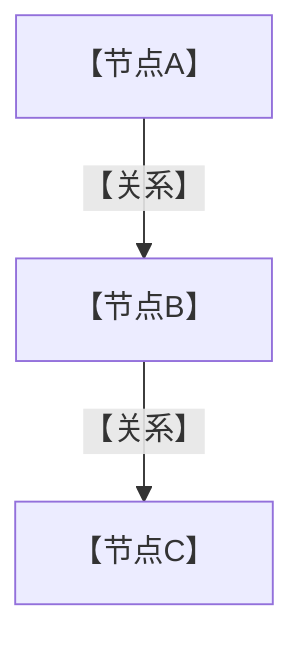

<!--
这是**骨架**：一篇成品文档必须有的一切块都在这里排好序，内容用【】占位。
写新文档时整份拷过去，逐个替换【】，删掉不适用的节（不适用 ≠ 不写，要在开头学习路线图里声明不覆盖）。
每块后面的 HTML 注释是 `audit_structure.py` 对应的判据代码，替换完把这些注释删掉。
四个只能靠运行证明的点不在骨架里：mermaid 要过真解析器、链接要以构建产物判定、
篇幅要够、覆盖度要对——见 SKILL.md 第五步。
-->

## 为什么需要【主题】？（痛点引入）

<!-- 判据 NO_PAIN_OPEN：首个真实 H2 必须含「为什么」；不能以定义开头 -->

【一到两个真实场景：没有它的时候团队怎么踩坑。写具体事故，不写抽象重要性。】

| 维度 | 没有【主题】时的痛苦 | 有了【主题】之后 |
|------|----------------------|------------------|
| 【沟通/扩容/隔离/定位/权限】 | 【具体表现】 | 【具体表现】 |

<!-- 判据 FEW_TABLES：全文至少 2 组表格（以 | 开头的行数 ÷ 2 ≥ 2） -->

> ### 💡 新人小结：【一句话概括【主题】到底是什么】
>
> 把【技术物】想象成「【一个有物理形态的日常事物】」：
> - 【类比点 1】= 【对应概念】
> - 【类比点 2】= 【对应概念】
> - 【类比点 3】= 【对应概念】
>
> **一句话总结（加粗）。**

<!-- 判据 FEW_NEWBIE：全文 ≥3 个「💡 新人小结」——开头、复杂概念处、结尾 -->

**学习路线图**（本文按【N】段推进）

```
痛点引入 → 【段落A】 → 【段落B】 → 【段落C】 → 要点总结
为什么    【副标题】   【副标题】   【副标题】    带走什么
```

<!--
判据 BOX_CHARS：正文出现制表画图字符即失败（九个框线字符的清单见 SKILL 的写作规范映射表），代码块内也算。
文本箭头只允许 → ↓ ①②③ 这类不依赖字符宽度对齐的符号；
一旦需要嵌套层级、多对多连线或超过 5 个节点，改用 mermaid。
-->

---

## 【主题】是什么

【正式定义，一到三段。先定义后展开，不要直接进实现。】



<!--
判据 NO_MERMAID：全文 ≥1 个 mermaid。
写法硬约束：节点标签加引号、边标签加引号、participant 用 `as "中文名"`、一图只讲一件事、
节点超过 12 个就拆图。图前必须有引导句（"下图是……"），图后必须有解读段——不许贴图了事。
-->

图后解读，【几条】最重要的关系：

1. 【关系 1 的结论 + 它在排障时意味着什么】
2. 【关系 2】

### 【子概念】一览

| 对象 | 定义（一句话） | 关键属性 | 关键约束 | 归谁管理 |
|------|----------------|----------|----------|----------|
| 【A】 | 【…】 | 【…】 | 【…】 | 【…】 |

---

## 【核心概念】：痛点 → 设计 → 用法

<!-- 写作主循环：每个核心概念都走这三步，写完一段概念就补一个新人小结 -->

### 痛点

【这个知识点具体解决什么问题，给一个会发生的故障。】

### 设计

【设计思路与核心抽象，讲清"为什么是这个形状"。】

### 具体用法

```【语言】
// ========== ✅ 推荐写法 ==========
【完整可运行的最小示例，含必要的初始化与清理】
// 输出: 【真实输出；上游没给就写"上游未给出输出样例"，禁止编造】

// ========== 不推荐写法（仅展示） ==========
// ❌ 【为什么错】
【反面代码】
```

<!--
判据 NO_CODE：≥1 个**语言标注**的围栏代码块，且 mermaid 不算代码块。
硬要求：可运行、关键行有注释、有 ✅/❌ 对照、有 `# 输出:` 行、块后紧跟参数解释表。
-->

参数解释：

| 参数／方法 | 含义 | 注意 |
|------------|------|------|
| 【`x(...)`】 | 【含义】 | 【默认值/边界/踩坑点；查不到就写「上游未给出」】 |

> ### 💡 新人小结：【针对本节复杂概念的类比】
>
> 【3–5 行类比 + 加粗结论】

---

## 版本差异：【旧写法】与【新写法】

<!--
如果本文讲的是对既有做法的改进，这一节是**必需**的（规范原则五）。
纯介绍型文档可删本节，但要在开头学习路线图里声明范围。
-->

> [!NOTE] 版本适用：【哪条结论只在某版本成立】
> 【补充说明；两版口径不同就各写一行，别把旧版结论当新版写。】

```【语言】
# 【旧写法最小案例】——同一场景
【代码】
```

```【语言】
# 【新写法最小案例】——场景与上面完全一致，保证可直接对照
【代码】
```

| 对比维度 | 旧方案 | 当前方案 |
|----------|--------|----------|
| 写法差异（代码量、复杂度） | 【…】 | 【…】 |
| 行为差异（性能、安全性、可维护性） | 【…】 | 【…】 |
| 迁移成本与兼容性风险 | 【…】 | 【…】 |
| 旧方案仍然适用的场景 | 【…】 | 【…】 |

---

## 对比与选型

| 对比项 | 【A】 | 【B】 | 【C】 |
|--------|-------|-------|-------|
| 【维度】 | 【…】 | 【…】 | 【…】 |
| 【维度】 | 【…】 | 【…】 | 【…】 |

结论：【一句话给出选择依据，而不是"视情况而定"】。

---

## 配图与实操参考


<!--
配图规则：站内绝对路径 /picture/xxx.png；文件名含空格或中文要 URL 编码。
只能用分派任务里"可用配图清单"中的路径，清单外的一律不存在，别猜。
控制台截图只用于操作类内容；架构与流程优先自画 mermaid。
-->

---

## 概念速查（术语表）

<!-- 判据隐含于规范：全文用到的每个专有名词与英文缩写都要在这里落地 -->

| 术语 | 全称 | 含义（用自己的话） | 在本文中的角色 |
|------|------|--------------------|----------------|
| 【X】 | 【Full Name】 | 【口语化解释，不照抄官方定义】 | 【它支撑本文哪一节】 |

---

## 常见误区自检（✅ 与 ❌ 对照）

| 场景 | ❌ 容易做错的判断 | ✅ 应有的判断 |
|------|-------------------|----------------|
| 【场景】 | 【错误做法】 | 【正确做法及其依据】 |

---

## 要点总结

<!-- 判据 NO_SUMMARY：必须存在「要点总结」这一节 -->

1. **【要点 1】**：【一句展开】
2. **【要点 2】**：【一句展开】
3. **【要点 3】**：【一句展开】

---

> ### 💡 新人小结：【主题】学完了，记住这 N 点
>
> 1. **【收获 1】**
> 2. **【收获 2】**
> 3. **【收获 3】**

<!--
判据 SKIP_LANGUAGE / SELF_CHECK_LEAK / SCRATCH_PATH：全文不得出现
「限于篇幅」「此处从略」「自行查阅」「待补充」等省略表达，
不得把审计工具的判据词抄进正文，不得引用本地暂存目录路径（引用出处写上游仓库相对路径）。
骨架里的【】占位必须清零：判据是 scaffold.py 报 placeholders_remaining=0，
以及把这篇拷进 content/docs 后 audit_structure.py 报 problems=0。
-->
