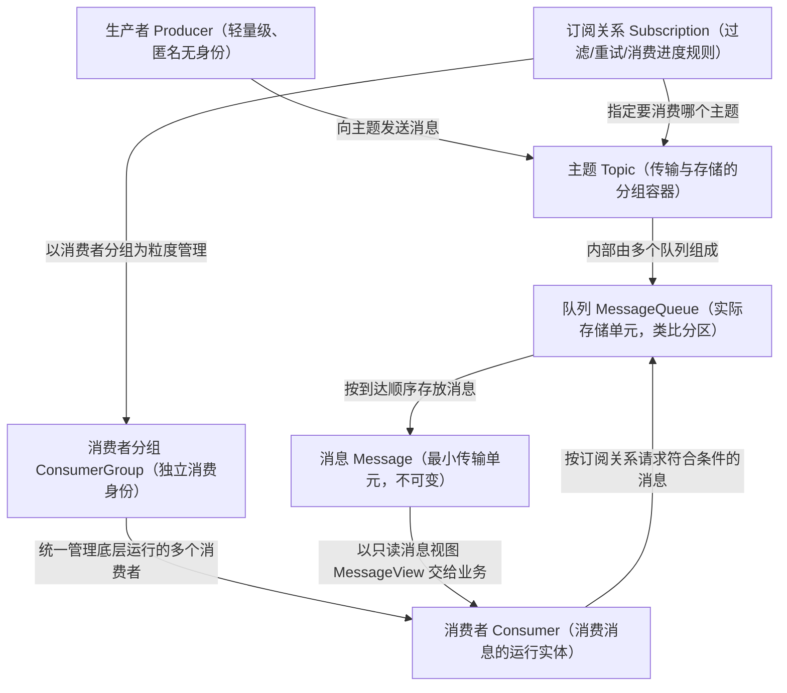
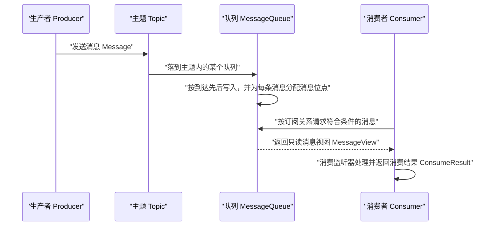

<!--
体裁：概念机制型
用途：写「这是什么、由哪些对象组成、怎么流转、和别的类似东西怎么区分」这类文档时照此结构。
必备块（缺一即被 audit_structure.py 报出）：
  - 首个真实 H2 以「为什么…」开头（痛点引入）
  - ≥1 个 mermaid 图
  - ≥2 组表格
  - ≥3 个「💡 新人小结」引用块
  - 一节「要点总结」
  - ≥1 个语言标注的代码或配置块（audit 的 NO_CODE 判据不把 mermaid 算作代码块）。
    本样章未含：源文里那几段 java 示例都在被整节删去的「发送侧三种通信语义」内。
    写真实文档时必须补上，代码块写法见 03-命令参数参考型.md。
  - 禁止方框字符画 ASCII 图（用 mermaid 代替）
源：rocket-mq-docs/content/docs/02-core-concepts/领域模型/领域模型全景与通信方式.md（415 行）
本样章：247 行，保留 mermaid 2/表格行对 33/语言标注代码块 0/callout 0/💡小结 3
-->
说明：front matter 的 description 照抄源文，而本样章已删去其中「通信方式／发送语义／传输模型」三节，
     故此处 description 与正文不再一致——这是节选样章的已知偏差。真实文档必须让 description 覆盖正文实际内容。


## 为什么需要领域模型？（痛点引入）

刚接入 RocketMQ 的团队，几乎都在同一个地方翻过车：**大家嘴里说着同一个词，指的却不是同一个东西**。

- 运维说的「队列」是 Broker 上的存储单元，开发说的「队列」是他代码里的内存队列。两个人争论了半小时，其实谁都没错。
- 有人以为「一个主题只能被一个下游消费」，于是新来一个下游业务就去改别人的消费代码，结果原业务收到 0 条消息。
- 有人把「消费者分组」当成线程池用，在同一进程里用相同配置起了 8 个消费者实例，吞吐没涨，服务端却一直在做负载均衡调整。
- 有人把「订阅」写在消费者代码里、又把「重试次数」写在另一个地方，等排查消费冲突时，谁也说不清这条消息到底该不该投给这个实例。

| 维度 | 没有统一对象模型时的痛苦 | 有了领域模型共识之后 |
|------|--------------------------|----------------------|
| 沟通成本 | 「队列」一词三种含义，评审要反复澄清 | 每个对象有唯一名字与职责边界 |
| 扩容方式 | 靠加进程、加线程瞎试 | 明确「队列数扩存储、消费者数扩消费能力」 |
| 隔离手段 | 用改代码的方式给新下游让路 | 用「新增消费者分组」实现一对多，互不影响 |
| 故障定位 | 消费不到消息时只能猜 | 能沿「生产 → 存储 → 消费」三段逐段查 |
| 权限与运维 | 权限散落在业务代码里 | 主题与分组是身份和权限的载体 |

> ### 💡 新人小结：RocketMQ 的领域模型到底是什么？
>
> 把整套模型想象成「小区的快递系统」：
> - 主题（Topic）= 快递驿站里按业务分的「货架分区」，比如「淘系包裹区」，它只是分类牌，不真正装包裹。
> - 队列（MessageQueue）= 分区里的「传送带」，包裹真正落在传送带上，一条传送带上的包裹天然有先后。
> - 消息（Message）= 一个个密封的包裹，寄出后内容就不能再改。
> - 消费者分组（ConsumerGroup）= 收件人「家庭户口」，同一个户口的人分摊这个户口订阅的包裹。
> - 订阅关系（Subscription）= 这个户口登记在册的「取件规则」：取哪些标签的件、取到第几件了、取件失败怎么重试。
>
> **领域模型就是把「驿站怎么运转」这件事拆成五个有名有姓的角色，谁也不能越界。**

**学习路线图**（本文按六段推进，逐段读完即可建立完整直觉）

```
痛点引入 → 对象全景 → 生命周期 → 通信方式 → 发送语义 → 传输模型 → 概念速查
为什么    谁挂谁    怎么流转   同步/异步   同步/异步/单向  点对点/发布订阅  术语对齐
```

---

## Apache RocketMQ 领域模型：七个对象怎么挂在一起

Apache RocketMQ 是一款典型的分布式架构下的中间件产品，使用**异步通信方式**和**发布订阅的消息传输模型**；产品具备异步通信的优势，系统拓扑简单、上下游耦合较弱，主要应用于异步解耦、流量削峰填谷等场景。

先看全景：下图是七个核心对象之间的挂关系，箭头方向表示「谁引用/依赖谁」，不是消息流动方向。



图后解读，三条最重要的关系：

1. **主题是逻辑容器，队列才是实际容器。** 消息的存储和水平扩展实际是通过主题内的队列实现的；对主题的所有约束和属性设置，最终也是通过主题内部的队列来实现。
2. **订阅关系的挂载点是「消费者分组 × 主题」，不是消费者实例。** 订阅关系以消费组粒度进行管理，消费组通过定义订阅关系控制指定消费组下的消费者如何实现消息过滤、消费重试及消费进度恢复。
3. **身份在分组，运行在消费者。** 生产者侧是匿名的（生产者是轻量级匿名无身份的）；消费侧必须有身份——消费者必须被指定到某一个消费组中，同一个消费组的多个消费者必须保持消费逻辑和配置一致，共同分担该消费组订阅的消息，以此实现消费能力的水平扩展。

官方给的领域模型全景图如下，可和上面的对象图对照看：


### 七个对象的职责边界速查

| 对象 | 定义（一句话） | 内部关键属性 | 关键行为约束 | 归谁管理 |
|------|----------------|--------------|--------------|----------|
| 生产者 Producer | 用于产生消息的运行实体，一般集成于业务调用链路的上游 | 客户端 ID、通信参数、预绑定主题列表、事务检查器、发送重试策略 | 匿名无身份；与主题是多对多关系 | 由业务进程创建与销毁 |
| 主题 Topic | 消息传输和存储的分组容器，标识同一类业务逻辑的消息 | 主题名称、队列列表、消息类型 | 一个主题内至少包含一个队列；5.0 起消息类型强制校验 | 预先创建的顶层资源 |
| 队列 MessageQueue | 消息传输和存储的实际单元容器，类比其它消息队列中的分区 | QueueId、读写权限、位点 | 读写权限属于运维侧操作，不建议频繁修改 | 由系统按队列数量分配 |
| 消息 Message | 最小传输单元 | 主题名、类型、队列、位点、消息 ID、Key、Tag、定时时间、属性、负载 | 具备不可变性，初始化发送和完成存储后即不可变 | 服务端持久化存储 |
| 消费者分组 ConsumerGroup | 发布订阅模型中独立的消费身份分组，统一管理底层多个消费者 | 分组名称、投递顺序性、消费重试策略、订阅关系集合 | 组内所有消费者的消费逻辑和配置必须一致 | 逻辑资源，需提前创建 |
| 消费者 Consumer | 消费消息的运行实体，一般集成在业务调用链路的下游 | 分组名称、客户端 ID、通信参数、预绑定订阅关系列表、消费监听器 | 必须关联到某一个消费者分组 | 业务进程内的运行实体 |
| 订阅关系 Subscription | 消息过滤、重试、消费进度的规则配置 | 过滤类型、过滤表达式、消费状态 | 除过滤表达式之外都是持久化的 | 以消费组粒度管理 |

> 每个对象的「版本兼容性」与「使用建议」篇幅较大，本文只给全景与边界；五个层次（定义／内部属性／行为约束／版本兼容性／使用建议）在下一节的两篇中逐对象展开。

---

## 消息生命周期：生产、存储、消费三段

Apache RocketMQ 中消息的生命周期主要分为**消息生产、消息存储、消息消费**这三部分：生产者生产消息并发送至服务端，消息被存储在服务端的主题中，消费者通过订阅主题消费消息。下图是这三段的时序关系。



| 阶段 | 发生什么 | 谁主导 | 状态可回溯的依据 |
|------|----------|--------|------------------|
| 消息生产 | 生产者在业务上游把负载与扩展属性包装成消息并发送 | 生产者 | 消息一经初始化即不可变 |
| 消息存储 | 消息按到达服务端的先后顺序存入指定主题的某个队列 | 服务端（Broker） | 队列是流式结构的无限队列，消息在队列内具备顺序性存储特征 |
| 消息消费 | 消费者按订阅关系拉取符合条件的消息，转成业务可理解的信息处理 | 消费者分组 | 服务端按每个消费者分组记录消费过的最新一条消息的位点 |

「消息被消费完不会立即删除」是新手最容易误解的一点：一条消息被某个消费者消费完成后不会立即从队列中删除，RocketMQ 只是基于每个消费者分组记录消费进度。这正是「重置消费位点」「消息回溯」这类能力能成立的底层原因——数据还在，只是进度指针在移动。

---

## 消费端怎么「推」给业务：长轮询、推拉与只读消息视图

新手常把 `PushConsumer` 理解成「服务端主动推消息给我」。从 5.0 的内部实现看，PushConsumer 的实时处理能力是基于 SDK 内部的典型 Reactor 线程模型实现的：SDK 内置一个长轮询线程，先把消息异步拉取到 SDK 内置的缓存队列中，再分别提交到消费线程里触发监听器执行本地消费逻辑。也就是说：

```
业务代码视角:  我注册了监听器，消息「被推」过来，处理完返回 ConsumeResult
SDK 实现视角:  长轮询线程拉取 → 本地缓存队列 → 消费线程回调监听器
```

| 术语 | 在本文中的准确含义 | 容易误解成 |
|------|--------------------|------------|
| 长轮询 | SDK 内置线程向服务端持续发起的取消息请求，取到的消息先落入 SDK 内置的缓存队列 | 服务端定时主动推送 |
| 推拉模型 | PushConsumer 是「SDK 拉 + 回调推」的封装；SimpleConsumer 与 PullConsumer 由业务主动调用取消息接口 | 推＝可靠、拉＝不可靠 |
| 消息视图 MessageView | 面向开发视角的消息**只读**接口：可读消息内部的多个属性和负载信息，但不能对消息本身做任何修改 | 一个可以再改再发的 Message 对象 |
| 消费结果 ConsumeResult | PushConsumer 消费监听器处理完消息后返回的处理结果，用来标识本次消息是否正确处理，包含消费成功和消费失败 | 返回值随便写，服务端不管 |

这也解释了前面「消息不可变性」在产品上的落点：服务端把消息交付给业务时，交给你的是只读视图，改不了。

> ### 💡 新人小结：PushConsumer 的「推」到底是谁在动？
>
> 想象你让家里人帮你盯着快递柜：
> - 家里人每隔一会儿去看一眼柜子，柜子里有件就立刻喊你（**SDK 的长轮询线程拉取**）。
> - 喊你的那句「有你的件」就是回调（**消费监听器被触发**）。
> - 快递柜自己不会长腿跑上门（上游对 PushConsumer 内部原理的描述是 **SDK 侧长轮询线程拉取**，实时性由此而来）。
> - 你答应「我拿到了」并处理完，柜子的台账才翻页（**返回 ConsumeResult，服务端按分组更新消费位点**）。
>
> **PushConsumer 是「SDK 拉回来、再回调推给你」的封装，名字里的 Push 描述的是你的编程体验，不是网络方向。**

---

## 基本概念速查（术语表）

下表逐条覆盖上游「基本概念」页面的全部术语，并补上本文正文用到的缩写。查不到的缩写不会出现在本文里。

| 术语 | 全称 | 含义（用自己的话） | 在本文中的角色 |
|------|------|--------------------|----------------|
| Topic | 主题（TopicName） | 消息传输和存储的顶层容器，用来标识同一类业务逻辑的消息，靠 TopicName 唯一标识 | 对象关系图的「货架分区」，身份与权限的载体 |
| MessageType | 消息类型 | 按消息传输特性定义的分类，用于类型管理和安全校验；支持普通、顺序、事务、定时/延时四类 | 主题的内部属性，5.0 起强制校验 |
| MessageQueue | 消息队列（QueueId） | 消息存储和传输的实际容器，也是消息的最小存储单元，靠 QueueId 唯一标识 | 真正把消息存下来、把容量水平拆开的地方 |
| Message | 消息 | 最小数据传输单元，业务负载加扩展属性被包装成消息发送，服务端按语义投递到消费端 | 生命周期三段里流动的那个对象 |
| MessageView | 消息视图 | 面向开发视角的消息只读接口，能读属性和负载、不能改消息本身 | 消费端拿到的交付形态，保障不可变性 |
| MessageTag | 消息标签 | 细粒度消息分类属性，在主题层级之下再做细分；消费者订阅特定标签实现细粒度过滤 | 过滤规则的输入，一条消息仅一个标签 |
| MessageQueueOffset | 消息位点 | 消息按到达服务端的先后顺序存在队列中，每条消息在队列里有一个唯一的 Long 型坐标 | 队列流式存储的「刻度尺」 |
| ConsumerOffset | 消费位点 | 消息消费后不立即删除，服务端基于每个消费者分组记录消费过的最新一条消息的位点 | 消费进度；分组级而非实例级 |
| MessageKey | 消息索引 | 面向消息的索引属性，通过设置的消息索引可快速查找对应消息内容 | 事后查消息用的钩子，由生产者定义 |
| Producer | 生产者 | 构建并传输消息到服务端的运行实体，通常集成在业务系统中 | 生命周期的起点 |
| TransactionChecker | 事务检查器 | 生产者用来执行本地事务检查和异常事务恢复的监听器，应通过业务侧数据状态判断事务消息状态 | 事务消息的兜底机制，与预绑定主题列表配合 |
| TransactionResolution | 事务状态 | 事务消息发送过程中事务提交的状态标识，含事务提交、事务回滚、事务未决 | 服务端据此决定半事务消息是否投递 |
| ConsumerGroup | 消费者分组 | 承载多个消费行为一致的消费者的负载均衡分组；不是运行实体而是逻辑资源；组内多实例实现水平扩展与高可用容灾 | 消费侧的身份与状态容器 |
| Consumer | 消费者 | 接收并处理消息的运行实体，从服务端取消息并转成业务可理解的信息 | 真正干活的那个进程内对象 |
| ConsumeResult | 消费结果 | PushConsumer 监听器处理完消息返回的结果，标识本次消息是否正确处理，含成功与失败 | 服务端判断是否重试的依据 |
| Subscription | 订阅关系 | 消费者获取消息、处理消息的规则和状态配置；由消费者分组动态注册到服务端，并在后续传输中按其过滤规则匹配消息与维护消费进度 | 连接「分组」与「主题」的那纸契约 |
| 消息过滤 | 消息过滤 | 消费者通过订阅指定 Tag 只接收过滤后的消息合集；过滤规则的计算和匹配在服务端完成 | 服务端行为，不是客户端筛掉不要的消息 |
| 重置消费位点 | 重置消费位点 | 以时间轴为坐标，在消息持久化存储的时间范围内重设某分组对已订阅主题的消费进度，之后开始消费新到达的消息 | 回溯与故障恢复的手段 |
| 消息轨迹 | 消息轨迹 | 一条消息从生产者发出到消费者接收处理过程中，各相关节点的时间、地点等数据汇聚成的完整链路信息 | 排障时的「物流详情」 |
| 消息堆积 | 消息堆积 | 生产者已把消息发到服务端，但消费者消费能力有限，短时间内未全部正确消费，服务端保存着未被消费的消息 | 消费侧容量问题的表现 |
| 事务消息 | 事务消息 | 支持在分布式场景下保障消息生产和本地事务最终一致性的高级消息类型 | 与 TransactionChecker、TransactionResolution 配套 |
| 定时/延时消息 | 定时/延时消息 | 消息发到服务端后需到指定时间才能被消费，可实现分布式场景的延时调度触发效果 | 影响「消息保存时间戳」的语义 |
| 顺序消息 | 顺序消息 | 支持消费者按发送先后顺序获取消息，实现业务场景的顺序处理 | 队列内顺序性 + 主题类型约束 |
| RPC | Remote Procedure Call，远程过程调用 | 让调用远端方法看起来像调本地方法的通信方式 | 与异步消息对照的另一种通信模式 |
| Oneway | 单向发送 | 只发请求、不等应答、无回调的发送方式 | 三种发送语义中可靠性最低的一档 |
| 长轮询 | Long Polling | SDK 内置线程向服务端持续取消息的机制，取回的消息先进入 SDK 内置的缓存队列 | 解释 PushConsumer「推」的真相 |
| SDK | Software Development Kit | 客户端开发包，消息发送重试等策略内置在其中 | 匿名客户端 ID、重试策略都出自它 |
| MessageGroup | 消息分组 | 顺序消息的分组标识，用来标记一组特定消息的先后顺序 | 解释 FIFO 语义时提到 |
| LiteTopic | 轻量主题 | 主题类型为 Lite 时的二级容器，标识同一类业务下不同子类（会话、任务等粒度）的消息 | 本文只在对象全景里点到，细节见下一篇 |
| PullConsumer / SimpleConsumer / PushConsumer | 消费者类型 | RocketMQ 面向不同开发场景提供的多样消费者类型 | 消费端「推拉」章节用到的分类名 |

---

## 常见误区自检（✅ 与 ❌ 对照）

| 场景 | ❌ 容易做错的判断 | ✅ 按领域模型应有的判断 |
|------|-------------------|--------------------------|
| 新下游要消费同一批消息 | 改原消费者的代码，让它「兼着处理」 | 新建一个消费者分组，靠发布订阅的一对多让每个组拿到全量消息 |
| 想提升消费吞吐 | 在同一进程用相同配置起多个消费者实例 | 队列数量扩存储侧能力、分组内多实例扩消费能力，且组内消费逻辑与配置必须一致 |
| 觉得消息「消费完就没了」 | 认为消费成功即从队列删除 | 消费进度只是分组级位点，数据仍在队列里，可回溯、可重置位点 |
| 想给消息「改一下再转发」 | 直接改收到的消息对象再发送 | 消费端拿到的是只读 MessageView；中转必须重新初始化一个新消息 |
| 关键业务用单向发送 | 图省事用 Oneway 发重要通知 | 关键消息用同步或异步发送（二者成功与否都有响应），Oneway 只用于可靠性要求低的场景 |
| 用主题当业务标志位 | 每个用户/订单单独建一个主题 | 主题拆分粒度过细会消耗大量主题资源、造成系统负载过重；细分诉求用 Tag/属性或 LiteTopic |

---

## 要点总结

1. **RocketMQ 的定位就写在模型里**：分布式架构下的中间件，采用异步通信 + 发布订阅传输模型，价值是异步解耦与流量削峰填谷，收益来自拓扑简单、上下游弱耦合、代理具备缓冲整形能力。
2. **七个对象各有边界**：主题是逻辑分组容器、队列才是实际存储单元、消息是不可变的最小传输单元；生产者匿名无身份，消费者必须有分组，订阅关系挂在「分组 × 主题」上并以消费组粒度管理。
3. **生命周期三段是排障的主干道**：生产 → 存储 → 消费；消息消费完不会立刻删除，分组级消费位点决定了「进度」与「堆积」的观测口径。
4. **通信方式与发送语义是两个层次**：系统层面是同步 RPC 与异步消息之争，一次发送层面是同步／异步／单向三种语义，前两种可靠（成功与否都有响应），单向不可靠（无响应、无重试）。
5. **术语必须先对齐再讨论**：Topic／MessageQueue／ConsumerGroup／Subscription／MessageView／两个 Offset 的差别，是后续所有性能与故障讨论的前提。

---

> ### 💡 新人小结：领域模型全景学完了，记住这 5 点
>
> 1. **先分角色再写代码**：驿站里货架分区（Topic）、传送带（队列）、包裹（Message）、户口（ConsumerGroup）、取件规则（Subscription）各管一件事，越界必然出问题。
> 2. **身份在分组，进度也在分组**：新增下游请新建消费者分组，别改别人的消费代码；消费位点按分组记录。
> 3. **单向发送只在「丢了也无所谓」时用**：同步与异步是可靠的，因为无论成功与否都有响应。
> 4. **PushConsumer 的「推」是 SDK 长轮询拉回来的**，你的监听器只是被回调的那个环节。
> 5. **概念没对齐就别开评审**：一个词三种理解，是所有「订阅关系不一致」类事故的起点。

---

<!--
本样章为控制篇幅删去了源文件的这几节（一律整节删除，未拆散任何表格／mermaid／引用块）：
1. 「通信方式：同步 RPC 与异步消息」——属「通信方式」重叠内容；含 1 个 > [!NOTE] callout、同步 RPC 与异步通信对比表、2 张官方配图。
2. 「发送侧的三种通信语义：同步 / 异步 / 单向」——属「发送语义」内容；含 3 段 java 发送示例代码、2 张对比/参数解释表、1 个 > [!NOTE] callout。
3. 「消息传输模型：点对点与发布订阅」——属「传输模型」内容；含 1 个 mermaid 图、1 张模型对比表、2 张官方配图。
删这三节是因为它们讲「系统之间怎么通信／一次发送怎么选语义／用哪种传输模型」，不是本体裁「对象怎么挂、怎么流转、怎么区分」的主干；
源文件里全部 2 处 > [!NOTE] callout、3 段 java 代码示例都在这三节内，随节整块移除，所以本样章 callout 计数为 0、代码块只剩 mermaid 与两处伪代码占位。
NOTE 提示块（写法为行首大于号加 [!NOTE]）、java 示例加参数解释表、官方配图的完整用法，全文参考见 99-完整参考全文.md。
-->
