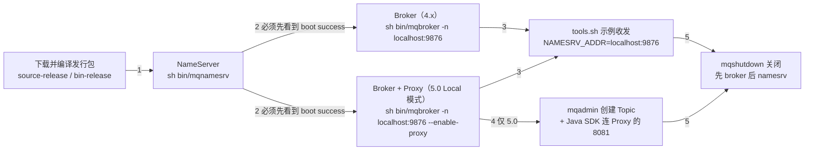

<!--
体裁：操作部署型
用途：写「装它、起它、验证跑通了、失败了怎么办」这类文档时照此结构。
必备块：
  - 首个真实 H2 以「为什么…」开头
  - 前置条件/端口/目录一律用表格，不用方框字符画
  - 每条命令独立成 fenced code block，块后紧跟「参数解释」表
  - 「验证」段必须写出期望输出，不能只说"启动成功"
  - ≥3 个「💡 新人小结」引用块、≥1 个 mermaid（部署拓扑或启动时序）
  - 一节「要点总结」
源：rocket-mq-docs/content/docs/03-quickstart/单机部署/本地二进制部署与消息收发.md（590 行）
本样章：238 行，保留 mermaid 1/表格行对 24（6 组）/代码块 4/callout 2/💡小结 3
-->


## 为什么需要本地二进制部署？（痛点引入）

几乎所有第一次接触 RocketMQ 的人，都会先在环境上耗掉半天，而且卡点高度雷同：

- 照着博客里抄来的命令启动 Broker，结果日志里等不到那句 `boot success`，因为 NameServer 其实还没起来；上游文档明确写了顺序要求「NameServer 成功启动后，我们启动 Broker」。
- 5.0 环境下客户端连不上，原因是把接入点填成了 NameServer 的 `localhost:9876`，而 5.0 的新客户端要连的是 Proxy 的地址和端口（示例值 `localhost:8081`）。
- 用源码包折腾了半天 `mvn`，却始终不知道自己该进哪个目录，因为发行包解压出来的路径和编译产物的路径不是同一个。
- 发完消息只看到一行 `SendResult [sendStatus=SEND_OK, msgId= ...`，但不确定这算不算真的成功，也不知道下一步该验证什么。
- 实验做完直接 `kill -9`，下次重启时又要重新猜一边启动顺序。

| 维度 | 没有一条可复现的本地启动路径 | 有了本文这条最短路径 |
|------|------------------------------|----------------------|
| 启动顺序 | 猜：先 Broker 还是先 NameServer | 固定三段：NameServer → Broker（5.0 带 Proxy）→ 收发验证 |
| 成败判据 | 「没报错应该就是起来了」 | 每步都有明确的日志文件与 `boot success` 字符串可对号入座 |
| 版本混淆 | 把 4.x 的命令直接套到 5.0，Proxy 迟迟不起 | 逐步骤标注 4.x / 5.0 差异，附对照表 |
| 接入点填错 | 客户端一律填 `9876` | 明确「工具测试用 `NAMESRV_ADDR`，5.0 SDK 用 Proxy endpoint」 |
| 收尾 | 强杀进程，留下脏状态 | 用 `sh bin/mqshutdown broker` / `sh bin/mqshutdown namesrv` 正常关闭 |

> ### 💡 新人小结：本地二进制部署到底在装什么？
>
> 把整套东西想象成「在自家厨房开一间小型咖啡馆」：
> - 发行包 = 一整台拆箱即用的咖啡机（二进制包）或一箱零件加说明书（源码包，需要自己 `mvn` 组装）。
> - NameServer = 门口的接线台，只负责告诉客人「现在哪台机器在营业」，它自己不做咖啡。
> - Broker = 真正做咖啡、存杯子的机器，消息就落在这里。
> - Proxy（只有 5.0）= 柜台窗口：新客户端只走窗口，不再直接找机器。
> - `tools.sh` 与 Java SDK = 第一杯试机咖啡：先按说明书接一杯（工具测试），再用自己家的杯子接（SDK 测试）。
>
> **快速开始的目标只有一个：在本地把「接线台 → 机器 → 窗口 → 第一杯咖啡」这条链路一次跑通，并且知道每一步用什么字符串判断成功。**

---

## 启动链路总览：谁必须先起来

下图是本文要跑通的依赖关系，箭头表示「前置完成才能进入下一步」，不是消息流动方向。



> ### 💡 新人小结：为什么要按这个顺序起？
>
> 想象咖啡馆开业：
> - 先把「门口的接线台」摆好（NameServer），客人才能问到哪里有咖啡。
> - 再开机做咖啡（Broker）；机器一开机就要主动去接线台登记「我在 10911 营业」，接线台还没摆好，登记就落空。
> - 5.0 多了一个「柜台窗口」（Proxy）：客人从此只在窗口点单，不冲进操作间。窗口背后仍然是同一台机器，所以本机演示把它们放在同一个进程里。
>
> **启动顺序不是玄学，而是「谁向谁登记」决定的：被登记的一方必须先活着。**

---

## 第一步：下载并编译 Apache RocketMQ

上游对系统要求只有两条（4.x 与 5.0 完全一致）：

1. 64 位操作系统，推荐 Linux/Unix/macOS；
2. 64 位 JDK 1.8+。

> [!NOTE] 上游本节只演示 Linux 环境
> 两版快速开始都写着「这里以在 Linux 环境为例，介绍 RocketMQ 安装过程」，均未给出 Windows 下的本地二进制启动方式；本文照抄这一口径，不给 Windows 版命令。Windows 的差异（`%cd%` 与 `$pwd`、换行续行符）集中在容器部署那篇：`03-quickstart/容器与云原生部署/Docker与Compose部署.md`。

上游对安装包的定位区分得很清楚：**二进制包是已经编译完成后可以直接运行的，源码包是需要编译后运行的**。

| 对比项 | 源码包（source-release） | 二进制包（bin-release） |
|--------|--------------------------|--------------------------|
| 4.9.4 下载地址 | `https://archive.apache.org/dist/rocketmq/4.9.4/rocketmq-all-4.9.4-source-release.zip` | `https://archive.apache.org/dist/rocketmq/4.9.4/rocketmq-all-4.9.4-bin-release.zip` |
| 5.3.2 下载地址 | `https://dist.apache.org/repos/dist/release/rocketmq/5.3.2/rocketmq-all-5.3.2-source-release.zip` | `https://dist.apache.org/repos/dist/release/rocketmq/5.3.2/rocketmq-all-5.3.2-bin-release.zip` |
| 是否需要 Maven 构建 | 需要，`mvn -Prelease-all -DskipTests -Dspotbugs.skip=true clean install -U` | 不需要，解压即可运行 |
| 上游演示用的是 | 是（两版都以源码包为例走完整流程） | 未演示 |
| 最终要进入的运行目录 | `distribution/target/rocketmq-4.9.4/rocketmq-4.9.4`（4.x）／`distribution/target/rocketmq-5.3.2/rocketmq-5.3.2`（5.0） | 解压目录本身（上游未给出具体路径写法） |
| 适用场景 | 想顺带验证「自己能不能从源码构建出发行版」 | 只想最快跑起来收发第一条消息 |

5.0 的构建多了「解压」和「进入解压目录」两步，其余一致：

```shell
# ========== ✅ 推荐：5.3.2 源码包完整四步 ==========
$ unzip rocketmq-all-5.3.2-source-release.zip
$ cd rocketmq-all-5.3.2-source-release/
$ mvn -Prelease-all -DskipTests -Dspotbugs.skip=true clean install -U
$ cd distribution/target/rocketmq-5.3.2/rocketmq-5.3.2

# ========== 不推荐写法（仅展示） ==========
# ❌ 构建完停在 rocketmq-all-5.3.2-source-release/ 根目录就去执行 sh bin/mqnamesrv：
#    上游的后续命令都以 distribution/target/rocketmq-5.3.2/rocketmq-5.3.2 为当前目录
```

参数解释：

| 片段 | 作用 | 注意 |
|------|------|------|
| `-Prelease-all` | 激活上游的发行版构建 profile，产出 `distribution/target/` 下的可运行分布 | 少了它就不会产出这个目录 |
| `-DskipTests` | 跳过单元测试 | 上游示例带此参数 |
| `-Dspotbugs.skip=true` | 跳过 SpotBugs 静态检查 | 上游示例带此参数 |
| `clean install -U` | 清理后重新构建并强制更新依赖 | `-U` 是上游原文 |
| `distribution/target/rocketmq-<版本>/rocketmq-<版本>` | 真正的运行目录，`bin/mqnamesrv`、`bin/mqbroker`、`bin/tools.sh` 都在这里的 `bin/` 下 | 4.9.4 与 5.3.2 只是版本号不同，路径结构一致 |

---

## 第二步：启动 NameServer

```shell
# ========== ✅ 推荐：先起 NameServer，并等到 boot success 再进入下一步 ==========
### 启动namesrv
$ nohup sh bin/mqnamesrv &

### 验证namesrv是否启动成功
$ tail -f ~/logs/rocketmqlogs/namesrv.log
The Name Server boot success...

# ========== 不推荐写法（仅展示） ==========
# ❌ 不起 NameServer、或没看到上面这行就直接执行下一条 sh bin/mqbroker -n localhost:9876 &：
#    上游的顺序要求是「NameServer 成功启动后，我们启动 Broker」，问路的地方不存在，Broker 起不来也无处可查
```

判据（4.x 与 5.0 完全一致）：在 `namesrv.log` 中看到 **`The Name Server boot success..`**，表示 NameServer 已成功启动。

参数解释：

| 片段 | 作用 | 备注 |
|------|------|------|
| `nohup ... &` | 让进程忽略挂断信号并放到后台运行，终端可以继续使用 | 上游原文写法 |
| `sh bin/mqnamesrv` | 启动 NameServer 的脚本 | 上游统一用 `sh`，未给 `bash` 写法 |
| `~/logs/rocketmqlogs/namesrv.log` | NameServer 日志路径 | 两版都是这个小写文件名 |
| `tail -f` | 实时跟踪日志，用来等那句 `boot success` | 看到后可 `Ctrl+C` 退出跟踪，不影响 NameServer 进程 |

> [!TIP] 验证不是可选步骤
> 上游在 NameServer 与 Broker 两步之后各给了一段「我们可以在 …log 中看到 …，表示 … 已成功启动」。这句话的实际作用是**闸门**：没看到对应字符串，就不要往下起 Broker。本文后续的排查清单也完全围绕这几条字符串组织。

---

## 第三步：启动 Broker（4.x）与 Broker+Proxy（5.0）

5.0：Broker 起来时把 Proxy 一起带起来（Local 模式，同进程）。

```shell
# ========== ✅ 推荐（5.0）：一条命令把 Broker 与 Proxy 一起带起来，验证看 proxy.log ==========
### 先启动broker
$ nohup sh bin/mqbroker -n localhost:9876 --enable-proxy &

### 验证broker是否启动成功, 比如, broker的ip是192.168.1.2 然后名字是broker-a
$ tail -f ~/logs/rocketmqlogs/proxy.log
The broker[broker-a,192.169.1.2:10911] boot success...

# ========== 不推荐写法（仅展示） ==========
# ❌ 在 5.0 里仍执行 4.x 的 sh bin/mqbroker -n localhost:9876 &：
#    少了 --enable-proxy，Proxy 不会被起来，第五步 SDK 示例连 localhost:8081 时无人应答
# ❌ 在 4.x 里执行带 --enable-proxy 的命令：4.x 文档没有这个参数，也没有 Proxy 组件
```

| 对比维度 | 4.x（4.9.4） | 5.0（5.3.2） |
|----------|--------------|--------------|
| 需要启动的服务端进程 | NameServer、Broker | NameServer、Broker+Proxy（同进程 Local 模式） |
| Broker 启动命令 | `sh bin/mqbroker -n localhost:9876` | `sh bin/mqbroker -n localhost:9876 --enable-proxy` |
| 成功判据所在日志 | `~/logs/rocketmqlogs/Broker.log` | `~/logs/rocketmqlogs/proxy.log` |
| 成功字符串 | `The broker[broker-a,192.169.1.2:10911] boot success...` | 同左（形式一致：`The broker[brokerName,ip:port] boot success..`） |
| 日志里自报的 Broker 端口 | `10911` | `10911` |
| 客户端要不要连 Proxy | 不存在 Proxy，客户端连 NameServer + Broker | 新 SDK 连 Proxy 的地址和端口，示例 `localhost:8081` |
| 上游给出的接入点注释 | `NAMESRV_ADDR=localhost:9876` | 「需要设置成 Proxy 的地址和端口列表，一般是 xxx:8080;xxx:8081」 |
| 分离部署 | 不适用 | 支持，但本文用 Local 模式；细节见 06-operations |
| 关闭时的输出差异 | `Send shutdown request to mqbroker(36695) OK` | `Send shutdown request to mqbroker with proxy enable OK(36695)` |

---

## 排查清单：只看上游给过的判据

下表把本文出现过的「成功字符串」和「它属于哪一步」列全。**上游快速开始没有给出任何错误码或异常样例输出**，因此本表只列正向判据，不编造失败文案。

| 症状 | 先看哪个判据 | 判据出自哪一步 | 判据缺失时本文给出的检查点 |
|------|--------------|----------------|------------------------------|
| 完全不知道服务起没起 | `The Name Server boot success...` | 第二步 `~/logs/rocketmqlogs/namesrv.log` | NameServer 必须第一个启动；`sh bin/mqnamesrv` 是否在当前运行目录下执行 |
| Broker 起了但注册不上 | `The broker[broker-a,192.169.1.2:10911] boot success...` | 第三步，4.x 看 `Broker.log`、5.0 看 `proxy.log` | `-n localhost:9876` 是否指向已启动的 NameServer；顺序是否反了 |
| 示例生产者发不出去 | `SendResult [sendStatus=SEND_OK, msgId= ...` | 第四步 | `NAMESRV_ADDR` 是否已 `export`，且与 `-n` 传的地址一致 |
| 示例消费者收不到 | `ConsumeMessageThread_%d Receive New Messages: [MessageExt...` | 第四步 | 先确认发送那步已经出现 `SEND_OK` |
| SDK 客户端连不上（5.0） | `Send message successfully, messageId=...` | 第五步 | 接入点必须填 Proxy 地址和端口（示例 `localhost:8081`），不是 `9876`；Broker 是否用 `--enable-proxy` 启动 |
| SDK 报主题不存在／发送失败（5.0） | `logger.error("Failed to send message", e)` 分支 | 第五步 | 是否执行过 `sh bin/mqadmin updatetopic -n localhost:9876 -t TestTopic -c DefaultCluster` |
| 消费端拿不到消息（5.0） | `Consume message successfully, messageId=...` | 第五步 | `YourConsumerGroup` 是否已创建（创建 Group 的命令见本文中的 TIP 说明）；`pushConsumer.close()` 是否被过早调用 |
| 关闭脚本没反应 | `Send shutdown request to ... OK` | 第六步 | 参数拼写：`broker` / `namesrv`（不是 `mqbroker`／`mqnamesrv`） |

---

## 要点总结

1. **本地部署只有三段式，顺序不能乱**：发行包（源码包要 `mvn -Prelease-all -DskipTests -Dspotbugs.skip=true clean install -U` 并进入 `distribution/target/rocketmq-<版本>/rocketmq-<版本>`）→ NameServer → Broker；每步都以上游给出的 `boot success` 字符串为闸门。
2. **5.0 与 4.x 的核心差异只有一处命令**：`sh bin/mqbroker -n localhost:9876 --enable-proxy`，Local 模式下 Proxy 与 Broker 同进程；验证日志从 `Broker.log` 换成 `proxy.log`，停机文案多出 `with proxy enable`。
3. **两条验证路各有分工**：`tools.sh` + `NAMESRV_ADDR=localhost:9876` 是版本通用的冒烟路径；5.0 的 Java SDK 路径走 `rocketmq-client-java` + Proxy 接入点（示例 `localhost:8081`），并且必须先用 `mqadmin updatetopic` 创建主题。
4. **接入点填错是 5.0 第一大坑**：新 SDK 连的是 Proxy，不是 NameServer；`9876` 只用于路由问路与 `mqadmin` 的 `-n` 参数。
5. **收尾用脚本、按反序关**：`sh bin/mqshutdown broker` → `sh bin/mqshutdown namesrv`，看到 `Send shutdown request to ... OK` 才算干净退出。

---

> ### 💡 新人小结：本地二进制部署学完了，记住这 5 点
>
> 1. **先摆接线台，再开机器**：NameServer 的 `boot success` 没出现，就不要去起 Broker。
> 2. **5.0 只多一个参数，但多一个必知的端口**：`--enable-proxy` 把窗口和操作间放在同一间屋子里；客户端从此连 8081 而不是 9876。
> 3. **工具测试和 SDK 测试是两件事**：前者证明「服务端活着」，后者证明「你的代码能连上」；两者判据分别是 `SEND_OK` 与 `Send message successfully, messageId=`。
> 4. **主题和分组要先存在**：SDK 路径里上游两次写明「需要提前创建」，Topic 用 `mqadmin updatetopic`，Group 用 `mqadmin updateSubGroup`（后者命令出自同一系列的 K8s 篇）。
> 5. **关闭也要照抄脚本，而不是 `kill -9`**：`mqshutdown` 输出的 `Send shutdown request to ... OK` 就是这次的收尾判据。

---

<!--
为控制篇幅，本样章删去了源文件的这几节（整节删除，未拆散任何表格／mermaid／代码块／引用块）：
1. 「先把术语对齐（否则后面每一步都会听不懂）」——1 张 19 行术语表。
2. 「第四步：第一次收发（tools.sh 示例程序，两版通用）」——1 个命令块、1 张逐行解释表、1 个 NOTE 提示块、1 个 mermaid 时序图；本样章只在「排查清单」表与「要点总结」第 3 条里留下它的判据字样 SEND_OK。
3. 「第五步（5.0 专有）：用 Java SDK 完成第一条消息」——最长的一节，含 xml 与 java 代码块、3 张表、2 个提示块。
4. 「旧写法与新写法：同一个「发第一条消息」目标的两条路」——1 个命令块、1 张 10 行对照表。
5. 「第六步：关闭服务器与清理」——2 个命令块、1 张关闭判据表、1 个 WARNING 提示块。
节内还删了这几处重复铺开的内容（同样整块删除）：痛点节的「学习路线图」纯文本箭头图与「本文范围」一句；总览节的「读图要点三条」；第一步节的 4.x 构建命令块（与 5.0 块同构，只多解压两步）；第三步节的 4.x 启动命令块、版本适用 NOTE 提示块、「判据对比」一句与结尾的 Proxy 小结（同样的信息已在 4.x／5.0 对照表的「成功判据所在日志」「成功字符串」「日志里自报的 Broker 端口」三行里）。
因此「排查清单」表里仍会出现第四步、第五步、第六步的步骤编号：那是源文原话，表格整块保留，不做改写。
NOTE／WARNING 提示块的写法、tools.sh 与 Java SDK 收发段、mqshutdown 收尾段，全文参考见 99-完整参考全文.md。
-->
