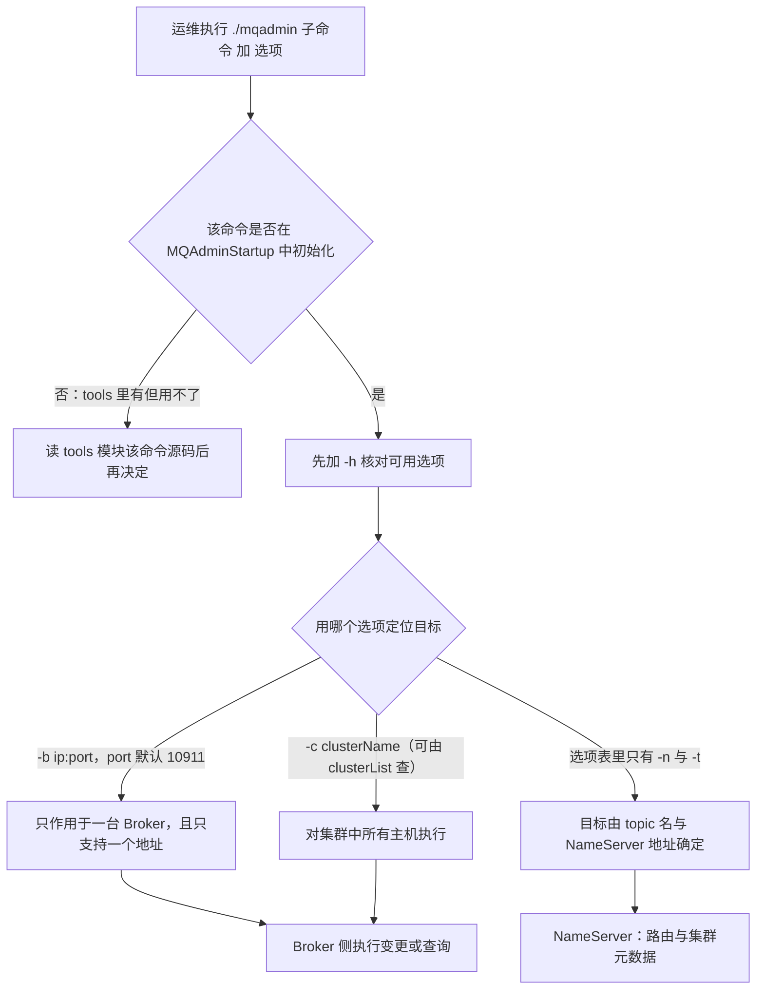

<!--
体裁：命令参数参考型
用途：写「CLI/HTTP 接口一览」「配置项清单」这类查得到、抄得走的文档时照此结构。
必备块：
  - 首个真实 H2 以「为什么…」开头（这类文档也要交代「为什么是这个工具/这套参数」）
  - 每条命令独立 H3，四件套齐全：用途 / 命令块 / 参数表 / 期望输出或注意点
  - 一张「命令速查总表」把全部子命令按用途归类
  - 参数表里凡是上游没给默认值的，照抄「上游未给出」口径，不许猜
  - ≥3 个「💡 新人小结」引用块、≥1 个 mermaid（如工具与服务端的调用关系）
  - 一节「要点总结」
源：rocket-mq-docs/content/docs/06-operations/命令行工具/mqadmin命令参考-主题集群与Broker.md（894 行）
本样章：249 行，保留 mermaid 1/表格行对 23/代码块 4/callout 1/💡小结 3
-->

## 为什么需要 mqadmin？（痛点引入）

线上出问题时，最尴尬的不是「不会修」，而是「连现场都看不到」。刚接手 RocketMQ 集群的同事通常卡在这几件事上：

- 业务方报「Topic 发不出消息」，你想确认它到底落在哪个集群、哪几台 Broker、有几条队列、权限是几，控制台没部署，只能去翻 Broker 的配置文件，一台一台看。
- 想给一个 Topic 加读队列分摊消费压力，不知道默认队列数是多少、改完会不会影响已有消费者，只能等凌晨窗口赌一把。
- 有人在测试集群建了 300 个 Topic，生产集群里也有同名残留，你想列出「这个 Topic 到底属于哪个集群、被哪些消费组订阅过」，靠 grep 日志根本查不清。
- NameServer 的配置项想核对一下当前生效值，没有 HTTP 接口可查，只能去机器上看启动参数。
- 怀疑某台 Broker 写入变慢，想量化「每台 Broker 的平均耗时」，业务侧指标只能看到整体抖动，定位不到是哪台。

> ### 💡 新人小结：mqadmin 到底是什么？
>
> 把 mqadmin 想象成「物业带的万能门禁遥控器」，而不是业主家里的门铃：
> - `-n ip:port` = 遥控器要先对准「物业总台」（NameServer），不然它不知道该去哪个小区。
> - `-b ip:port` = 你直接点名「3 栋 1 单元那扇门」，只开这一台，上游明确写着一句话：只支持单台 Broker。
> - `-c clusterName` = 你说「3 栋所有门」，于是这个集群里每台门都被执行一遍。
> - `-h` = 每把钥匙背面贴的小标签，写清了这把钥匙能开哪些锁。
> - 遥控器不是所有功能都通了电：tools 里能看到一堆命令，但只有在 `MQAdminStartup` 中初始化过的才真能按。
>
> **mqadmin 是「对着 NameServer 和 Broker 喊话」的运维遥控器：先报总台地址，再点名目标，最后说干什么。**

---

## 全局约定：动手前必须读完的 6 条

| 序号 | 上游约定（原文要点） | 落到操作上的意思 | 违反后的典型现象 |
|------|---------------------|------------------|------------------|
| 1 | 执行命令方法：`./mqadmin {command} {args}` | 子命令在前、选项在后，统一以 `./mqadmin` 为入口 | 把选项写在子命令前面、或漏掉 `./` 导致命令找不到 |
| 2 | 几乎所有命令都需要配置 `-n` 表示 NameServer 地址，格式为 `ip:port` | 本文 17 条命令的选项列里都列出了 `-n`，执行时要显式带上 NameServer 地址 | 不带 `-n` 时无从定位 NameServer，命令无法执行 |
| 3 | 几乎所有命令都可以通过 `-h` 获取帮助 | 拿不准选项就先 `-h`，这是本篇唯一的「权威选项清单」来源 | 凭记忆写选项，写出不存在的字母 |
| 4 | 既有 Broker 地址（`-b`）又有 clusterName（`-c`）时，优先以 Broker 地址执行；不配置 Broker 地址则对集群中所有主机执行；只支持一个 Broker 地址；`-b` 格式为 `ip:port`，port 默认是 10911 | `-b` 是「点名单台」，`-c` 是「全集群广播」，两个同时给时 `-b` 生效 | 想批量刷全集群却带了 `-b`，结果只改了一台；以为能写多个地址，实际只支持一个 |
| 5 | 在 tools 下可以看到很多命令，但并非都能用：只有在 `MQAdminStartup` 中初始化的命令才能用；也可以修改这个类来增加或自定义命令 | 「tools 里有」不等于「能执行」；判断可用性的依据是 `MQAdminStartup` 的初始化清单 | 照社区文章执行某命令，报命令不存在 |
| 6 | 由于版本更新问题，少部分命令可能未及时更新，遇到错误请直接阅读相关命令源码 | 文档与代码冲突时，以 `tools` 模块源码为准 | 按文档写的选项拼命令始终报错 |

约定 1 的骨架，配合约定 3 取帮助：

```bash
# ========== ✅ 推荐写法：先问 -h，再拼正式命令 ==========
./mqadmin topicList -h          # 约定 3：几乎所有命令都可以用 -h 获取帮助（源文件第 7 行）
./mqadmin topicList -n 127.0.0.1:9876   # 约定 2：-n 是 NameServer 地址，格式 ip:port（源文件第 6 行）

# ========== 不推荐写法（仅展示） ==========
# ❌ 凭记忆拼选项、不带 -h 核对，也不带 -n：目标地址与可用选项都不知道，命令无法定位 NameServer
./mqadmin topicList
```

上游未给出输出样例：`-h` 会打印什么、`topicList` 成功后的输出格式，源文件里没有任何示例，本文因此不写任何「预期输出」。

> ### 💡 新人小结：为什么 `-b` 和 `-c` 同时出现时只改了一台？
>
> 把它想成「给一栋楼发通知」：
> - `-c DefaultCluster` = 按「楼号」发，这栋楼里每一户都收到（对集群中所有主机执行）。
> - `-b 192.168.0.1:10911` = 按「门牌号」发，只敲这一户的门（只支持单台 Broker、只支持一个地址）。
> - 两个同时写 = 门牌号更具体，于是按门牌号执行（`-b` 优先）。
>
> **凡是带「影响面」的命令，动手前先确认自己用的是 `-b` 还是 `-c`——这一个字母决定了是改 1 台还是改 N 台。**

> [!NOTE] 版本适用：4.x 与 5.0 完全同一份内容
> 本文唯一源文件 `docs/04-deployment/02admintool.md` 与 5.0 版 `versioned_docs/version-5.0/05-deploymentOperations/02admintool.md` 大小均为 111,737 字节，SHA256 摘要一致（前 16 位 `825df0d5cb44bb98`）。
> 也就是说 mqadmin 这一整套命令在两代文档里没有任何差异，本文的每条选项对 4.x 与 5.0 同样成立，不存在「旧写法／新写法」对照。
> 同一份缺陷也同时存在于两个版本，见后文「Broker 相关」一节。

---

## 按场景选命令：决策树与速查表

**场景 → 命令 → 关键选项速查表**

| 业务场景 | 首选命令 | 上游给出的关键选项 | 读还是写 |
|----------|----------|--------------------|----------|
| 列出所有 Topic | `topicList` | `-n`；加 `-c` 才返回所属集群与订阅关系 | 读 |
| 看某 Topic 的路由 | `topicRoute` | `-n`、`-t` | 读 |
| 看某 Topic 各队列的 offset | `topicStatus` | `-n`、`-t` | 读 |
| 看某 Topic 在哪些集群 | `topicClusterList` | `-n`、`-t` | 读 |
| 看订阅关系、TPS、积累量、24h 读写总量 | `statsAll` | `-n`；`-a` 只打印活跃 topic；`-t` 指定 topic | 读 |
| 看集群、BrokerName、BrokerId、TPS | `clusterList` | `-n`；`-m` 打印更多信息；`-i` 打印间隔（秒） | 读 |
| 量化集群各 Broker 的 RT | `clusterRT` | `-n`、`-c`、`-a`、`-s`、`-i`、`-m`、`-p` | 写（发消息） |
| 算消费者列表的队列负载结果 | `allocateMQ` | `-n`、`-t`、`-i`（逗号分隔 ip 列表） | 读 |
| 创建或更新 Topic 配置 | `updateTopic` | `-n`，`-b` 或 `-c`，`-t`，`-r`/`-w`/`-p` | 写 |
| 只改 Topic 读写权限 | `updateTopicPerm` | `-n`，`-b` 或 `-c`，`-t`，`-p` | 写 |
| 删除某集群下的某 Topic | `deleteTopic` | `-n`、`-c`、`-t`（选项列里没有 `-b`） | 删 |
| 更新 NameServer 的 kv 配置 | `updateKvConfig` | `-n`、`-s`、`-k`、`-v` | 写（上游标注未使用） |
| 删除 NameServer 的 kv 配置 | `deleteKvConfig` | `-n`、`-s`、`-k` | 删 |
| 获取 NameServer 配置 | `getNamesrvConfig` | `-n`（选项列只有 `-n` 与 `-h`） | 读 |
| 修改 NameServer 配置 | `updateNamesrvConfig` | `-n`、`-k`、`-v` | 写 |
| 读写特定命名空间的顺序配置 kv | `updateOrderConf` | `-n`、`-t`、`-v`、`-m`（get/put/delete） | 写（上游标注未启用） |
| 开启监控进程 | `startMonitoring` | `-n` | 起进程 |



---

## Topic 相关：10 条命令逐条拆解

> ### 💡 新人小结：同一封信，为什么要抄送给全公司？
>
> 把 Topic 的元数据想成「员工手册的适用范围声明」：
> - 一条 `updateTopic`/`updateTopicPerm` 加 `-c DefaultCluster` = 手册抄送全公司每台 Broker，一处改处处一致，漏一台就出现「同一 Topic 在 A 机能写、在 B 机不能写」。
> - `deleteTopic` = 公告作废，`-c` 写明在哪个集群作废。
> - 手册上那条 `perm` 就是「可写(2)／只读(4)／读写(6)」，即权限不是开关，而是三个数值档位。
>
> **Topic 类命令的关键不是会不会写，而是「这次动了几台 Broker」。**

### updateTopic —— 创建或更新 Topic 配置

上游「含义」列原文：**创建更新Topic配置**。

| 名称 | 命令选项 | 说明（上游原文） |
|------|----------|------------------|
| updateTopic | `-b` | Broker 地址，表示 topic 所在 Broker，只支持单台 Broker，地址为 ip:port |
| updateTopic | `-c` | cluster 名称，表示 topic 所在集群（集群可通过 clusterList 查询） |
| updateTopic | `-h-` | 打印帮助 |
| updateTopic | `-n` | NameServer 服务地址，格式 ip:port |
| updateTopic | `-p` | 指定新 topic 的读写权限(W=2\|R=4\|WR=6) |
| updateTopic | `-r` | 可读队列数（默认为 8） |
| updateTopic | `-w` | 可写队列数（默认为 8） |
| updateTopic | `-t` | topic 名称（名称只能使用字符 `^[a-zA-Z0-9_-]+$`） |

```bash
# ========== ✅ 推荐写法：按集群批量下发，队列数与权限一次说清 ==========
# -n NameServer 地址，格式 ip:port（约定 2）
# -c cluster 名称：不配 -b 时对集群中所有主机执行（约定 4）
# -t topic 名称，只允许字符 ^[a-zA-Z0-9_-]+$
# -w / -r 可写队列数 / 可读队列数，上游标注默认都是 8
# -p 读写权限，上游给的是 W=2|R=4|WR=6，此处 6 即 WR
./mqadmin updateTopic -n 127.0.0.1:9876 -c DefaultCluster -t OrderMsg -w 8 -r 8 -p 6

# ========== 不推荐写法（仅展示） ==========
# ❌ 同时给 -b 与 -c：按约定 4，-b 优先且只支持一个 Broker 地址，
#    本想刷全集群，实际只会改到 -b 那一台
./mqadmin updateTopic -n 127.0.0.1:9876 -c DefaultCluster -b 192.168.0.1:10911 -t OrderMsg
```

上游未给出输出样例。

参数解释与踩坑：

- `-r`/`-w` 的默认值是上游明写的「默认为 8」，这是本文出现的唯一队列数默认值；不要按「一般消息队列都是 4」去推定别的数字。
- `-p` 与 `updateTopicPerm` 的 `-p` 用的是同一套取值（W=2|R=4|WR=6）；本文不解释这些数字以外的权限位，上游没给。
- 选项列里 `-h-` 是上游原样（源文件第 99 行），其余 16 条命令都写 `-h`，这个多出来的横线上游未解释，疑为上游排版缺陷；需要帮助时按约定 3 处理，并以 `-h` 打印结果为准。
- 风险定位：变更类，需要走变更流程；改 `-w`/`-r` 会改变队列个数分布，务必先确认影响面是 `-b` 单台还是 `-c` 全集群。

### topicList —— 查看 Topic 列表信息

上游「含义」列原文：**查看 Topic 列表信息**。

| 名称 | 命令选项 | 说明（上游原文） |
|------|----------|------------------|
| topicList | `-h` | 打印帮助 |
| topicList | `-c` | 不配置 `-c` 只返回 topic 列表，增加 `-c` 返回 clusterName、topic、consumerGroup 信息，即 topic 的所属集群和订阅关系，没有参数 |
| topicList | `-n` | NameServer 服务地址，格式 ip:port |

```bash
# ========== ✅ 推荐写法：两种形态都跑一遍，看清 -c 的差别 ==========
./mqadmin topicList -n 127.0.0.1:9876              # 不带 -c：只返回 topic 列表
./mqadmin topicList -n 127.0.0.1:9876 -c           # 带 -c：额外返回 clusterName / topic / consumerGroup

# ========== 不推荐写法（仅展示） ==========
# ❌ 把 -c 当「cluster 名称」用：这里的 -c 是「没有参数」的开关，
#    与 updateTopic/deleteTopic 里 -c 后面要接集群名完全不同
./mqadmin topicList -n 127.0.0.1:9876 -c DefaultCluster
```

上游未给出输出样例。

踩坑：这是本文最容易踩的「同名选项漂移」现场——同样是 `-c`，在 `updateTopic`、`deleteTopic`、`updateTopicPerm` 里是「cluster 名称」（要接集群名），在 `clusterRT` 里是「探测哪个集群」，在 `topicList` 里却是**上游明写「没有参数」的开关**；而 `statsAll`、`topicRoute`、`topicStatus`、`topicClusterList` 的选项列里根本没有 `-c`。写命令前先 `-h`（约定 3）。

风险定位：只读，低。

---

## NameServer 相关：4 条命令

### getNamesrvConfig —— 获取 NameServer 配置

上游「含义」列原文：**获取NameServer配置**。

| 名称 | 命令选项 | 说明（上游原文） |
|------|----------|------------------|
| getNamesrvConfig | `-n` | NameServer 服务地址，格式 ip:port |
| getNamesrvConfig | `-h` | 打印帮助 |

```bash
# ========== ✅ 推荐写法：全文最短的一条，两个选项就够 ==========
./mqadmin getNamesrvConfig -n 127.0.0.1:9876

# ========== 不推荐写法（仅展示） ==========
# ❌ 漏掉 -n：本命令选项列里只有 -n 与 -h，没有任何筛选类选项，
#    按约定 2 不报 NameServer 地址就定位不到目标，更谈不上只看某一项
./mqadmin getNamesrvConfig
```

上游未给出输出样例；具体会返回哪些配置键，上游未列出，本文不猜。

风险定位：只读，低。它是 `updateNamesrvConfig` 的「改前留档」手段。

---

## 要点总结

1. **先用 6 条全局约定校准预期**：入口是 `./mqadmin {command} {args}`；几乎所有命令都要 `-n ip:port`；几乎都能用 `-h` 取帮助；`-b` 与 `-c` 同时存在时 `-b` 优先且只支持一个 Broker 地址（`-b` 的 port 默认 10911），不给 `-b` 就对集群中所有主机执行；tools 里能看到的命令只有在 `MQAdminStartup` 初始化过的才能用；少部分命令未及时更新，遇到错误请直接阅读相关命令源码。
2. **读写分离要按上游措辞判定**：`clusterRT` 的「含义」列写着「发送消息」，它是写操作；`deleteTopic`、`deleteKvConfig`、`updateTopicPerm`、`updateNamesrvConfig`、`updateOrderConf` 属于高危，必须走变更流程；只读的 8 条可以直接执行。
3. **影响面靠 `-b`/`-c` 一个字母决定**：单台 vs 全集群，同时给时 `-b` 优先。写类命令执行前先用 `clusterList` 拿到 clusterName、`topicClusterList`/`topicList -c` 拿到归属与订阅关系。
4. **「Broker 相关」段是上游缺陷**：它的表格与「消息相关」段 10 条命令名与含义逐行相同，上游没有 Broker 侧命令；需要 Broker 操作时走「跑 `./mqadmin` 看可用命令 → 用 `-h` 取单命令帮助 → 读 `tools` 模块源码」三条有据可依的路径，不得编造命令与选项。那 10 条消息类命令的解释在下篇。
5. **同名选项不等于同义**：`-c` 在 `topicList` 里是不带值的开关、在 `updateTopic` 里是集群名；`-i` 在 `allocateMQ` 是 ip 列表、在 `clusterList`/`clusterRT` 是秒；`-m`、`-p`、`-a`、`-s` 都各有两种以上语义。拿不准就先 `-h`。
6. **上游给的两个默认值与一条字符规则要记牢**：`-r`/`-w` 默认都是 8；`-b` 的 port 默认 10911；topic 名称只能用字符 `^[a-zA-Z0-9_-]+$`。此外源文件全文没有任何输出样例，本文所有示例后一律标注「上游未给出输出样例」。

---

## 本样章的取舍说明

开头体裁说明块与本节为样章自写；其余正文一律从源文件逐字裁出，按 H2/H3 整条取舍，未改写句式、未补参数、未编造输出。各 H2 标题（含「10 条」「4 条」等数字）照抄源文，指源文该节的条目数，不是本样章保留数。上述被删命令的参数表、示例与其余表格，全文参考见 99-完整参考全文.md。

- 保留的命令（3 条）：`updateTopic`（写类，8 行参数表 + `-r`/`-w` 默认值「默认为 8」）、`topicList`（读类，含「同名选项漂移」踩坑）、`getNamesrvConfig`（选项只有 `-n` 与 `-h` 的最短一条）。
- 删掉的命令（14 条）：`deleteTopic`、`topicRoute`、`topicStatus`、`topicClusterList`、`updateTopicPerm`、`updateOrderConf`、`allocateMQ`、`statsAll`、`clusterList`、`clusterRT`、`updateKvConfig`、`deleteKvConfig`、`updateNamesrvConfig`、`startMonitoring`。
- 删掉的其他块：「为什么」一节的痛点对照表、`:::tip 注意` 出处段、决策树文本块、图后解读三句、「Broker 相关：上游文档缺陷」整节、「同名选项跨命令含义对照」表、「风险分级与变更流程」表、「常见误区自检」表、「术语表」、「本篇 17 条命令总表」、结尾 6 点「💡 新人小结」。
- 关于 `-h` 输出示例：源文件第 83 行明写「上游未给出输出样例：`-h` 会打印什么、`topicList` 成功后的输出格式，源文件里没有任何示例」，所以本样章只保留「先 `-h` 核对选项、再拼正式命令」的用法块与「上游未给出」口径，未编造帮助输出。
