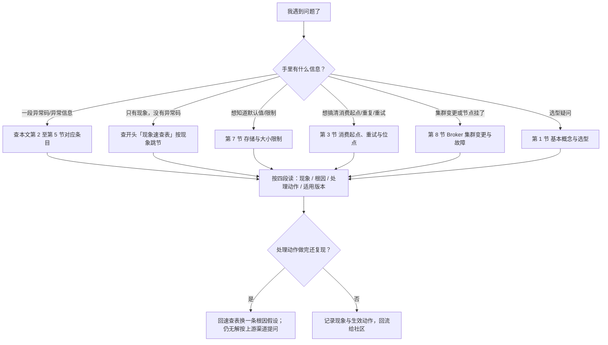
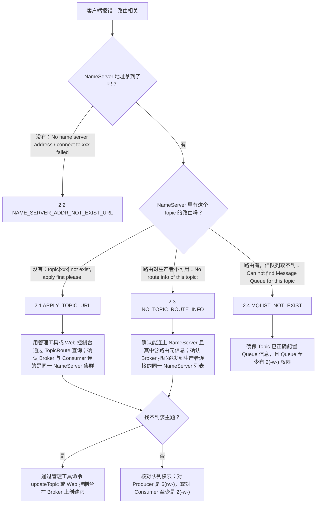

<!--
体裁：FAQ 排障型
用途：写「按现象组织的排查清单」时照此结构；一条 FAQ 只解决一个现象。
必备块：
  - 首个真实 H2 以「为什么…」开头
  - 每条问答固定三段：现象 / 根因 / 处理动作（可验证的动作，不是“检查一下”）
  - ≥1 个 mermaid：排查决策树或「生产→存储→消费」三段定位图
  - 一张按现象归类的速查表
  - 版本口径不同处用 > [!NOTE] 显式标注，别把 4.x 结论当 5.0 写
  - 一节「要点总结」、≥3 个「💡 新人小结」
源：rocket-mq-docs/content/docs/10-community/常见问题/常见问题FAQ.md（800 行）
本样章：244 行，保留 mermaid2/表格行对3/代码块1/callout1/💡小结3
-->

## 为什么需要按根因重排 FAQ？（痛点引入）

线上出问题时翻 FAQ 的体验通常是这样：报错 `No route info of this topic: OrderTopic`，你按关键词搜到「NO_TOPIC_ROUTE_INFO」这一条，看完它的四条解决方案，觉得都对，于是开始挨个试；试到第三条才想起——同一个「拿不到路由」的现象，在 FAQ 里还散落在 `APPLY_TOPIC_URL`、`MQLIST_NOT_EXIST`、`SUBSCRIPTION_GROUP_NOT_EXIST` 三条里，四条的解决清单互相重叠又各有细节。你其实是在**用同一份文档做四次重复排查**。

上游 FAQ 的组织方式是「基本 / 使用 / 配置相关 / 错误 / 其他」五组，其中第四组 12 条按**异常码名字**排序。这对「我已经知道异常码」的人是快的，对「我只知道现象」的人是慢的——而新人 90% 的时间属于后者。

| 维度 | 只按上游五组顺序读 | 本文的两层组织 |
|------|--------------------|----------------|
| 入口 | 必须先知道异常码或问题分组 | 先看「现象速查表」，从现象直接跳节 |
| 同一现象的多条 | 散落在 4 个条目里，靠通读发现 | 归到同一节，一次读完全部判据 |
| 排查顺序 | 条目内部是「原因 + 解决方案」两段 | 每条固定四段：现象 / 根因 / 处理动作 / 适用版本 |
| 版本差异 | 4.x 与 5.0 两版各说一遍，容易只看到一半 | 每条末尾显式标「适用版本」，差异处并列两版原文 |
| 高频项 | 纯文字，无判据流 | 补 Mermaid 排障流程，判据全部取自上游文本 |

> ### 💡 新人小结：这份 FAQ 该怎么用？
>
> 把排障想象成**去医院挂号**：
> - 速查表 = 大厅的「症状 → 科室」指示牌：先按症状找到科室（第几节），不用先知道病名。
> - 异常码 = 化验单上的指标名。你已经拿着化验单，就直接按码找条目。
> - 每条的四段结构 = 医生的四句话：你看到什么（现象）、为什么（根因）、做什么（处理动作）、这份结论适用于谁（适用版本）。
> - 「上游未给出」= 医生明说「这个要再做检查」，而不是随口给你一个答案。
>
> **FAQ 的价值不在条目多，而在你能在三分钟内定位到该看的那一条。**

**学习路线图**（先按现象分流，再进对应节）



---

## 现象速查表（按现象查表）

| 你看到的现象 / 异常信息（上游原文照抄） | 上游给出的可能根因 | 跳到 |
|-------------------------------------------|---------------------|------|
| 不知道选不选 RocketMQ、要不要装别的东西 | 属于选型与部署依赖问题 | 第 1 节 |
| `topic[xxx] not exist, apply first please!` | Producer 发送或 Consumer 消费时，根据 Topic 获取路由信息失败 | 2.1 |
| `No name server address, please set it` 或 `connect to xxx failed, maybe the domain name xxx not bind in /etc/hosts` | Producer 或 Consumer 获取 NameServer 地址信息异常 | 2.2 |
| `No route info of this topic:` | 消息要发到一个路由信息对生产者不可用的主题 | 2.3 |
| `Can not find Message Queue for this topic` | 对 Producer，根据 Topic 未能获取对应的 Queue 信息 | 2.4 |
| 新建的消费组第一条消息从哪来、重启后从哪来 | 消息是否在三天内 + 是否首次上线 + SDK 版本 | 3.1 |
| 消费失败后消息会不会重投、重投几次 | 集群模式可重试（4.x 写死 16 次 / 5.0 按配置）；广播模式不重发 | 3.2 |
| 消费失败的那条消息去哪了、怎么找回来 | 按时间 / 按 Topic+消息 ID / 按 Topic+Key 三种查询能力 | 6.1 |
| 消息会不会重复 | RocketMQ 保证至少传递一次；大多数情况下不会重复 | 6.2 |
| 消费者线程数怎么调 | 4.x 有 `ConsumeThreadNums`；5.0 只说不同版本参数名不一样 | 3.3 |
| `readLocalOffset Exception` | 广播模式加载本地 `offsets.json` 异常；损坏的 fastjson 文件同样导致 | 3.4 |
| `The producer group[xxx] has been created before, specify another name please.` | 相同名称的 Consumer Group 已经启动，注册失败 | 4.1 |
| `consumerGroup can not equal ...` / `allocateMessageQueueStrategy is null ...` / `Long polling mode, the consumer consumerTimeoutMillisWhenSuspend must greater than brokerSuspendMaxTimeMillis ...` | Consumer 参数校验失败 | 4.2 |
| `subscription group not exist` | Consumer Group 或 DelayQueue（4.x 原文拼作 `DleayQueue`）获取订阅信息异常 | 4.3 |
| `the consumer's group info/subscription not exist` | Consumer 订阅 Topic 信息不存在 | 4.4 |
| `The xxx service state not OK, maybe started once` | 同一个 Producer/Consumer Group 在同一个 JVM 中启动了多个实例 | 5.1 |
| `Send [xxx] times, still failed, cost [xxx]ms, Topic: xxx, BrokersSent ...` | Producer 消息发送异常；SYNC 共发送 3 次，ASYNC 与 ONEWAY 发送 1 次 | 5.2 |
| `InetAddress java.net.InetAddress.getLocalHost() throws UnknownHostException` | 主机可能有很多网络接口，并且一个接口可能绑定到多个 IP 地址 | 5.3 |
| 消息在服务器上能存多久、消息体多大 | 默认值类问题：最多保存 3 天；体大小通常 256KB | 第 7 节 |
| 怎么加一台新 Broker | 新 Broker 注册进 NameServer 的 Broker 列表；业务主题与消费者组需手工复制 | 8.1 |
| Broker 挂了会怎样（Master / 部分 Slave / 全部 Slave） | 影响面按角色分三种情形 | 8.2 |

---

## 第 2 节 路由与寻址失败（4 条）

这一节把上游四条「拿不到东西」的异常码收在一起。它们根因不同层：NameServer 地址（2.2）→ NameServer 里有没有这个 Topic 的路由（2.1 / 2.3）→ 路由里的队列与权限（2.4）。判据全部来自上游文本。

下图是这四种情形的排查顺序，判据均为上游原文。



### 2.1 APPLY_TOPIC_URL

- **现象**：异常信息 `topic[xxx] not exist, apply first please!`。
- **根因**：上游原文一条——Producer 发送消息或 Consumer 消费消息时，根据 Topic 获取路由信息失败，会出现这个异常。
- **处理动作**（上游四条，逐条保留）：
  1. 确保 NameServer 确实包含 Topic 的路由信息。可以使用管理工具或 Web 控制台通过 TopicRoute 从 NameServer 查询路由信息；
  2. 确保 Broker 和 Consumer 连接的是**同一 NameServer 集群**；
  3. 确保主题的队列权限，对 Producer 是 `6(rw-)`，或对 Consumer 至少是 `2(-w-)`；
  4. 如果找不到此主题，请通过管理工具命令 `updateTopic` 或 Web 控制台在 Broker 上创建它。
- **适用版本**：4.x 与 5.0 文本一致。

### 2.2 NAME_SERVER_ADDR_NOT_EXIST_URL

- **现象**：两条异常信息之一（上游原文并列给出）：
  - `No name server address, please set it`
  - `connect to xxx failed, maybe the domain name xxx not bind in /etc/hosts`
- **根因**：Producer 或 Consumer，获取 NameServer 地址信息异常。
- **处理动作**：上游只给一条——请参考 [5.1 客户端寻址方式](https://github.com/apache/rocketmq/blob/develop/docs/cn/best_practice.md)。本条不再补具体参数名（上游未给出）。
- **适用版本**：4.x 与 5.0 文本一致；差异仅在排版——4.x 把「或」紧贴两段异常信息，5.0 在前后各加了空行，两版文字逐字相同。

### 2.3 NO_TOPIC_ROUTE_INFO

- **现象**：异常信息 `No route info of this topic:`。
- **根因**：上游原文——将消息发送到一个路由信息对生产者不可用的主题时，就会发生这种情况。
- **处理动作**（上游五条，逐条保留）：
  1. 确保生产者可以连接到名称服务器并且能够从中获取路由元信息；
  2. 确保名称服务器确实包含主题的路由元信息。可以使用管理工具或 Web 控制台通过 TopicRoute 从名称服务器查询路由元信息；
  3. 确保你的 Broker 将心跳发送到你的生产者正在连接的**同一 NameServer 列表**；
  4. 确保主题的权限为 `6(rw-)`，或至少为 `2(-w-)`；
  5. 如果找不到此主题，请通过管理工具命令 `updateTopic` 或 Web 控制台在 Broker 上创建它。
- **适用版本**：4.x 与 5.0 文本一致。

### 2.4 MQLIST_NOT_EXIST

- **现象**：异常信息 `Can not find Message Queue for this topic`。
- **根因**：对于 Producer，根据 Topic 未能获取对应的 Queue 信息。
- **处理动作**（上游两条）：
  1. 确保 Topic 已经正确配置 Queue 信息；
  2. 确保 Topic 对应的 Queue 至少有 `2(-w-)` 权限。
- **适用版本**：4.x 与 5.0 文本一致（差异为条目缩进与空行排版）。

> ### 💡 新人小结：路由、队列、权限是三层不同的东西
>
> 把它想成**寄快递**：
> - NameServer 地址 = 快递网点的电话。打不通 → 2.2。
> - Topic 的路由 = 电话本里有没有「这个小区」的登记。没登记 → 2.1 / 2.3。
> - Queue 信息 = 该小区下面具体有几条投递线路。线路查不到 → 2.4。
> - 队列权限 = 这条线路允不允许你收件/派件。线路在但不让你派 → 权限不足。
>
> **四条异常码对应四层，逐层确认比一次改四个配置更快收敛。**

---

## 第 3 节 消费起点、重试与位点（4 条）

### 3.2 当消费失败的时候如何重新消费消息？

- **现象**：业务处理抛异常或返回失败，消息会不会自动重投。
- **根因**：取决于消费模式。集群模式走重试；广播模式不重发。
- **处理动作**：见下表两版口径 + 模式对照。
- **适用版本**：**4.x 与 5.0 文本不同**。

| 对比维度 | 4.x FAQ | 5.0 FAQ |
|----------|---------|---------|
| 失败时的返回值表述 | `Action.ReconsumerLater`、`NULL`、或抛出异常 | 返回消费失败状态、或抛出异常 |
| 重试次数 | 最多重试 **16 次** | 按照设置的**最大重试次数**（未写死数值） |
| 重试耗尽之后 | 该消息会被丢弃 | 该消息会被丢弃 |
| 广播模式 | 保证至少被消费一次，但不提供重发的选项 | 与 4.x 逐字相同 |

> [!NOTE] 版本适用：广播消费不提供失败重试
> 4.x《Push 消费》明确：「消息重试只针对集群消费模式生效；广播消费模式不提供失败重试特性，即消费失败后，失败消息不再重试，继续消费新的消息。」因此依赖 4.x 广播模式做本地缓存刷新的下游，失败只能靠自己的重扫逻辑兜底，不能指望重试链路。

### 3.4 LOAD_JSON_EXCEPTION

- **现象**：异常信息 `readLocalOffset Exception`。
- **根因**（上游两条）：
  1. 消费者在广播模式下，加载本地 `offsets.json` 文件异常；
  2. 损坏的 fastjson 文件也会导致同样的问题。
- **处理动作**（上游两条）：
  1. 检查 fastjson 版本和 RocketMQ 使用版本是否一致；
  2. 升级 fastjson 版本。
- **适用版本**：4.x 与 5.0 文本一致（差异为空行排版）。

```shell
# ✅ 推荐排查顺序（判据均来自上游两条动作）
# 步骤 1：确认异常发生在广播模式下 —— 上游根因 1 明确限定「消费者在广播模式下」
# 步骤 2：确认本地 offsets.json 能否被正常加载（现象即 readLocalOffset Exception）
# 步骤 3：核对 fastjson 版本与 RocketMQ 所用版本是否一致（上游动作 1）
# 步骤 4：不一致则升级 fastjson 版本（上游动作 2）
# 输出: 上游未给出成功日志，此处不编造

# ❌ 不推荐：把 offsets.json 直接删掉当作「清理缓存」
#    上游未把删除文件列为处理动作，位点文件承载消费进度，动作以外来手段属越界
```

---

## 要点总结

1. **先按现象分流，再按异常码定位**：上游 23 条 Q&A 被重组为 8 个根因分组——选型（第 1 节）、路由与寻址（第 2 节，4 条）、消费起点与位点（第 3 节，4 条）、分组与订阅（第 4 节，4 条）、发送失败与实例状态（第 5 节，3 条）、消息查找与传递语义（第 6 节，2 条）、默认值限制（第 7 节，2 条）、集群变更与故障（第 8 节，2 条）。
2. **路由类四条异常是四层问题**：NameServer 地址（`No name server address` / `/etc/hosts`）→ Topic 路由是否存在（`topic[xxx] not exist` / `No route info of this topic:`）→ 队列信息（`Can not find Message Queue for this topic`）→ 队列权限（Producer 要 `6(rw-)`、Consumer 至少 `2(-w-)`）；跨条重复的判据（同一 NameServer 集群、`TopicRoute` 查询、`updateTopic` 创建）集中在速查表里。
3. **三条高频项在两版 FAQ 里口径不同，必须分版本陈述**：新消费组起点（4.x 只看三天与重启，5.0 先看 5.x SDK 还是 3.x/4.x SDK）、失败重投（4.x 写死最多重试 16 次，5.0 按设置的最大重试次数）、消费线程数（4.x 给 `ConsumeThreadNums` 与 20/20 示例，5.0 只说不同版本参数名不一样）。
4. **传递语义与默认值要按原文强度理解**：「至少传递一次」是保证，「大多数情况下不会重复」不是保证；「3 天」「256KB」都受上游第 3 组开头的「均为默认值，可通过配置修改」限定。
5. **发送次数与实例数的数字有出处**：`SEND_MSG_FAILED` 的「SYNC 3 次、ASYNC/ONEWAY 1 次」与 `CLIENT_SERVICE_NOT_OK` 的「同组同 JVM 只起一个实例」是两条独立判据，排查发送失败时按 5.2 上图的三条动作顺序收敛；Broker 崩溃影响面按 Master / 部分 Slave / 全部 Slave 三种情形分开评估，`SLAVE_NOT_AVAILABLE` 只在 Master 为 `SYNC_MASTER` 且所有 Slave 都崩溃时出现在 Producer 侧。

---

> ### 💡 新人小结：这份 FAQ 学完了，记住这 5 点
>
> 1. **别一上来搜异常码**：先在「现象速查表」里按你看到的现象找到分组，异常码只是这一组里的细分标签。
> 2. **路由问题分四层看**：地址 → 路由 → 队列 → 权限；每层都有对应的异常字符串，逐层确认比一次改四个配置快。
> 3. **版本口径要分清**：5.x SDK 的新消费组从队列尾开始；4.x FAQ 里「三天内从头开始」的说法对应的是 3.x/4.x SDK；「重试 16 次」只在 4.x 口径里成立。
> 4. **默认值不是硬限制**：3 天保存、256KB 消息体、线程数配置，都受「均为默认值，可通过配置修改」这句限定；跨版本迁移时先确认目标环境有没有改过。
> 5. **上游没写的别当成结论**：本 FAQ 的处理动作里，凡是上游只给链接的（如客户端寻址方式、客户端配置），本文照抄链接而不编步骤；需要更细的操作，按社区渠道提问（`users@rocketmq.apache.org` 与 GitHub Issue，见贡献篇）。

---

**本样章的取舍清单（只删块、只裁条目；正文每句都是源文件里的连续原文，未改写）**

- 保留的问答条目（每条一个 H3，内部固定现象 / 根因 / 处理动作 / 适用版本）：2.1 APPLY_TOPIC_URL、2.2 NAME_SERVER_ADDR_NOT_EXIST_URL、2.3 NO_TOPIC_ROUTE_INFO、2.4 MQLIST_NOT_EXIST、3.2 当消费失败的时候如何重新消费消息、3.4 LOAD_JSON_EXCEPTION。
- 删掉的问答条目：1.1、1.2、3.1（消费起点，连带其两版口径 text 块、对照表与 stateDiagram）、3.3（消费者线程数，连带 java 块与对照表）、4.1–4.4、5.1–5.3（连带发送排障 mermaid）、6.1–6.2、7.1–7.2、8.1–8.2（连带崩溃影响 mermaid 与其 💡 小结）。
- 删掉的其它块：术语表、两版 FAQ 的差异汇总、处理动作里的通用判据速查表、第 2 节的 java 与 properties 代码块及 2.1/2.3 对照表、3.2 的 java 原文口径块、3.4 的参数解释、3.4 之后「位点三个名词别混」的 💡 小结（内容依赖已删的 3.1）。
- 「现象速查表」整表保留，故其中指向第 1 节、4.x、5.x、6.x、第 7 节、8.x 的「跳到」目标在本样章内已不存在；节标题里「第 3 节 …（4 条）」这类条数是源文原话，节选后实际保留 2 条，照此体裁写整页时两者要一致。
- 唯一的 `> [!NOTE]` 整块取自辅助对照文件 content/docs/05-consumption/均衡进度与重试/消费重试与死信队列.md（FAQ 源文件本身没有 callout），放在 3.2 的对照表之后，用来标 4.x 与 5.0 集群/广播重试口径的差异。
- 全文参考见 99-完整参考全文.md。
