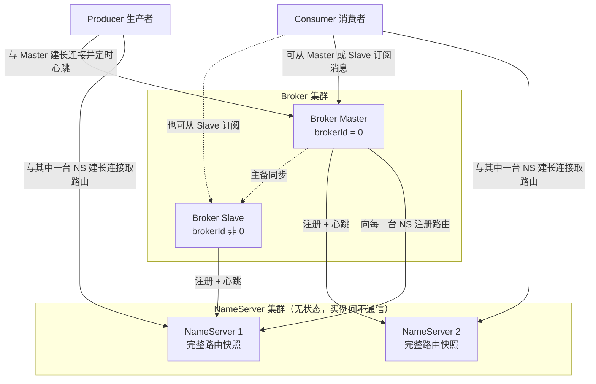
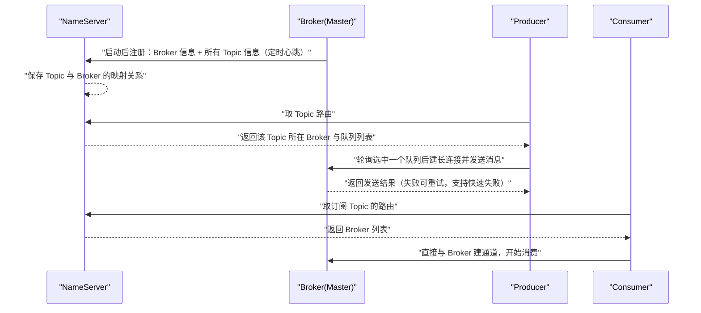

<!--
体裁：完整参考全文（不删节、不裁剪）
这份是**一篇真实成品文档的全貌**，用来对照前面四份样章——样章是「一类体裁的骨架」，这一份是「填满之后的样子」。
源：rocket-mq-docs/content/docs/01-overview/认识RocketMQ/是什么与为什么选择RocketMQ.md
     （由上游 apache/rocketmq-site 仓库 docs/00-introduction/01whychoose.md 与 docs/00-introduction/02whatis.md（4.x）及对应 5.0 版 两篇合并重写而来）
实测规模：全文 523 行 / 正文 518 行 / 43488 字节；H2 11 个；mermaid 2；语言标注代码块 6；表格行对 58；callout 4；💡 新人小结 5。
读它时重点看四件事：
  1 开头如何用真实痛点与对比表把「为什么」讲完，再给学习路线图；
  2 每个核心概念如何走「痛点 → 设计 → 用法」，代码块后如何紧跟参数解释表；
  3 版本差异如何用 > [!NOTE] 就地标注，而不是散在正文里靠读者自己辨；
  4 术语表、误区自检表、要点总结、结尾💡小结如何与正文一一呼应（不引入正文没讲过的新概念）。
使用方式：拷进 content/docs/<分类>/<板块>/ 后只需改 front matter 的 title/description/weight；
     验收判据是 audit_structure.py 报 problems=0、validate_mermaid.py 报 REAL_FAIL=0、check_links.py 报 broken=0。
-->


## 为什么需要 RocketMQ？（痛点引入）

想象你在做一个电商下单接口：一次「创建订单」要同时通知积分系统、库存系统、物流系统和风控系统。如果直接用同步 RPC 串行调用这四个下游，你会遇到三件事：

- 只要有一个下游慢（例如风控要调第三方模型），整个下单接口的响应时间就被拖长，用户看到转圈；
- 大促瞬时流量进来，下游处理能力有限，直接把下游打挂，故障沿调用链一路回溯到下单本身；
- 下游要扩容、要发布、要容灾，都必须和上游一起排期，因为它们是「直接连接」的强耦合关系。

把中间那一层「直接调用」换成「先把事件（消息）交给一个可靠的中间代理，再由代理按语义投给下游」，上面的三个问题分别变成：接口只等代理收下消息、流量被代理缓冲整形、上下游各自独立升级。这个中间代理就是消息中间件，而 Apache RocketMQ 就是其中专为「业务消息」打磨的一款。

| 场景 | 没有消息引擎（同步 RPC 直连） | 有了 RocketMQ（异步消息） |
|------|------------------------------|---------------------------|
| 上游响应时间 | 等所有下游处理完才返回 | 消息发送成功即认为该异步链路调用完成 |
| 下游故障 | 故障沿调用链上溯，上游被拖垮 | 中间代理负责缓冲和异步恢复，上下游耦合较弱 |
| 大促峰值 | 峰值直接击中下游，容易击垮 | 代理具备流量缓冲和整形能力，削峰填谷 |
| 系统拓扑 | 多对多直连，网状难以维护 | 统一和中间代理通信，星型结构，易于维护 |
| 新增消费者 | 上游要改代码、加调用 | 新消费组订阅同一主题即可，上游不动 |

> ### 💡 新人小结：把 RocketMQ 想成小区的智能快递柜
>
> 把消息系统想象成「小区快递柜 + 驿站」这套日常设施：
>
> - 寄件人（生产者 Producer）不需要认识收件人，只要把包裹投进指定柜门编号；
> - 柜门分区（队列 MessageQueue）让同一个小区的包裹可以并行投递、并行取件；
> - 一家人（消费组 ConsumerGroup）共享取件任务，谁取到算谁那份，不会重复取；
> - 驿站仓库（Broker）真正存放包裹并保证不丢，柜子的「哪个小区哪个驿站有货」的目录（NameServer）只负责查路由；
> - 取件人按短信提示到柜取件（拉 Pull），也可以由柜子主动推送提醒（推 Push）。
>
> **一句话总结：RocketMQ 就是一个「带可靠仓储、带目录查询、带取件规则」的异步消息快递系统。**

**学习路线图**

```text
痛点与定位 → 基础消息模型 → 扩展消息模型 → 部署模型 → 集群工作流 → 5.0 视角选型 → 4.x 视角选型 → 场景与生态
为什么       Pub/Sub        队列/消费组     NS/Broker   5 步流程      AI 原生/对比表   历史/对比表    落地
```

本文覆盖「是什么、为什么选、架构如何分工、消息模型如何演进」；具体的参数硬限制清单见〈使用限制与参数约束〉，4.x 与 5.0 的迁移决策见〈4.x 与 5.0 的差异及迁移选型〉，各消息类型的发送代码见「消息类型与发送」板块，此处按知识板块分工不重复展开。

---

## 官方定位：4.x 与 5.0 的两种说法

同一个产品，两代文档给出的定位口径不同，复刻时两套都要保留，因为「为什么选它」的答案随版本演进发生了变化。

| 口径 | 官方原文定位 | 强调的能力 |
|------|--------------|-----------|
| 4.x《为什么选择 RocketMQ》 | 「架构简单、业务功能丰富、具备极强可扩展性」；「业内共识的金融级可靠业务消息首选方案」 | 与传统 pub/sub 到高容量实时零误差交易系统的全覆盖 |
| 5.0《为什么选择 RocketMQ》 | 「面向万亿级消息规模的 AI 原生异步通信引擎」；「已从高性能消息队列演进为统一消息平台，横跨传统业务消息、事件流处理和新兴的 AI 原生通信三大范式」 | AI 原生通信、云原生架构、金融级可靠性三组优势 |

4.x 文档还交代了它诞生的动机：在阿里孕育 RocketMQ 的雏形时期，它被用于异步通信、搜索、社交网络活动流、数据管道、贸易流程；随着贸易业务吞吐量上升，消息传递集群压力变得紧迫。根据官方的研究，随着队列和虚拟主题使用的增加，ActiveMQ IO 模块达到了瓶颈，团队尝试用节流、断路器、降级来缓解，但效果不理想；随后尝试当时流行的 Kafka，结果在低延迟和高可靠性两方面不满足要求。于是在这种情况下决定自研一个新的消息传递引擎，处理更广泛的消息用例——从传统 pub/sub 场景，到高容量的实时零误差交易系统。历经十余年的大规模场景打磨，RocketMQ 被广泛应用于互联网、大数据、移动互联网、物联网等领域的业务场景。

> [!NOTE] 版本适用：上面这段「与 ActiveMQ / Kafka 的历史选型」是 4.x 时期文档的叙事口径；5.0 时期文档已改为以「AI 原生异步通信引擎」开篇。两代文档的对比表维度也不同，本文分别保留，见后文两张对比表。

### 术语表

| 术语 | 全称 | 通俗含义（用自己的话） | 在本文中的角色 |
|------|------|------------------------|----------------|
| Pub/Sub | Publish / Subscribe，发布-订阅 | 发送方把消息投给「频道」，订阅该频道的人都能收到 | 第一节的基础消息模型 |
| Producer | 生产者 | 造消息并投进系统的一方，通常就是业务代码 | 概念模型与部署模型的发送端 |
| Consumer | 消费者 | 从系统里取消息并处理的一方，通常是后台异步任务 | 概念模型与部署模型的接收端 |
| Topic | 主题 | 一类消息的集合，订阅的基本单位 | 消息传送的通道标识 |
| MessageQueue | 队列 | 主题被切成的多个并行通道，用来做水平扩展 | 扩展消息模型 |
| ConsumerGroup | 消费者分组（消费组） | 一组消费逻辑相同的消费者，共同分摊一个主题的消息 | 消费能力水平扩展 |
| Broker | 代理服务器 | 真正存消息、投消息、查消息的服务端节点 | 部署模型核心组件 |
| NameServer | 名字服务器 | 轻量的主题路由注册与发现中心，只答「谁在哪个 Broker 上」 | 部署模型路由中枢 |
| Master / Slave | 主节点 / 从节点 | 同一组 Broker 里负责写的和负责备的 | Broker 高可用 |
| Proxy | 代理层 | 5.x 新增的无状态接入层，客户端先连它再由它转发到 Broker | 5.0 云原生架构 |
| gRPC | Google Remote Procedure Call | 一套跨语言的 RPC 框架，5.x 用它做客户端通信协议 | 5.0 SDK 与多协议支持 |
| LiteTopic | 轻量主题 | 为 AI Agent 会话设计的极轻量通道，可开到百万级 | 5.5 AI 原生能力 |
| MCP | 上游文档未展开全称（业界通称 Model Context Protocol，模型上下文协议） | LLM 与外部工具、上下文之间交互的协议名 | AI Agent 通信场景 |
| A2A | Agent to Agent（缩写直译，智能体之间） | 智能体与智能体互相通信的协议名 | 多 Agent 异步通信场景 |
| SQL92 | Structured Query Language 1992 | 用类 SQL 表达式做消息过滤 | 功能对比表的过滤维度 |
| DLedger | 上游文档未展开全称，出现处均与 Raft 一致性协议并列 | RocketMQ 侧用于选主与多副本同步复制的组件名 | 5.0 高可用架构 |
| Raft | Raft Consistency Protocol | 分布式节点就「谁当主、日志如何一致」达成共识的算法 | 5.0 高可用架构 |
| FIFO | First In First Out | 先进先出，保证先后顺序 | 严格顺序消息 |
| CDC | Change Data Capture | 捕获数据库变更并实时搬运到别处 | 事件流与数据集成场景 |
| TPS | Transactions Per Second | 每秒事务/消息处理量 | 吞吐与选型讨论 |
| IoT | Internet of Things | 物联网设备 | MQTT 场景 |
| Serverless | 无服务器 | 按需拉起、不常驻的函数计算形态 | 多协议支持目标端 |
| Helm / Operator | Kubernetes 的包管理器 / 自定义控制器 | 在 K8s 里声明式部署和运维应用的两种方式 | 云原生架构 |
| MQTT | Message Queuing Telemetry Transport（上游未展开，业界通称） | 面向弱网、小设备的轻量发布订阅协议 | 多协议支持与 IoT 场景 |
| AMQP | Advanced Message Queuing Protocol（上游未展开，业界通称） | 一套面向消息队列的开放标准协议 | 多协议支持；4.x 表中 ActiveMQ 的协议之一 |
| RocksDB | 上游未展开全称，作为索引存储引擎出现在 LiteTopic 描述中 | 键值存储引擎，被用来给海量 LiteTopic 建索引 | 百万级 LiteTopic 的实现依据 |
| LLM | Large Language Model | 大模型推理任务本身，AI 会话的算力侧 | 长会话续连与批量消费场景 |
| AI Agent | 智能体 | 能自主调用工具、与其他智能体协作的程序实体 | 5.0 AI 原生章节的主体对象 |

---

## 核心概念与问题定义：基础消息模型就是一个 Pub/Sub 模型

我们平时使用体育新闻类软件，会订阅自己喜欢的球队板块；当有作者发表文章到相关板块，我们就能收到相关新闻推送。这就是发布-订阅范式：消息的发送者（发布者、生产者、Producer）将消息发送给特定的接收者（订阅者、消费者、Consumer）。RocketMQ 的基础消息模型就是一个简单的 Pub/Sub 模型。

三个基础概念按官方口径：

- **生产者**：负责生产消息，一般由业务系统负责生产消息；一个消息生产者会把业务应用系统里产生的消息发送到 Broker 服务器。RocketMQ 提供多种发送方式——同步发送、异步发送、顺序发送、单向发送。
- **消费者**：负责消费消息，一般是后台系统负责异步消费；一个消息消费者会从 Broker 服务器拉取消息并把它提供给应用程序。从用户应用的角度而言提供了两种消费形式：拉取式消费、推动式消费。
- **主题（Topic）**：表示一类消息的集合，每个主题包含若干条消息，每条消息只能属于一个主题，是 RocketMQ 进行消息订阅的基本单位。


上图是一个基本的消息系统模型：包括**生产者（Producer）**、**消费者（Consumer）**，中间进行基于**消息主题（Topic）**的消息传送。

在**基于主题**的系统中，消息被发布到主题或命名通道上；消费者将收到其订阅主题上的所有消息；生产者负责定义订阅者所订阅的消息类别。这是基础概念模型，而实际应用中的结构更复杂：为了支持高并发和水平扩展，中间的消息主题需要进行分区，同一个 Topic 会有多个生产者，同一个消息会有多个消费者，消费者之间要进行负载均衡。

---

## 扩展后的消息模型：队列与消费者分组


扩展后的消息模型包括**两个生产者**、**两个消息 Topic**、以及**两组消费者 Consumer**；存储消息 Topic 的**代理服务器（Broker）**是实际部署过程对应的代理服务器。官方给出的两条扩展动机非常关键：

- 为了消息写入能力的**水平扩展**，RocketMQ 对 Topic 进行分区，这种操作被称为**队列（MessageQueue）**；
- 为了消费能力的**水平扩展**，**ConsumerGroup** 的概念应运而生。

相同的 ConsumerGroup 下的消费者主要有两种负载均衡模式：**广播模式**和**集群模式**（官方图中是最常用的集群模式）。

- **集群模式**：同一个 ConsumerGroup 中的 Consumer 实例是负载均衡消费。官方例子：ConsumerGroupA 订阅 TopicA，TopicA 对应 3 个队列，则 GroupA 中的 Consumer1 消费 MessageQueue 0 和 MessageQueue 1 的消息，Consumer2 消费 MessageQueue 2 的消息。
- **广播模式**：同一个 ConsumerGroup 中的每个 Consumer 实例都处理全部的队列。因为每个实例都要处理全部消息，官方明确说明这种模式仅推荐在通知推送、配置同步类小流量场景使用。

这两种模式的差别用一段可运行的校验脚本最能看清分摊结果：

```python
# 集群模式 vs 广播模式：同一份队列与消费者配置，各自会分到什么
# 依据 4.x《初识 RocketMQ》中 ConsumerGroupA / TopicA（3 个队列）的例子
queues = ["MessageQueue 0", "MessageQueue 1", "MessageQueue 2"]
consumers = ["Consumer1", "Consumer2"]

def cluster_assign(queues, consumers):          # 平均分配：按队列数除以消费者数均摊
    per = len(queues) // len(consumers)         # 每个消费者的基础队列数
    extra = len(queues) % len(consumers)        # 余数分给前面的消费者
    result, cursor = {}, 0
    for i, name in enumerate(consumers):
        take = per + (1 if i < extra else 0)
        result[name] = queues[cursor:cursor + take]
        cursor += take
    return result

def broadcast_assign(queues, consumers):        # 广播：每个消费者拿到全部队列
    return {name: list(queues) for name in consumers}

print("集群模式:", cluster_assign(queues, consumers))
print("广播模式:", broadcast_assign(queues, consumers))
# 输出: 集群模式: {'Consumer1': ['MessageQueue 0', 'MessageQueue 1'], 'Consumer2': ['MessageQueue 2']}
# 输出: 广播模式: {'Consumer1': ['MessageQueue 0', 'MessageQueue 1', 'MessageQueue 2'], 'Consumer2': ['MessageQueue 0', 'MessageQueue 1', 'MessageQueue 2']}
```

参数与行为解释：

| 项目 | 含义 | 依据 |
|------|------|------|
| `queues` | TopicA 的队列数，示例为 3 | 4.x《初识 RocketMQ》集群模式举例 |
| `cluster_assign` | 把队列均摊给组内消费者，结果与官方例子一致（Consumer1 拿到队列 0、1；Consumer2 拿到队列 2） | 同上 |
| `broadcast_assign` | 组内每个消费者都拿到全部队列，即每条消息被组内每个实例处理一次 | 4.x《初识 RocketMQ》广播模式说明 |
| 适用建议 | 广播模式流量小才可用，官方点名「通知推送、配置同步类小流量场景」 | 同上 |

✅ 推荐：一个逻辑消费身份建一个消费组，组内多实例做集群消费，靠加实例提升消费能力。
❌ 不推荐：把广播模式用在高吞吐业务链路上——每个实例都要处理全量消息，等于把吞吐压力复制了 N 份。

> ### 💡 新人小结：队列是收银通道，消费组是一队顾客
>
> 把 Topic 想成超市，把 MessageQueue 想成并排开的收银通道：
>
> - 开更多通道（加队列）= 提高结账并行度，这就是写入与消费的「水平扩展」；
> - 一个消费组 = 一队顾客，通道和顾客之间按规则分配；
> - 集群消费 = 每位顾客只被一个收银员服务一次；广播消费 = 每位顾客要把整袋商品给每个收银员各登记一次；
> - 顾客比通道多时，多出来的顾客只能干等——消费者数超过队列数并不能继续提升消费能力。
>
> **一句话总结：想扩吞吐，先看队列数够不够，再加消费者实例。**

---

## 部署模型：NameServer 与 Broker 的分工

Producer、Consumer 又是如何找到 Topic 和 Broker 的地址？消息的具体发送和接收又是怎么进行的？


Apache RocketMQ 部署架构上主要分为四部分。

**生产者 Producer**：发布消息的角色。Producer 通过 MQ 的负载均衡模块选择相应的 Broker 集群队列进行消息投递，投递过程支持快速失败和重试。

**消费者 Consumer**：消息消费的角色。支持以推（push）、拉（pull）两种模式消费消息；同时支持集群方式和广播方式消费；提供实时消息订阅机制，可以满足大多数用户的需求。

**名字服务器 NameServer**：一个简单的 Topic 路由注册中心，支持 Topic、Broker 的动态注册与发现，主要包括两个功能：

- **Broker 管理**：接收 Broker 集群的注册信息并保存下来，作为路由信息的基本数据；并提供心跳检测机制，检查 Broker 是否还存活。
- **路由信息管理**：每个 NameServer 都会保存关于 Broker 集群的整个路由信息和用于客户端查询的队列信息。Producer 和 Consumer 通过 NameServer 就可以知道整个 Broker 集群的路由信息，从而进行消息的投递和消费。

NameServer 通常有多个实例部署，各实例间相互不进行信息通讯。Broker 向每一台 NameServer 注册自己的路由信息，所以每一个 NameServer 实例上面都保存一份完整的路由信息。当某个 NameServer 因某种原因下线，客户端仍然可以向其它 NameServer 获取路由信息。

**代理服务器 Broker**：主要负责消息的存储、投递和查询以及服务高可用保证。NameServer 几乎是无状态节点，因此可集群部署，节点之间无任何信息同步；Broker 部署相对复杂。在 Master-Slave 架构中，Broker 分为 Master 与 Slave：一个 Master 可以对应多个 Slave，但一个 Slave 只能对应一个 Master；Master 与 Slave 的对应关系通过指定相同的 BrokerName、不同的 BrokerId 来定义，BrokerId 为 0 表示 Master，非 0 表示 Slave；Master 也可以部署多个。

下图是这套部署关系的拓扑视图（不含消息内容，只画「谁和谁建长连接」）：



解读：三条关键连线决定了整套架构的行为。第一，Master 和 Slave 都要把路由注册到**每一台** NameServer，所以任一 NameServer 都持有全量路由，这是「NS 可以随意多实例、单台下线不影响客户端」的根因。第二，Producer 只与 Master 建长连接并定时心跳——写路径只进主节点；第三，Consumer 既可以从 Master 订阅也可以从 Slave 订阅，读路径可以在主备之间分担。图中刻意省略了 Proxy（5.x 才有），5.x 的客户端接入方式见后文版本适用说明。

部署模型的三条小结（官方口径）：

| 角色 | 与 NameServer 的关系 | 与 Broker 的关系 | 状态性 |
|------|---------------------|------------------|--------|
| Broker | 与 NameServer 集群中**所有**节点建立长连接，定时注册 Topic 信息到所有 NameServer | 自身即服务端 | 有状态（持有存储） |
| Producer | 与其中**一个**节点建立长连接，定期获取 Topic 路由信息 | 向提供 Topic 服务的 Master 建立长连接，并定时向 Master 发送心跳 | 完全无状态 |
| Consumer | 与其中**一个**节点建立长连接，定期获取 Topic 路由信息 | 向提供 Topic 服务的 Master、Slave 建立长连接，并定时向 Master、Slave 发送心跳 | 既可从 Master 订阅，也可从 Slave 订阅 |

主备关系靠配置文件里的 `brokerName` 与 `brokerId` 定义，一个 Master + 一个 Slave 的最小可用配对可以这样写：

```properties
# ===== 推荐写法：broker-a.properties（Master）=====
brokerClusterName = DefaultCluster   # 本 broker 所属 Cluster 名称，默认 DefaultCluster
brokerName = broker-a                # Master 与 Slave 靠「相同的 BrokerName」配对
brokerId = 0                         # 0 表示 Master，其他正整数表示 Slave
brokerRole = SYNC_MASTER             # 可选 ASYNC_MASTER / SYNC_MASTER / SLAVE（默认 ASYNC_MASTER）
flushDiskType = ASYNC_FLUSH          # 可选 SYNC_FLUSH / ASYNC_FLUSH（默认 ASYNC_FLUSH）

# ===== 推荐写法：broker-a-s.properties（它的 Slave）=====
brokerClusterName = DefaultCluster
brokerName = broker-a                # 与 Master 同名，构成一对
brokerId = 1                         # 非 0 即为 Slave
brokerRole = SLAVE
```

```properties
# ===== 不推荐写法 ❌ =====
# broker-a-dup.properties
brokerName = broker-a
brokerId = 0            # ❌ 同一 BrokerName 下再出现一个 brokerId=0，就不是「一主一备」了
brokerRole = SYNC_MASTER   # ❌ 一个 Slave 只能对应一个 Master；同名同 ID 会让主备关系混乱
```

参数解释（取值与默认值均来自 4.x 最佳实践的 Broker 配置项表）：`brokerClusterName` 默认 `DefaultCluster`；`brokerName` 默认为 `null`，是主备配对的身份；`brokerId` 默认 `0`，0 表示 master、其他正整数表示 slave；`brokerRole` 默认 `ASYNC_MASTER`，可选 `ASYNC_MASTER/SYNC_MASTER/SLAVE`；`flushDiskType` 默认 `ASYNC_FLUSH`，SYNC_FLUSH 模式在收到确认给生产者之前将消息刷盘，ASYNC_FLUSH 利用刷盘一批消息的模式换取更好性能；`listenPort` 默认 `10911`，是接受客户端连接的监听端口；`namesrvAddr` 默认 `null`，即 NameServer 地址。

> [!NOTE] 版本适用：5.x 的自动主备切换模式下，Broker 无需指定 `brokerId` 和 `brokerRole`，其由 Controller 组件分配；4.x 仍按「相同 BrokerName + 不同 BrokerId」手工定义主备。

> ### 💡 新人小结：NameServer 是查号台，Broker 是仓库
>
> - NameServer 像 114 查号台：它不存包裹、不管存取货，只回答「这个小区的货在哪个仓库」；问任何一座查号台答案都一样，因为仓库会把地址报给**所有**查号台。
> - Broker 像驿站仓库：真正存货（存储）、发货（投递）、查货（查询），并靠主仓（Master）与备仓（Slave）互相备份来保证高可用。
> - 查号台挂了换一个号码打即可，业务不受影响；仓库挂了，货和订单都受影响——所以 Broker 的配置（主备、刷盘）要谨慎，NameServer 只要多部署几台就够。
>
> **一句话总结：路由信息「人人手里都有一份全量」，所以查询层极简化、无状态化。**

---

## 集群工作流程：从启动到收到第一条消息

官方把集群的完整生命周期拆成五步：

```text
① 启动 NameServer: 启动后监听端口，等待 Broker、Producer、Consumer 连接，相当于一个路由控制中心
② 启动 Broker:     与所有 NameServer 保持长连接，定时发送心跳包；心跳包包含当前 Broker 信息及存储的所有 Topic 信息
                   注册成功后，NameServer 集群中就有了 Topic 与 Broker 的映射关系
③ 创建 Topic:      创建时需指定该 Topic 要存储在哪些 Broker 上，也可以在发送消息时自动创建 Topic
④ 生产者发送消息:  先与 NameServer 集群中其中一台建立长连接，获取当前发送的 Topic 存在于哪些 Broker 上，
                   轮询从队列列表中选择一个队列，然后与队列所在的 Broker 建立长连接向 Broker 发消息
⑤ 消费者接收消息:  与其中一台 NameServer 建立长连接，获取当前订阅 Topic 存在哪些 Broker 上，
                   然后直接跟 Broker 建立连接通道，开始消费消息
```

下图把第 ②～⑤ 步的通信顺序画成时序图：



解读：整个链路里 NameServer 只做一件事——把 Broker 上报的路由转交给客户端；真正的消息收发全部发生在客户端与 Broker 之间的长连接上。这也解释了为什么 Broker 必须向**所有** NameServer 注册：客户端只连其中任意一台，路由必须完整才不影响收发。

对应到 4.x 的实际操作，官方快速开始的命令与日志判据如下（端口与输出为上游原文）：

```shell
# ========== 推荐写法：4.x 单 Master 集群启动与验证 ==========
$ nohup sh bin/mqnamesrv &                     # ① 启动 NameServer
$ tail -f ~/logs/rocketmqlogs/namesrv.log
The Name Server boot success...                # 输出: 看到该行表示 NameServer 启动成功

$ nohup sh bin/mqbroker -n localhost:9876 &     # ② 启动 Broker，-n 指定 NameServer 地址
$ tail -f ~/logs/rocketmqlogs/Broker.log
The broker[broker-a,192.169.1.2:10911] boot success...   # 输出: 看到该行表示 Broker 注册成功

$ export NAMESRV_ADDR=localhost:9876             # ④⑤ 告诉客户端 NameServer 地址（环境变量方式）

# ========== 5.0 的同一场景（新写法） ==========
$ nohup sh bin/mqbroker -n localhost:9876 --enable-proxy &   # 5.x 单机场景用 --enable-proxy 让 Broker 内嵌 Proxy

# ========== 不推荐写法 ❌ ==========
# ❌ 把 NameServer 地址写成客户端硬编码的单一 IP：NameServer 支持多实例、单台下线不影响路由获取，
#    但硬编码单点会把「可替换的目录服务」变成单点故障。
```

参数解释：`-n localhost:9876` 指定 NameServer 地址（Broker 配置项 `namesrvAddr` 默认 `null`，故需显式给出或用环境变量 `NAMESRV_ADDR`）；NameServer 客户端连接端口在上游部署文档中为 `9876`，Broker 监听端口默认 `10911`（`listenPort`）；`--enable-proxy` 是 5.x 才有的开关。

> [!NOTE] 版本适用：`--enable-proxy` 为 5.x 写法（5.0 起 Broker 需与 Proxy 一同启动），4.x 无 Proxy 组件，社区版 4.x 文档中另有独立启动 `mqproxy` 的部署示例，两者不可混用。

---

## 5.0 视角：为什么现在选 RocketMQ

5.0 文档把答案组织成三组优势加一张对比表。

### AI 原生能力（5.5 新特性）

RocketMQ 5.5.0（2026 年 4 月发布）引入面向 AI 工作负载的升级：

- **百万级 LiteTopic**：专为 AI Agent 会话管理设计，以极低资源开销支持百万级轻量通道；每个 AI Agent 对话会话映射为独立 Topic，基于 RocksDB 索引实现细粒度状态隔离与生命周期管理。
- **Lite Mode 轻量订阅**：面向 AI 场景的轻量级订阅模型，以显著更低的资源消耗实现高效消息传递——适用于数千 Agent 需要实时协调的事件驱动编排场景。
- **智能计算调度**：通过事件驱动拉取机制，解决 AI 工作流中的长会话断连、空闲连接资源浪费、多 Agent 管线级联阻塞等关键问题。

### 云原生架构

- **弹性伸缩**：无状态 Proxy 层与存算分离架构，支持吞吐与存储容量独立扩缩。
- **Kubernetes 原生**：提供 Helm Charts、Operator 以及与云原生可观测体系的无缝集成。
- **轻量 gRPC SDK**：多语言客户端（Java、Go、C++、Rust、Python、Node.js）基于 gRPC 构建，提供一致的 API 和更低的集成复杂度。
- **多协议支持**：原生支持 gRPC、MQTT、AMQP 和 HTTP/REST，统一覆盖 IoT 设备、微服务和 Serverless 函数的消息需求。

### 金融级可靠性

- **事务消息**：原生两阶段提交保证分布式系统中的精确一次投递语义，消息发送与本地数据库事务原子性地同时成功或失败。
- **高可用架构**：基于 DLedger 的 Raft 一致性协议确保消息零丢失，支持自动选主和多副本同步复制。
- **严格顺序消息**：分区级 FIFO 顺序保证，支撑订单创建、支付扣款、库存扣减等要求严格串行化处理的业务场景。

### 消息模式

RocketMQ 在单一平台内支持多种消息模式：

| 消息模式 | 官方描述 | 典型场景 |
|----------|----------|----------|
| 发布/订阅 | 经典的基于 Topic 的扇出模型，实现微服务间解耦通信 | 一个订单事件分发给积分、物流、风控 |
| 请求/应答 | 基于异步消息的同步风格 RPC，用于服务调用场景 | 跨系统调用需要拿到结果 |
| 事件流 | 支持消费位点管理、消息回溯、与流处理框架集成的持续事件处理 | 流处理、数据管道 |
| 延迟与定时消息 | 任意精度的定时投递，支撑订单超时取消、重试调度等业务流程 | 30 分钟未支付自动关单 |
| 批量消费 | 高吞吐批量拉取，面向数据管道和分析场景 | 日志与指标批处理 |

> [!NOTE] 版本适用：上表的「任意精度定时投递」是 5.0 文档的表述。5.0 消息属性中定时时间为毫秒级时间戳、最大可设置定时时长 40 天；4.x 侧则通过 `DelayTimeLevel` 延时级别控制（0 表示不延时）。两代写法不可混用，迁移细节见〈4.x 与 5.0 的差异及迁移选型〉。

### 功能对比表（5.0 口径，逐行保留）

| 特性 | RocketMQ | ActiveMQ | Kafka |
|------|----------|----------|-------|
| AI Agent通信 | LiteTopic | 不支持 | 不支持 |
| 消息顺序 | 分区级严格 FIFO | 独占消费者 | 仅分区级 |
| 消息过滤 | SQL92 + Tag 过滤 | 有限支持 | 仅 Topic 级 |
| 事务消息 | 原生两阶段提交 | XA（重量级） | 不支持 |
| 延迟消息 | 任意精度 | 有限级别 | 不支持 |
| 死信队列 | 内置重试机制 | 内置 | 需手动实现 |
| 消息轨迹 | 内置全链路追踪 | 插件实现 | 不支持 |
| 水平扩展 | 线性扩展 | 有限 | 受分区数约束 |
| 运维工具 | 丰富的 Dashboard 与 CLI | 基础 Web 控制台 | 依赖第三方工具 |
| 协议支持 | gRPC/MQTT/AMQP/HTTP | AMQP/STOMP/MQTT | 自定义 TCP |

> ### 💡 新人小结：LiteTopic 就是给每个 AI 会话单独开一个「呼叫分机」
>
> 把传统 Topic 想成公司总机（一个频道容纳所有客户），LiteTopic 想成给每位来电客户单开一路分机号：
>
> - 分机号数量极多（百万级），但每路只占很少资源，所以敢一人一号；
> - 客户挂断再打回来，能重新接上原来的分机与进度（断点续连），后台的客服不必陪着干等（LLM 推理任务不中断）；
> - 可以只对某一路分机暂停接听（按 LiteTopic 粒度 Suspend/Resume），一个客户闹事不会波及整条生产线（异常不扩散）；
> - 传统总机要临时扩容只能加线路，LiteTopic 靠极低开销把「加频道」的成本压到可以接受。
>
> **一句话总结：会话隔离单元从「重量级 Topic」降为「一次性轻量通道」，才撑得起百万级 AI 会话。**

---

## 4.x 视角：RocketMQ vs. ActiveMQ vs. Kafka

下表显示 RocketMQ、ActiveMQ 和 Kafka 之间的比较。需要提醒的是：这是 **4.x 时期的选型视角**，列名与结论按当年上游原文保留（例如协议维度写的是 TCP/JMS/OpenMessaging，而非 5.0 表里的 gRPC/MQTT/AMQP/HTTP），阅读时请把它当成「当年的选型依据」，而不是当前版本的能力清单。

| Messaging Product | Client SDK | Protocol and Specification | Ordered Message | Scheduled Message | Batched Message | BroadCast Message | Message Filter | Server Triggered Redelivery | Message Storage | Message Retroactive | Message Priority | High Availability and Failover | Message Track | Configuration | Management and Operation Tools |
| -------|--------|--------|-----|-----|-----|-----|-----|-----|-----|-----|-----|-----|-----|-----|-----|
| ActiveMQ | Java, .NET, C++ etc. | Push model, support OpenWire, STOMP, AMQP, MQTT, JMS | Exclusive Consumer or Exclusive Queues can ensure ordering | Supported | Not Supported | Supported | Supported | Not Supported | Supports very fast persistence using JDBC along with a high performance journal，such as levelDB, kahaDB | Supported | Supported | Supported, depending on storage,if using levelDB it requires a ZooKeeper server | Not Supported | The default configuration is low level, user need to optimize the configuration parameters | Supported |
| Kafka | Java, Scala etc. | Pull model, support TCP | Ensure ordering of messages within a partition | Not Supported | Supported, with async producer | Not Supported | Supported, you can use Kafka Streams to filter messages | Not Supported | High performance file storage | Supported offset indicate | Not Supported | Supported, requires a ZooKeeper server | Not Supported | Kafka uses key-value pairs format for configuration. These values can be supplied either from a file or programmatically. | Supported, use terminal command to expose core metrics |
| RocketMQ | Java, C++, Go | Pull model, support TCP, JMS, OpenMessaging | Ensure strict ordering of messages,and can scale out gracefully | Supported | Supported, with sync mode to avoid message loss | Supported | Supported, property filter expressions based on SQL92 | Supported | High performance and low latency file storage | Supported timestamp and offset two indicates | Not Supported | Supported, Master-Slave model, without another kit | Supported | Work out of box,user only need to pay attention to a few configurations | Supported, rich web and terminal command to expose core metrics |

这张表里出现了一批协议与存储组件名，逐个交代清楚，否则新人只能看到一堆英文缩写：

| 名词 | 通俗含义 | 出现在表中哪一格 |
|------|----------|------------------|
| OpenWire | ActiveMQ 自家的二进制传输协议 | ActiveMQ 的 Protocol and Specification |
| STOMP | Simple Text Oriented Messaging Protocol（业界通称），纯文本行的简单消息协议 | ActiveMQ 的 Protocol and Specification |
| AMQP | 面向消息队列的开放标准协议 | ActiveMQ 支持列表 |
| MQTT | 面向 IoT 设备的轻量发布订阅协议 | ActiveMQ 支持列表 |
| JMS | Java Message Service，Java 平台的消息服务标准接口 | ActiveMQ（JMS）与 RocketMQ（JMS） |
| OpenMessaging | 分布式消息系统的开放规范，RocketMQ 声明兼容 | RocketMQ 的 Protocol and Specification |
| Kafka Streams | Kafka 自带的流式计算库，表中用它实现过滤 | Kafka 的 Message Filter |
| ZooKeeper | 分布式协调服务，表中 ActiveMQ/Kafka 的高可用依赖它 | 两者的 High Availability and Failover |
| levelDB / kahaDB | ActiveMQ 可选的两种持久化存储引擎 | ActiveMQ 的 Message Storage |
| JDBC | Java 连数据库的标准接口，表中指 ActiveMQ 可用它做快速持久化 | ActiveMQ 的 Message Storage |
| offset | 位点，消息在分区/队列中的位置编号 | Kafka 的 Message Retroactive |

从这张表按需求反查，官方给出的取值依据如下（每格都能在上方原表找到）：

| 你的需求 | 该看哪一列 | 4.x 表中 RocketMQ 的取值 | 竞品在同列的取值 |
|----------|-----------|--------------------------|------------------|
| 同一业务串行走（订单状态机） | Ordered Message | 严格顺序且可优雅水平扩展 | ActiveMQ 靠独占消费者/独占队列；Kafka 只保证分区内顺序 |
| 定时投递（超时关单） | Scheduled Message | Supported | ActiveMQ Supported；Kafka Not Supported |
| 攒批写数据管道 | Batched Message | Supported，sync mode 避免丢消息 | Kafka 为 async producer；ActiveMQ Not Supported |
| 一对多通知 | BroadCast Message | Supported | ActiveMQ Supported；Kafka Not Supported |
| 服务端失败后重投 | Server Triggered Redelivery | Supported | ActiveMQ、Kafka 均 Not Supported |
| 按时间或位点重放 | Message Retroactive | 支持 timestamp 与 offset 两种指示 | Kafka 仅 offset；ActiveMQ Supported |
| 不部署额外组件的高可用 | High Availability and Failover | Master-Slave 模型，without another kit | ActiveMQ/Kafka 依赖 ZooKeeper（按存储而定） |
| 排查一条消息去哪了 | Message Track | Supported | ActiveMQ、Kafka 均 Not Supported |
| 不想调一大堆参数 | Configuration | 开箱可用，仅需关注少量配置 | ActiveMQ 需优化配置；Kafka 键值对配置 |
| 运维控制台与指标 | Management and Operation Tools | 丰富的 Web 与终端命令暴露核心指标 | ActiveMQ Supported；Kafka 终端命令 |

对照之后要补一句诚实的判断：这张表的 Message Priority 一列，RocketMQ 取值是 **Not Supported**——4.x 的选型视角并没有把「一切维度都胜出」写死，按表选型时这一列要如实纳入评估。

---

## 典型场景与生态（5.0 口径）

### AI Agent 通信

5.0 文档把它列为最新前沿方向——为多 Agent AI 系统提供异步通信基础设施，并给出四大场景方案：

| 场景方案 | 上游做法 | 解决的问题 |
|----------|----------|-----------|
| MCP & 长会话状态续连 | 每个会话映射到一个独立的 LiteTopic，应用服务器保持无状态；客户端断线重连后可断点续传，后端 LLM 推理任务持续运行不中断 | 长对话场景下的会话丢失与算力浪费 |
| 细粒度隔离与限流 | 消费者侧支持以 LiteTopic 为粒度的 Suspend/Resume 操作，实现毫秒级精细化限流；配合平滑流量曲线与弹性扩缩 | 单个会话或 Agent 的异常扩散、多租户共存稳定性 |
| 多 Agent 异步通信 | 原生支持 MCP 与 A2A 协议，对接 LangChain、CrewAI、AutoGen、AgentScope、Dify、Coze 等主流框架，也兼容自研框架 | 静态编排不灵活，需要事件驱动协作 |
| 批量消费释放 GPU 算力 | 消息条数 + 时间窗口双触发；PushConsumer 与 SimpleConsumer 都可适配 LLM Batch API 调用范式 | 自适应吞吐压力，最大化 GPU 推理吞吐与利用率 |

### 业务消息与微服务

作为微服务架构的异步通信骨干，处理订单处理、支付通知、库存同步和跨服务事件传播，提供金融级事务保证。

### 事件流与数据集成

通过内置的 RocketMQ Connect，平台集成 30+ 数据源和目标端（MySQL、PostgreSQL、Elasticsearch、Hudi 等），支持实时 CDC 管道、数据湖入湖和跨系统事件溯源。

### IoT 与边缘计算

MQTT 协议支持百万级设备连接，适用于 IoT 遥测采集、设备指令下发和边云消息桥接场景。

### 生态与社区

- **75+ 贡献者**，GitHub 上持续活跃开发
- **RocketMQ Streams**：轻量级流处理库，支持实时计算
- **RocketMQ Connect**：标准化连接器框架，用于数据集成
- **RocketMQ MQTT**：IoT 工作负载的协议桥接
- **RocketMQ Dashboard**：功能完备的 Web 运维控制台
- **多云部署**：在主流云平台提供托管服务（阿里云、AWS、华为云）

官方给这条产品线的收束是一句话：从久经考验的业务消息到 AI 原生异步通信，驱动下一代分布式系统。

---

## 选型与认知误区排查清单

| 现象/说法 | 是否成立 | 依据 |
|-----------|----------|------|
| 「RocketMQ 在所有维度都优于 Kafka」 | ❌ 不成立 | 4.x 对比表中 Message Priority 一列 RocketMQ 为 Not Supported |
| 「广播模式可以用来做业务高峰削峰」 | ❌ 不成立 | 官方：广播模式下每个实例都处理全部消息，仅推荐通知推送、配置同步类小流量场景 |
| 「NameServer 之间要同步路由数据」 | ❌ 不成立 | 官方：各实例间相互不进行信息通讯；Broker 向每一台 NameServer 注册，所以每台都持有完整路由 |
| 「Producer 要连所有 Broker 才能发消息」 | ❌ 不成立 | Producer 与 NameServer 集群中其中一个节点建长连接取路由，再与队列所在 Broker 建长连接 |
| 「Topic 必须事先手工创建」 | ❌ 不成立 | 官方：创建 Topic 时需指定存储在哪些 Broker 上，也可以在发送消息时自动创建 Topic |
| 「4.x 服务端可以直接换 gRPC SDK」 | ❌ 不成立 | gRPC SDK 仅支持 5.x 服务端，建议先平滑升级服务端再更换 SDK |
| 「新业务该选哪套 SDK 不确定」 | 有官方建议 | 全新业务系统接入推荐使用 gRPC SDK，可获得更好的使用体验和多语言环境支持 |

---

## 要点总结

1. **RocketMQ 的存在理由是「把同步 RPC 换成异步代理通信」**：系统拓扑简单、上下游耦合弱、容量削峰填谷，这三条正是电商下单扇出场景里同步调用做不到的。
2. **两代定位口径都要记住**：4.x 说「金融级可靠业务消息首选方案」，5.0 说「面向万亿级消息规模的 AI 原生异步通信引擎」；5.0 的能力扩展到了 AI 原生通信、事件流与云原生架构。
3. **模型的两次扩展各解决一个方向**：写入水平扩展靠对 Topic 分区（队列 MessageQueue），消费水平扩展靠 ConsumerGroup；集群模式分摊消息、广播模式复制消息，广播只适合小流量。
4. **架构分工决定可用性**：NameServer 无状态、实例间不通信、每台都持完整路由，故可随意多部署；Broker 负责存储、投递、查询和高可用，Master/Slave 靠相同 BrokerName + 不同 BrokerId 定义（0 为 Master），5.x 自动主备切换下改由 Controller 分配。
5. **选型对比表要按版本读**：5.0 的十行功能对比表和 4.x 的十六列对比表维度不同，且 4.x 表里 RocketMQ 也有 Not Supported 的列（消息优先级），别把任一版本读成全能冠军。

---

> ### 💡 新人小结：RocketMQ 学完了，记住这 5 点
>
> 1. **快递柜类比走全程**：生产者=寄件人、Topic=柜门编号、队列=并排柜格、消费组=一家人、Broker=驿站仓库、NameServer=查号台；把这条链记住，架构问题就有了第一直觉。
> 2. **扩吞吐先看队列数**：消费者比队列多不会更快，这是队列粒度分配天然的上限。
> 3. **广播是「复制流量」不是「分摊流量」**：只在通知推送、配置同步这类小流量场景用。
> 4. **目录服务无状态、仓库有状态**：NameServer 多实例互不通信也能工作，Broker 的主备与刷盘配置才是运维重点。
> 5. **两张对比表属于两个年代**：5.0 表讲 AI 原生/协议/运维，4.x 表讲 SDK/存储/回溯/优先级；做选型时先确认自己看的是哪个版本口径。
