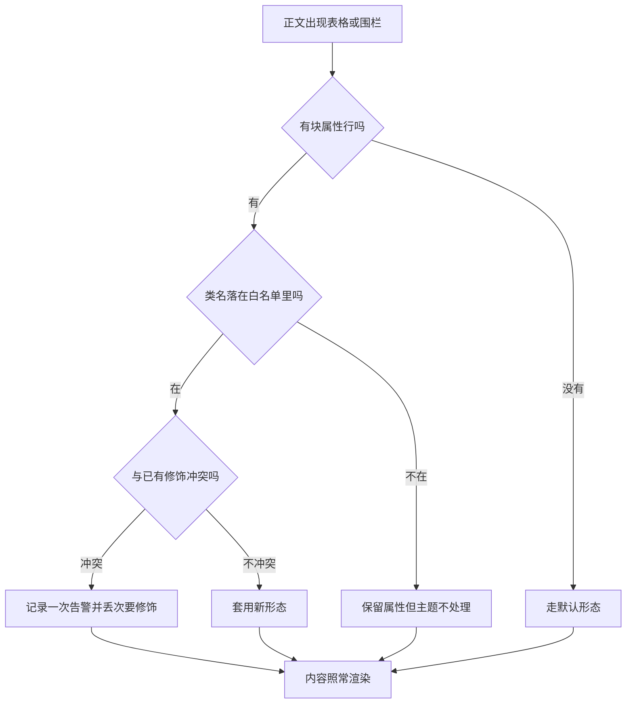

主题 1.4.0 给正文加了五件作者侧标记：表格的 `.wide` 与 `.expand`、卡片的 `variant="list"`、步骤的 `variant="compact"`、代码围栏的 `.td-code-command`。它们都不改变你的文字内容，只改变呈现方式；写错了主题只会退回原来的样子。

这一篇是这一轮全站改造的入口。它要回答的不是「有哪些新开关」，而是**为什么这些开关值得你在已经写好的文里回头改一遍**——以及改的时候怎么保证不把已经通过的验收改坏。

先给一句结论：这五件里只有 `.expand` 会引入新的 DOM（一个原生 `dialog`），其余四件都是纯 CSS 层面的排布变化。所以「用了新写法会不会让离线搜索、打印档、`llms.txt` 变样」这个常见担忧，答案是只有 `.expand` 需要额外确认，其余都不会。

## 为什么要改写法：三类排版痛点

旧写法在这三种场景里会持续产生返工，而新标记正好各治一种：

| 痛点场景 | 旧写法为什么撑不住 | 对应的新标记 |
|---|---|---|
| 参数表列数多、单元格里有长句 | 正文列宽由阅读栏决定，宽表只能横向滚动，读者容易没意识到右边还有列 | `.wide` 技术表格排布 |
| 列多到必须放大才能读 | 只能把表拆成两张，或改成列表，等于改写内容 | `.expand` 阅读抽屉 |
| 一组同级要点想排成一行一行的列表 | 卡片 shortcode 只有网格形态，条目不等长时会出现参差的空位 | `cards variant="list"` |
| 步骤有七八步，首屏只看见两三步 | 步骤块按常规留白排布，纵向成本高 | `steps variant="compact"` |
| 正文里就是一条要复制执行的命令 | 代码块带标题栏、复制按钮与行号槽，一行命令被包在三层装饰里 | `.td-code-command` |

判断该不该改，用这条：**这段内容的呈现问题，能不能靠删减文字解决**。能删就删，不要拿样式补内容的洞；不能删（信息本来就是这么多列）才上新标记。

> ### 💡 新人小结：这五件东西是同一类东西吗？
>
> 不是，可以分三档记：
>
> - **表格档**（`.wide`、`.expand`）：作用在 Markdown 表格上方的属性行上，改的是「这张表怎么排、要不要给读者一个放大入口」。
> - **shortcode 档**（`cards`、`steps` 的 `variant`）：作用在已有 shortcode 的参数上，不加新 shortcode，只是给老的可能形态里多选一个。
> - **围栏属性档**（`.td-code-command`）：作用在代码围栏的 info string 上，和 `linenos=table`、`filename=` 是同一层的写法。
>
> 分档的好处是排障方向不同：表格档出问题去看表格渲染 partial，shortcode 档出问题看 shortcode 本身，围栏档出问题看代码块的规范化流程。

## 先看渲染决策：主题是怎么选形态的

这四条路径的判断顺序很短，画出来便于定位「为什么我写了没生效」：



关键点是中间那条**冲突分支**：主题不会因为你写错就把整块内容弄丢，它丢的是次要的那个修饰，并且会打出一次告警。所以「构建仍然 0 个错误」不等于「我的标记生效了」——这也是一会儿要回来看产物的原因。

## 宽表标记 `.wide`：写法与生效边界

`.wide` 是给「技术表格」用的排布标记。它等价于主题里早就存在的 `td-table--wide` 修饰类，但作者不用手写类名：

````markdown
| 参数 | 旧默认值 | 新默认值 | 影响 |
|------|---------|---------|------|
| 连接超时 | 30s | 10s | 冷启动更快失败 |
| 空闲回收 | 600s | 120s | 长连接需要重连 |
{#param-migration .wide caption="技术表格排布"}
````

- **属性行写在表格之后并紧贴**，这是实测出来的：把 `{#id .wide}` 放在表格上方，Hugo 不会把它绑到这张表（产物里 `<table>` 没有 id 也没有类）；放在表格下方紧贴，才渲染成 `<table id="…" class="wide td-table--wide">`。
- `caption=` 与类名写在同一行，题注会跟列标签对齐；题注可以是中文，**id 不行**。
- **id 必须匹配 `[A-Za-z][A-Za-z0-9_.:-]*`**（首字符是字母）。写中文 id 时主题会丢掉 id 并打一条 WARN：
  `shortcode "table": id must match [A-Za-z][A-Za-z0-9_.:-]*; got "参数迁移对照表" …; dropping it`。
  类和题注不受影响，但**锚点直达会失效**——中文标题的表要用 `#英文id` 或 `?查询串` 之外的稳定锚点，就得先起个 ASCII 名。
- 已经手写过 `td-table--wide` 的老表不用动：两者不冲突，主题只在缺规范类名时补。

| 写在一起的两个修饰 | 主题的处理 |
|---|---|
| `.wide` 单独 | 按技术表格排布，行为与规范类名一致 |
| `.wide` + `.matrix` | 都保留，矩阵排布优先 |
| `.wide` + 老式 `td-table--wide` | 不重复追加，等价写法 |

下面这张是**真的带 `.wide` 的表**，不是示例文本，可以在页面上直接看排布效果：

| 参数 | 旧默认值 | 新默认值 | 影响的链路 | 回滚方式 |
|------|---------|---------|-----------|---------|
| 连接超时 | 30s | 10s | 冷启动首次握手 | 改回 30s，无需重启数据面 |
| 空闲连接回收 | 600s | 120s | 长连接的保活间隔 | 调大回收窗口并同步客户端心跳 |
| 单请求体上限 | 64MiB | 512MiB | 大对象直传 | 降回上限并改用分片 |
| 并发写闸 | 8 | 32 | 批量导入吞吐 | 按核数回退，观察队列积压 |
{#param-migration-live .wide caption="服务端参数迁移对照（示例数据）"}

## `.expand` 阅读抽屉：什么时候值得给读者一个放大入口

`.expand` 会在表格角上放一个动作：桌面端悬停或聚焦出现，触屏设备常显。点开是原生 `dialog`，里面保留原表、原字号、链接与选区，关闭后回到原阅读位置。

```markdown
| 错误码 | 触发条件 | 是否可重试 | 处置 |
|--------|---------|-----------|------|
| E-102 | 连接池耗尽 | 是 | 等待后重试 |
| E-204 | 分片键缺失 | 否 | 修正请求 |
{#error-codes .expand caption="需要逐列核对时才点开"}
```

它引入一个新 DOM 节点，所以有两个别处没有的代价，值得先确认再上：

下面这张是**真的带 `.expand` 的表**：桌面端把指针移到表上或聚焦，右上角会出现展开动作；触屏设备该动作常显。点开是原生对话框，关掉后回到原位置。

| 错误码 | 触发条件 | 是否可重试 | 客户端动作 | 服务端线索 | 处置建议 |
|--------|---------|-----------|-----------|-----------|---------|
| E-102 | 连接池耗尽 | 是 | 退避后重试 | 队列长度上升 | 提高池上限或降低并发 |
| E-204 | 分片键缺失 | 否 | 立即失败 | 请求校验日志 | 补齐分片键再发 |
| E-317 | 副本落后过多 | 是 | 换副本重试 | 复制延迟指标 | 检查网络与磁盘压力 |
| E-421 | 配额超限 | 否 | 停止并重报 | 配额计数器 | 申请提额或错峰 |
| E-509 | 时钟漂移过大 | 是 | 同步后重试 | 节点时间差 | 校准 NTP 再观察 |
{#error-codes-live .expand caption="需要逐列核对时才点开（示例数据）"}

| 代价 | 具体表现 | 怎么确认 |
|---|---|---|
| 无脚本环境 | 抽屉不工作，但表格仍以完整内联形式在正文里 | 把产物 HTML 里的表格行数与源文对一遍 |
| 打印 | 打印前主题会把打开的表还原回内联 | 走 `_print/` 那一版产物核对 |

互斥关系要记住一条：`.expand` 与字段表（`.fields`）不能同时用，同时写时主题丢 `.expand` 并记录一次告警。字段表本身就是一种特殊排布，两者对同一张表的意图是相反的。

> ### 💡 新人小结：`.wide` 和 `.expand` 会不会重复？
>
> 不重复，它们回答的是两个问题：`.wide` 管「这张表本来就是技术表，请按技术表排布」；`.expand` 管「这张表大到需要给读者一个放大的入口」。
>
> 可以只写 `.wide`（宽但还能在栏内读完），也可以两个都写（宽且确实需要放大）。判断线很朴素：**把这张表打印到 A4 上，读者能不能不借助屏幕就看完**。能看完就别加抽屉。

`.wide` 与 `.expand` 可以同时给一张表：前者管排布，后者管放大入口，两者不冲突。下面这张就是 `{#wide-plus-expand .wide .expand}` 的真实效果——既有技术表排布，角上又有展开动作：

| 组件 | 升级前 | 升级后 | 迁移动作 | 回滚窗口 | 风险 |
|------|--------|--------|----------|----------|------|
| 元数据 | 单库 | 分片 | 双写后切读 | 2 周 | 切读时机 |
| 对象层 | 本地盘 | 纠删码池 | 后台搬移 | 4 周 | 带宽抢占 |
| 网关 | 单点 | 主备 | 配置下发 | 24 小时 | 会话丢失 |
| 客户端 | 老协议 | 新协议 | 兼容期双栈 | 6 个月 | 行为差异 |
{#wide-plus-expand .wide .expand caption="两把标记叠加（示例数据）"}

## 卡片列表与紧凑步骤：两个 `variant` 的取舍

卡片默认是网格，条目不等长时会出现空位；`list` 变体把它变成带分隔线的逐行列表：

```markdown


不要先调参数。用默认值把整条链路跑通一次，再谈优化。


同时改两个变量，得到的结论无法归因。


```

下面是**真的列表形态卡片**，注意两条长度不等——这正是 `list` 要治的场景：



用默认值把整条链路跑通一次，再谈优化；连没连通都不知道，任何参数比较都没有意义。


同时改两个变量，得到的差异无法归因，只会把结论写成一次巧合。


每一轮都记下同一条命令的真实输出，下一轮才有对照物。



步骤同理，`compact` 收紧纵向留白，适合步骤多、每步文字短的教程。步骤的条目**不是子 shortcode，而是一个三级标题算一步**：

```markdown


### 装扩展版 Hugo

确认 `hugo version` 的输出里带 extended。

### 确认 Go

要能真的执行到够新的那个 go.exe，不是只看 PATH 里第一个。

### 起站

用站点根的启动脚本，别裸敲。


```

下面是**真的紧凑步骤**（每步一个三级标题，编号由主题自动排）：



### 确认 Hugo 是扩展版

`hugo version` 的输出里必须带 extended，标准版编不了主题用的 SCSS。

### 确认执行到的 Go 够新

看的是真的被调用那个 go.exe 的版本，不是 PATH 里排第几。

### 用站点根的启动脚本起站

脚本会设好离线变量并挑一个空闲端口，比裸敲命令少踩两个坑。



| 变体 | 适合 | 不适合 |
|---|---|---|
| `cards variant="list"` | 条目不等长、彼此有先后或并列关系、条目数 3–8 | 需要三列并排对比的同构卡片 |
| `steps variant="compact"` | 步骤多、每步一句话、希望一屏看完 | 每步都带代码块的长教程 |

两个 shortcode 只接受 `variant` 一个参数，值写错时主题记录一次告警并退回默认形态——不是构建失败，所以只能靠肉眼看产物或看构建日志里的告警发现。

## 命令条 `.td-code-command`：只在单行时成立

正文里那种「就一行，给读者复制」的命令，套普通代码块会带标题栏、复制按钮和行号槽三层装饰。命令条把这些都收掉：

````markdown
```bash {.td-code-command}
mc cp --recursive backup/ myalias/bucket/
```
````

下面这行是**真的命令条**（单行、无行号、不折叠），拿掉任何一个条件就会退回普通代码块：

```bash {.td-code-command}
python -m http.server 8899 --directory public
```

三个硬条件，任一不满足主题就剥掉这个类、退回普通代码块并告警：

| 条件 | 为什么 | 不满足时 |
|---|---|---|
| 只有一行 | 命令条是一行式呈现，多行会失去对齐 | 告警并退回常规块 |
| 不开行号 | 行号槽会占掉命令条左侧的对齐基准 | 告警并退回常规块 |
| 不做折叠 | 折叠需要展开控件，与「一眼看完」冲突 | 告警并退回常规块 |

同一条约束还有后半段：如果高亮结果里仍然带了行号类结构，主题在渲染阶段再兜一次，同样退回。所以「我明明写了属性却没生效」的答案通常就在这三行里。

> ### 💡 新人小结：命令条和带 filename 的代码块能同时用吗？
>
> 不要把注意力放在「能不能同时出现」上，先看命令条的三个硬条件。标题栏与行号槽都属于会被判定为冲突的装饰，命令条的目标就是把它们收掉；一旦你给它加了文件名或行号，等价于要求它同时是两种东西，主题只能选后者。
>
> 记一句就够：**想当命令条用，就只写一行命令；想当代码文件展示用，就不是命令条。**

## 这些新写法与既有正文门槛的关系

示例站的每一篇正文都要过同一套结构性门槛：篇幅下限、小结数量、至少一张图、至少一组表格、至少一个带语言的代码块、结尾要有总结。新写法在这里的作用要认清两面：

| 事实 | 影响 |
|---|---|
| 新标记只改呈现，不改字数与结构 | 不能拿它来凑篇幅或凑表格数 |
| 表格行与代码围栏照常出现在源文里 | 加了属性行的表仍按表计，命令条仍按代码块计 |
| `.expand` 只往 HTML 加 DOM，不加源文 | 离线搜索索引与打印档的内容不变 |
| PlantUML 围栏不在既有图校验工具的覆盖范围内 | 「至少一张图」这件事仍由 Mermaid 承担，见下一篇 |

顺带一条容易忽略的：属性行本身不是表格行，它不会让「表格行数」翻倍计数，别指望多写一行属性就多出半张表。

## 落地顺序：先改哪一类页面

新标记很容易「一次性全上」，结果是同一批页面同时改排布、改内容、改结构，出了问题分不清归因。按下面这个顺序走，每一步都可单独回退：

| 步骤 | 动什么 | 为什么排在这个位置 | 完成后确认什么 |
|---|---|---|---|
| 1 | 只给已有的宽表加 `.wide` | 纯排布，不动内容，风险最低 | 表仍按原列数渲染，题注没跑位 |
| 2 | 挑一张确实放不下的表加 `.expand` | 这一步会引入新 DOM，要单独验证 | 放大入口能开、关掉后位置没丢、打印档里表还完整 |
| 3 | 把不等长的卡片组换成 `variant="list"` | 只影响一个 shortcode | 空位消失，条目顺序与原来一致 |
| 4 | 长教程的步骤块换 `variant="compact"` | 同上，另一处 | 每步标题与正文没被挤掉 |
| 5 | 单行命令换成命令条 | 有硬条件，最容易写错，放最后 | 命令条真的生效，没退回常规块 |

第 2 步和第 5 步要各自单独确认，原因是这两步的主题行为不一样：第 2 步**加东西**（新增一个对话框节点），第 5 步**收东西**（去掉三层装饰）。加错了会在产物里多出你不想要的节点，收错了会在产物里回到原来的样子——两种错的排查方向相反，混在同一步做就只能全部重来。

## 常见误写与它们各自的后果

这几类写法在评审里出现频率最高，后果分三种：主题救得回来、主题救不回来、以及看着没事但其实没生效。

| 误写 | 后果 | 归哪类 |
|---|---|---|
| 属性行放在表格上方 | goldmark 不把它绑到这张表，标记整个失效 | 主题救不回来，且不会告警（实测：`<table>` 既无 id 也无类） |
| 属性行与表格之间空了一行 | 变成独立段落，同样不生效 | 主题救不回来，且不会告警 |
| 同时写 `.fields` 和 `.expand` | 丢 `.expand`，字段表照常渲染 | 主题告警并退回 |
| 命令条里塞了两行命令 | 退回普通代码块，装饰全回来 | 主题告警并退回 |
| 命令条同时要求行号 | 同上，退回常规块 | 主题告警并退回 |
| `variant` 拼成别的值 | 卡片/步骤按默认形态渲染 | 主题告警并退回 |
| 以为 `.expand` 会改源文内容 | 源文没变，只是 HTML 多了节点；离线搜索与打印档不受影响 | 认知偏差，不是写法错 |

第一行是唯一「不告警」的那种，所以最难发现：构建干净、页面也干净，只是这张表一直按默认形态排。检查办法就一条——**去产物里找这个标记应该留下的痕迹**，找不到就是没生效。

> ### 💡 新人小结：属性行到底是贴在上面还是贴在下面？
>
> **贴在下面，紧跟最后一行表格，中间不空行。** 这是实测的结论，不是习惯问题：把 `{#id .wide}` 放在表格上方，产物里那张 `<table>` 既没有 id 也没有类；放在下方紧贴，才渲染成 `<table id="…" class="wide td-table--wide">`。
>
> 可以这样记：属性行是这张表的「尾注」，不是「门牌」——它说明的是刚刚结束的那个块，所以必须跟在块后面。同理，属性行本身不算表格行，不会让「表格行数」翻倍计数。

## 为什么不直接写 HTML

主题渲染表格与代码块的通道已经开着（骨架配置里那几项 goldmark 设置就是为它准备的），所以有人会在正文里直接手写 `<div>`、`<table>` 来复刻这些形态。不建议，三条理由：

1. 直接写的 HTML 不会被打印档、Markdown 输出、`llms.txt` 这三条通道同等对待——它们读的是结构化渲染结果，不是你的手搓标签。
2. 手写标签跳过了主题的冲突判定，也就跳过了那一次告警。写错时你既拿不到提示，也拿不到回退。
3. 后续主题改形态时，标记跟着主题走，手写的 HTML 只能一张张改回来。

用标记的代价只是「学一行属性写法」，省下的是将来一整轮的返工对齐。

## 改完怎么验证生效

顺序是固定的三步，跳步就会拿到假绿：

1. 重新构建，让产物落到 `public/`。
2. 在产物里找新形态留下的痕迹：表格是否被包进带展开动作的外框、卡片是否用了列表类名、命令条是否带上命令类。查产物，不是查源文。
3. 用 HTTP 打开对应页面看真实呈现；用 `file://` 双击只会拿到无样式文字，看不出任何排布差异。

如果第 2 步找不到痕迹，回来看构建日志里的告警——主题丢次要修饰的那条分支会在那里留话，而不是在构建的返回码里。

## 要点总结

- 1.4.0 的五件新标记都只动呈现，不动内容；写错时主题告警并退回原形态，构建仍然成功。
- `.wide` 与 `.expand` 分别管「按技术表排布」和「给读者放大入口」，判断线是打印到 A4 能否读完；`.expand` 与字段表互斥。
- `cards variant="list"` 治不等长卡片，`steps variant="compact"` 治步骤多而文字短；两个 shortcode 只认 `variant` 一个参数。
- `.td-code-command` 的三个硬条件（单行、无行号、不折叠）任一不满足就退回常规代码块，这是「写了没生效」最常见的原因。
- 新标记不能用来凑结构性门槛，也不能替代内容删减；`.expand` 只加 HTML，不改离线搜索与打印档的内容。
- 验证生效要按「重构建 → 查产物痕迹 → HTTP 打开看呈现」三步走，只查源文或只看返回码都会拿到假绿。
