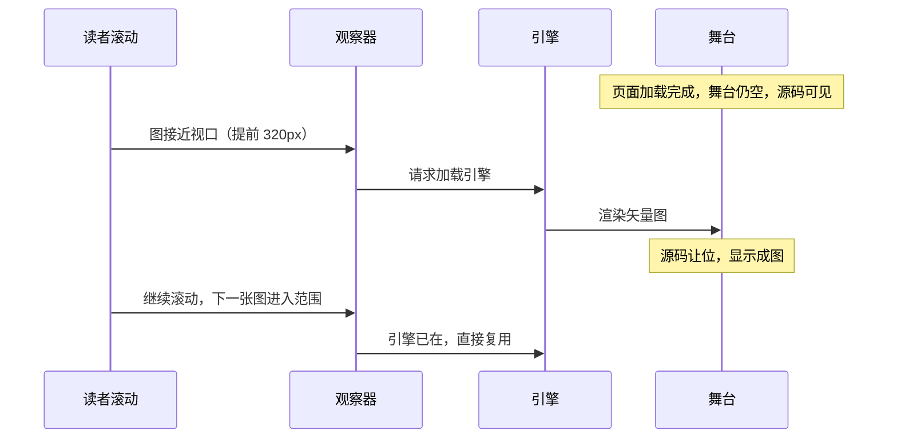
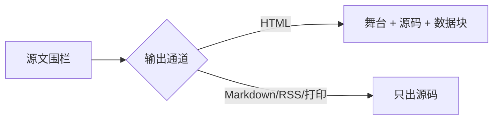
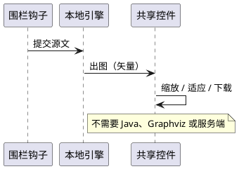

1.4.0 把图的加载与渲染推迟了：引擎不再在页面初始化时就请求，而是在图接近视口时才加载。同时，Mermaid 围栏现在除了空舞台还会输出一段可读源码。两件事叠在一起，直接改变了「这张图画出来了没有」这个问题的判法。

这一篇讲的就是这个变化带来的三类误判，以及各自正确的判据落在哪一层。

## 为什么要先滚到图前，再判这张图渲染成功

旧假设是：页面加载完成 → 所有图都渲染完成 → 截图或断言可以直接读最终状态。这个假设在 1.3.2 成立，在 1.4.0 **不再普遍成立**。新机制下有三条分支，读到的东西完全不同：

| 你在页面上看到的样子 | 成因 | 该判成什么 |
|---|---|---|
| 一段 Mermaid 源文字（带边框、可聚焦） | 图还没进入触发范围，源码 pre 保持可见 | 既不是失败也不是成功，属「未触发」 |
| 渲染好的矢量图 | 已进入范围且引擎渲染成功 | 成功 |
| 图位置上是错误提示或空舞台 | 已进入范围但语法或渲染失败 | 失败 |

第一列那行是关键：**「未触发」与「失败」在截图上长得像，但含义相反**。首屏以下的图如果没滚到位，看到的就是源码；把它当失败会误报，把「终于看到图」当验收通过又会漏掉真正没渲染的那几张。



主题把触发线设成「提前 320 像素」而不是「进入可见区」，本意是让读者在图还差半屏时就拿到结果，避免看到明显的空档。所以判断「到底该不该已经渲染」，要看这张图相对视口的位置，不是看它在文档里的位置。

> ### 💡 新人小结：为什么主题要改成懒加载？
>
> 因为过去是「这一页有图，就把引擎整套拉进来」，读者只要滑过一张图就要付引擎的加载代价。改成延迟之后：
>
> - 没有图的页面完全不碰引擎，产物里连引用都没有；
> - 有图的页面按需取，且一次取到、后面复用；
> - 打印和无脚本场景靠那份可读源码兜住，不会一片空白。
>
> 代价就是本文这一条：验收的时序假设变了，判图要按位置判，不能按页面判。

## 源码态从哪来：围栏现在输出什么

围栏钩子对一张图会产出三样东西，看清它们才好定位「我看到的到底是哪一层」：

| 产出 | 作用 | 什么时候可见 |
|---|---|---|
| 空舞台容器 | 引擎渲染结果落在这里 | 图被触发并渲染成功后 |
| 可读源码块 | 原样保留图源，带焦点 tabindex | 未触发时、无脚本时、以及打印的早期阶段 |
| 图源数据块 | 供运行时读取，不直接参与呈现 | 一直存在，但读者看不到 |

非 HTML 的输出通道（Markdown、RSS、打印档）走另一条分支：只输出源码，不出舞台。所以你在 `public/**/*.md` 或 `_print/` 里看到源文字，那不是回归，是设计。

写法本身没变，变的是渲染时机：

````markdown

````

## 判语法：离线解析台为什么不受这次改动影响

「这张图的写法对不对」和「这张图在页面上画出来没有」是两件事，本示例站把它们交给两个不同的判据：

| 问题 | 判据落点 | 是否受懒渲染影响 | 结论形态 |
|---|---|---|---|
| 语法能不能解析 | 离线解析台：直接在页内调用引擎的解析接口，逐块试 | 不受影响，它不走页面那条延迟路径 | 一个总数加一个失败数，另有一好一坏两枚自证样本 |
| 页面有没有画出来 | 浏览器：把图滚进范围，看舞台里是否出现矢量内容 | 受影响，必须先滚 | 逐图人工确认，属交付前的走查项 |

解析台的用法与它为什么可信，都值得单独记一下：它把整站的图源收集成一个清单，在同一个页面里用**主题自带的那份引擎文件**逐块解析。引擎文件在 1.3.2 与 1.4.0 之间字节完全相同，所以旧版跑通的判据可以继续沿用，不需要因为升级重做。

```bash
python <技能目录>/scripts/validate_mermaid.py --site <站点目录> --selftest
python -m http.server 8899 --directory <站点目录>/_mermaid-harness
msedge --headless=new --disable-gpu --virtual-time-budget=9000 --dump-dom http://127.0.0.1:8899/index.html
```

读回结果时有一处容易踩空：转储的 HTML 里会同时出现**脚本源码里的字符串常量**和**页内元素里的实际读数**，两者长得一模一样。要认后者。本示例站的实际读数贴在站点 `doc/运行与构建（T0Level）.md` 的对应小节里，不在本文重复。

> ### 💡 新人小结：为什么解析台成功不等于页面渲染成功？
>
> 两件验证的东西根本不同：
>
> - 解析台问的是「这段文字是不是合法的图描述」——它绕开页面，直接问引擎。
> - 页面问的是「读者能不能看到他该看到的图」——它牵涉触发时机、样式、颜色模式与舞台尺寸。
>
> 合法但画不出来是可能的（比如舞台被隐藏、或颜色模式切换后重渲失败）；画不出来也可能根本不是你的语法错。所以两者都要跑，而且都要按各自的读法判，不能互相顶替。

## PlantUML 现在可以本地渲染，代价在哪

1.4.0 之前，PlantUML 想在本地图渲染基本得靠服务端；现在主题把 MIT 许可的渲染引擎与布局引擎一起带进包里，读者不需要 Java、Graphviz 或任何服务。

开关要注意位置：

```yaml
params:
  plantuml:
    enable: true
```

它在 `params` 顶层，与 `markmap`、`drawio` 同级，**不是** `params.ui` 下面的一项。写错位置不会报错，只会安静地什么都不做——这类「配置层看着对、产物层没反应」的坑，检查方法只有一个：回来看产物里有没有出现引擎引用。

开了之后，正文里就多一个可用的围栏：



这个块在本示例站的作用是把开关的产物效果验出来：构建后到对应页面里核对是否出现本地引擎的引用。语法层面它不在离线解析台的覆盖范围内，出图本身也需要浏览器走查——两件事都记在未验证一侧，见文末。

| 围栏类型 | 能否本地出图 | 是否被语法判据覆盖 | 用它当「每张文至少一图」的依据合不合适 |
|---|---|---|---|
| Mermaid | 是 | 是（解析台逐块试） | 合适 |
| PlantUML | 是（需显式开启） | 否 | 不合适，它是未被语法验证的补充 |
| Markmap、信息图等 | 是 | 否 | 同样只能当补充 |

结论是明确的：**别把正文的图门槛从 Mermaid 放宽到 PlantUML**。放宽之后，一个语法写错的 PlantUML 块不会在任何自动判据里报警，只会让读者看到一块不出的图——这类缺陷在交付阶段最难被发现，因为它长得像「还没加载」。

代价另外两条要提前接受：一是本地图包里多了两个大文件（渲染引擎加布局引擎），二是只有在真的有图的页面上才会被引用。没有图的页面产物里搜不到它们，这一点可以在构建产物上直接核对。

## 缩放、适应与下载：新控件的验收点

图现在共享一套阅读控件。它们不影响构建，只影响读者体验，所以验收要落在浏览器里：

| 控件 | 判据 | 本示例站的当前状态 |
|---|---|---|
| 平移与缩放 | 放大后边缘不出白边、不丢失对齐 | 未逐项核对 |
| 适应窗口 | 从放大态回到整图可见 | 未逐项核对 |
| 查看与复制源文 | 复制到的内容与围栏源一致 | 未逐项核对 |
| 下载独立矢量图 | 下载文件名与内容可用 | 未逐项核对 |
| 键盘可达 | 只用键盘能打开、能关 | 未逐项核对 |

这四条是「未验证」而不是「通过」。示例站负责说明判据长什么样，跑通它们要留给真实交付轮，别在文档里替它们打勾。

## 打印与无脚本环境

懒渲染最容易被误伤的两个场景恰好都是离线呈现：

| 场景 | 主题的处理 | 你要确认的 |
|---|---|---|
| 打印 | 先还原打开的表与图，再交给纸张 | `_print/` 与浏览器打印预览里源文或图至少有一个可读 |
| 禁用 JavaScript | 舞台不填充，源码块保留 | 关掉脚本后正文不空白 |
| 机器可读通道（Markdown、RSS、列表文件） | 只输出源码，不出舞台 | 这些通道里出现源文字是预期 |

> ### 💡 新人小结：三件事还是三套判据？
>
> 是三套，混用就会得到错误结论：
>
> - **语法**归解析台：一个总数、一个失败数，加两枚自证样本。
> - **呈现**归浏览器：先滚到位，再看舞台里是不是矢量内容。
> - **离线通道**归产物文件：读 `_print/` 与 `.md` 输出，看到源码是正确而非缺陷。
>
> 记法就一句：判语法问引擎，判呈现问浏览器，判通道问文件。

## 本示例站这一轮量到的读数

下面所有数字都来自本轮在 `demo-docs-140` 上的真实命令，工具是 Hugo v0.168.0 Extended + Go 1.27.3，与本文前面的判据一一对得上：

| 量什么 | 读数 | 说明这条读数证的是什么 |
|---|---|---|
| 构建结果 | `Pages 35 / Static files 34 / Total in 1339 ms`，0 个错误 | 站点能构建，且产物数量与页面结构一致 |
| 首页是否引用 PlantUML 引擎 | 出现次数 0 | 没有图的页面完全不碰引擎，包体不落到每个页面 |
| 本页是否引用 PlantUML 引擎 | 引用 `plantuml-browser-zh` 运行时块 | 引擎按页挂载，且带语言后缀（要跟 i18n 标签一起打包） |
| 本页 Mermaid 舞台数 | 1 | 真渲染的舞台只有一个，写在代码围栏里的那段是示例文本 |
| 本页 Mermaid 源码块数 | 1 | 未触发或无脚本时读者能拿到的东西 |
| 共享控件运行时块 | 1 个 | 缩放/适应/看源/下载的实现文件确实产出 |
| 离线解析台 | `TOTAL=3 REAL_FAIL=0 SELFTEST=1/2 SELFTEST_PASS` | 语法层无失败，且一好一坏两枚自证样本都在 |

解析台那条要补一句口径说明：它的块数按源文正则统计，所以**写在代码围栏里当示例的那张图也被算进去了**（3 = 本页真图 2 + 示例文本 1 的源文出现次数）。这不影响「有没有语法错」这个结论——三块都能解析；但它说明一件事：**块数不等于页面上会出现的图数**。要数后者，得去产物 HTML 里数舞台，像上面第三、四行那样分开量。

对照另一组数字会更清楚「按页挂载」这件事：同一台机器上，只含文章桩的骨架站构建是 `Pages 51 / Static files 34 / 1292 ms`，而本示例站是 `Pages 35 / Static files 34`。两站的 Static files 相同，主题副本虽然比上一版多带了约 4.98 MB 的引擎文件，产物里却一个都没多——因为没有页用到它们。

## 还没量到的部分

写清楚未验证项，比给一堆「应该没问题」有用：

| 项 | 本轮状态 | 要补的判据长什么样 |
|---|---|---|
| PlantUML 真的画出图 | 未验证（只验到运行时块被挂载） | 浏览器打开本页，把图滚进视口，确认舞台里出现矢量内容 |
| 缩放、适应、下载矢量图 | 未验证 | 逐控件操作一次，下载到的文件能独立打开 |
| 颜色模式切换后重渲 | 未验证 | 切深色再切回，图应随模式重出，不残留旧配色 |
| 390 像素窄屏下的呈现 | 未验证 | 用真实视口宽度测横向溢出，而不是缩窗口目测 |
| 打印档里的图 | 未验证 | 看 `_print/` 那一版，确认至少源文可读 |

> ### 💡 新人小结：为什么文档里要留一张「未验证」表？
>
> 因为这一页讲的就是「同一种现象有三种成因」。如果文档只写「图会渲染」，读者遇到那块源码文字时，唯一能做的就是猜。把已量到的与没量到的分开列出来，读者的判断路径就变成：
>
> - 落在「已量到」那一栏的现象 → 按给出的判据复核一次；
> - 落在「未验证」那一栏的现象 → 知道这是文档明确承认的空白，不是自己哪里做错了。
>
> 这也是本示例站的用意：它演示怎么写这种文档，而不只是演示主题功能。

## 怎么在别的页面上复现这套判断

上面那些数字不是本站专属，判据可以照搬到任何用这套骨架建出来的站点。给一份最小操作顺序，每一步只回答一个问题：

| 步骤 | 命令或动作 | 这一步只回答 |
|---|---|---|
| 1 | `hugo --cleanDestinationDir` | 站点能不能构建（看有没有错误，不看告警） |
| 2 | 在产物里数舞台：搜 `data-td-diagram-stage` | 这一页**应该**出现几张图 |
| 3 | 在产物里数源码块：搜 `td-mermaid-source` | 未触发或无脚本时读者能拿到什么 |
| 4 | 数运行时块是否产出：在 `public/js` 里找 `diagram` | 共享控件的实现有没有被打进产物 |
| 5 | 起 HTTP 服务，浏览器打开该页，把图滚进视口 | 图**实际**画出来没有 |
| 6 | 跑离线解析台，读页内元素那行结果 | 每张图的语法能不能被引擎接受 |

第 2 步与第 5 步之间隔着的正是本次变化：前者数的是「意图」，后者看的是「结果」。升级前后判据名字没变，但含义从「同一件事」变成「两件事」，这是最容易漏的地方。

一条常见的走捷径做法是把第 2 步和第 6 步合并——它们看着都是「有图且没报错」，其实一个查源文语法、一个查产物结构，谁都不能替谁：

```bash
# 第 2 步：查产物结构（意图）
grep -c 'data-td-diagram-stage' public/docs/<分类>/<板块>/<文章>/index.html

# 第 6 步：查源文语法（合法性）
python <技能目录>/scripts/validate_mermaid.py --site .
# 然后起 http、用无头浏览器读回页内那一行
```

两条命令的输出数量常常不相等，原因有三类：正文里当作示例写在代码围栏中的图只被第 6 步统计；同一页重复引用同一张图会被第 2 步数两次而第 6 步一次；非 HTML 输出通道（Markdown、打印档）有源文但没有舞台。所以数量差本身不是缺陷，**把它当缺陷之前先确认差的属于哪一类**。

> ### 💡 新人小结：一句话记住这轮变化
>
> 以前是「构建过了 = 图有了 = 语法对了」三件事挤在一个判据里；现在必须拆成三句问：**源文合法吗（解析台）、页面要出图吗（数舞台）、真出了吗（滚过去看）**。
>
> 三句都有各自的答案来源，任何一句想用另一句的结果交差，都会得到一次假绿。

三句问，各自的工具与产出形态固定如下，抄这一张表就够用：

| 问什么 | 用哪个工具 | 产出形态 | 能否替代别人 |
|---|---|---|---|
| 源文合法吗 | 离线解析台 | 一个总数、一个失败数、两枚自证样本 | 不能证明页面画出来了 |
| 页面要出图吗 | 在产物 HTML 里数舞台 | 每页一个计数 | 不能证明语法对 |
| 真出了吗 | 浏览器滚到位后看 | 逐页人工确认 | 不能替代前两项 |

## 要点总结

- 1.4.0 把引擎加载与渲染推迟到图接近视口（提前 320 像素），首屏以下未触发的图呈现为可读源码——那不是失败。
- 围栏现在同时产出舞台、可读源码与图源数据三份；非 HTML 通道只出源码，属设计而非回归。
- 语法判据（离线解析台）不受懒渲染影响，且因引擎文件字节未变可直接沿用；但它与页面呈现判据是两套，不能互替。
- PlantUML 可本地渲染，开关是 `params.plantuml.enable`（在 `params` 顶层，不在 `params.ui`）；它未被语法判据覆盖，因此不能替代 Mermaid 承担「每文至少一图」。
- 阅读控件（缩放、适应、看源、下载矢量图、键盘可达）本示例站尚未逐项核对，文档里保留为未验证而不是通过。
- 打印与无脚本场景由源文兜底，验收要分别走 `_print/`、禁用脚本与机器可读通道三条路。
