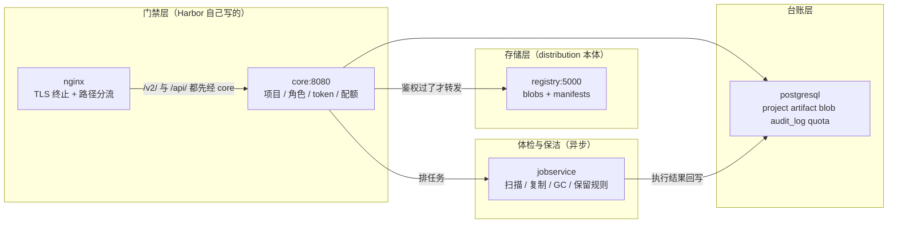
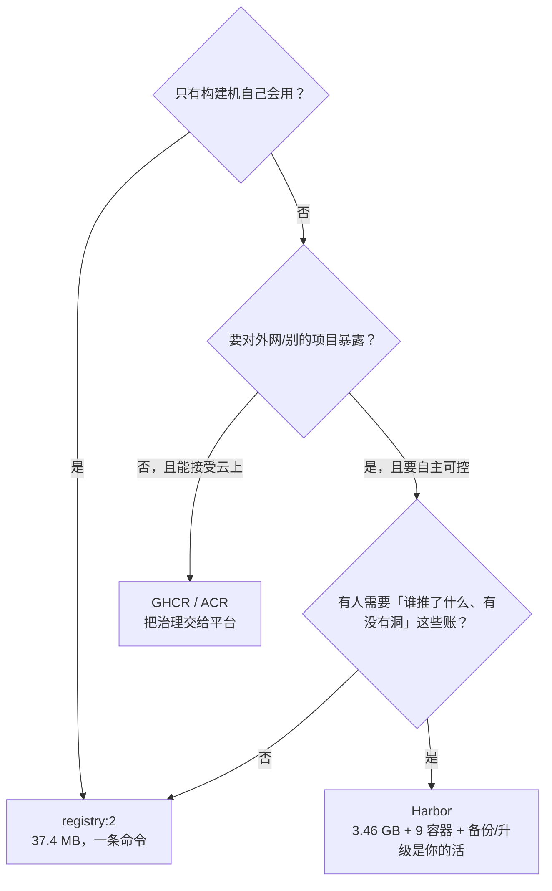

# 01 为什么要用 Harbor：什么时候它不值那 3.4 GB

## 为什么要多这一层：仓库解决的不是「放哪儿」，是「敢不敢让别人碰」

一个团队走到第二次「谁的镜像覆盖了谁的」之后，就会开始找私有仓库。但把需求拆开看，会发现「存镜像」和「治理镜像」是两件事：

| 你真实要回答的问题 | 只靠存储层能不能答 | 谁来答 |
|---|---|---|
| 构建产物放哪儿、怎么拉回来 | 能 | `registry:2`（distribution）一条 `docker run` |
| 谁能推、谁能拉，按项目还是按全局 | **不能**，存储层只认目录 | Harbor 的项目 + 角色（RBAC） |
| 这个镜像里有没有 CVE，能不能拦住不让部署 | 不能 | 扫描器（Trivy adapter）+ 策略 |
| 昨天线上那个版本对应哪次提交、谁推的、什么时候 | 只能靠镜像里的 label 反查 | 元数据库里的制品/标签/审计记录 |
| 三个月前的 `latest` 还在不在、垃圾什么时候清 | 没有语义层，删了就是删了 | 不可变标签、保留规则、GC 编排 |

> 💡 新人小结（合租冰箱 vs 单位食堂库房）：`registry:2` 是放在走廊的共享冰箱——能冷藏、谁都能开，东西不坏，但没人知道谁拿了谁的、也没有保质期标签。Harbor 是食堂库房：入库登记（项目/制品表）、领料卡（角色与 token）、到货检疫（扫描）、过期清退（保留规则 + GC）。**冰箱坏不了东西，是人会把东西放乱**——Harbor 治的是「人」这一侧。

官方定位一句很准的话：*an open source registry that secures artifacts with policies and role-based access control, ensures images are scanned and free from vulnerabilities, and signs images as trusted*，并且是 **CNCF 毕业项目**（出处与日期在 `03-历史与版本迭代.md` 的「可核证的锚点」一节）。

## 它是怎么解决的：五层能力，每层都有自己的落点

Harbor 不是「registry + 网页」，它是在 distribution 外面套了鉴权与元数据，再把治理动作排进异步队列：



读图只需记一件事：**`/v2/`（OCI 推拉协议）不直连 registry，先撞 core**。所有「Harbor 比裸 registry 多的东西」都是从这一次中转长出来的——没有 token 就进不去，配额满了也进不去。细节在 `02-组件与架构.md`。

## 先看清代价：本机两组数

| 对比项 | `registry:2`（段⑤ 用的那个） | Harbor v2.14.6（本机在跑） |
|---|---|---|
| 镜像体积 | **37.4 MB** 一个 | **约 3.46 GB**（10 个 `goharbor/*`，含只用于生成配置的 `prepare` 421 MB） |
| 运行体 | 1 个容器 | **9 个容器** |
| 元数据 | 只有文件系统里那棵树 | PostgreSQL（本机实测 40+ 张表：`project`、`project_member`、`access`、`quota`、`artifact`、`blob`、`audit_log`、`execution`、`immutable_tag_rule`、`cve_allowlist`…） |
| 数据盘起点 | 推一个 alpine 就几十 MB | `/data/database` 一开箱就 **49.2 MB**，`/data/registry` 3.5 MB（`/data` 合计 52.7 MB） |
| 装好耗时（本机） | 一条 `docker run`，几十秒 | 拉镜像 + `prepare` + `up` 一轮，分钟级 |

> 💡 新人小结（买车还是班车）：`registry:2` 是班车——到点就走、不要钱、不用你养。Harbor 是买车：保险、保养、年检、停车位（TLS、备份、扫描库、GC 排班）全是你的。**当只有你一个人每天固定通勤时，买车是净亏**；当你要接送五个孩子、还要拉货、还要能查里程报销，班车才真的不够用。

**结论一句话**：只是要给构建产物找个落脚点的，用 `registry:2`；一旦「谁都能推」这件事会让人睡不着，才轮到 Harbor。

## 它多给的能力，逐条标「本机能不能验」

治理层的每一项都要落到具体机制上，否则就是 PPT 能力。下表右列是本目录给出的证据：

| 能力 | 靠什么落地 | 本机证据 |
|---|---|---|
| 项目 + 角色（RBAC） | `project` / `project_member` / `role` / `permission_policy` 表；不是靠目录约定 | 建项目 `POST /api/v2.0/projects` → `201 Created` + `Location: /api/v2.0/projects/8`；未建项目前 push 得 `401` |
| 匿名拉取要不要 token | registry 前面挡了一层 core，`/v2/` 由 core 转发 | `curl https://localhost:8443/v2/kbdemo/harbor-probe/tags/list` 不带凭据 → `{"errors":[{"code":"UNAUTHORIZED","message":"authorize header needed to send HEAD to repository"...}]}`（**公开项目也不例外**） |
| 机器人账户（CI 用短期凭据） | `robot_account` 类表 + token 机制 | 表在（`access`/`project_member`），本轮没建机器人账户 → **未验证** |
| 漏洞扫描 | Trivy adapter（**要在 `prepare` 时开 `--with-trivy`**） | 本机 core 环境里 `WITH_TRIVY=False`、`TRIVY_ADAPTER_URL=http://trivy-adapter:8080` 有值但服务不在 → **未装** |
| 签名与可信策略 | cosign 路线（notary v1 已在 v2.8.0 前后移除，见 `03` 的「移除链」一节） | 未做 |
| 不可变标签 / 保留规则 / GC | `immutable_tag_rule` 表、tag retention API、GC 走 jobservice 的 `execution` | 表在；本轮没跑 GC（跑一次会真删数据，不适合边写文档边试） |
| 复制（多站点同步）、P2P 预热 | `p2p_preheat_instance/policy` 表、replication adapter | 表在，未配 |
| 代理缓存（pull-through） | Harbor 原生支持，比裸 registry 多了「按项目 + 可过滤 + 有 UI」 | 裸形态本机量过（见 3.10 那篇），Harbor 侧未做 |
| 审计 | `audit_log` / `audit_log_ext` 表 | 表在；v2.13 起还专门把版本号从匿名响应里摘掉 |

## 三条只有真装过才会写进规范的实测

这三条都会被当成「常识」写错，所以各配一条原文读数。

1. **「仓库不存在」和「你没权限」是同一个错误码**。本机 push 到还没建项目的位置：

   ```text
   unknown: unexpected status from HEAD request to
   https://localhost:8443/v2/kbdemo/probe/blobs/sha256:bf8527eb…: 401 Unauthorized
   ```

   第一反应都是「凭据错了」，其实是项目不存在。**所以 CI 里 401 之后该做的第一件事是建项目，不是刷 token。** 社区里这是已知问题，v2.16.0-rc1 的修复项里就有 `return 404 when listing artifacts of a non-existing repository`（见 `03` 的「未来展望」一节）。

2. **`pull_count` 不能当审计依据**。本机推 1 次、拉 3 次之后，`/api/v2.0/projects/kbdemo/repositories` 仍报 `pull_count: 0`。要统计真实下载走 `audit_log` 或 `/var/log/harbor/registry.log`（本机 99,459 字节，八个日志里最大），别信这个计数。

3. **回环入口的 TLS 是「不验」而不是「验过了」**。Docker Desktop 出厂 `InsecureRegistryCIDRs=["::1/128","127.0.0.0/8"]`，所以 `localhost:8443` 的 push/pull 与证书无关。这条不写清，团队会以为「HTTPS 已经生效」，而真客户端（curl / 浏览器 / kubelet 走别的名字访问）第一脚就踩证书。四层信任的完整拆解在 `06-配置HTTPS.md`。

> 💡 新人小结（门禁卡为什么刷不出房间）：`401` 像门禁「刷卡无效」——它可能因为你没权限，也可能因为**这栋楼根本没这间房**（项目没建）。刷不通就先去查楼层平面图（`GET /api/v2.0/projects`），别急着换卡（重签 token）。而 `pull_count: 0` 是那种坏掉的计数器：门禁明明天天刷卡，显示屏上永远是 0——**要查记录就去看日志，别看显示屏**。

## 具体怎么用：三条命令组，自己把上面三条坑复现一遍

不用信我的转述，这四段都能在本机对着正在跑的 Harbor 重放（前提：`Harbor.cmd status` 已全 healthy）：

```console
# 坑 3：回环入口不验证书 —— 看 daemon 的出厂免检名单
docker info --format '{{json .RegistryConfig.InsecureRegistryCIDRs}}'
# ["::1/128","127.0.0.0/8"]        ← localhost/127.0.0.1 都在里面，所以推拉与 CA 无关

# 坑 1 的另一面：仓库活着的表现是 401，不是 200
curl -k -s -D - -o NUL https://localhost:8443/v2/
# HTTP/1.1 401 Unauthorized
# Docker-Distribution-Api-Version: registry/2.0
# Www-Authenticate: Bearer realm="https://localhost:8443/service/token",service="harbor-registry"

# 公开项目也不给匿名列标签（鉴权确实走在 core）
curl -k -s https://localhost:8443/v2/kbdemo/harbor-probe/tags/list
# {"errors":[{"code":"UNAUTHORIZED","message":"authorize header needed to send HEAD to repository"...}]}

# 坑 2：拉了几次之后 pull_count 还是 0
curl -k -s -u admin:<密码> https://localhost:8443/api/v2.0/projects/kbdemo/repositories
# [{"artifact_count":1,"name":"kbdemo/harbor-probe","pull_count":0,...}]
```

「坑 1 的正面」（没建项目就 push 得到 401 而不是 404）要先把项目删掉才能复现，本机没做这个破坏性动作，那条读数取自安装时的原文记录（见 `07` 的「安装五步与实测读数」一节里那张十条判据表）。

## 什么时候不该上 Harbor

| 情况 | 更合适的做法 |
|---|---|
| 单机跑 demo、给 CI 缓存几个中间镜像 | `registry:2`（37.4 MB，一条 `docker run`） |
| 团队已经在云上、不需要自建高可用 | 云厂商托管仓库（GHCR / ACR 等）——把 RBAC、扫描、复制的运维负担交出去 |
| 只要「制品仓库 + 签名策略」，不要镜像 Web 控制台 | 直接 distribution + 对象存储 + 一套策略引擎（要自己拼审计与权限） |
| 机器只有 2C4G、盘紧张 | 先别上：官方起步建议就是 2C4G，本机 `database/` 与 10 个镜像的占用见上面那组数 |

选型可以走这条最短路径：



## 具体怎么用：五分钟把结论变成动作

| 步骤 | 动作 | 判据 |
|---|---|---|
| 1 | 把需求写成一句话：「我要 ______」（存产物 / 控权限 / 拦漏洞 / 追责任 / 清垃圾） | 只有第一项 → 走 `registry:2`，到此结束 |
| 2 | 需求里有两项以上，且必须自建 | 读本篇代价表，确认容量与人力能付 |
| 3 | 决定装 | 照 `04-快速入门.md` 五条命令走，装完跑 `Harbor.cmd verify` |
| 4 | 给 CI 用 | 别用 `admin` 密码；机器人账户那条本机**未验**，先按 `07` 的未验证项一节当作待办 |
| 5 | 长期跑 | 备份按 `05-本机存储目录.md` 的「备份、还原与两条判据」一节——`registry/` 与 `database/`、`secret/` 必须一起备 |

## 要点总结

- `registry:2` 答「镜像放哪儿」；Harbor 答「**谁能推、谁能拉、有没有洞、出事能不能追、留多久**」，这五问各自对应一张表或一个组件，不是同一件事的不同说法。
- 架构上的分水岭只有一条：**`/v2/` 先经 core 再到 registry**（「它是怎么解决的」那张图）。所有治理能力和所有新的失败模式都从这里派生。
- 代价是本机实测的：3.46 GB 镜像、9 个容器、`/data` 起手 52.7 MB，其中元数据库 49.2 MB。文件数也是同一口径——`/data` 里 1,580 个文件中只有 8 个在 `registry/` 下，**备份要按「元数据才是主体」来设计**。
- 三条实测坑：401 掩盖「项目不存在」；`pull_count` 恒 0 不能当审计；回环入口的 HTTPS 其实是「不验」。
- 不选 Harbor 的四种情况同样重要，尤其是「只要存产物」那一种——**它不是退而求其次，是正确答案**。

## 本目录其它文件

`02-组件与架构.md`（9 个容器各自干什么、一次 push 走哪 7 步）· `03-历史与版本迭代.md`（里程碑、各版本发布日、移除链、EOL 规律、v2.16 展望）· `04-快速入门.md`（五条命令从零到第一次推拉）· `05-本机存储目录.md`（`/data` 每个目录归谁、blob 落在哪）· `06-配置HTTPS.md`（证书怎么生、信任放在哪一层、四条走不通的路）· `07-本机安装与判据实录.md`（安装全过程原文与未验证项总表）
