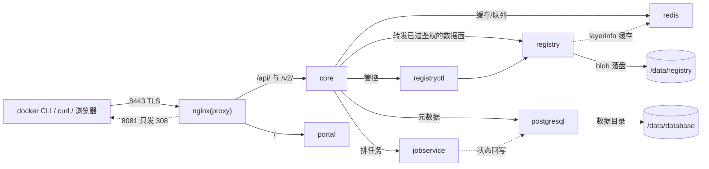
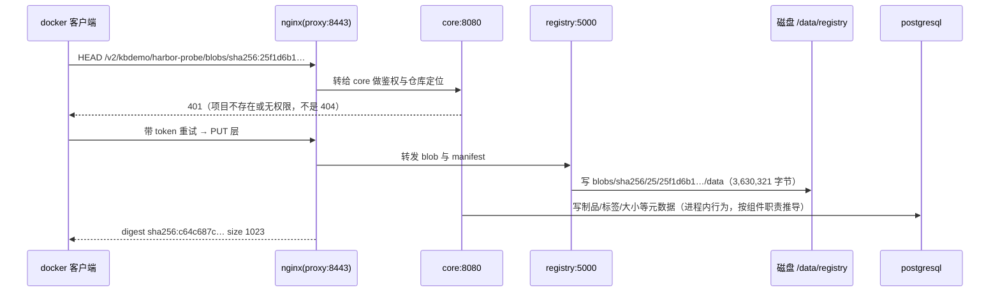

# 02 组件与架构：九个容器、一张网、一次 push 的完整路径

## 为什么要拆成九个容器：一个进程装不下「存储 + 语义 + 异步」

裸 registry 是一个进程：收 blob、发 manifest，没有用户概念。一旦要治理（谁能推、留多久、有没有洞、能不能追），就必然出现三类**行为特征完全不同**的负载：

| 负载类型 | 特征 | 为什么必须独立进程 |
|---|---|---|
| 同步数据面（收发 GB 级 blob） | 吞吐敏感、逻辑简单、要稳定 | 不能被鉴权与元数据计算的抖动拖累 |
| 同步控制面（项目/角色/token/配额/元数据） | 读写 PostgreSQL、逻辑复杂、改动频繁 | 出问题要能单独重启，不该把数据面一起带走 |
| 异步任务（扫描、复制、GC、保留规则） | 一跑几分钟到几小时 | 绝不能占用推拉的请求线程；失败要能重试与留痕 |

Harbor 的答案是三类分开摆：nginx 统一入口，core 做控制面，registry 做数据面，PostgreSQL 存语义，redis 做缓存与队列底座，jobservice 跑异步，log 收日志。**代价立刻显形**：9 个容器、3.46 GB 镜像，以及「改配置要重建哪几个」这类新的运维因果（见「变更生效链」一节）。

以下每一条都来自本机 `docker-compose.yml` 与 `common/config/`（由官方 `goharbor/prepare:v2.14.6` 生成）的直接读取，不是从文档抄的架构图。只有「元数据写入 PostgreSQL」这类进程内行为标了推导依据。

> 💡 新人小结（医院为什么不设一个全科）：前台（nginx）只认门；挂号处（core）决定你能进哪个科、能开什么药；药房（registry）只管发药；病案室（PostgreSQL）记「谁看了什么、开了什么」；检验科（jobservice）做那种当场出不了结果的化验；监控室（log）收所有科室的噪音；药房旁边的小货架（redis）放常取的药，省得每次回总仓。**让挂号处顺便发药，它一排队，全科室跟着停摆**——九个容器买的是「互不拖累」。

## 九个组件：名字、镜像、对内地址、依赖

| 服务名（compose） | 容器名 | 镜像（v2.14.6） | 对内地址 | 干什么 | 依赖谁 |
|---|---|---|---|---|---|
| `proxy` | `nginx` | `nginx-photon` | **唯一对外发布**：`8081:8080`、`8443:8443` | TLS 终止 + 路径分流 + 308 重定向 | registry、core、portal、log |
| `portal` | `harbor-portal` | `harbor-portal` | `portal:8080` | 前端静态站（Angular 构建产物） | log |
| `core` | `harbor-core` | `harbor-core` | `core:8080` | API 与鉴权中心：项目/角色、token、webhook、tag 规则、GC 编排 | log、registry、redis、postgresql |
| `registry` | `registry` | `registry-photon` | `registry:5000` | OCI Distribution：真正收发 blob/manifest | log |
| `registryctl` | `registryctl` | `harbor-registryctl` | `registryctl:8080` | registry 的控制器（GC、catalog 等受控入口），core 通过它管 registry | log |
| `jobservice` | `harbor-jobservice` | `harbor-jobservice` | `jobservice:8080` | 异步任务队列的执行端（复制、扫描、GC、保留规则） | core |
| `postgresql` | `harbor-db` | `harbor-db` | `postgresql:5432` | 元数据库（项目、制品、标签、配额、审计、执行记录） | log |
| `redis` | `redis` | `redis-photon` | `redis:6379` | 缓存与队列底座（registry 层信息缓存 db1、core 用 db0） | log |
| `log` | `harbor-log` | `harbor-log` | `127.0.0.1:1514 → 10514` | 收集全部组件日志（rsyslog），只绑回环 | —— |

全景挂在一起长这样（实线 = 请求方向，虚线 = 共用同一份宿主目录或同一张网）：



拓扑只有一张网：`docker network inspect harbor_harbor` → `驱动=bridge 容器数=9 IPv6=false`。compose 顶层网络段就三行：

```yaml
networks:
  harbor:
    external: false
```

**除 proxy 与 log 外没有任何端口发布到宿主**：宿主机 `netstat` 能看到的只有 8443、8081（全网卡）与 1514（回环）。别人要访问 Harbor 只能走 8443，也就没法绕过 nginx 直接戳 core 或 registry。

## 请求怎么分流（读自 `common/config/nginx/nginx.conf`）

```nginx
upstream core   { server core:8080; }
upstream portal { server portal:8080; }

listen 8443 ssl;
ssl_certificate     /etc/cert/server.crt;      # 由 prepare 从 harbor.yml 的 certificate 拷进 /data/secret/cert
ssl_certificate_key /etc/cert/server.key;
ssl_protocols TLSv1.2 TLSv1.3;
ssl_session_cache shared:SSL:10m;

location /            { proxy_pass http://portal/; }          # UI
location /api/        { proxy_pass http://core/api/; }        # Harbor 自有 REST v2.0
location /v2/         { proxy_pass http://core/v2/; }         # OCI 推拉协议，也先经 core！
location /c/          { proxy_pass http://core/c/; }          # CSAR/CSI 类接口
location /service/    { proxy_pass http://core/service/; }    # 服务间回调
location /service/notifications { return 404; }               # 显式关掉

server { listen 8080; return 308 https://$host:8443$request_uri; }   # 明文口只做重定向
```

`/v2/` 走 core 而不是直连 registry，是 Harbor 与裸 registry **最根本的架构差别**：每一次推拉都要先在 core 完成鉴权与配额检查，再由 core 转发到 registry。第 1 篇那条「公开项目匿名列标签也要 token」就是这么来的。

> 💡 新人小结（仓库卷帘门封了）：`registry:2` 像仓库直接朝马路开个卷帘门，知道地址就能进出。Harbor 把卷帘门封死，只在商场大厅留一道门（8443），提货先在柜台核验身份（core 发 token），柜台背后才有一条内部通道通往货架（registry:5000）。**好处是没人能绕过柜台搬货；代价是大厅一关谁都进不去**——8443 是这套架构唯一的单点入口，也是它最值得监控的地方。

## 一次 `docker push` 在机器里走过的路



其中三处是**本机直接验到**的：401 那条原文、`/data/registry/docker/registry/v2/blobs/sha256/25/…/data` 的确切路径与字节数、push 结束打印的 manifest digest `sha256:c64c687c…`（与 `blobs/sha256/c6/…/data` 的 1,023 字节一致）。元数据入库那一步没有逐帧抓包，是按 core 的职责与 PostgreSQL 里存在的 `artifact`/`blob`/`project` 等表推出来的。

## 数据面自己怎么配（读自 `common/config/registry/config.yml`）

```yaml
version: 0.1
storage:
  cache: { layerinfo: redis }
  filesystem: { rootdirectory: /storage }      # 容器里 /storage ← 宿主 /data/registry
  maintenance:
    uploadpurging: { enabled: true, age: 168h, interval: 24h, dryrun: false }
  delete: { enabled: true }
redis: { addr: redis:6379, dialtimeout: 10s, readtimeout: 10s, writetimeout: 10s, db: 1 }
auth:
  htpasswd: { realm: harbor-registry-basic-realm, path: /etc/registry/passwd }
validation: { disabled: true }
compatibility: { schema1: { enabled: true } }
```

三条读法，每条都对应一个可验证结论：

| 配置 | 含义 | 为什么重要 |
|---|---|---|
| `auth.htpasswd` | registry 自己也有一道 basic 认证，凭据在 `common/config/registry/passwd`（本机 82 字节） | **registry 不对公网裸奔**，只有 core 拿这份凭据能访问它。这也解释了「变更生效链」里那条「重跑 `prepare` 不重建容器就会 401」 |
| `uploadpurging: age: 168h` | 断点续传留下的半截上传，默认 **7 天后 registry 自己清** | 本机 `/data/registry/docker/registry/v2/` 下确实只有 `blobs` 与 `repositories`，没有 `_uploads`；老文档里「手动清 `_uploads`」已不属于默认路径 |
| `validation: { disabled: true }` | distribution 侧不做 manifest 语义校验 | 校验前移到 core/Harbor 层，「按项目策略拦」才可能实现；代价是有些非法内容能不能落盘，取决于上层而不是存储层 |

> 💡 新人小结（车站寄存处的超时规矩）：`uploadpurging` 就是行李寄存——你开了柜没取走，7 天后统一清掉，不会等你想起来。所以「推到一半断网」不会在磁盘上堆垃圾，但也别指望第二天接着传：可能已经被清了。

## 安全上下文：默认降权，逐个加回

compose 里每个服务都是 `cap_drop: [ALL]` 再按需 `cap_add`（本机实测值）：

| 容器 | `cap_add` | 为什么要这一项 |
|---|---|---|
| `log`、`postgresql` | `CHOWN DAC_OVERRIDE SETGID SETUID` | 要改数据目录属主、要以别的 uid 起进程 |
| `registry`、`registryctl`、`jobservice`、`redis` | `CHOWN SETGID SETUID` | 同上，不需要覆盖 DAC |
| `portal`、`proxy` | `CHOWN SETGID SETUID NET_BIND_SERVICE` | 要在容器内绑低位端口 |
| `core` | `SETGID SETUID` | **连 `NET_BIND_SERVICE` 都没有**——它不对外，只让 nginx 转进来 |

## 元数据侧：数据库里有什么（本机实测 40+ 表，节选）

```text
artifact  artifact_blob  artifact_reference  artifact_accessory  artifact_trash
project   project_member project_metadata    permission_policy   role
quota     project_blob   blob                immutable_tag_rule  label / label_reference
audit_log audit_log_ext  notification_policy job_queue_status    execution
cve_allowlist  harbor_user  oidc_user  robot_account*  replication_*  p2p_preheat_instance/policy
data_migrations  alembic_version  properties
```

这张表就是能力边界：**凡是你想在 UI 上点的开关，都有一张表撑着**（配额、不可变标签、CVE 白名单、P2P 预热、复制、审计）。反过来，「本目录没做」的章节（机器人账户、复制、GC）不是没实现，只是没验——写文档时这两者必须分清。

数据库底座本机实测在 `/data/database/pg15`（**PostgreSQL 15**）。顺带纠一句：v2.3.0 的 release notes 写的是「PostgreSQL 升到 13.3」，那是三年前的状态，别照抄旧 notes 判断今天的底座。

## 本机没起的那个组件

`core/env` 里明确写着 `WITH_TRIVY=False`，同时 `TRIVY_ADAPTER_URL=http://trivy-adapter:8080` 与 `ROBOT_SCANNER_NAME_PREFIX=CTG5J594` 都已生成——也就是说**扫描器是 `prepare` 时就决定装不装的可选组件**，不是运行时开关。要加它：重跑 `prepare --with-trivy` 再 `up -d`（会多拉 `goharbor/trivy-adapter-photon`，且首次扫描要联网下漏洞库）。本轮没装，`07-本机安装与判据实录.md` 的未验证项一节里有这条。

## 变更生效链：改哪样东西，要重启什么

这是这套拓扑最容易踩的一组因果，本机都有原文：

| 动作 | 影响面 | 实测/依据 |
|---|---|---|
| 改 `harbor.yml`（端口、密码、证书路径） | 必须重跑 `prepare` 才生效——它才是配置与 compose 的生成器；**而且跑完要 `docker compose -p harbor up -d`** | 本机实测：重跑 `prepare` 后只 `restart proxy`，`docker pull` 直接 `401 Unauthorized`（`prepare` 重生成 `common/config/registry/passwd` 等共享凭据，`core`/`registryctl`/`jobservice` 还在用启动时那份）；`up -d` 只重建这三个（其余 `Running` 不动），之后 pull 回 rc=0 |
| 换服务器证书 | **nginx 只在启动时读 `/etc/cert`**，不重启就还是旧证书 | 第一次 CA 实验全失败原因就是这个；`restart proxy` 之后才拿到 200。生效判据是「递交的证书 / `/data/secret/cert/server.crt` / `/data/harbor-certs/harbor.crt` 三处指纹相同」，见 `06-配置HTTPS.md` |
| 升级小版本 | 官方走 `prepare migrate`（v2.0 起把独立的 migrator 镜像并进了 prepare） | 版本史原文见 `03-历史与版本迭代.md` 的「唯一的架构级断点」一节 |
| 停与彻底拆 | `down` 不带 `-v` 时数据全留在 VM 的 `/data` | 见 `07-本机安装与判据实录.md` 的「数据在哪、怎么备份与回滚」一节 |
| 加可选组件（Trivy） | 属于「重跑 prepare + up -d」这一档 | 见上一节，本轮未做 |

## 具体怎么用：把这张拓扑拿去排障

| 症状 | 先看哪个组件 | 一条命令 |
|---|---|---|
| 推拉全挂、UI 也打不开 | `nginx`（单点入口） | `docker logs nginx --tail 50` |
| 能连上但全是 401/403 | `core`（鉴权与 token） | `curl -k -u admin:<pw> https://localhost:8443/api/v2.0/health` |
| 层能推上去但 UI 看不见制品 | `postgresql` + `registryctl` | `docker logs harbor-db --tail 30` |
| 扫描/GC/复制不动 | `jobservice`（本机 `WITH_TRIVY=False`） | `docker logs harbor-jobservice --tail 30` |
| 谁都说不清是谁改坏的 | `log` 收的八份日志 | `docker run --rm -v /var/log/harbor:/l:ro alpine:3.20 ls -l /l` |

## 要点总结

- 拆九个容器不是铺张，是**三类负载（数据面 / 控制面 / 异步）必须分开**：分开才能各自重启、才能把长任务挡在请求线程外。代价是 9 个进程、一张网，和一条「改配置要重建哪三个」的生效链。
- 架构上只有一条真正的分水岭：**`/v2/` 先经 core 再到 registry**。治理能力和单点入口（8443）都从这里派生——排障时「全挂」优先怀疑 nginx，「全 401」优先怀疑 core。
- 数据面自己也加固过：`htpasswd` 让 registry 只接受 core，`validation: disabled` 把语义校验上移，`uploadpurging` 7 天清半截上传。
- 元数据表清单＝能力清单：UI 上每个开关背后都有一张表；「本机没验」不等于「没实现」，文档里要分清这两件事。
- **默认 `cap_drop: ALL` 逐个加回**，`core` 只拿 `SETGID/SETUID`——这是这套拓扑能拿去评审的底气之一。
