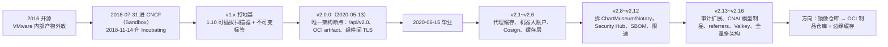
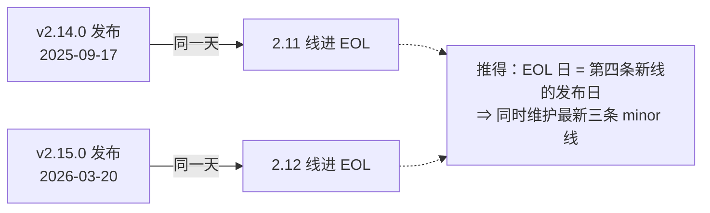

# 03 历史与版本迭代：怎么选版本，以及哪些「老话」已经失效

## 为什么要读版本史：三个会真金白银付出的代价

版本史不是怀旧，是三类具体风险的提前排雷：

| 你会踩的坑 | 触发条件 | 代价 |
|---|---|---|
| 停在过去某条线上「等下个补丁」 | 该 minor 线已进 EOL | **没有安全补丁了**，扫描器报的 CVE 永远修不掉 |
| 照抄教程里的开关 | 那个组件已被移除（ChartMuseum、Notary、按镜像数配额） | 安装脚本报错或 UI 里根本找不到那个入口，排查半天是教程老 |
| 脚本与 API 对不上 | v1→v2 的 REST 前缀变更、CRON 时区变更 | CI 里 404、定时任务在错误时刻跑，且**看起来像环境问题** |

所以本篇只回答三个问题：**该装哪条线**、**这条线还在不在维护**、**社区里那些关于 Harbor 的说法有没有过期**。所有版本号与日期都从 GitHub API 与 CNCF 项目页直接取（取证命令在末节「本文的取证命令」），不是搜来的。

> 💡 新人小结（手机厂商为什么只推最近三代）：Harbor 也一样——新 minor 一发，往前数第四条线就停止补丁。你手上那台「还能用」的旧版本，可能已经处在没人给它修安全问题的区间里。**能跑 ≠ 有人管**。

## 它是怎么长成今天的：可核证的锚点

| 事件 | 日期 | 一手出处 |
|---|---|---|
| 开源 | 2016 年 | CNCF 官方博客：*Open-sourced in 2016, Harbor joined the CNCF on July 31, 2018, and graduated on June 15, 2020, as its eleventh project* |
| GitHub 上最早的 release 记录 | **0.5.0，2016-12-06** | `api.github.com/repos/goharbor/harbor/releases` |
| CNCF 接纳（Sandbox） | 2018-07-31 | `cncf.io/projects/harbor/` |
| 晋升 Incubating | 2018-11-14 | 同上 |
| **毕业（Graduated）** | 2020-06-15（CNCF 第 11 个毕业项目） | 同上 + 官方博客 |
| v2.0.0 | 2020-05-13 | GitHub release |
| 本机在跑的 v2.14.6 | 2026-10-23 | GitHub release；运行时自证 `systeminfo` → `harbor_version: v2.14.6-f435c950` |

一条演进主线，看清它的能力重心是怎么移动的：



一个容易被写成「常识」但核不到的点：**Harbor 1.0 GA 的具体日期在 GitHub 上没有记录**。`/releases/tags/v1.0.0` 与 `/git/refs/tags/v1.0.0` 都返回 404，release 列表里 0.5.0（2016-12-06）之后直接跳到 v1.1.0（2017-04-16）。所以「2016 年开源」可以引 CNCF 口径，「1.0 于 X 月发布」这种句子要写就得给出别的一手材料，否则别写。

## 唯一的架构级断点：v1 → v2（v2.0.0，2020-05-13）

v2.0.0 的 release notes 里有六条 breaking，逐条都会改变你写的脚本：

| 变更 | 对你的影响 |
|---|---|
| REST 路径前缀从 `/api` 改成 **`/api/v2.0`** | 所有 1.x 时代的 API 调用、CI 脚本、Terraform provider 的老写法都要改路径 |
| 安装配置文件改名 `harbor.yml` → **`harbor.yml.tmpl`** | 「直接编辑 harbor.yml」的老教程失效：**必须复制一份并改名为 `harbor.yml` 再跑安装脚本**。本目录 `07` 的第 2 步就是在复刻这条规则 |
| **migrator 镜像被移除**，`migrate` 变成 `prepare` 的子命令 | 升级不再单独拉一个迁移容器；`prepare migrate` 是一条命令 |
| 按镜像数量的项目配额被**永久移除** | 老文档里的「项目最大镜像数」开关不存在了，配额只剩容量（`storage`） |
| 存储里的制品若**没有标签**就不再被 GC 删（v2.0.0 关掉了 delete-untag） | 官方明确要求：**升级到 2.0 之前先跑一次 GC**，否则历史无标签制品永远删不掉 |
| CRON 调度从服务器本地时区改成 **UTC** | 跨时区机器上「保留规则/扫描计划」的执行时刻会整体平移 |

> 💡 新人小结（驾照编号换了规则）：v1→v2 不是「多几个按钮」，是**档案编号体系变了**——原来查档案报 `/api/xxx`，现在必须 `/api/v2.0/xxx`；原来那张「按镜像数限量」的额度卡直接作废，只剩按容量的。所以拿旧表格去新窗口办事，会被当成「查无此人」（404），而不是「你错了」（4xx 语义）。

## minor 线一行表（发布日 + 这条线为什么值得记）

| 版本 | 发布日 | 值得记的东西 |
|---|---|---|
| v1.10.0 | 2019-12-13 | 可插拔扫描器框架（Aqua/Anchore）、**项目级不可变标签** |
| v2.0.0 | 2020-05-13 | 上面整节；另加 OCI image index（多架构）、Trivy 成为默认扫描器、**组件间 TLS** |
| v2.1.0 | 2020-09-18 | **非阻塞 GC**、**代理缓存（pull-through）**、P2P 预热（Dragonfly/Kraken）、AI/ML 制品（Kubeflow 数据模型） |
| v2.2.0 | 2021-02-24 | 系统级机器人账户（机器人名里的 `$sign` 被去掉）、指标与可观测性、OIDC 管理员组、GC/扫描/保留/复制统一进任务管理器；**Go 1.15.6 → 证书必须有 SAN** |
| v2.3.0 | 2021-06-21 | 声明式配置（环境变量覆盖配置）、IPv6、基座镜像 Photon 2→4（PostgreSQL 13.3、Redis 6.0.13） |
| v2.5.0 | 2022-04-11 | **Cosign 签名与验签**（签名作为 artifact accessory 与主体同生命周期）、GC 容错（单个制品删除失败不中断）、**启用 distribution 的 upload purging**；外部数据库仅支持 PostgreSQL ≥ 10；宣布计划弃用 ChartMuseum |
| v2.6.0 | 2022-08-29 | 高并发拉取的缓存层（project/repository/manifest 各级 cache manager） |
| v2.8.0 | 2023-04-17 | **ChartMuseum 彻底移除**（UI 与后端都拿掉，Helm Chart 走 OCI 制品，官方给迁移页） |
| v2.9.0 | 2023-09-01 | **Security Hub**（跨项目漏洞汇总与搜索、CVSS v3 分数入库）、GC 执行历史与并行删除 |
| v2.11.0 | 2024-06-06 | **SBOM 生成与管理**（手动或推送到货时自动生成，可复制）；已知问题：外部反代下 SBOM 报 404、旧 `TLS_RSA_*` 套件的 LDAP 握手失败（要 `GODEBUG=tlsrsakex=1`） |
| v2.12.0 | 2024-11-08 | 机器人账户扩展、**代理缓存限速**、LDAP 登录性能、ACR/ACR EE 复制适配器 |
| v2.13.0 | 2025-04-10 | 审计日志扩展、OIDC 登出与 PKCE、**CloudNativeAI（CNAI）模型制品**；匿名响应里不再暴露版本号 |
| v2.14.0 | 2025-09-17 | 代理缓存与上游状态同步（上游删了就删本地缓存；摘要一致时直接给本地 manifest）、单一活跃复制、CVE 报告里的 fixVersion、GC 进度可见 |
| v2.15.0 | 2026-03-20 | GC 增加「删标签」选项、每个代理缓存项目的上游连接数上限（UI 可配）、**每个 registry 端点独立 CA 证书** |
| v2.16.0-rc1 | 2026-10-27 | 见「未来展望」一节 |

补丁版看不出信息量，但能看出维护节奏：2026-10-06 一天同时发 v2.13.6 / v2.14.5 / v2.15.3，2026-10-09 补 v2.15.4，2026-10-23 补 v2.14.6——**三条线同时出补丁，正是「维护窗口」一节那条规律的直接体现**。

## 哪些「老话」已经失效：移除链

| 曾经有 | 现在 | 本机可核证据 |
|---|---|---|
| Clair 扫描器 | 早弃用，只剩 Trivy 与可插拔扫描器 | `install.sh` 里仍留着 `# clair is deprecated` 这行注释 |
| ChartMuseum（Helm Chart 仓库） | v2.5 宣布计划弃用 → v2.6 起正式弃用 → **v2.8.0 移除** | `install.sh` usage 原文：`Please do NOT set --with-chartmuseum, as chartmusuem has been deprecated and removed.`（原文就有 typo） |
| Notary（v1 签名服务 signer & server） | v2.6.0 起弃用；v2.7.0 notes 原文 *Start the deprecation of Notary(signer&server) from v2.6.0 and begin to remove in v2.8.0*；v2.14.6 的安装脚本已按「移除」对待。签名改走 Cosign / Notation | `install.sh` usage 原文：`Please do NOT set --with-notary, as notary has been deprecated and removed.` |
| 按镜像数量的项目配额 | v2.0.0 永久移除 | 见「唯一的架构级断点」那张表 |
| 独立的 migrator 镜像 | v2.0.0 并入 `prepare migrate` | 同上 |

结论一句话：**任何还写着 `--with-notary` / `--with-chartmuseum` / 「用 Harbor 存 Helm Chart（chartmuseum 方式）」的教程，都在讲 v2.6 以前的 Harbor。** 现在 Helm Chart 要放进 Harbor，走的是 OCI 制品。

> 💡 新人小结（酒店拆了旧 Wing）：老攻略写「穿过 2 楼连廊去旧楼健身房，刷房卡进门」——旧楼 2023 年拆了，连廊尽头现在是一堵墙。正确做法不是投诉房卡坏了，而是承认攻略过期：健身改在「OCI 制品」这层新馆。判据同理：**先确认设施还在不在，再去查凭据对不对**（这条与 `01` 里「401 之后先建项目」是同一个道理）。

## 维护窗口是怎么设计的：三条线，跟着新线走

`endoflife.date/api/harbor.json` 的读数（本机 2026-10-27 取）：

| 线 | 首发 | 最新补丁 | EOL |
|---|---|---|---|
| 2.15 | 2026-03-20 | 2.15.4（2026-10-09） | 仍在维护 |
| 2.14 | 2025-09-17 | **2.14.6（2026-10-23）** | 仍在维护（本机这条） |
| 2.13 | 2025-04-09 | 2.13.6（2026-10-06） | 仍在维护 |
| 2.12 | 2024-11-05 | 2.12.4（2025-05-23） | 2026-03-20 |
| 2.11 | 2024-06-04 | 2.11.2（2024-11-19） | 2025-09-17 |
| 2.10 | 2023-12-14 | 2.10.3（2024-07-04） | 2025-04-09 |
| 2.9 | 2023-08-31 | 2.9.5（2024-07-01） | 2024-11-08 |

把 EOL 列与首发列并排看，规律自己就出来了：



这条规律决定两件实操：

- **不要停在旧线上「等下个补丁」**：线一 EOL 就没有安全补丁了，跨线升级是必做动作，不是可选项。
- 小版本内升级用 `prepare migrate`（见「唯一的架构级断点」一节），跨 minor 前先在 UI 跑一次 GC 并备份 `/data`（备份判据见 `05-本机存储目录.md` 的「备份、还原与两条判据」一节）。

## 未来展望：v2.16.0-rc1 的信号（2026-10-27 发布）

这些不是猜的方向，是 release notes 里已合并的 PR，而且每一条都能对到本机的实测现象：

| v2.16 的变更 | 与本机读数的关系 |
|---|---|
| **用 Valkey 取代 Redis 作为缓存底座**（PR #23157） | 本机 `/data/redis/dump.rdb` 两次读数 15,733 → 19,753 字节、容器 `redis`（`goharbor/redis-photon`）。升级时这一步会改名换底座，**备份清单要跟着改** |
| **全量多架构（amd64 + arm64）**（PR #22311） | 本机 push 时 Docker 打的这句 `Info -> Not all multiplatform-content is present and only the available single-platform image was pushed`，正是「客户端与仓库两侧都还没把多架构当成默认」的现场 |
| **ListReferrers API**（registry 客户端 + 代理到上游并本地合并、分页） | OCI 1.1 referrers（签名、SBOM、attestation 的引用关系）终于不是「accessory 表里看得见、协议层拿不到」 |
| **代理缓存仓库过滤器 + UI 配置 + 命中/未命中指标** | 与 v2.14「上游删了本地也删」、v2.12「限速」、v2.15「上游连接数上限」连成一条线：Harbor 把「当 Docker Hub 的边缘缓存」当成正式用例在做 |
| **自定义项目角色**（前端 PR #23970） | 现在只有 project-admin / developer / maintainer / guest 等固定角色（`role`/`permission_policy` 表撑着，见 `02`）；落地后「只想给某个人拉取权」不必再靠机器人账户绕 |
| **`return 404 when listing artifacts of a non-existing repository`** | 正好修本机那条实测坑：**项目不存在时 Harbor 报 401 而不是 404**（见 `01` 的「三条只有真装过才会写进规范的实测」）。CI 里那段「401 之后先建项目」的兜底，未来可以按版本门控关掉 |

趋势本身可以从「minor 线一行表」那张表读出来：v2.11 SBOM、v2.13 CNAI 模型制品、v2.14~v2.16 的代理缓存与 referrers——Harbor 正在从「镜像仓库」变成 **OCI 制品仓库（镜像 + SBOM + 签名 + AI 模型权重）**，同时把「拉得快」这件事越做越像 CDN 边缘节点。

## 具体怎么用：选版本的五步流程

| 步 | 动作 | 判据（能自己跑） |
|---|---|---|
| 1 | 列出候选 | `curl -s "https://api.github.com/repos/goharbor/harbor/releases?per_page=100"` 里筛 `prerelease=false` |
| 2 | 判断哪些线还在维护 | `curl -s https://endoflife.date/api/harbor.json`，取 `eol=false` 的 cycle（本机读数：2.13 / 2.14 / 2.15） |
| 3 | 交叉两条信息 | 候选 = 「最新三条线里，补丁日最近的那条」。本机据此选 **v2.14.6**，而不是笼统的「latest」 |
| 4 | 装完自证版本 | `curl -k -u admin:<pw> https://<入口>/api/v2.0/systeminfo` 读 `harbor_version`（本机 `v2.14.6-f435c950`），**别用镜像 tag 当版本证据** |
| 5 | 计划下一次升级 | 记下「新 minor 发布 ⇒ 我这条线进入 EOL 倒计时」，把跨线升级排进季度维护，而不是等 CVE |

## 两条取证陷阱（写任何版本结论前先看这两条）

1. **`releases/latest` 不等于版本号最高的那条。** 本机读数：`/releases/latest` → `v2.14.6`（2026-10-23），而版本号更高的稳定版 `v2.15.4`（2026-10-09）发布时间更早，`v2.16.0-rc1` 因是 prerelease 被排除。**GitHub 的 `latest` 按发布时间取，不做语义化比较。** 所以本目录选 `v2.14.6` 的理由是「仍在维护的三条线之一、且是 `latest` 给的那条」，不是「最新版」——之前把它写成「GitHub 最新版」是错的。
2. **别把搜索结果里的版本号当事实。** 中文社区文章里常见「2020 年 9 月毕业」「CNCF 第二个毕业项目」这类说法，与 `cncf.io/projects/harbor/` 的 2020-06-15、「第十一个项目」直接冲突。引用日期与里程碑只认项目页与 release notes。

## 本文的取证命令

```console
# 全部稳定版 release 的发布日与原文（分页）
curl -s "https://api.github.com/repos/goharbor/harbor/releases?per_page=100&page=1"
# 「latest 不是最高版本」这条结论的两端
curl -s https://api.github.com/repos/goharbor/harbor/releases/latest      # → v2.14.6
# v1.0.0 到底有没有记录（两个都 404）
curl -s -o NUL -w %{http_code} https://api.github.com/repos/goharbor/harbor/releases/tags/v1.0.0
curl -s -o NUL -w %{http_code} https://api.github.com/repos/goharbor/harbor/git/refs/tags/v1.0.0
# EOL 规律的数据源
curl -s https://endoflife.date/api/harbor.json
```

出处链接：[CNCF 项目页 Harbor](https://www.cncf.io/projects/harbor/) · [CNCF 博客：Harbor: Enterprise-grade container registry](https://www.cncf.io/blog/2025/12/08/harbor-enterprise-grade-container-registry-for-modern-private-cloud/) · [goharbor.io](https://goharbor.io/) · [Harbor releases](https://github.com/goharbor/harbor/releases)

## 要点总结

- 读版本史买的是三样：**不被停在无补丁区间、不照抄已移除的开关、不让老 API 写法伪装成环境故障**。
- 唯一的架构断点是 v2.0.0（2020-05-13）：`/api/v2.0`、`harbor.yml.tmpl`、`prepare migrate`、删镜像数配额、无标签制品不再 GC、CRON 改 UTC。这六条今天仍在影响脚本写法。
- 维护窗口是**结构性的**：新 minor 发布即第 4 条线进 EOL ⇒ 同时只有三条线有补丁。选版本要拿 `endoflife` 与 releases 两个接口交叉，不能只看 `latest`。
- 能力重心的迁移方向明确：**OCI 制品仓库 + 边缘缓存**（SBOM、CNAI 模型、referrers、代理缓存限速与过滤）。
- 里程碑日期只认一手出处；`latest` 与搜索结果都不是事实来源，这两条是本篇的取证底线。
