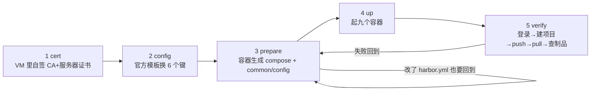

# 04 快速入门：从空目录到第一次推拉，五条命令

## 为什么要先花三分钟「劝退」：一半人其实不该装 Harbor

装错的代价是不对称的：选小了后面要迁仓库，选大了你会守着九个容器学怎么备份一个用不上的东西。所以本篇第一件事不是给命令，是给一条**分流判断**：

| 你要的东西 | 走哪条 | 代价（本机实测） |
|---|---|---|
| 构建产物有个落脚点的仓库，能推拉就行 | `docker run -d -p 5000:5000 registry:2` | 镜像 **37.4 MB**，一条命令，几十秒 |
| 账号/项目/角色、UI、审计、扫描、保留策略、代理缓存 | 本目录这条路 | 10 个 `goharbor/*` 镜像约 **3.46 GB**、9 个运行容器、`/data` 开箱 **52.7 MB**（其中 PostgreSQL 49.2 MB） |

**只是想验证「BuildKit 推到私有仓库」这条协议的，`registry:2` 十分钟能跑完**；Harbor 值得等的那件事叫「你要给别人用」。判断依据与反例见 `01-为什么要用Harbor.md`。

> 💡 新人小结（先问「这顿饭几个人吃」）：一个人吃饭不用建食堂。Harbor 是食堂：要办健康证（证书）、要备案（配置）、要验收（prepare 生成）、要营业（up）、要试吃（verify）。**如果你只是给自己带饭，微波炉（`registry:2`）就够了**——这不是省事，是正确答案。

## 它为什么是这五步：设计上的三条约束

这条流程不是照抄官方 `install.sh`，是被三条实测约束逼出来的形状：

| 约束 | 现象 | 于是流程长成这样 |
|---|---|---|
| `prepare` 是**生成器**而不是启动器 | 它读 `input/harbor.yml`，产出 `docker-compose.yml` 与 `common/config/` 九个目录 | 配置改动必须走 `config` → `prepare`，**手改 compose 会被下次 prepare 覆盖** |
| 数据与证书路径活在 **Docker Desktop 的 VM** 里 | `data_volume: /data` 不是 Windows 路径；从 Git Bash 传 `-v /data/...` 会被 MSYS 改写成 `C:\Program Files\Git\data` 并报 `Access is denied` | 所有 docker 调用走 Python 传 argv（`harborctl.py`），证书也放 VM 内的 `/data/harbor-certs` |
| 官方校验只硬拒 IP，不硬拒 `localhost` | `hostname: 127.0.0.1` → `ERROR:root:127.0.0.1 can not be the hostname`（rc=255）；`hostname: localhost` 能过并跑通全部判据 | 演示用 `localhost` 求「装完立刻能用」；生产必须真域名（`06` 的「生产上换正式证书的最小清单」） |

整体形状：



## 前置闸门（每条都在本机验过）

| 项 | 官方要求 | 本机读数 | 结论 |
|---|---|---|---|
| Docker Engine | `common.sh` 第 2 行 `docker version: 20.10.10+` | `Server=29.8.0 API=1.56` | 过 |
| Compose | `common.sh` 第 3 行 `docker-compose version: 1.18.0+`，且 `install.sh` 里 `DOCKER_COMPOSE=docker-compose`（v1 名字） | `Docker Compose version v5.5.1`，本机**没有** v1 shim | 官方脚本会在这步失败；本目录直接调 `docker compose` 子命令 |
| 宿主 python / go | `common.sh` 还要 golang `1.12.0+` | **不需要** | `prepare` 本身就是 `docker run goharbor/prepare:v2.14.6`，配置生成全在容器里 |
| 磁盘 | 官方建议 2C4G 起 | VM 内 `nproc` 24、`MemTotal` 49,292,256 kB；宿主 C 盘剩 **293.9 GB**（共 476.5 GB） | 过 |
| 端口 | 80/443 常被占 | `netstat` 里 `:80`/`:443` 的 LISTENING 命中数 **0**，仍选 **8081/8443** | 避开 443 与 IPv6 回环那对坑 |
| 在线包 | 离线包 `harbor-offline-installer-v2.14.6.tgz` 783.7 MB | 在线包只有 **12,122 字节**（5 个文件），镜像在 `prepare`/`up` 时才拉 | 内网没外网才需要离线包；**Windows 装不了与离线包无关** |

## 五条命令与预期读数

```console
CD /D <本目录>
Harbor.cmd cert        # 1 自签 CA + 服务器证书，写进 VM 的 /data/harbor-certs
Harbor.cmd config      # 2 在官方模板上换六个键，生成本机 harbor.yml
Harbor.cmd prepare     # 3 官方容器生成 common/ 与 docker-compose.yml
Harbor.cmd up          # 4 起九个容器
Harbor.cmd verify      # 5 判据链：登录 → 建项目 → push → pull → 查制品
```

第 2 步会自己报告有没有改到位——这比「跑完了」有意义得多：

```console
=== 2. 由官方模板生成本机 harbor.yml（只换六个键，其余键与注释原样保留）
   模板 339 行 -> harbor.yml 339 行；每个替换命中次数={'^hostname: ': 1, '^  port: 80$': 1, '^  port: 443$': 1,
   '^  certificate: ': 1, '^  private_key: ': 1, '^harbor_admin_password: ': 1}
   没命中的替换：无
```

**任何一个键没命中就退出 1**：「替换没命中」和「命中了但值错」是两类失败，前者必须当场拦下。产物 `harbor.yml` 是 345 行 = 模板 339 行 + 顶部 6 行说明。

第 4 步之后的状态（`Harbor.cmd status` 原文）：

```console
   Harbor 相关容器 9 个：
      harbor-jobservice Up 27 minutes (healthy) goharbor/harbor-jobservice:v2.14.6
      harbor-core Up 27 minutes (healthy) goharbor/harbor-core:v2.14.6
      registryctl Up 27 minutes (healthy) goharbor/harbor-registryctl:v2.14.6
      nginx Up 25 minutes (healthy) goharbor/nginx-photon:v2.14.6
      harbor-portal Up 34 minutes (healthy) goharbor/harbor-portal:v2.14.6
      registry Up 34 minutes (healthy) goharbor/registry-photon:v2.14.6
      harbor-db Up 34 minutes (healthy) goharbor/harbor-db:v2.14.6
      redis Up 34 minutes (healthy) goharbor/redis-photon:v2.14.6
      harbor-log Up 34 minutes (healthy) goharbor/harbor-log:v2.14.6
   /api/v2.0/health（带 -k）：{"components":[{"name":"core","status":"healthy"},...
   同一个地址**不带 -k**：|http=000
```

刚起完的十几秒里 `jobservice`、`registryctl` 会先报 `"error":"unknown status","status":"unhealthy"` 再转 healthy——**这是启动窗口，不是故障**，别在脚本里把它当失败退出（本机两次观测都是这个形状）。

版本自证别靠镜像名猜，问 API：

```console
># curl -s -k -u admin:<密码> https://localhost:8443/api/v2.0/systeminfo
{"auth_mode":"db_auth","external_url":"https://localhost:8443","harbor_version":"v2.14.6-f435c950",
 "has_ca_root":false,"project_creation_restriction":"everyone","read_only":false,
 "registry_storage_provider_name":"filesystem","registry_url":"localhost:8443","self_registration":false}
```

> 💡 新人小结（别拿包装盒当版本号）：镜像 tag 是**包装盒上的印刷**，`systeminfo` 才是**机器自己报的型号**。`harbor_version: v2.14.6-f435c950` 里的 `f435c950` 是构建提交短哈希——排障时这个串比版本号有用，因为它能定位到具体那份代码。

## 最小闭环判据（这四条全绿才算装成）

| # | 判据 | 命令 | 本机读数 |
|---|---|---|---|
| 1 | 健康 | `curl -k https://localhost:8443/api/v2.0/health` | `"status":"healthy"`，七个组件全 healthy |
| 2 | 认证与协议在位 | `curl -k -D - -o NUL https://localhost:8443/v2/` | `HTTP/1.1 401 Unauthorized` + `Docker-Distribution-Api-Version: registry/2.0` + `Www-Authenticate: Bearer realm="https://localhost:8443/service/token",service="harbor-registry"` |
| 3 | 推 | `docker tag alpine:3.20 localhost:8443/kbdemo/harbor-probe:1` → `docker push ...` | `rc=0`，`1: digest: sha256:c64c687c… size: 1023` |
| 4 | 删本地后拉回来 | `docker rmi <同一个名>` → `docker pull ...` | `rc=0`，`Status: Downloaded newer image for localhost:8443/kbdemo/harbor-probe:1` |

第 2 条要单独记：**仓库活着的表现是 401，不是 200**。拿「200 才算通」当判据的人会在私有仓库上反复误判——401 恰好证明 `/v2/` 前面有人（core）在发 token。

> 💡 新人小结（重复寄同一件快递）：再 `docker push` 一次同一份镜像，输出是 `25f1d6b1951a: Layer already exists` + **完全相同的 digest**。这不是失败，是内容寻存储在起作用——仓库说「这箱我仓里有，不重收」。**判据要认这个形态**：重复推之后摘要不变才算幂等，报红或摘要变了才是要查的。

## 三个最常见的失败（都是本机撞过的原文）

**一、没建项目就 push。**

```text
unknown: unexpected status from HEAD request to
https://localhost:8443/v2/kbdemo/probe/blobs/sha256:bf8527eb…: 401 Unauthorized
```

看着像密码错，其实是**项目不存在**。Harbor 用 401 掩盖「不存在 / 无权限」两种情况（这个语义在 v2.16.0-rc1 里才开始被修，见 `03-历史与版本迭代.md` 的「未来展望」一节）。先 `POST /api/v2.0/projects` 建项目再推。

顺带一条自己踩的坑：重复建同名项目时 `curl` 的退出码仍是 **0**，而响应是——

```console
{"errors":[{"code":"CONFLICT","message":"The project named kbdemo already exists"}]}
|HTTP=409
```

**`rc=0` 只说明请求发出去并收到了响应，4xx/409 一样是 0。** 判据要写 `-w "|HTTP=%{http_code}"` 把状态码打出来；只看 `curl` 退出码就是假绿（`harborctl.py` 现在两个都打）。

**二、把 `pull_count` 当下载计数。** 本机推 1 次、拉 3 次之后：

```json
[{"artifact_count":1,"name":"kbdemo/harbor-probe","pull_count":0,"project_id":2}]
```

要统计真实拉取，看 `/var/log/harbor/registry.log`（本机 99,459 字节，八个日志里最大）或 `audit_log` 表，别信这个字段。

**三、换了证书却没重启 proxy。** nginx 只在启动时读 `/etc/cert`；`docker compose -p harbor restart proxy` 之前它一直服务旧证书，你会误判成「CA 没生效」。完整因果与生效判据（三处指纹一致）在 `06-配置HTTPS.md`。

## 停下来 / 拆掉 / 重来

| 动作 | 命令 | 后果 |
|---|---|---|
| 停（保留数据） | `Harbor.cmd down`（`compose -p harbor down`，**不带 `-v`**） | 容器删掉，`/data` 与镜像都留着；再 `up` 就回来 |
| 只重启某个组件 | `docker compose -p harbor restart proxy` | 只换了证书/nginx 配置时用 |
| 改了 `harbor.yml` | `Harbor.cmd prepare` → **`docker compose -p harbor up -d`** | **不能只 `restart proxy`**：`prepare` 会重生成 registry 的共享凭据，老容器还在用启动时那份，pull 会得 `401 Unauthorized`。`up -d` 只重建受影响的 core/registryctl/jobservice（本机实测），其余不动 |
| 彻底拆 | `down` + 手工清 VM 里的 `/data` + `docker rmi goharbor/*` | 本目录**不自动删**，避免误清别人的数据 |

## 与链上其它部分的关系

- 段⑤ `示例/贯穿示例/段5-推上仓库/` 用的是 `registry:2`，判据是「tag/push/pull + 反查 commit」，不需要账号模型；这里回答的是「有项目/角色/证书的仓库长什么样」。
- 文章侧对应 [3.10 私有镜像仓库](/docs/03-镜像构建/交出去/BuildKit私有仓库标签策略与构建排错/)；3.12 排错表里 `401`（项目不存在/无权限同一句话）与 `%2F` 路径形式两条来自这里。
- 后续批次（CI 推镜像、扫描、保留策略/GC）把这里当被测仓库。Trivy 本轮**没装**（`WITH_TRIVY=False`），要用得 `prepare --with-trivy` 再 `up -d`。

## 要点总结

- **先分流再安装**：「只存产物」用 `registry:2`；要治理（权限/审计/扫描/清理）才上 Harbor，代价是 3.46 GB、9 容器、`/data` 起手 52.7 MB。
- 五步的形状由三条约束决定：`prepare` 是生成器（别手改 compose）、路径活在 VM（argv 传参，别走 Git Bash 的 `/data`）、校验只硬拒 IP（`localhost` 可用但生产要真域名）。
- `config` 的自检输出（六个键各命中 1 次、否则退出 1）比「跑完没报错」强，因为它能证伪。
- **最小闭环四判据**：health `healthy`；`/v2/` 匿名得 **401 + Bearer realm**；push 出摘要；删本地后能 pull 回。全绿才算装成。
- 失败三态记牢：401 可能是「项目不存在」；`curl rc=0` 不等于 HTTP 成功；`pull_count` 恒 0 不能当审计。
- 改配置后的正确生效链是 `prepare` → **`up -d`**，不是 `restart proxy`。

## 接着读

`02-组件与架构.md`（九个容器与一次 push 的完整路径）· `05-本机存储目录.md`（数据到底落在哪、怎么备份）· `06-配置HTTPS.md`（四层信任开关各在哪一层生效）· `07-本机安装与判据实录.md`（全过程与未验证项清单）
