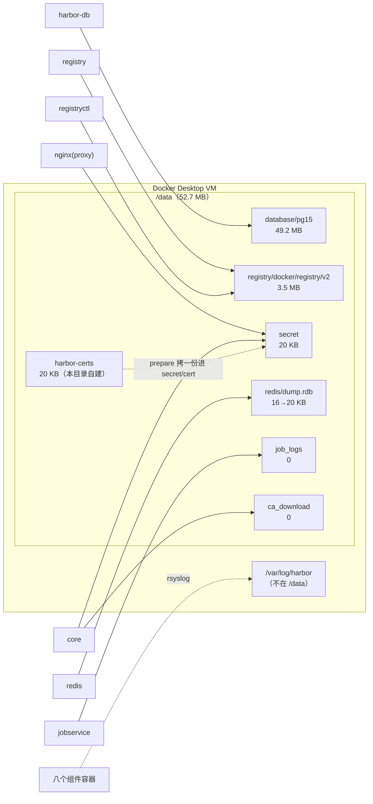
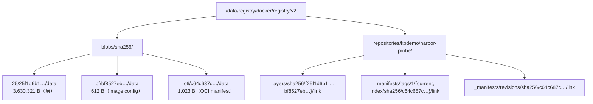

# 05 本机存储目录：数据到底落在哪，备份要带上哪四样

## 为什么要先搞清「数据在哪」：三个会让人白干的问题

装完之后最容易做错的一件事，是**按 Windows 的直觉去找目录**。这条弯路有三种代价：

| 问题 | 典型做法 | 后果 |
|---|---|---|
| 看不见 | 在资源管理器里找 `C:\data`，或在 `wsl -d docker-desktop` 里 `ls /data` | 报 `No such file or directory`，于是误判「Harbor 没写盘 / 装坏了」 |
| 备份备错东西 | 只 tar 了 `registry/`（看着像「镜像本体」） | 恢复时制品还在，但**凭据解不开、内部互信断**，等于拿回一堆无人认领的货箱 |
| 低估元数据 | 以为「推了一个 alpine，所以只有几十 MB」 | 本机 `/data` 的 1,580 个文件里只有 **8 个**在 `registry/` 下，其余几乎都是 PostgreSQL 的 |

> 💡 新人小结（账本比货箱重要）：`registry/` 是**货箱**，`database/` 是**账本**。只搬货箱不搬账本，恢复出来的就是「有货但没人知道是谁的、能不能出库」——Harbor 会立刻把那些 blob 判成孤儿。**备份要按「账本 + 货箱 + 钥匙串」三件套一起备**，钥匙串就是 `secret/`。

## 它的存储设计：三个互不相通的位置

| 位置 | 在哪 | 装什么 | 本机读数 |
|---|---|---|---|
| **`/data`** | Docker Desktop VM 内（`data_volume: /data` 是 VM 路径，不是 `C:\data`） | Harbor 自己的数据：制品 blob、PostgreSQL、密钥、redis dump | 合计 **52.7 MB**（推了一个 alpine 之后） |
| **`/var/log/harbor`** | 同一个 VM 内，**不在 `/data` 里** | 八个组件的日志（rsyslog 收集） | `registry.log` 99,459 字节最大，最小的 `redis.log` 6,377 字节 |
| **Docker 镜像存储** | VM 内的 containerd 存储（本机 `storage-driver=overlayfs`，见 5.4 那篇） | 10 个 `goharbor/*` 镜像本体 | 约 **3.46 GB**；`docker system df`：Images 21 / ACTIVE 9 / **4.49 GB** / 可回收 2.43 GB |

三个位置各有各的清理动作：**清 `/data` 清不掉日志，清日志不影响数据，`docker image prune` 只动第三栏**。`system df` 那个「可回收 2.43 GB」是**除 Harbor 之外**的历史镜像与构建缓存，别顺手 `prune` 把段②~⑤ 的实验镜像一起清了。

`/data` 内部谁挂谁（读自 `docker-compose.yml` 的 volumes 段，本轮逐条核过）：



## `/data` 七个顶层目录，逐个归谁

| 目录 | 本机大小 | 谁挂它 | 里面是什么 | 丢了会怎样 |
|---|---|---|---|---|
| `database/` | **49.2 MB** | `postgresql` → `/var/lib/postgresql/data` | `pg15/` 一个目录就是全部元数据：项目、成员、制品、标签、配额、审计、执行记录 | Harbor 认不出任何仓库，`/data/registry` 里的 blob 全成孤儿 |
| `registry/` | 3.5 MB | `registry` 与 `registryctl` **共用** → `/storage` | distribution 的文件树（下一节逐层拆） | 层与 manifest 真没了，UI 里却还「看得见」制品（元数据还在） |
| `secret/` | 20 KB | 分散挂到 `proxy`/`core`/`registry` | 四件：`cert/server.crt`+`server.key`、`registry/root.crt`、`core/private_key.pem`、`keys/secretkey`（16 字节） | 见「四件套」一节，**这四件必须与 database 同批备份** |
| `redis/` | 16 KB → 20 KB | `redis` → `/var/lib/redis` | 只有一个 `dump.rdb`：两次读数 **15,733 → 19,753 字节**，推拉开几下就长 | 队列/缓存状态丢，重建即可，不是数据 |
| `harbor-certs/` | 20 KB | 本目录 `cert` 子命令建的（**不是官方默认目录**，是我们放自签 CA 的地方） | `ca.crt`/`ca.key`/`ca.srl`/`harbor.crt`/`harbor.key` | 换不了证书；`ca.key` 丢了签不了第二张（本机踩过，见 `06`） |
| `job_logs/` | 0 | `jobservice` → `/var/log/jobs` | 任务日志（GC/复制/扫描）；本轮没跑过任务所以空 | 任务历史丢，功能不受影响 |
| `ca_download/` | 0 | 只有 `core` 挂它 → `/etc/core/ca/` | **本轮没能验出谁来写它**（见「增长、清理与两个未验证项」） | 未知 |

顺带一条底座读数：`/data/database/pg15` 说明本机这套装的是 **PostgreSQL 15**——别拿 v2.3.0 时代 notes 里的「PG 13.3」去判断今天的底座。

## 一个 alpine 的真实落盘

`storage.filesystem.rootdirectory: /storage`，容器里 `/storage` ← 宿主 `/data/registry`，所以完整前缀是 `/data/registry/docker/registry/v2/`。一个只有一层的 alpine 推进去之后：



四个读法，都是本机验过的：

1. **`sha256/` 后两级是摘要自截断**：`25/25f1d6b1…`，前两位做分片目录。所以「找某个 blob」不用 `find` 全树扫，路径可以直接算出来。
2. **`_layers/` 里也有 config 的 link**（`bf8527eb…`）。目录名会骗人：distribution 把**除 manifest 以外的所有 blob** 都登记成 `_layers` 链接，别按字面理解成「只有层」。`head -c 612` 该 blob 得到的是 `{"architecture":"amd64","config":{...},"rootfs":{"type":"layers","diff_ids":["sha256:08bc4e53…"]}}`，确实是 config。
3. **link 文件的内容就是一个摘要字符串**，例如 `_manifests/tags/1/current/link` 里写着 `sha256:c64c687cbea9300…`。标签不是「指向目录的软链接」，而是**一个内容为摘要的文本文件**——所以「改标签」在文件系统层是重写一个小文件，不碰 blob。
4. **算术能对上 API**：3,630,321 + 612 + 1,023 = **3,631,956**，与 `GET /api/v2.0/statistics` 的 `total_storage_consumption: 3631956` 一字不差。这条等式是「UI 报的容量到底含什么」的最短判据：**含 config 与 manifest，不只层**。

> 💡 新人小结（快递柜柜号就是取件码前两位）：`blobs/sha256/25/25f1d6b1…` 这种两层目录不是审美，是**分柜**——摘要前两位决定去哪个区，剩下的是完整柜号。取件时没人逐柜翻，你也不该 `find` 扫全树。

## 断点续传残留：本机为空的 `_uploads`

`find /data/registry/docker/registry/v2 -maxdepth 1` 只有 `blobs` 与 `repositories` 两项，**没有 `_uploads`**。原因是生成的 `common/config/registry/config.yml` 里写着：

```yaml
maintenance:
  uploadpurging: { enabled: true, age: 168h, interval: 24h, dryrun: false }
```

半截上传**默认 7 天后由 registry 自己清**。这条从 v2.5.0 起就有（`03-历史与版本迭代.md` 那张表里的「Activated distribution upload purging」），老文档里「手动清 `_uploads` 目录」的建议已不属于默认路径。

## `secret/` 四件套：为什么必须和数据库一起备份

| 文件 | 本机读数 | 作用 | 丢了的后果 |
|---|---|---|---|
| `cert/server.crt` / `cert/server.key` | md5 `7f2e8727a633352d299867c1280d9bca` / `8de1663f222fbf84d716ebe9fce2e7ba`，**与 `/data/harbor-certs/harbor.crt`、`.key` 逐字节相同** | 对外 TLS 证书。`prepare` 把 `harbor.yml` 的 `https.certificate` **拷进** `/data/secret/cert`，`proxy` 只挂后者 | 换成自签的另一张，客户端信任全失效 |
| `registry/root.crt` | 1,753 字节，`subject=` 与 `issuer=` **都为空**，`CA:TRUE`(critical)，有效期 2026-10-27 → 2036-10-24（**10 年**） | **组件之间 TLS 的根**（v2.0.0 起那条「Enable TLS between Harbor components」） | core/registry 等内部互信断，服务起不来 |
| `core/private_key.pem` | 3,243 字节，`BEGIN RSA PRIVATE KEY` | token / 凭据加密用的密钥 | **已存的机器人账户 token、外部端点凭据全部解不开** |
| `keys/secretkey` | 16 字节 | core 的对称密钥 | 同上 |

结论一句话：**只备份 `/data/registry` 是最危险的假备份**——制品还在，但凭据解不开、内部互信断，等于重装一套新 Harbor 却对不上旧元数据。

> 💡 新人小结（换锁要一整串钥匙一起带走）：`secret/` 是那串钥匙——大门钥匙（对外证书）、内部通道钥匙（组件间 CA）、密码本（core 私钥）、封条（对称密钥）。**搬新家只带大门钥匙，你会发现进不了自己家的仓库**：备份或迁移时这四件必须与账本（`database/`）同批打包。

## Windows 侧到底能看到什么

本目录（Windows 文件系统）里由 `prepare` 生成的配置产物，可以直接看、可以直接 diff：

```console
common/config/core/app.conf            74     common/config/portal/nginx.conf    1062
common/config/core/env              1,879     common/config/registry/config.yml    708
common/config/db/env                   25     common/config/registry/passwd         82
common/config/jobservice/config.yml  1,343    common/config/registryctl/config.yml   91
common/config/jobservice/env            594    common/config/registryctl/env          64
common/config/log/logrotate.conf        135    common/config/nginx/nginx.conf      4,197
common/config/log/rsyslog_docker.conf   207
                                    合计 10,461 字节 / 13 个文件 / 9 个组件目录
docker-compose.yml   256 行 / 5,886 字节（官方 prepare 生成，不要手改）
harbor.yml           345 行（= 官方模板 339 行 + 顶部 6 行说明）
```

两处值得专门记：

- `common/config/shared/trust-certificates/` 是**空目录**，却被挂进五个服务（`registry`、`registryctl`、`core`、`jobservice`、`proxy`；`docker inspect` 里 registry 的容器挂载点是 `/harbor_cust_cert`）。这就是「让 Harbor 信任某个外部端点（自签对象存储、上游仓库）」的**正确投放点**——比改容器 `/etc/hosts` 或到处加 `--insecure` 干净得多。
- **VM 的 `/data` 从 Windows 侧是可达的**，只是路径不是 `/data`：在 `wsl -d docker-desktop -u root` 里它落在 **`/run/rootfs.upper/data/`**，`md5` 与容器里的 `/data/harbor-certs/ca.crt` 一致（`3fe9d254ce7d20a84d206d0cce7df877`）。直接 `ls /data` 报 `No such file` 只是因为根路径不在那儿——**早前那份「Windows 完全看不到 / 没有 `/etc/docker`」的记录是错的，本轮已更正**。

日常读法仍是借一个挂了 `/data` 的容器，最稳：

```console
docker run --rm -v /data:/d:ro alpine:3.20 sh -c 'du -sh /d/*; du -sh /d'
docker run --rm -v /data:/d:ro alpine:3.20 sh -c 'find /d -type f | wc -l'
```

别从 Git Bash 直接把 `/data/...` 当参数传：MSYS 会改写成 `C:\Program Files\Git\data\...` 再报 `Access is denied`。本目录所有 docker 调用都走 Python 传 argv，就是为了绕开这一层（详见 `07-本机安装与判据实录.md` 的「安装五步与实测读数」一节）。

## 具体怎么用：备份、还原与两条判据

```console
# 备份：一条 tar 把 /data 全量带走（含 secret 与 database）
docker run --rm -v /data:/d:ro alpine:3.20 tar czf - -C /d . > harbor-data-<日期>.tgz

# 判据一：备份里必须同时出现这四样，缺一个就报警
tar tzf harbor-data-<日期>.tgz | awk -F/ '{print $2}' | sort -u
#   期望含：database  registry  secret  harbor-certs（本例还有 redis）

# 判据二：还原前先比 md5，确认对外证书与 prepare 拷进去的那份仍是同一张
docker run --rm -v /data:/d:ro alpine:3.20 md5sum /d/harbor-certs/harbor.crt /d/secret/cert/server.crt
```

还原：`/data` 放回原位（同一份 tar 反向解开）→ 用**同一份** `harbor.yml` 重跑 `Harbor.cmd prepare` → **`docker compose -p harbor up -d`**。少 `prepare` 这一步，`docker-compose.yml` 与 `common/config/` 就可能和备份里的 `/data` 不是同一套参数生成的；少 `up -d`，会撞上 `02-组件与架构.md`「变更生效链」那条 401。

## 增长、清理与两个未验证项

| 项 | 现状 | 说明 |
|---|---|---|
| 日志 | 八份在 VM 的 `/var/log/harbor`，由 `common/config/log/logrotate.conf`（135 字节）管轮转；`log` 服务对外只绑回环 `127.0.0.1:1514`（compose 里 `1514:10514`） | **不在 `/data`**，清 `/data` 清不掉日志 |
| 制品 | 删仓库/删标签只动元数据与 link 文件，blob 要等 **GC** 才真回收 | 本轮**没跑 GC**（跑一次会真删数据，不适合边写文档边试），所以「GC 之后 `/data/registry` 缩多少」没有读数；机制与操作归 6.x（保留策略与回收） |
| `ca_download/` | 恒为 0 字节，只被 `core` 挂在 `/etc/core/ca/` | `GET /api/v2.0/systeminfo/cer` 本机是 **404**（`{"errors":[{"code":"NOT_FOUND","message":"path /api/v2.0/systeminfo/cer was not found"}]}`，顺带可见 Harbor 的错误体会把**解码后的路径**原样打回来，这也是 `%2F` 那条排错的来源）。我没找到会往里写文件的接口，**「UI 下载 CA 往哪写」标为未验证**，不编 |
| `redis/` | `dump.rdb` 15,733 → 19,753 字节 | 量级 KB，随活动自然增长，不用管 |

## 要点总结

- Harbor 的数据住在**三个互不相通的位置**：VM 的 `/data`（52.7 MB）、VM 的 `/var/log/harbor`（八份日志）、Docker 镜像存储（约 3.46 GB）。清错地方 = 白清。
- `/data` 里**元数据才是主体**：1,580 个文件只有 8 个属于 `registry/`，`database/pg15` 一家就 49.2 MB。备份策略要按这条事实设计，而不是按「镜像多大」的直觉。
- 落盘布局可算、可对账：`blobs/sha256/<前两位>/<全摘要>/data`，三块字节相加 = `total_storage_consumption`（3,631,956）。`_layers` 里含 config 是实现细节，别按字面理解。
- **四件密钥与 `database/` 同生死**；只备 `registry/` 是最危险的假备份。
- Windows 侧读 VM 的路径写 `/run/rootfs.upper/data/`；给外部端点加信任的投放点是 `common/config/shared/trust-certificates/`（挂进五个服务）。
- 两条未验证（GC 回收量、`ca_download` 写入者）明确挂着，别当已知结论引用。

## 接着读

`02-组件与架构.md`（谁挂谁、一次 push 走哪几步）· `06-配置HTTPS.md`（证书与四层信任）· `07-本机安装与判据实录.md`（安装全过程原文）
