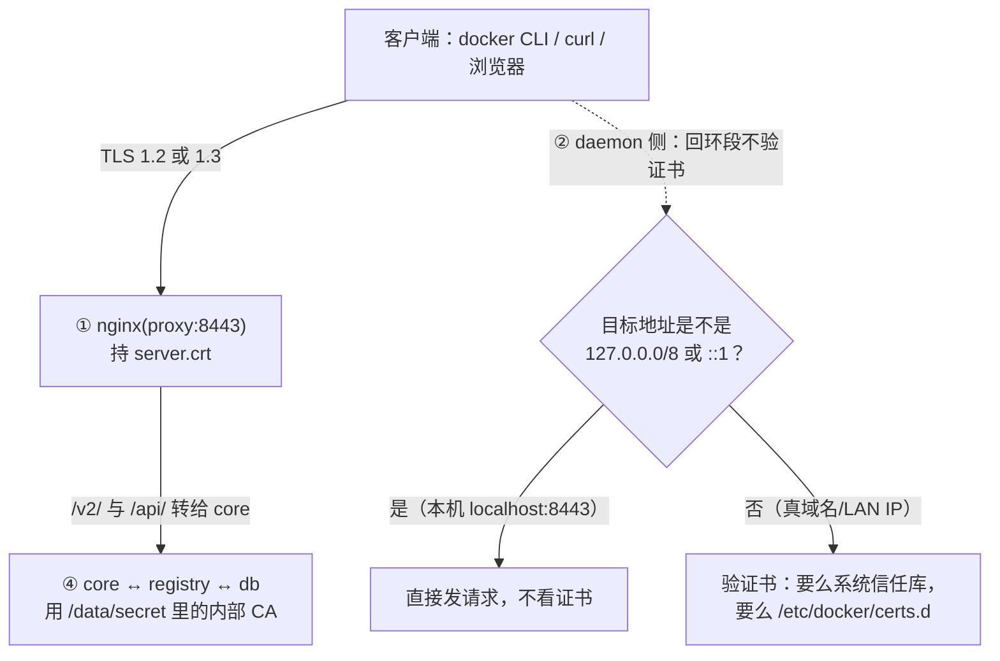

# 06 配置 HTTPS：证书怎么生、信任放在哪一层、四条走不通的路

## 为什么「HTTPS 已经开了」这句话没有信息量：四类误判同源

「我们仓库上了 HTTPS」在评审里是一句听不得后半句的话。因为一次 `docker push` 到 Harbor 的链路上，**有四个互相独立的校验点**，任何一个都可以单独关掉，而且它们关掉之后症状很像：

| 误判 | 现实 | 本机读数依据 |
|---|---|---|
| 「端口是 8443、URL 是 https，所以证书在校验」 | daemon 对回环段**根本不验** | `InsecureRegistryCIDRs=["::1/128","127.0.0.0/8"]`，`localhost:8443` 推拉 rc=0 与 CA 无关 |
| 「CA 装好了，客户端就会验链条」 | 把**服务器证书本身**当 CA 交出去也「验证通过」 | `--cacert /c/harbor.crt` → `SSL certificate verify ok.` + `200` |
| 「Windows 的 curl 不认 `--cacert`，说明它忽略这个参数」 | 它解析了参数、读了文件，只是**不拿它当信任锚** | 路径不存在 → `rc=2 option --cacert: is badly used here`；给正确 CA → `rc=60 SEC_E_UNTRUSTED_ROOT` |
| 「内部也 TLS 了，所以整条链路都加密」 | 对外证书与**组件之间那把 CA** 是两把不同的东西 | `/data/secret/registry/root.crt`：subject/issuer 都为空、`CA:TRUE(critical)`、有效期 10 年 |

本篇的结论只有一句：**四件事各有各的开关，任何一个都不能替另一个背书。** 下面按「先分层 → 再讲服务端怎么配 → 再讲怎么生效 → 最后讲客户端与生产」的顺序展开，所有读数都在本机取过。

> 💡 新人小结（一栋楼的四种门禁）：外墙闸机（① nginx 持证书）、员工刷卡机是否联网核身份（② daemon 验不验）、访客登记处（③ curl/浏览器自己的信任库）、楼层之间的内门（④ 组件间 TLS）。**「大楼有门禁」这句话没说清是哪一道门**——所以每次都要问：哪一层、用什么凭据、我在哪儿能验证它。

## 它是怎么设计的：四层信任与各自的实测状态



| 层 | 谁在做决定 | 本机状态与读数 | 开关在哪 |
|---|---|---|---|
| ① 服务端 | `proxy`（nginx）持证书并终止 TLS | `listen 8443 ssl;` + `ssl_certificate /etc/cert/server.crt;`，`ssl_protocols TLSv1.2 TLSv1.3;`。协商结果：`SSL connection using TLSv1.3 / TLS_AES_256_GCM_SHA384 / x25519 / RSASSA-PSS`，`ALPN: server accepted http/1.1`（**没有开 h2**） | `harbor.yml` 的 `https:` 段 + `common/config/nginx/nginx.conf` |
| ② Docker daemon（`push`/`pull`） | `InsecureRegistryCIDRs` 与 `/etc/docker/certs.d/` | 出厂含回环两段 → **`localhost:8443` 与 `127.0.0.1:8443` 不验证书**，本机推拉跑通与 CA 无关 | daemon 配置（Docker Desktop 的设置或 `daemon.json`） |
| ③ 直连客户端（curl / 浏览器 / CI 脚本） | 各自的信任库 | Windows 自带 curl（Schannel）不带 `-k` → `rc=60` + `schannel: SEC_E_UNTRUSTED_ROOT (0x80090325)`；容器里 OpenSSL 版 curl 带对 CA → `http=200` | 系统证书库 / `--cacert` / 浏览器信任设置 |
| ④ Harbor 组件之间 | 自签的一把内部 CA（v2.0.0 起那条「Enable TLS between Harbor components」） | `/data/secret/registry/root.crt`：**subject 与 issuer 都为空**、`CA:TRUE (critical)`、2026-10-27 → 2036-10-24（**10 年**，与对外那张 825 天不同） | `prepare` 生成，落在 `/data/secret/` |

## 服务端：一张能用的证书要满足什么

`Harbor.cmd cert` 干的活（全部在容器里跑，宿主不需要 openssl）：

```console
# CA：必须留着 ca.key，并且 basicConstraints 要显式 critical,CA:TRUE
openssl req -x509 -newkey rsa:2048 -sha256 -days 825 -nodes -keyout ca.key -out ca.crt \
  -subj '/CN=Harbor Demo CA' -addext 'basicConstraints=critical,CA:TRUE'
# 服务器证书：SAN 必须覆盖你打算用的**每一个**名字
openssl req -newkey rsa:2048 -nodes -keyout harbor.key -out harbor.csr -subj '/CN=localhost'
printf 'subjectAltName=DNS:localhost,DNS:host.docker.internal,IP:127.0.0.1\n' > san.ext
openssl x509 -req -in harbor.csr -CA ca.crt -CAkey ca.key -CAcreateserial \
  -out harbor.crt -days 825 -sha256 -extfile san.ext
```

本机对结果的读数（这张是当前在服务的；每次重签 serial 与指纹都会变，所以**指纹是判断「nginx 到底在用哪张」的唯一手段**）：

```console
subject=CN=localhost                     issuer=CN=Harbor Demo CA
notBefore=Oct 27 14:21:40 2026 GMT       notAfter=Jan 29 14:21:40 2029 GMT（825 天）
serial=6C9526B260E6506C5219A13DD773AA7937FFF931
X509v3 Subject Alternative Name: DNS:localhost, DNS:host.docker.internal, IP Address:127.0.0.1
X509v3 Subject Key Identifier / Authority Key Identifier（除此之外没有别的扩展）
Signature Algorithm: sha256WithRSAEncryption   Public-Key: (2048 bit)
服务器证书指纹 sha256 98:C5:37:73:…:DD:2D:65:2A
CA 指纹（自 13:35 生成后没变）  sha256 B0:AA:7C:9C:…:FC:F0:60
```

三条只有踩过才知道的点：

1. **`ca.key` 删了就签不出第二张。** 第一版脚本习惯性地 `rm -f ca.key`（「私钥不该躺在数据目录里」的直觉），结果第二次执行 `cert` 直接 rc=1。现在改成「`ca.key` 不在才生成 CA」，只删 `harbor.csr` 与 `san.ext` 两个中间产物。
2. **SAN 少一项就是一次「证书不可信」**。第一版只写 `DNS:localhost,IP:127.0.0.1`，后来想试 `host.docker.internal` 就撞上名字对不上——**那不是 CA 没装**，加 CA 也救不了。Go 1.15（v2.2.0 那次升级）起彻底不吃 CN-only 证书，从那时起这就是硬要求。
3. **本张证书没有 Key Usage / EKU 扩展**（读数只有 SAN/SKI/AKI）。浏览器与 Go 客户端不管这个，但严格的策略引擎（例如准入控制器）可能挑出来。生产换正式证书就不存在这问题。

「生效判据」是三处指纹必须相同：

```console
# 1) nginx 实际递交的（在线抓）
echo | openssl s_client -connect host.docker.internal:8443 | openssl x509 -noout -fingerprint -sha256
# 2) prepare 拷进挂载位的那份
openssl x509 -in /data/secret/cert/server.crt -noout -fingerprint -sha256
# 3) cert 子命令生成的源文件
openssl x509 -in /data/harbor-certs/harbor.crt -noout -fingerprint -sha256
本机三处读数完全一致（98:C5:37:…）——任何一处不同，就说明该重启没重启、或该重跑 prepare 没重跑。
```

> 💡 新人小结（身份证复印件不能当身份证用）：判「证书对不对」要拿**指纹**（同一份证件的防伪编号）三处对照，而不是看「我刚才放进去的那张纸」。把服务器证书当 CA 交出去也能「验证通过」，就像**拿身份证复印件跟查验员说这是我的证件**——他比对上了，但你并没有证明链条。

## 生效链：改证书之后必须做的两步，顺序不能错

`prepare` 不是「写个 nginx 配置」就完事，它把证书**拷了一份**：

```console
/data/harbor-certs/harbor.crt    md5 7f2e8727a633352d299867c1280d9bca
/data/secret/cert/server.crt     md5 7f2e8727a633352d299867c1280d9bca   ← nginx 挂的是这里（/etc/cert）
/data/harbor-certs/harbor.key    md5 8de1663f222fbf84d716ebe9fce2e7ba
/data/secret/cert/server.key     md5 8de1663f222fbf84d716ebe9fce2e7ba
```

于是有两个坑，本机都撞过：

| 坑 | 现象 | 正确动作 |
|---|---|---|
| nginx 只在**启动时**读 `/etc/cert` | 换完证书 `docker ps` 显示 nginx 仍 `Up 5 minutes`，服务的是旧证书，怎么加 CA 都失败 | `docker compose -p harbor restart proxy` |
| `prepare` 会重生成 `common/config/registry/passwd` 等一批共享凭据，**而老容器还在用启动时读进内存的那份** | 重跑 `prepare` 之后 `docker pull` 报 `unexpected status from HEAD request to https://localhost:8443/v2/...: 401 Unauthorized`（rc=1） | `docker compose -p harbor up -d`：它只重建配置变了的那三个（本机输出 `harbor-core Recreated`、`registryctl Recreated`、`harbor-jobservice Recreated`，其余 `Running` 不动），之后 pull 回 rc=0 |

第二条是本轮新撞出来的：**只 `restart proxy` 不够**。改 `harbor.yml` 之后的正确链条是 `prepare` → **`up -d`**。

## 客户端信任：带 CA 与不带 CA 的对照（最干净的一组读数）

在容器里（OpenSSL 版 curl）对**非回环名** `host.docker.internal:8443` 做五组：

| 组 | 命令要点 | 读数 |
|---|---|---|
| 不带 CA | `curl -s -o /dev/null -w %{http_code}` | `000`（握手都没过） |
| 带正确 CA | `--cacert /c/ca.crt` | `200` |
| 带**别人的** CA（现场另签一张 `CN=Wrong CA`） | `--cacert /w/wrong.crt` | `000` |
| 限定 TLS 版本 | `--tlsv1.2 --tls-max 1.2` / `--tlsv1.3` | 都是 `200` |
| 只允许 TLS 1.1 | `--tlsv1.1 --tls-max 1.1` | `000` ← 与 `ssl_protocols TLSv1.2 TLSv1.3` 一致 |

**陷阱：把服务器证书本身当 CA 交出去也会「验证通过」**（`--cacert /c/harbor.crt` → `SSL certificate verify ok.` + `200`），因为 OpenSSL 把你给的那份 pem 当**信任锚**，直接匹配就不走链了。所以「装了 CA 就能通」不能证明信任链正确——判据必须成对：**正向通过 + 反向必红**（第三组 `000` 就是那条反向对照）。

## Windows 侧：`--cacert` 为什么不生效（区分实验）

Windows 自带 `curl 8.21.0 (Windows) libcurl/8.21.0 Schannel`。三次读数：

```console
A --cacert C:\nope\missing-ca.crt  -> rc=2  curl: option --cacert: is badly used here     ← 参数会被解析
B --cacert <真正的 ca.crt>          -> rc=60 http=000  schannel: SEC_E_UNTRUSTED_ROOT       ← 文件读到了，但仍按系统库判定
D --cacert <真正的 ca.crt> 且 -k    -> rc=0  http=200                                       ← -k 直接赢
（对照）容器里 OpenSSL 版 curl 用同一个 CA 文件 -> 200
```

A 组是关键对照：**如果 curl 完全忽略这个选项，路径不存在时不会报错**。所以准确结论不是「`--cacert` 被忽略」，而是「**Schannel 后端不把 `--cacert` 当信任锚，它只认 Windows 证书库**」。要让 Windows 侧任何客户端真信这张 CA，只有 `certutil -addstore Root <ca.crt>`（要管理员、动系统信任库，本目录**没做**，生产也不建议——生产应该用正式 CA）。

> 💡 新人小结（老大门焊死了，只贴一张「请走正门」）：明文口 8081 就是那扇焊死的门。实测 `curl http://host.docker.internal:8081/api/v2.0/health` → `308` + `redirect=https://host.docker.internal:8443/api/v2.0/health`，跟随后 `200`。nginx 原文 `listen 8080; return 308 https://$host:8443$request_uri;`——**它不服务明文 API**，所以「先开 http 口方便调试」在这里不成立；要方便调试请走 ② 的回环或 ③ 的 CA 路线。

同一份响应头里还能读到 Harbor 默认加的一组安全头（本机 `POST /api/v2.0/projects` 拿到 201 时）：

```console
Strict-Transport-Security: max-age=31536000; includeSubdomains; preload
X-Frame-Options: DENY
Content-Security-Policy: frame-ancestors 'none'
```

**HSTS 默认开着，`max-age` 一年。** 纯 `localhost` 场景看不出影响，换成真域名之后有实际后果：浏览器收到 HSTS 就在有效期内记住「只能用 HTTPS、不许例外」，届时自签证书被判错也**不会再给「继续访问」按钮**——要么把 CA 装进系统信任库，要么别在真域名上用自签。头里的 `preload` 只对已进浏览器预置清单的域生效，本机场景不涉及。

另外 `harbor.yml.tmpl` 有一行注释掉的 `strong_ssl_ciphers: false`（默认关）。打开后 nginx 会换成更严的套件；本机读数是默认那份：

```nginx
ssl_ciphers '!aNULL:kECDH+AESGCM:ECDH+AESGCM:RSA+AESGCM:kECDH+AES:ECDH+AES:RSA+AES:';
ssl_prefer_server_ciphers on;
ssl_session_cache shared:SSL:10m;
```

## 四条在本机走不通、或判不了的路（留原文）

| 想做的事 | 结果 | 原文依据 |
|---|---|---|
| 写用户级 `%USERPROFILE%\.docker\certs.d\localhost:8443\ca.crt`（Linux 标准做法） | **做不到**：NTFS 不允许目录名含冒号 | `NotADirectoryError: [WinError 267] 目录名称无效`；改成 `localhost!8443` 能建，但 daemon 不按这个名字找 |
| 写 daemon 视野里的 `/etc/docker/certs.d/<reg>:<port>/ca.crt` | **路径能建、CA 能放，但本机证明不了它生效** | `wsl -d docker-desktop -u root` 里 `/etc/docker/certs.d/` 存在（冒号在 ext4 合法），拷进去 `ls -l` 见 `ca.crt 1127` 字节；改完 SAN 再拉非回环入口：`Head "https://192.168.65.254:8443/v2/kbdemo/harbor-probe/manifests/1": EOF`，放 CA 之后**仍是同一句 EOF**，且 nginx 访问日志里**没有这两次请求的记录** → 失败在 TCP 层，不在证书层。这条既没跑通也没证伪（实验完把写进去的目录删净，`/etc/docker/certs.d` 现为空） |
| 靠 `host.docker.internal` 让 daemon 去拉 | 解析不到 | `getent hosts host.docker.internal` → `** server can't find host.docker.internal: NXDOMAIN`。那个名字是**容器里**由 Docker 的嵌入式 DNS 给的，daemon 自己的命名空间没有 |
| 问 Harbor 要它的根证书文件 | 端点没有 | `GET /api/v2.0/systeminfo/cer` → `{"errors":[{"code":"NOT_FOUND","message":"path /api/v2.0/systeminfo/cer was not found"}]}`；`/data/ca_download` 一直 0 字节 |

**顺带纠正两条我自己写错的结论**：早前记录说「`wsl -d docker-desktop` 里没有 `/etc/docker`」——本轮实测**有**；「VM 里看不到容器用的 `/data`」也不准确——`/run/rootfs.upper/data/` 能读到，`md5` 与容器里的 `/data/harbor-certs/ca.crt` 一致（`3fe9d254ce7d20a84d206d0cce7df877`）。两条错处的共同根因是**拿一次探测当定论**，已在 `07-本机安装与判据实录.md` 的「本轮新增的两条坑」一节登记。

## 生产上换正式证书的最小清单

| 步骤 | 要点 |
|---|---|
| 1 申请 | `hostname` 填真域名；SAN 覆盖**所有会被人用的名字**（裸域名、`registry.xxx`、可能的内网别名）。IP 一般别写进 SAN，靠域名 |
| 2 放置 | 证书与私钥放 `harbor.yml` 的 `https.certificate` / `private_key` 指向的路径（**VM 内路径！**）；`prepare` 会拷进 `/data/secret/cert` |
| 3 生效 | `prepare` → `up -d`（本节那条 401 教训）；`restart proxy` 只在没跑 prepare 的临时替换时才需要 |
| 4 客户端 | 正式 CA 签发的话，Linux/macOS/Windows 的 docker、curl、浏览器都零配置；**自签的话**，Linux 走 `/etc/docker/certs.d/<registry>/ca.crt`（带端口的目录名只在 Linux 合法），macOS 进钥匙串，Windows 进证书库或按上一节改用 `-k` 以外的方案 |
| 5 回环陷阱 | 别让 `InsecureRegistryCIDRs` 帮你「测试通过」：测之前先 `docker info` 看这一项，或干脆用一个非回环的名字测 |
| 6 别忘了内部那张 | `/data/secret/registry/root.crt` 是组件互信用（10 年），与对外证书**无关**，别拿它去给客户端当 CA |

## 本轮未验证（HTTPS 部分）

| 项 | 状态 |
|---|---|
| `certutil -addstore Root` 让 Windows 全局信任 | 未做（要管理员、动系统信任库） |
| `strong_ssl_ciphers: true` 的实际套件变化 | 未测（要改配置重跑 prepare） |
| Harbor 前置另一个反代（如公司现有 nginx）时的证书链 | 未测；`external_url` 与 `X-Forwarded-*` 的组合本轮没试 |
| daemon 侧 `certs.d` 是否真被读取 | **既没跑通也没证伪**（网络层不通，见上面那张表第二行） |
| Let's Encrypt / ACME 自动续期与 Harbor 的配合 | 未做，属生产运维，超出「本机装一套能推拉的 Harbor」 |

## 要点总结

- **信任有四层，各自独立**：服务端持证书（TLSv1.2/1.3，实测协商 1.3，无 h2）、daemon 对回环段不验、客户端各自校验、组件之间另有一把 10 年的内部 CA。任何一层的「通过」都不能替另一层背书。
- 证书硬规矩三条：**`ca.key` 要留**（删了就签不出第二张）、**SAN 要覆盖每个要用的名字**（Go 1.15 起不吃 CN-only）、**生效判据是三处指纹相同**（在线抓的 / `/data/secret/cert/server.crt` / 源文件）。
- 改配置的链条是 `prepare` → **`up -d`**；只 `restart proxy` 会让推拉静默 401。
- 判客户端信任的写法必须是**成对**的：带 CA 通过 + 换不相干 CA 必红。只测正向会漏掉「把服务器证书当 CA 也通过」这种假绿。
- Windows 侧三条限制值得背下来：**NTFS 不让目录名带冒号**（`certs.d` 标准路径建不出来）、**Schannel 不把 `--cacert` 当信任锚**（不是忽略参数）、**HSTS 默认一年**（真域名 + 自签会失去「继续访问」按钮）。
- 明确判不了的一条：daemon 读不读 `certs.d`——本机非回环入口在 TCP 层就 EOF，且 nginx 日志无记录，**不写结论**。
