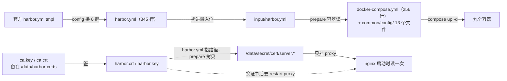

# 07 本机安装与判据实录：Windows + Docker Desktop 上真装一遍 Harbor（HTTPS）

这篇是这个目录的**安装实录**：每一步都在本机跑过，跑不通的地方留的是报错原文，包括我自己写错的几处。它是 [3.10 私有镜像仓库](/docs/03-镜像构建/交出去/BuildKit私有仓库标签策略与构建排错/) 那篇「真实案例」侧的完整版。装完的状态：Harbor v2.14.6 九个容器全 healthy，入口 `https://localhost:8443`，本机 `docker push` / `docker pull` 双向跑通，`/api/v2.0/health` 报 `"status":"healthy"`。

想按最短路径重装一遍请看 `04-快速入门.md`；这篇负责把「为什么是这几条命令」和「哪些路走不通」写全。

## 为什么这篇要从「入口名」讲起：这台机器上只有一条路是通的

| 候选入口名 | 结果 | 原文依据 |
|---|---|---|
| `127.0.0.1:8443` | **被官方配置校验拒绝** | `prepare` 输出 `Error happened in config validation...` + `ERROR:root:127.0.0.1 can not be the hostname`，rc=255 |
| `harbor.local:8443` 这类自建名 | 不可行 | 没有能解析它的 DNS；写 Windows 的 `hosts` 要管理员，且不算「本机装完就能用」 |
| `host.docker.internal:8443` | VM 侧容器里能用，**Windows 侧不能用**，daemon 自己也不能用 | Windows：`socket.gethostbyname('host.docker.internal')` → `[Errno 11001] getaddrinfo failed`，`docker login` 因此 rc=1；VM 根命名空间：`getent hosts host.docker.internal` → `** server can't find host.docker.internal: NXDOMAIN`（那是**容器里**的嵌入式 DNS 才给的名字） |
| `localhost:8443` | **可用，本目录采用** | push/pull rc=0；`/api/v2.0/health` 200；门户返回 `<!DOCTYPE html>...<title>Harbor</title>` |

`hostname: localhost` 与官方 `install.sh` usage 里那句 `DO NOT use localhost or 127.0.0.1 for hostname` 是冲突的——但**校验只硬拒 IP**，`localhost` 能过。本目录用它是为了「装完立刻能推拉」，代价写在 `06` 的「四条在本机走不通、或判不了的路」与「生产上换正式证书的最小清单」两节：生产必须填真域名。

还有一层必须写清：**daemon 对 `localhost:8443` 不做证书校验**，原因不是我们配了什么，而是 Docker Desktop 出厂就把回环段列进了 insecure 名单：

```console
># docker info --format '{{json .RegistryConfig.InsecureRegistryCIDRs}}'
["::1/128","127.0.0.0/8"]
```

这一条同时解释了三个看似矛盾的现象：`docker login localhost:8443` 成功、`docker push` 能进到 HTTP 层（撞的是 `401 Unauthorized`），而 Windows 上的 `curl` 不带 `-k` 直接 `http=000`。**daemon 不验，客户端自己验**——这条分不清，后面所有「证书到底要不要装」的判断都会跑偏。

## 版本与前置闸门（全部实测）

> 💡 新人小结（装修前先量房）：官方 `common.sh` 那三行注释（docker 20.10.10+ / docker-compose 1.18.0+ / golang 1.12.0+）就是「户型要求」。**量房的目的不是照抄要求，是知道自己哪一项不符**——本机 compose 是 v5.5.1 但没有 v1 那个 `docker-compose` 命令名，官方脚本恰好会在这里失败；而 golang 那条根本不用管，因为配置生成跑在容器里。

| 项 | 要求 | 本机 |
|---|---|---|
| 发行版 | **v2.14.6**，发布日 2026-10-23。取法：`api.github.com/repos/goharbor/harbor/releases/latest` → `v2.14.6`；注意 **`latest` ≠ 版本号最高**（`v2.15.4` 发布于 2026-10-09，更早；`v2.16.0-rc1` 是 prerelease 被排除）。本机选它的理由是「仍在维护的三条线之一，且是 `latest` 给的那条」，不是「最新版」 | 用它，运行时自证 `harbor_version: v2.14.6-f435c950` |
| 离线包 | `harbor-offline-installer-v2.14.6.tgz` **783.7 MB** | 没下。在线包只有 12,122 字节，镜像在 `prepare`/`up` 时从 Docker Hub 拉。**离线包解决的是「内网没外网」，不是「Windows 装不了」** |
| `docker` | `common.sh` 第 2 行 `docker version: 20.10.10+` | `Server=29.8.0 API=1.56` 通过 |
| `docker compose` | `common.sh` 要求 `1.18.0+`；`install.sh` 默认变量 `DOCKER_COMPOSE=docker-compose`（v1 名字） | 本机 `Docker Compose version v5.5.1`，**没有 v1 shim** → 官方脚本会在这步失败；本目录直接调 `docker compose` 子命令 |
| 宿主 python3 / go | `common.sh` 还要 golang `1.12.0+` | **不需要**：`prepare` 本身就是一条 `docker run goharbor/prepare:v2.14.6`，配置生成跑在容器里 |
| 端口 | 80/443 常被占 | `netstat -ano` 里 `:80` 与 `:443` 的 LISTENING **命中数为 0**，但仍选 **8081/8443**：避开 443 与 IPv6 回环那对坑。装完之后本机监听是 `0.0.0.0:8081`、`0.0.0.0:8443`、`[::]:8081`，外加 `127.0.0.1:8081`、`127.0.0.1:8443`（Desktop 自己的回环转发）与 `127.0.0.1:1514`。**注意 proxy 那两个口是全网卡发布** |
| 资源 | 官方建议 2C4G 起 | VM 内 `nproc` = **24**、`MemTotal` = 49,292,256 kB（**47.0 GiB**）；Docker 数据盘 `overlay` 1006.9G 总 / 948.4G 可用；宿主 C 盘剩 **293.9 GB**（共 476.5 GB） |

在线包里只有 5 个文件，`官方安装包留档/` 存的就是它们原件（Apache-2.0）——**留着是为了能对照我改了哪几行**：

```console
$ tar tf harbor-online-installer-v2.14.6.tgz
harbor/prepare
harbor/LICENSE
harbor/install.sh
harbor/common.sh
harbor/harbor.yml.tmpl
```

## 目录里每个文件是什么

| 文件 | 作用 |
|---|---|
| `harborctl.py` | 唯一实现。子命令 `cert` / `config` / `prepare` / `up` / `status` / `trust` / `verify` / `down`，一条只做一件事，便于逐步复现与逐步记录 |
| `Harbor.cmd` | ASCII-only + CRLF 的转发包装（逻辑不在里面）；开头 `chcp 65001` 让中文输出不乱码 |
| `官方安装包留档/` | 上面那 5 个原件 |
| `harbor.yml` | 本机实参，由 `config` **在官方模板上逐行替换生成**：345 行 = 模板 339 行 + 顶部 6 行说明，只动 6 个键 |
| `input/harbor.yml` | `prepare` 的输入位（官方脚本要求把 `harbor.yml` 拷进 `input/`，v2.0.0 起模板与实参分名，见 `03` 的「唯一的架构级断点」一节） |
| `docker-compose.yml` | 由官方 `prepare` 生成（256 行 / 5,886 字节），**不是手写、也不要手改** |
| `common/config/` | 同样由 `prepare` 生成：9 个组件目录、13 个文件、10,461 字节 |
| `certs/harbor-ca.crt` | `trust` 从 VM 里取出的自签 CA（1,127 字节），给 `curl --cacert`、浏览器与 CI 用 |
| `project.json` | `verify` 用来建演示项目的请求体 |

## 安装五步与实测读数

```console
CD /D <本目录>
Harbor.cmd cert        # 1 自签 CA + 服务器证书（写进 VM 的 /data/harbor-certs）
Harbor.cmd config      # 2 在官方模板上换六个键，生成本机 harbor.yml
Harbor.cmd prepare     # 3 官方容器生成 common/ 与 docker-compose.yml
Harbor.cmd up          # 4 起九个容器
Harbor.cmd verify      # 5 判据链：登录 → 建项目 → push → pull → 查制品
```

这五步的产物关系（虚线 = 拷贝，实线 = 生成）——看懂这张图就知道为什么「改完 `harbor.yml` 必须重跑 `prepare`，而 `prepare` 之后必须 `up -d`」：



### 第 1 步 证书：SAN 三个都要写，`ca.key` 不能删

```console
subject=CN=localhost          issuer=CN=Harbor Demo CA
notBefore=Oct 27 14:21:40 2026 GMT   notAfter=Jan 29 14:21:40 2029 GMT（825 天）
X509v3 Subject Alternative Name: DNS:localhost, DNS:host.docker.internal, IP Address:127.0.0.1
```

两个硬点（细节与判据在 `06`）：

- 第一版脚本签完就把 `ca.key` 删了，于是**第二次重签直接 rc=1**。现在改成「`ca.key` 不在才生成 CA」，只删 `harbor.csr` / `san.ext`。
- SAN 必须覆盖**每一个要用的名字**。只写 `DNS:localhost,IP:127.0.0.1` 时去试 `host.docker.internal` 就撞上 `SSL certificate problem`——那是名字对不上，不是 CA 没装。
- 证书放在 `/data/harbor-certs`（**VM 里的目录**）。为什么不放 Windows 路径：`prepare` 会把它们拷进 `/data/secret/cert` 给 nginx 挂载，全程留在 VM 里就绕开「中文路径 + 文件共享」两层转码坑；而且从 Git Bash 传 `-v /data/...` 会被 MSYS 改写成 `C:\Program Files\Git\data` 并报 `Access is denied`——**所以本目录所有 docker 命令都走 Python 传 argv**。

> 💡 新人小结（公章和介绍信）：`ca.key` 是**公章**，`harbor.crt` 是盖好章的介绍信。把公章扔了，介绍信还在、还能用，但**你再也开不出第二张**——这就是「签完就删私钥」换来第二次 rc=1 的原因。而 SAN 是介绍信上写明的**目的地列表**：你去 A 城出差却只写了 B 城，门卫不放行，这跟「有没有盖章」是两回事。

### 第 2 步 配置：改模板，不手写 YAML，并且要自证命中

`config` 只做六处替换，命中数会被打印出来：

```console
=== 2. 由官方模板生成本机 harbor.yml（只换六个键，其余键与注释原样保留）
   模板 339 行 -> harbor.yml 339 行；每个替换命中次数={'^hostname: ': 1, '^  port: 80$': 1, '^  port: 443$': 1,
   '^  certificate: ': 1, '^  private_key: ': 1, '^harbor_admin_password: ': 1}
   没命中的替换：无
```

**任何一个键没命中就退出 1**。这条不是形式主义：`install.sh` 那套流程不会告诉你「你以为改了、其实没改」。

为什么不手写一份精简 `harbor.yml`：我先手写过，`prepare` 连撞两次 `KeyError`——`job_loggers`、`webhook_job_http_client_timeout`。**新版 prepare 读的是键存在性而不是默认值**，模板里注释掉的键它照要。改模板之后一次通过。

> 本轮（10-27 晚）修脚本时又发现一条：`config` 引用的 `TMPL` / `PATCH` / `NOTE` 三个常量在一次编辑中被丢掉了，`Harbor.cmd config` 直接 `NameError: name 'TMPL' is not defined`，而我前一天写的 README 还声称「五步都能复现」。**判据要能跑，光有文档不算**——补回常量后重跑 `config`，产物与旧文件只差那 6 行说明头（`diff` 只命中第 1~6 行），六个替换各命中 1 次。

### 第 3 步 prepare：官方那条 docker run 长什么样

```console
docker run --rm -v <本目录>/input:/input -v /data:/data -v <本目录>:/compose_location \
  -v <本目录>/common/config:/config -v /:/hostfs/ --privileged goharbor/prepare:v2.14.6 prepare
rc=0
```

产物：`docker-compose.yml`（256 行）、`common/config/` 下九个组件目录（`core` 里还有 `certificates/`，`nginx` 里有 `conf.d/`，`shared` 里有 `trust-certificates/`），以及对 `/data` 的 **14 处引用（分布在 11 行）**——这两处数字本轮都重新数过，`grep -c` 数的是行数、不是出现次数。

### 第 4 步 起：九个容器与一次真实的启动窗口

```console
harbor-log  harbor-portal  harbor-db  redis  registry  registryctl  harbor-core  harbor-jobservice  nginx
全部 Up (healthy)
```

版本自证走 API，不靠镜像名猜：

```console
># curl -k -u admin:*** https://localhost:8443/api/v2.0/systeminfo
{"auth_mode":"db_auth","external_url":"https://localhost:8443","harbor_version":"v2.14.6-f435c950",
 "has_ca_root":false,"project_creation_restriction":"everyone","read_only":false,
 "registry_storage_provider_name":"filesystem","registry_url":"localhost:8443","self_registration":false}
```

`has_ca_root:false` 是 Harbor 在说「客户端还没装我的根 CA」，与 `06` 那对 `--cacert` 读数互证。`/api/v2.0/health` 原文（`-k`）：七个组件全 healthy + `"status":"healthy"`。**刚 `up`/重建完的十几秒里 `jobservice`、`registryctl` 会报 `"error":"unknown status","status":"unhealthy"`**——本机两次观测（首次安装、以及本轮重建三个容器）都是这个形状，随后转 healthy。**这是启动窗口，不是故障**，脚本里别把它当失败退出。

compose 的端口来自 `prepare`：`proxy` 段 `8081:8080` 与 `8443:8443`，`log` 段特意 `127.0.0.1:1514:10514`（只绑回环）。

### 第 5 步 判据链（十条，全部本机原文）

| # | 判据 | 命令 | 实测 |
|---|---|---|---|
| 1 | 未信任时客户端会拒 | `curl -s https://localhost:8443/api/v2.0/health` | rc=60，`schannel: SEC_E_UNTRUSTED_ROOT (0x80090325)`，`http=000`；加 `-k` 才出 JSON |
| 2 | 仓库活着的表现是 401 | `curl -k -D - -o NUL https://localhost:8443/v2/` | `HTTP/1.1 401 Unauthorized` + `Docker-Distribution-Api-Version: registry/2.0` + `Www-Authenticate: Bearer realm="https://localhost:8443/service/token",service="harbor-registry"` |
| 3 | 项目要先存在 | `POST /api/v2.0/projects`（`kbdemo`，public） | 首次：**`HTTP/1.1 201 Created`**、`Content-Length: 0`、`Location: /api/v2.0/projects/8`（成功没有响应体，**要判状态码或 Location，不能看 body**）。本轮用临时项目 `zzprobe201` 复测过 201，读完立刻 `DELETE`（返回 200），没留残渣；**重复建同名：body 是 `{"errors":[{"code":"CONFLICT","message":"The project named kbdemo already exists"}]}` 且 `HTTP=409`，而 curl 的 rc 仍是 0** |
| 4 | push | `docker tag alpine:3.20 localhost:8443/kbdemo/harbor-probe:1` → `docker push` | **rc=0**，`1: digest: sha256:c64c687c… size: 1023`，并附 `Info -> Not all multiplatform-content is present and only the available single-platform image was pushed` |
| 5 | 重复 push 的形态 | 再 `docker push` 一次 | rc=0，`25f1d6b1951a: Layer already exists` + 同一个 digest —— **摘要不变就是内容寻存储在起作用** |
| 6 | 项目不存在时 push 报什么 | 建项目之前 push | rc=1，`unknown: unexpected status from HEAD request to https://localhost:8443/v2/kbdemo/probe/blobs/sha256:bf8527eb…: 401 Unauthorized`（**不是 404**） |
| 7 | 删本地后能拉回来 | `docker rmi` → `docker pull` | rc=0，`Status: Downloaded newer image` / 第二次 `Status: Image is up to date` |
| 8 | Harbor 侧看得见 | `GET /api/v2.0/projects/kbdemo/repositories` | `[{"artifact_count":1,"name":"kbdemo/harbor-probe","pull_count":0,...}]`；**推拉若干次之后 `pull_count` 仍是 `0`**（本轮复测第三次仍是 0）——这个计数不能当审计依据 |
| 9 | artifact 明细与容量口径 | `GET .../repositories/harbor-probe/artifacts`；`GET /api/v2.0/statistics` | 返回带 `sha256:c64c687c…` 的 `addition_links`（**嵌套式路径**；`/repositories/kbdemo%2Fharbor-probe/artifacts` 会被解码回斜杠再报 `NOT_FOUND`）；`total_storage_consumption = 3631956` = 落盘三块 `3,630,321 + 612 + 1,023` 之和（见 `05`） |
| 10 | 匿名能力与 UI | `curl -k /v2/kbdemo/harbor-probe/tags/list`；`curl -k /harbor/` | 前者 `{"errors":[{"code":"UNAUTHORIZED","message":"authorize header needed to send HEAD to repository"...}]}`（**公开项目也要 token**）；后者返回 `<!DOCTYPE html>...<title>Harbor</title>` |

## 把本机 docker 配成用它：两条路，各自适用谁

> 💡 新人小结（员工刷卡 vs 访客登记）：路 A 是**员工刷卡**——回环地址在出厂的「免检名单」里，docker 自己不看证书，所以「能推拉」这件事压根没经过证书系统；路 B 是**访客登记**——真客户端（curl、浏览器、另一台机器上的 kubelet）要出示 CA 才放行。**用路 A 的成功去证明「证书配好了」，等于用「我刷卡进了门」证明「访客登记系统正常」**——两套系统。

**路 A：让 `docker` 用它（本目录已跑通）** —— 什么都不用装，因为 `InsecureRegistryCIDRs` 出厂含 `127.0.0.0/8` 与 `::1/128`：

```console
docker login localhost:8443 -u admin -p <harbor.yml 里的 harbor_admin_password>
docker tag <镜像> localhost:8443/<项目>/<名>:<标签>
docker push localhost:8443/<项目>/<名>:<标签>
```

代价要知道：这条路的「安全」来自**只有回环能连**。compose 里 proxy 的端口是全网卡发布（`8443:8443`），同网段别人照样能打进来——这条属于未验证项，别原样搬进生产。

**路 B：让真客户端验证书** —— 把 `certs/harbor-ca.crt` 交给客户端。最干净的一组读数在容器里（同一个非回环入口，带 CA 与不带 CA）：

```console
不带CA http=000
{"components":[{"name":"core","status":"healthy"}, ...      ← 带 --cacert /c/ca.crt 之后 200
```

两个附带真相都写在 `06`：换证书必须 `restart proxy`；Windows 自带 curl 是 Schannel 后端，**`--cacert` 不当信任锚用**（有区分实验）。

**没走通的路，留原文**：

| 想做的事 | 为什么不行 |
|---|---|
| 写 `%USERPROFILE%\.docker\certs.d\localhost:8443\ca.crt`（Linux 上的标准做法） | Windows 不允许目录名含冒号：`NotADirectoryError: [WinError 267] 目录名称无效`；换成 `localhost!8443` 能建但 daemon 不按这个名字找 |
| 写 VM 里 daemon 的 `/etc/docker/certs.d/...` | 目录**确实存在**且冒号合法（本轮实测：`/etc/docker/certs.d/host.docker.internal:8443/ca.crt` 1,127 字节写入成功），但**无法证明 daemon 读它**——回环名本来就不验证书，非回环入口（`192.168.65.254:8443`）daemon 根本连不通（`EOF`，且 nginx 访问日志里没有对应请求）。放 CA 前后同一句 EOF，所以这条**既没跑通也没证伪** |
| 从 Windows 用 `host.docker.internal` | 名字在 Windows 侧不解析（`getaddrinfo failed`）；它只在容器命名空间里由 Docker 的 DNS 提供 |

> 更正一条旧记录：本节此前写的是「`wsl -d docker-desktop` 里**没有** `/etc/docker`」。本轮实测**有**，而且里面那个空目录就是我自己前一天试建留下的（`mtime 13:33`）。旧结论是拿一次探测当定论，实验完已把试建的目录删净（`/etc/docker/certs.d` 现为空）。

## 数据在哪、怎么备份与回滚

数据全在 VM 的 `/data`（`data_volume: /data` 是官方默认）。逐目录大小、谁挂载、blob 布局与备份判据都在 **`05-本机存储目录.md`**，这里只留总账：

```console
docker run --rm -v /data:/d:ro alpine:3.20 sh -c 'du -sh /d/*; du -sh /d'
0  ca_download   0  job_logs   20K harbor-certs   20K redis   20K secret   3.5M registry   49.2M database
52.7M  /d
```

- 停与回滚：`Harbor.cmd down`（`compose -p harbor down`，**不带 `-v`，`/data` 保留**）。彻底拆还要手工清 VM 里的 `/data` 与那 10 个镜像；本目录不自动删——**按约定保留在跑**，供段⑥ 与 6.x 复用。
- 重装：`cert`（`ca.key` 已在，只重签服务器证书）→ `config` → `prepare` → **`up -d`** → `verify`。最后那个 `-d` 见「本轮新增的两条坑」那条。
- 全程不碰 Windows 的系统配置。

拉下来的镜像与体积（`docker images` 口径，一次 `up` 之后）：

| 镜像 | Size | 镜像 | Size |
|---|---|---|---|
| `goharbor/harbor-db` | 611 MB | `goharbor/harbor-jobservice` | 328 MB |
| `goharbor/prepare`（配置生成器本身） | 421 MB | `goharbor/harbor-core` | 350 MB |
| `goharbor/harbor-registryctl` | 336 MB | `goharbor/redis-photon` | 322 MB |
| `goharbor/harbor-log` | 312 MB | `goharbor/harbor-portal` | 289 MB |
| `goharbor/nginx-photon` | 278 MB | `goharbor/registry-photon` | 217 MB |

合计约 **3.46 GB**（`prepare` 那 421 MB 只在生成配置时用一次，事后可以 `docker rmi`）。**这就是「装 Harbor」和「跑个 `registry:2`（本机 37.4 MB）」的真实差距**，也是清单里把 Harbor 标成「按需」的原因。

> 💡 新人小结（换了门锁，别忘了通知保安）：`prepare` 相当于给整栋楼重配了一次锁芯（`registry/passwd` 等共享凭据全换新的），而 `core`、`registryctl`、`jobservice` 这三个「保安」手里还攥着旧钥匙串——你只去前台（proxy）打了个招呼，他们照样开不了门，报的就是 401。**改完配置要 `up -d`，是让保安换钥匙，不是让前台换句话术。**

## 本轮新增的两条坑（都属于「跑通之后才会暴露」）

| 坑 | 现象原文 | 结论 |
|---|---|---|
| **重跑 `prepare` 之后只 `restart proxy`** | `docker pull localhost:8443/kbdemo/harbor-probe:1` → `Error response from daemon: unknown: ... unexpected status from HEAD request to https://localhost:8443/v2/kbdemo/harbor-probe/manifests/1: 401 Unauthorized`（rc=1） | `prepare` 会重生成 `common/config/registry/passwd`（82 字节，mtime 跟着变）等一批共享凭据，而 `core`/`registryctl`/`jobservice` 还在用启动时读进内存的旧那份。**改完配置要 `docker compose -p harbor up -d`**：本机输出只有 `harbor-core`、`registryctl`、`harbor-jobservice` 被 `Recreated`，其余 `Running` 不动，之后 pull 回 rc=0、push rc=0、health 全 healthy |
| **想验证「daemon 会不会读 certs.d」时，非回环入口连不通** | 拉 `192.168.65.254:8443` → `Head "...": EOF`；写 CA 进 `/etc/docker/certs.d/192.168.65.254:8443/ca.crt` 之后**仍是同一句 EOF**；nginx 访问日志（`/var/log/harbor/proxy.log`）里这两次**一条记录都没有** | 失败发生在 TCP 层，不在证书层，所以这个实验**判不了** daemon 的证书来源。要把这条钉死，得在一个「daemon 真能连上、且不在 insecure 段里」的入口上做（真域名 + LAN/正式证书），本轮没做 |

## 未验证项（写清楚没做什么，比假装做完有用）

| 项 | 状态 | 原因 |
|---|---|---|
| Trivy 扫描（`--with-trivy`、扫描 API 与漏洞报告） | 未装 | compose 里就 9 个服务，无 trivy-adapter；`core` 环境里 `WITH_TRIVY=False`。装它要多拉 `goharbor/trivy-adapter-photon`，且首次扫描要下漏洞库 |
| 机器人账户、复制、GC、镜像保留策略 | 未做 | 属 6.x 主题；本目录只钉「仓库可用 + 证书生效」 |
| 浏览器目测 `https://localhost:8443/harbor/` | 未做 | 只验到 HTTP 200 与 HTML 正文 |
| proxy 端口对同网段暴露的实际风险 | 未测 | `8443:8443` 是全网卡发布，没做局域网侧连接实验，不下结论 |
| Docker Desktop 重启后 `/data` 与容器是否原样回来 | 未测 | 要重启 Docker Desktop，会打断这台机器上其它会话 |
| `certutil -addstore Root` | 未做 | 要管理员、动系统信任库，超出范围 |
| 官方 `install.sh` 全流程 | 未跑 | 它检查 golang 且默认用 `docker-compose` v1；本目录改成逐条等价命令（同一镜像、同一 `prepare` 容器），差异在各节写明 |
| daemon 侧 `certs.d` 是否被读取 | 未证实 | 见「本轮新增的两条坑」第二条 |

## 与链上其它部分的关系

- 段⑤（`示例/贯穿示例/段5-推上仓库/`）用最小 `registry:2`：判据是「tag/push/pull + 反查 commit」，不需要认证与项目模型。
- 本目录回答另一组问题：**有账号/项目/角色的仓库长什么样**、证书放哪、信任开关在哪一层生效。段⑥ 与 6.x（CI 推镜像、扫描、保留策略/GC）拿这里当被测仓库。
- 文章侧：3.10 对比表里「自建 Harbor」那一行原本写「未实测」，现在有真读数；3.12 排错表里 `401`（项目不存在/无权限同一句话）与 `%2F` 路径两条也来自这里。
- GitHub Actions 那条线（段⑥）：**Actions runner 连不到本机 Harbor**，所以工作流推 GHCR，本目录负责「私有仓库那一侧长什么样」。

## 要点总结

- **入口名是第一个决策，不是最后一步**：`127.0.0.1` 被官方校验硬拒（rc=255），`host.docker.internal` 在 Windows 侧与 daemon 侧都解析不到，只有 `localhost:8443` 能「装完即用」；代价是生产不能照搬（本节与 `06` 的「生产上换正式证书的最小清单」）。
- **前置闸门要逐条量，不要照抄要求**：本机 compose 是 v5.5.1 但没有 `docker-compose` 这个 v1 命令名，官方 `install.sh` 恰好在这一步失败；golang 那条不用管，因为 `prepare` 是容器里跑的。
- **五步的形状由产物关系决定**：`harbor.yml` → `input/` → `prepare` 生成 compose 与 `common/config/`，证书由 `harbor.yml` 指向的路径**拷**进 `/data/secret/cert`。所以改配置必须重跑 `prepare`，而 `prepare` 之后必须 `up -d`（见「本轮新增的两条坑」）。
- **十条判据的可信度来自「能红」**：401（项目不存在）、`HTTP=409` 而 `curl rc=0`、`pull_count` 恒 0、`%2F` 被解码回斜杠——这四条都是失败样本，不是成功样本。
- **daemon 不验回环，客户端才验**：本机推拉跑通与 CA 无关（见「把本机 docker 配成用它」的路 A）；要证明证书生效，得用非回环入口 + 带 CA 的客户端，且配一组「换掉 CA 必须失败」的对照（`06` 的「客户端信任」一节）。
- **两条旧结论被本轮实测推翻**（`/etc/docker` 存在、`/data` 在 `/run/rootfs.upper/` 可见），错因都是拿一次探测当定论；一条判不了（daemon 读不读 `certs.d`）明确挂着不写结论。
- 状态与回收：九个容器 healthy、`/data` 52.7 MB、镜像约 3.46 GB；`down` 不带 `-v` 数据保留，彻底回收要手工清 `/data` 与 `goharbor/*`（本目录不自动删）。
